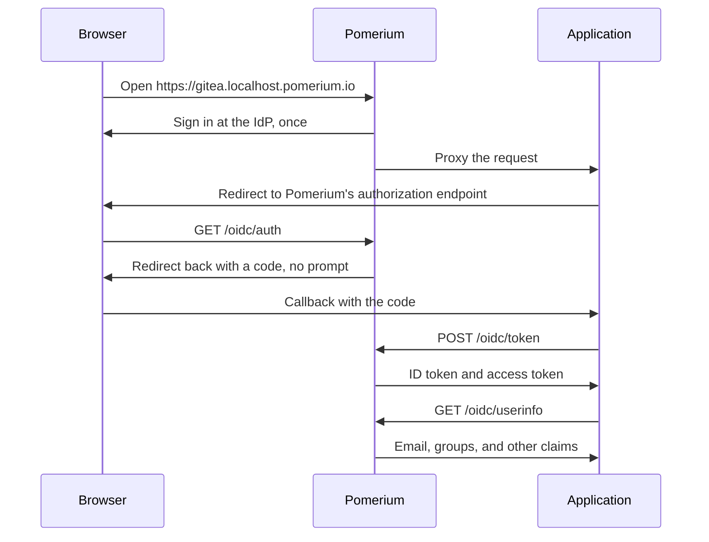
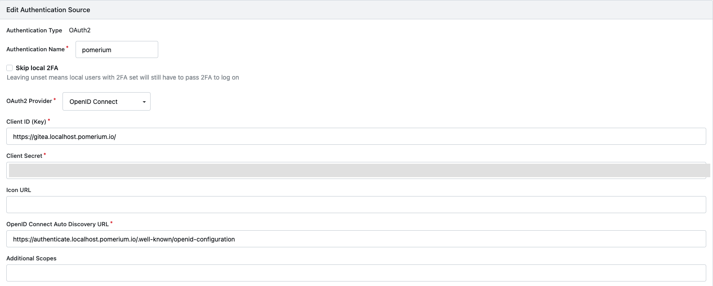

# OIDC Bridge

Many applications behind Pomerium keep their own login page. If an application cannot read the Pomerium JWT, users sign in twice: once at your organization's identity provider (IdP) through Pomerium, and again at the application. The **OIDC bridge** fixes this. Pomerium acts as an OpenID Connect (OIDC) provider, so the application logs users in through Pomerium using the session they already have.

Use the bridge when an application supports OIDC login but not JWT header authentication. If the application can verify a JWT from a request header, use [continuous identity verification](/docs/capabilities/getting-users-identity) instead. The Pomerium JWT also shows that Pomerium authorized the request. An ID token only shows who the user is.

## Security considerations

- The bridge only handles login. Access control still comes from the route policy, which Pomerium checks on every request.
- The application never receives tokens from your IdP. Pomerium mints the ID token and the access token itself.
- There are no refresh tokens. The access token works only while the user's Pomerium session is active.

## How it works

1. The user opens the route and signs in through Pomerium, as with any other route. Pomerium checks the route policy.
2. The application starts its usual OIDC login and sends the browser to Pomerium's authorization endpoint.
3. The user already has a Pomerium session, so Pomerium sends them back to the application with an authorization code. No login prompt appears. If the session has expired, the user signs in again first.
4. The application exchanges the code for an ID token and an access token. The ID token identifies the user. To get the user's email, name, and groups, the application calls the userinfo endpoint with the access token.



:::note Claims

The ID token only identifies the user. It carries `sub`, `sid` (your IdP's session ID, if it sets one), and the standard `iss`, `aud`, `iat`, and `exp` claims. It also carries `nonce` if the application sends one. `iss` is the authenticate service URL, and `aud` is the client ID. The ID token doesn't include `email`, `name`, or `groups`.

The userinfo endpoint returns the user's claims from your IdP. A single value keeps its type, such as `"email_verified": true`. Multiple values become a JSON array, such as `"groups": ["admins", "developers"]`. A list with one item becomes a single value, so a user in one group gets `"groups": "admins"`. Nested objects become dotted names, such as `address.country`.

:::

:::info

The ID token can't replace the Pomerium JWT in [application-based mutual authentication](/docs/internals/mutual-auth#jwt-verification-application-based-mutual-authentication).

:::

## Prerequisites

- Pomerium Core running its own authenticate service, with [`authenticate_service_url`](/docs/reference/service-urls#authenticate-service-url) set. The [hosted authenticate service](/docs/capabilities/authentication#hosted-authenticate-service) works too, as long as you set `authenticate_service_url` and `idp_provider: hosted` explicitly. The default hosted setup without `authenticate_service_url` does not expose the bridge.
- A `shared_secret` in the config.
- An application that supports OIDC login with the authorization code flow and can request the `openid` scope alone. The bridge rejects other scopes, such as `email` and `profile`.

## Configuration

Set `oidc_bridge` globally to cover every route, or on a route to cover only that one. A route-level block replaces the global one. With no block at all, the bridge is off.

```yaml
# Global: enable the bridge for all routes
oidc_bridge:
  enabled: true

routes:
  - from: https://gitea.localhost.pomerium.io
    to: http://gitea:3000
    oidc_bridge:
      # Gitea does not use PKCE, so it is a confidential client.
      # Use the same value as the Client Secret in the Gitea auth source.
      client_secret: <GITEA_CLIENT_SECRET>
      # Optional: accept only Gitea's callback URL.
      redirect_uris:
        - https://gitea.localhost.pomerium.io/user/oauth2/pomerium/callback
    allow_any_authenticated_user: true

  # Opt this route out
  - from: https://wiki.localhost.pomerium.io
    to: http://localhost:9090
    oidc_bridge:
      enabled: false
```

| Key | Type | Default | Description |
| :-- | :-- | :-- | :-- |
| `enabled` | boolean | `true` | Turns the bridge on or off. The default applies whenever an `oidc_bridge` block is present, so `oidc_bridge: {}` is enough to enable it. |
| `client_secret` | string | none | Set this only if the application doesn't support Proof Key for Code Exchange (PKCE). Keep it secret. |
| `redirect_uris` | array of strings | none | The redirect URIs the application may use. Pomerium accepts only exact matches. If you don't set it, Pomerium accepts any redirect URI on the client ID's host, at or below the client ID's path. |

In the application, set the client ID to the route's `from` URL, such as `https://gitea.localhost.pomerium.io/`.

## Example: Gitea

[Gitea](https://about.gitea.com/) is a self-hosted Git service. It can't read the Pomerium JWT, but it supports OpenID Connect login, so it works well with the bridge. Gitea doesn't use PKCE, so it needs a `client_secret` on the route.

### Pomerium route

```yaml
routes:
  - from: https://gitea.localhost.pomerium.io
    to: http://gitea:3000
    oidc_bridge:
      client_secret: <GITEA_CLIENT_SECRET>
    allow_any_authenticated_user: true
```

### Gitea setup

1. In Gitea's `app.ini`, set `ROOT_URL = https://gitea.localhost.pomerium.io/`. In Docker, use the `GITEA__server__ROOT_URL` variable instead.
2. Add the login source. Go to **Site Administration** > **Identity & Access** > **Authentication Sources** > **Add Authentication Source** and fill in:

   | Setting | Value |
   | :-- | :-- |
   | **Authentication Type** | `OAuth2` |
   | **Authentication Name** | `pomerium` |
   | **OAuth2 Provider** | `OpenID Connect` |
   | **Client ID (Key)** | `https://gitea.localhost.pomerium.io/` |
   | **Client Secret** | the route's `client_secret` |
   | **OpenID Connect Auto Discovery URL** | `https://authenticate.localhost.pomerium.io/.well-known/openid-configuration` |
   | **Additional Scopes** | leave empty, because the bridge accepts only `openid` |

   

3. Save. The Gitea login page now offers **Sign in with pomerium**, and the callback Gitea uses is `https://gitea.localhost.pomerium.io/user/oauth2/pomerium/callback`. To accept only this callback, add it to the route's `redirect_uris`.
4. To skip the Gitea login page entirely, leave the bridge as the only login method and let Gitea create accounts on first sign-in:

   ```ini title="app.ini"
   [oauth2_client]
   ENABLE_AUTO_REGISTRATION = true
   USERNAME = email

   [service]
   ENABLE_PASSWORD_SIGNIN_FORM = false
   ENABLE_PASSKEY_AUTHENTICATION = false
   REQUIRE_SIGNIN_VIEW = true

   [server]
   LANDING_PAGE = login
   ```

   Turning off the password and passkey forms leaves Pomerium as the only way to sign in. Gitea then skips its login page and redirects users to Pomerium. `LANDING_PAGE = login` makes the home page redirect too. Without it, users land on Gitea's home page signed out and must click **Sign In**.

   Gitea gets the user's email from the userinfo endpoint. With `USERNAME = email`, it names new accounts after the part of the email before the `@`.

## Verify

Open the route and sign in at your IdP. If you applied step 4, Gitea opens already logged in. Otherwise, click **Sign In**, then **Sign in with pomerium**. In both cases, the bridge works if you aren't asked to sign in at your IdP a second time.

## Troubleshooting

| Symptom | Cause and fix |
| :-- | :-- |
| `404 Not Found` from the discovery URL or any `/oidc/` path | The application is using the wrong host, or no route has the bridge enabled. Point the application at the authenticate service URL, and enable `oidc_bridge` on the route. |
| Discovery works, but the issuer is `https://authenticate.pomerium.app` and sign-in fails | There is no `authenticate_service_url` in the Pomerium config, so the application found the hosted authenticate service, which is a different OIDC provider. Set `authenticate_service_url` and `idp_provider`, and point the application at that URL. |
| HTTP 400 at `/oidc/auth`: `unknown client_id`, `invalid client_id`, or `redirect_uri ... does not match ...` | The client ID or redirect URI doesn't match a route with the bridge enabled. Set the client ID to the route's `from` URL, and use a redirect URI on that host. If the route sets `redirect_uris`, add the exact redirect URI to the list. |
| Sign-in fails with `invalid_scope` | The application requested scopes other than `openid`, such as `email` or `profile`. Configure it to request only `openid`. It still gets the email and other claims from the userinfo endpoint. |
| Token request fails with `invalid_client` | The client secret doesn't match the route's `client_secret`, or the HTTP Basic header has invalid percent-encoding. Use the same secret in the application and on the route. |
| Token request fails with `invalid_grant`: `invalid client_id: URL scheme must be "https"` | The application sends HTTP Basic credentials without URL-encoding the client ID, so the colon in `https:` splits the header in the wrong place. Switch the application to `client_secret_post`. |
| Token request fails with another error, such as `invalid_grant` or `invalid_request` | The `error_description` in the response and the Pomerium log line `oidc: token request invalid` say what's wrong, for example an expired code (codes last five minutes) or a redirect URI that doesn't match the authorization request. |
| Users still see two login prompts | The application shows its own login page first. Disable local login so the application redirects to Pomerium. |
