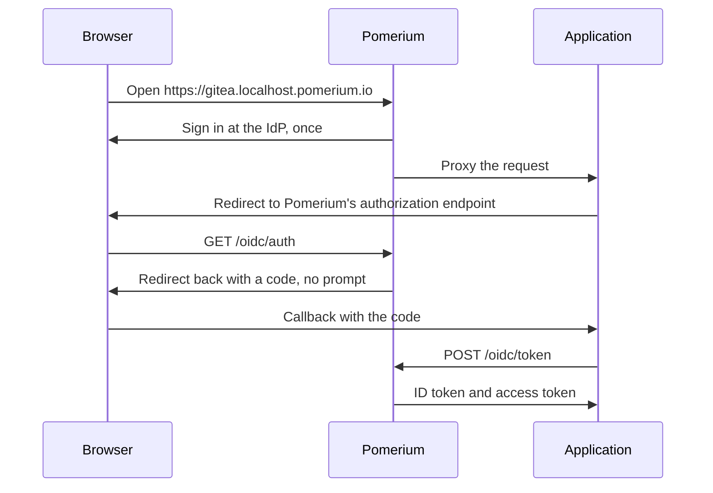
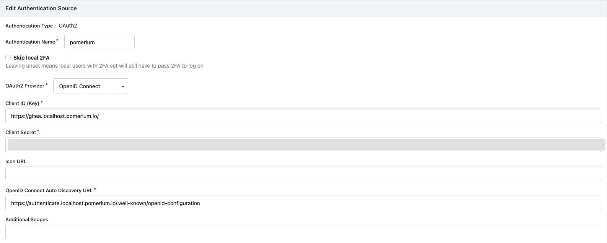

# OIDC Bridge

Many applications behind Pomerium keep their own login page. If an application cannot read the Pomerium JWT, users sign in twice: once at your organization's identity provider (IdP) through Pomerium, and again at the application. The **OIDC bridge** fixes this. Pomerium acts as an OpenID Connect (OIDC) provider, so the application logs users in through Pomerium using the session they already have.

Use the bridge when an application supports OIDC login but not JWT header authentication. If the application can verify a JWT from a request header, use [continuous identity verification](/docs/capabilities/getting-users-identity) instead. The Pomerium JWT also shows that Pomerium authorized the request. An ID token only shows who the user is.

## Security considerations

- The bridge only handles login. Access control still comes from the route policy, which Pomerium checks on every request.
- The application never receives tokens from your IdP. Pomerium mints the ID token and the access token itself.
- There are no refresh tokens. The access token works only while the user's Pomerium session is active.

## How it works

1. The user opens the route and signs in through Pomerium, as with any other route. Pomerium checks the route policy.
2. The application starts its usual OIDC login and sends the browser to Pomerium's authorization endpoint.
3. The user already has a Pomerium session, so Pomerium sends them back to the application with an authorization code. No login prompt appears. If the session has expired, the user signs in again first.
4. The application exchanges the code for an ID token and an access token. It can also call the userinfo endpoint for the same claims.



:::note Claims

The claims in the ID token come from your IdP, such as `sub`, `email`, and `name`. Pomerium rewrites `iss` to the authenticate service URL and `aud` to the client ID. Every value is a string, so a list like `groups` becomes `"admins,developers"` and `email_verified` becomes `"true"` rather than `true`. The userinfo endpoint returns the same claims.

:::

:::info

The ID token can't replace the Pomerium JWT in [application-based mutual authentication](/docs/internals/mutual-auth#jwt-verification-application-based-mutual-authentication).

:::

## Prerequisites

- Pomerium Core running its own authenticate service, with [`authenticate_service_url`](/docs/reference/service-urls#authenticate-service-url) set. The [hosted authenticate service](/docs/capabilities/authentication#hosted-authenticate-service) works too, as long as you set `authenticate_service_url` and `idp_provider: hosted` explicitly. The default hosted setup without `authenticate_service_url` does not expose the bridge.
- A `shared_secret` in the config.
- An application that supports OIDC login with the authorization code flow.

## Configuration

Set `oidc_bridge` globally to cover every route, or on a route to cover only that one. A route-level block replaces the global one. With no block at all, the bridge is off.

```yaml
# Global: enable the bridge for all routes
oidc_bridge:
  enabled: true

routes:
  - from: https://gitea.localhost.pomerium.io
    to: http://gitea:3000
    oidc_bridge:
      # Gitea does not use PKCE, so it is a confidential client.
      # Use the same value as the Client Secret in the Gitea auth source.
      client_secret: <GITEA_CLIENT_SECRET>
    allow_any_authenticated_user: true

  # Opt this route out
  - from: https://wiki.localhost.pomerium.io
    to: http://localhost:9090
    oidc_bridge:
      enabled: false
```

| Key | Type | Default | Description |
| :-- | :-- | :-- | :-- |
| `enabled` | boolean | `true` | Turns the bridge on or off. The default applies whenever an `oidc_bridge` block is present, so `oidc_bridge: {}` is enough to enable it. |
| `client_secret` | string | none | Set this only if the application doesn't support Proof Key for Code Exchange (PKCE). Keep it secret. |

## Example: Gitea

[Gitea](https://about.gitea.com/) is a self-hosted Git service. It can't read the Pomerium JWT, but it supports OpenID Connect login, so it works well with the bridge. Gitea doesn't use PKCE, so it needs a `client_secret` on the route.

### Pomerium route

```yaml
routes:
  - from: https://gitea.localhost.pomerium.io
    to: http://gitea:3000
    oidc_bridge:
      client_secret: <GITEA_CLIENT_SECRET>
    allow_any_authenticated_user: true
```

### Gitea setup

1. In Gitea's `app.ini`, set `ROOT_URL = https://gitea.localhost.pomerium.io/`. In Docker, use the `GITEA__server__ROOT_URL` variable instead.
2. Add the login source. Go to **Site Administration** > **Identity & Access** > **Authentication Sources** > **Add Authentication Source** and fill in:

   | Setting | Value |
   | :-- | :-- |
   | **Authentication Type** | `OAuth2` |
   | **Authentication Name** | `pomerium` |
   | **OAuth2 Provider** | `OpenID Connect` |
   | **Client ID (Key)** | `https://gitea.localhost.pomerium.io/` |
   | **Client Secret** | the route's `client_secret` |
   | **OpenID Connect Auto Discovery URL** | `https://authenticate.localhost.pomerium.io/.well-known/openid-configuration` |
   | **Additional Scopes** | leave empty |

   

3. Save. The Gitea login page now offers **Sign in with pomerium**, and the callback Gitea uses is `https://gitea.localhost.pomerium.io/user/oauth2/pomerium/callback`.
4. To skip the Gitea login page entirely, leave the bridge as the only login method and let Gitea create accounts on first sign-in:

   ```ini title="app.ini"
   [oauth2_client]
   ENABLE_AUTO_REGISTRATION = true
   USERNAME = email

   [service]
   ENABLE_PASSWORD_SIGNIN_FORM = false
   ENABLE_PASSKEY_AUTHENTICATION = false
   REQUIRE_SIGNIN_VIEW = true
   ```

   Turning off the password and passkey forms leaves Pomerium as the only way to sign in. Gitea then skips its login page and redirects users to Pomerium.

## Verify

Open the route and sign in. If you land in Gitea already logged in, the bridge works.

## Troubleshooting

| Symptom | Cause and fix |
| :-- | :-- |
| `404 Not Found` from the discovery URL or any `/oidc/` path | The application is using the wrong host. Point the application at the authenticate service URL, and check that `idp_provider` is set. |
| Discovery works, but the issuer is `https://authenticate.pomerium.app` and sign-in fails | There is no `authenticate_service_url` in the Pomerium config, so the application found the hosted authenticate service, which is a different OIDC provider. Set `authenticate_service_url` and `idp_provider`, and point the application at that URL. |
| HTTP 400 at `/oidc/auth`: `redirect_uri "..." does not match client_id "..."` | The redirect URI is on a different host than the client ID, or its path is not under the client ID path. Use the route's `from` URL as the client ID and a redirect URI on that host. |
| Token request fails with `unsupported_grant_type` | The application asked for something other than `authorization_code`, usually a refresh token. The bridge does not issue refresh tokens, so turn off token refresh in the application. |
| Token request fails with `invalid_client` | The application authenticates with HTTP Basic (`client_secret_basic`) and leaves `client_id` out of the request body. Switch it to `client_secret_post`. |
| Token request fails with `invalid_request` | The code expired (codes last five minutes), the `redirect_uri` is not the one used in the authorization request, or the PKCE verifier does not match. The Pomerium log line `oidc: token request invalid` says which. Sign in again. |
| Userinfo returns 401 `invalid_token` | The access token is not one this Pomerium issued, or Pomerium restarted without a fixed `shared_secret` and can no longer decrypt it. Set `shared_secret` and sign in again. |
| Users still see two login prompts | The application shows its own login page first. Disable local login so the application redirects to Pomerium. |
