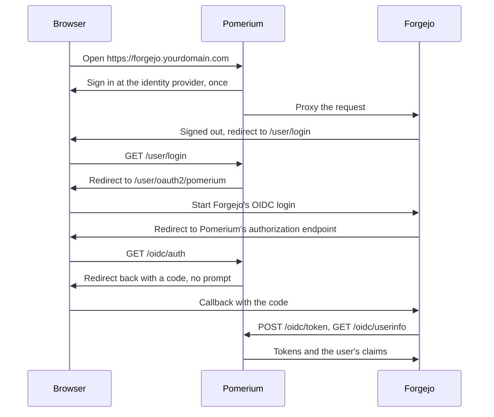
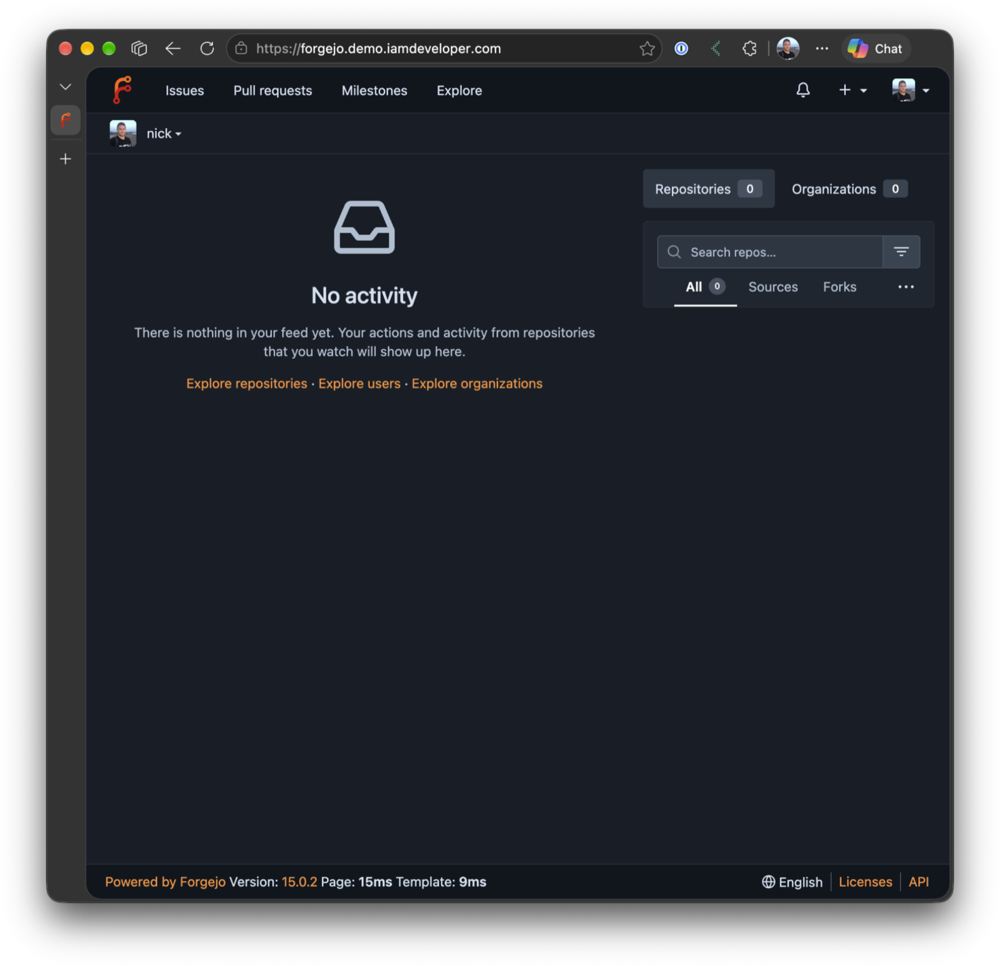
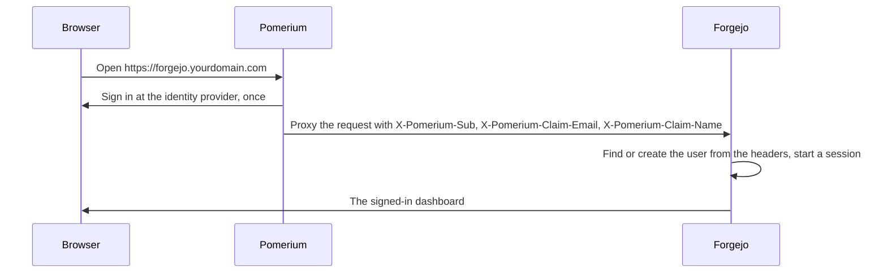
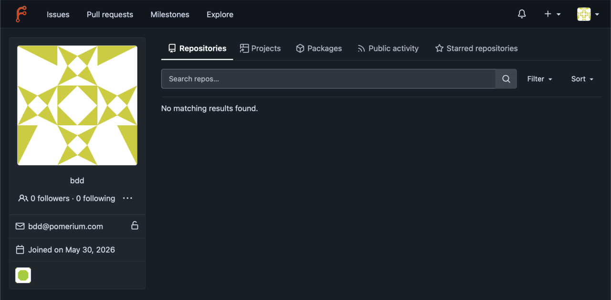

---
# cSpell:ignore automations forgejo gitea tmpl WEBAUTH
title: Secure Forgejo with Pomerium
sidebar_label: Forgejo
lang: en-US
image: ./img/forgejo/forgejo-dashboard.png
keywords:
  [
    pomerium,
    forgejo,
    gitea,
    git,
    sso,
    oidc,
    oidc bridge,
    openid connect,
    identity aware proxy,
    reverse proxy authentication,
    identity headers,
  ]
description: Put a Forgejo instance behind Pomerium and sign users in once, either with Pomerium as Forgejo's OpenID Connect provider through the OIDC bridge or with reverse-proxy header authentication.
---

import CodeBlock from '@theme/CodeBlock';
import TabItem from '@theme/TabItem';
import Tabs from '@theme/Tabs';

import Config from '!!raw-loader!/content/examples/guides/forgejo/config.yaml';
import ProxyHeadersConfig from '!!raw-loader!/content/examples/guides/forgejo-proxy-headers/config.yaml';
import Compose from '!!raw-loader!/content/examples/guides/forgejo/docker-compose.yaml';
import ProxyHeadersCompose from '!!raw-loader!/content/examples/guides/forgejo-proxy-headers/docker-compose.yaml';
import Footer from '!!raw-loader!/content/examples/guides/forgejo/footer.tmpl';

# Secure Forgejo with Pomerium

Pomerium can sign users in to [Forgejo](https://forgejo.org/), a self-hosted Git service, so they never see a separate Forgejo login.

There are two ways to secure Forgejo with Pomerium: the OIDC bridge and proxy headers. The table below compares them, and each one has its own tab with the full setup.

|  | OIDC bridge | Proxy headers |
| :-- | :-- | :-- |
| Forgejo login | Its [OpenID Connect (OIDC) login](https://forgejo.org/docs/latest/user/oauth2-provider/), with Pomerium as the provider | [Reverse-proxy authentication](https://forgejo.org/docs/latest/admin/setup/reverse-proxy/) from identity headers Pomerium forwards |
| What Forgejo trusts | Tokens from Pomerium's OIDC endpoints, using the route's client secret | The identity headers, from any peer that can reach Forgejo |
| Route settings | `oidc_bridge` with a client secret, plus a redirect route for `/user/login` | `pass_identity_headers`, plus global `jwt_claims_headers` |
| Authenticate service URL | Must be a domain you control | The default hosted URL works |
| Sign-out | Also signs out of Pomerium | Not covered |
| Admin recovery | From the Forgejo container's CLI | A break-glass admin created out of band |

Use **OIDC bridge** if you control an authenticate service domain and want Forgejo to verify tokens with Pomerium rather than trusting headers on the network; use **Proxy headers** if you want to stay on Pomerium's hosted authenticate URL and can strictly isolate Forgejo on a private network.

Both setups keep Forgejo's own sign-in form out of the way, and Forgejo creates each user's account the first time they sign in. Only sign-in from a browser goes through Pomerium: Git over HTTP, API clients, automations, and SSH keep using Forgejo [access tokens](https://forgejo.org/docs/latest/user/api-usage/) or SSH keys. This guide was tested with Forgejo 15.0.2.

## Prerequisites

- You've completed the [Quickstart](/docs/get-started/quickstart), and Pomerium is running
- [Docker](https://docs.docker.com/install/) and [Docker Compose](https://docs.docker.com/compose/install/)
- A domain for the Forgejo route (this guide uses `forgejo.yourdomain.com`)
- For the OIDC bridge only: an authenticate service URL on a domain you control (this guide uses `authenticate.yourdomain.com`)

:::tip Prefer to self-host the identity provider?

This guide uses Pomerium's [hosted identity provider](/docs/capabilities/authentication#hosted-authenticate-service), so you don't have to run one. To run your own instead, follow [Keycloak + Pomerium](/docs/integrations/user-identity/oidc) and add its `idp_*` settings to `config.yaml`.

:::

<Tabs queryString="method">
<TabItem value="oidc-bridge" label="OIDC bridge" default>

Pomerium's [OIDC bridge](https://www.pomerium.com/docs/capabilities/oidc-bridge) makes Pomerium an OpenID Connect provider for Forgejo's built-in OIDC login. Users sign in to Pomerium once, and Forgejo finishes its own login without asking them to sign in again.

Forgejo always shows its login page before it starts an OIDC login, even when there's only one login source. To skip it, a second Pomerium route redirects `/user/login` straight to the Pomerium login source, so users never have to click a **Sign in with Pomerium** button.



## Configure Pomerium {#oidc-bridge-configure-pomerium}

<Tabs queryString="type">
<TabItem value="zero" label="Pomerium Zero" default>

1. On the **Identity Provider** page of the [Zero Console](https://console.pomerium.app), set **Authenticate Service URL** to a domain you control, such as `https://authenticate.yourdomain.com`. Leave **Hosted Authenticate** selected.
1. Create the login redirect route. Set **From** to `https://forgejo.<your-starter-domain>`, and on the **Path Matching** tab, choose **Exact Path** and enter `/user/login`.
1. On that route's **Advanced** tab, choose **Redirect** and set **Path Redirect** to `/user/oauth2/pomerium`. Set the policy to the users who should reach Forgejo, then save.
1. Create the Forgejo route. Set **From** to the same URL, **To** to `http://forgejo:3000`, and the same policy as the redirect route.
1. On the **Advanced** tab, turn on **OIDC Bridge** and enter an **OIDC Bridge Client Secret**. Generate one with `openssl rand -base64 32`. Forgejo doesn't use Proof Key for Code Exchange (PKCE), so Pomerium needs this secret to know the token request really comes from Forgejo.
1. On the **Timeouts** tab, set **Timeout** to `0s` and **Idle Timeout** to `600s`, so long Git pushes and clones aren't cut off. Then save.
1. Order the login redirect route above the Forgejo route. Otherwise the Forgejo route matches `/user/login` first, and users see Forgejo's login page.

The route's **From** URL also serves as the OIDC client ID. Wherever this guide shows `https://forgejo.yourdomain.com`, use your **From** URL instead. That includes the `FORGEJO__server__ROOT_URL` setting and the `--key` value when you add the login source.

</TabItem>
<TabItem value="core" label="Pomerium Core">

Create a `config.yaml` file with the following contents. The comments in the file explain what each setting does.

<CodeBlock language="yaml" title="config.yaml">
  {Config}
</CodeBlock>

Replace the example domains and `you@example.com` with your own values, in the policies of both routes. Generate `shared_secret` and the route's `client_secret` with the command shown in each setting's comment. Don't regenerate `shared_secret` when Pomerium restarts, or every user has to sign in again.

</TabItem>
</Tabs>

## Configure and run Forgejo {#oidc-bridge-configure-forgejo}

Forgejo runs in Docker Compose alongside Pomerium. The comments in the Compose file explain each Forgejo setting.

<Tabs queryString="type">
<TabItem value="zero" label="Pomerium Zero" default>

The Quickstart's `compose.yaml` already runs Pomerium. From the following Compose file, copy only the `forgejo` service and the `forgejo-data` volume into it.

<CodeBlock language="yaml" title="docker-compose.yaml">
  {Compose}
</CodeBlock>

Then attach the `forgejo` service to the Quickstart's `main` network, so Pomerium can reach it at `http://forgejo:3000`:

```yaml
services:
  forgejo:
    networks:
      - main
```

</TabItem>
<TabItem value="core" label="Pomerium Core">

The following Compose file runs Pomerium Core and Forgejo together.

<CodeBlock language="yaml" title="docker-compose.yaml">
  {Compose}
</CodeBlock>

</TabItem>
</Tabs>

Forgejo's sign-out ends only the Forgejo session, so with `LANDING_PAGE: login` the next page load signs the user straight back in. Save the following [custom footer template](https://forgejo.org/docs/latest/admin/customization/) as `footer.tmpl` next to the Compose file. It runs Forgejo's sign-out, then sends the browser to `/.pomerium/sign_out` to end the Pomerium session too:

<CodeBlock language="html" title="footer.tmpl">
  {Footer}
</CodeBlock>

To skip the template, remove `LANDING_PAGE` and the `footer.tmpl` volume. Users then select **Sign in** on Forgejo's home page and open `/.pomerium/sign_out` to sign out of Pomerium.

1. Start the stack:

   ```bash
   docker compose up -d
   ```

1. Add Pomerium to Forgejo as a login source. Use the route's client secret as the `--secret` value:

   ```bash
   docker compose exec -u git forgejo forgejo admin auth add-oauth \
     --name pomerium \
     --provider openidConnect \
     --key https://forgejo.yourdomain.com \
     --secret REPLACE_WITH_ROUTE_CLIENT_SECRET \
     --auto-discover-url https://authenticate.yourdomain.com/.well-known/openid-configuration
   ```

Keep `--name pomerium`, because the redirect route sends users to `/user/oauth2/pomerium`. The Forgejo container also has to be able to resolve and reach `authenticate.yourdomain.com`, because Forgejo calls Pomerium's OIDC endpoints itself. If you prefer the UI, you can add the same login source in **Site Administration** > **Identity & Access** > **Authentication Sources**. Choose **OpenID Connect** as the provider and leave the additional scopes empty.

If you change `config.yaml` later, run `docker compose restart pomerium` to apply it. If you change the Compose file, run `docker compose up -d`.

:::caution Keep `ACCOUNT_LINKING: login` if you allow more than one email domain

Keep `ACCOUNT_LINKING: login` if your route policy allows more than one email domain. With `USERNAME: email`, Forgejo uses the part of the email before the `@` as the username, so `sam@example.com` and `sam@example.org` both become `sam`. With `ACCOUNT_LINKING: auto`, Forgejo links a sign-in to an existing account with the same username, so `sam@example.org` would be signed in to `sam@example.com`'s account. `login` shows the second user a form to choose a different username instead.

:::

## Make yourself the administrator {#oidc-bridge-make-yourself-the-administrator}

Forgejo makes the first account it creates an administrator. To make sure that's you, sign in through Pomerium before anyone else does, as described in [Verify the setup](#oidc-bridge-verify-the-setup).

If no one has administrator access anymore, you can promote a user from the Forgejo container. Forgejo's CLI can't promote an existing user, so the following command creates a temporary administrator, uses it to promote `your-username` through Forgejo's API, and then deletes the temporary account and its token:

```bash
docker compose exec -u git forgejo sh -c '
  forgejo admin user create --admin --username recovery-tmp \
    --email recovery-tmp@forgejo.invalid --random-password --must-change-password=false >/dev/null
  TOKEN=$(forgejo admin user generate-access-token --username recovery-tmp \
    --token-name recovery --scopes write:admin --raw)
  curl -s -X PATCH -H "Authorization: token $TOKEN" -H "Content-Type: application/json" \
    -d "{\"admin\": true}" http://localhost:3000/api/v1/admin/users/your-username
  forgejo admin user delete --username recovery-tmp'
```

Replace `your-username` with the account to promote. If it worked, the response includes `"is_admin":true`.

## Verify the setup {#oidc-bridge-verify-the-setup}

1. Open `https://forgejo.yourdomain.com` in a private or incognito window. Pomerium asks you to sign in.
1. Sign in. You land on the Forgejo dashboard without seeing Forgejo's login page.
1. Open **Settings**. Your email comes from your identity provider. Your full name and avatar appear too, if your identity provider sends `name` and `picture` claims. If yours is the first account, **Site Administration** also appears in your menu.

   

1. Select **Sign out**. You land on Pomerium's signed-out page, and when you open Forgejo again, Pomerium asks you to sign in.
1. Sign in as a user your policy excludes. Pomerium denies access before Forgejo loads, so Forgejo never creates an account for that user.

## Troubleshooting {#oidc-bridge-common-failure-modes}

| Symptom | Fix |
| :-- | :-- |
| Pomerium returns `403` | Replace `you@example.com` in the policy on both routes with your users or domain. |
| `add-oauth` fails with `Failed to initialize OpenID Connect Provider` | Make sure Pomerium is running and the Forgejo container can resolve `authenticate.yourdomain.com`. |
| Forgejo's login page shows a **Sign in with Pomerium** button | Order the `/user/login` redirect route before the Forgejo route. |
| `404 Not Found` after selecting **Sign in** | Name the login source `pomerium`, or change the redirect route's `path_redirect` to match its name. |
| `404 Not Found` from the discovery URL or any `/oidc/` path | Point Forgejo at your authenticate service URL, and set `authenticate_service_url` and `idp_provider` in Pomerium. |
| HTTP 400 at `/oidc/auth`: `redirect_uri ... does not match client_id ...` | Set `--key` and `FORGEJO__server__ROOT_URL` to the route's `from` URL. |
| Token request fails with `invalid_client`, and Pomerium logs `oidc: token request invalid` | Run `forgejo admin auth update-oauth --id 1 --secret <route client_secret>` (find the ID with `forgejo admin auth list`), then restart Forgejo. |
| Forgejo shows a link-account or registration form | Your username clashes with an existing account. Register a username nobody has. |
| **Sign out** returns to the dashboard | Check that `footer.tmpl` is mounted, restart Forgejo, and confirm the sign-out link's `data-url` still ends in `/user/logout`. |
| Sign-in stops at Forgejo's home page with a **Sign in** link | Set `LANDING_PAGE` to `login`. |
| The avatar is a generated pattern | Set `UPDATE_AVATAR` to `true`, and check that your identity provider sends `picture` and the Forgejo container can reach the image URL. |
| `invalid_token` on Forgejo's user info request | Set a fixed `shared_secret` and sign in again. |
| Sign-in fails on the username | Pick a `USERNAME` value whose claim is a valid Forgejo username (letters, digits, `-`, `_`, `.`). |

## Security considerations {#oidc-bridge-security-considerations}

- **Keep the route policy tight.** Forgejo creates an account for every user the policy allows, the first time they sign in, so the policy decides who gets a Forgejo account.
- **Don't publish Forgejo's port.** If users can reach `forgejo:3000` directly, they skip Pomerium's policy checks. Only Pomerium should be able to reach it.
- **Keep the `client_secret` secret.** It's how Pomerium knows a token request really comes from Forgejo. Anyone with the secret can redeem authorization codes for the route.
- **Don't set `ACCOUNT_LINKING: auto`.** Forgejo matches on username before email, so a username clash can sign one user in to another user's account, as the caution in [Configure and run Forgejo](#oidc-bridge-configure-forgejo) explains.
- **Sign-out is global.** The sign-out template ends the Pomerium session for every route in that browser, and the identity provider session too.
- **Recovery needs shell access.** Local sign-in is off, so the only way back in without Pomerium is through the Forgejo container.

## Next steps {#oidc-bridge-next-steps}

- [OIDC bridge](https://www.pomerium.com/docs/capabilities/oidc-bridge)
- [Authentication](/docs/capabilities/authentication)
- [Authorization](/docs/capabilities/authorization)
- [Mirror repositories](https://forgejo.org/docs/latest/user/repo-mirror/) into a Pomerium-gated warm standby

</TabItem>
<TabItem value="proxy-headers" label="Proxy headers">

Pomerium adds the user's `sub`, `email`, and `name` claims as headers to every request it forwards to Forgejo. Forgejo's reverse-proxy authentication reads those headers and signs the user in, creating the account on their first visit.



:::caution Forgejo trusts the identity headers from any peer

Forgejo can't verify Pomerium's signed JWT, so it believes whatever identity headers arrive with a request. Anyone who can reach Forgejo without going through Pomerium can send their own headers and sign in as any user. Keep Forgejo reachable only through Pomerium, and read the [Security considerations](#proxy-headers-security-considerations) before you deploy.

:::

## Configure Pomerium {#proxy-headers-configure-pomerium}

<Tabs queryString="type">
<TabItem value="zero" label="Pomerium Zero" default>

1. In the [Zero Console](https://console.pomerium.app), go to **Settings** > **Headers**. Under **JWT Claim Headers**, add `X-Pomerium-Sub` from `sub`, `X-Pomerium-Claim-Email` from `email`, and `X-Pomerium-Claim-Name` from `name`, then save. These apply to every route that passes identity headers.
1. Create a route. Set **From** to `https://forgejo.<your-starter-domain>`, **To** to `http://forgejo:3000`, and the policy to the users who should reach Forgejo.
1. On the **Headers** tab, turn on **Pass Identity Headers**.
1. On the **Timeouts** tab, set **Timeout** to `0s` and **Idle Timeout** to `600s`, so long Git pushes and clones aren't cut off. Then save.

Wherever this guide shows `https://forgejo.yourdomain.com`, use your route's **From** URL instead. That includes the `FORGEJO__server__ROOT_URL` setting.

</TabItem>
<TabItem value="core" label="Pomerium Core">

Create a `config.yaml` file with the following contents. The comments in the file explain what each setting does.

<CodeBlock language="yaml" title="config.yaml">
  {ProxyHeadersConfig}
</CodeBlock>

Replace the example domain and `you@example.com` with your own values.

</TabItem>
</Tabs>

## Configure and run Forgejo {#proxy-headers-configure-forgejo}

Forgejo runs in Docker Compose on a private network that only Pomerium shares, so nothing else can reach it and send forged identity headers. Pomerium has a fixed address on that network, which Forgejo uses to read the client's IP address from `X-Forwarded-For`. The comments in the Compose file explain each Forgejo setting.

<Tabs queryString="type">
<TabItem value="zero" label="Pomerium Zero" default>

The Quickstart's `compose.yaml` already runs Pomerium. From the following Compose file, copy only the `forgejo` service, the `forgejo-internal` network, and the `forgejo-data` volume into it.

<CodeBlock language="yaml" title="docker-compose.yaml">
  {ProxyHeadersCompose}
</CodeBlock>

Then add the `forgejo-internal` network to the `pomerium` service in the Quickstart's `compose.yaml`, at the fixed address:

```yaml
services:
  pomerium:
    networks:
      main:
        aliases:
          - verify.<CLUSTER_STARTER_SUBDOMAIN>.pomerium.app
      forgejo-internal:
        ipv4_address: 172.30.0.2
```

</TabItem>
<TabItem value="core" label="Pomerium Core">

The following Compose file runs Pomerium Core and Forgejo together.

<CodeBlock language="yaml" title="docker-compose.yaml">
  {ProxyHeadersCompose}
</CodeBlock>

</TabItem>
</Tabs>

Start the stack:

```bash
docker compose up -d
```

If you change `config.yaml` later, run `docker compose restart pomerium` to apply it. If you change the Compose file, run `docker compose up -d`.

## Recover admin access {#proxy-headers-recover-admin-access}

Every request through Pomerium arrives already signed in, and local sign-up is closed, so you can't sign in to Forgejo with a password the usual way. To keep a way in if Pomerium or your identity provider is unavailable, create a recovery administrator from the Forgejo container:

```bash
docker compose exec -u git forgejo forgejo admin user create --username recovery-admin \
  --email recovery-admin@example.com --random-password --admin
```

The command prints the account's random password. To sign in with it, you need to reach Forgejo without Pomerium's identity headers, for example by temporarily setting `ENABLE_REVERSE_PROXY_AUTHENTICATION` to `false`.

## Verify the setup {#proxy-headers-verify-the-setup}

1. Open `https://forgejo.yourdomain.com` in a private or incognito window. Pomerium asks you to sign in.
1. Sign in. You land on the Forgejo dashboard without entering a Forgejo password.

   

1. Open your profile. Your username comes from the `sub` claim, and your email comes from your identity provider. Your full name appears only if your identity provider sends a `name` claim.

   

1. Sign in as a user your policy excludes. Pomerium denies access before Forgejo loads, so Forgejo never creates an account for that user.

## Troubleshooting {#proxy-headers-common-failure-modes}

| Symptom | Fix |
| :-- | :-- |
| Pomerium returns `403` | Replace `you@example.com` in the route policy with your users or domain. |
| You reach Forgejo but aren't signed in | Turn on `pass_identity_headers`, and make the header names in `jwt_claims_headers` and `REVERSE_PROXY_AUTHENTICATION_*` match exactly. |
| Sign-in fails on the username | Forward a claim that's already a valid Forgejo username, such as `sub`, as `X-Pomerium-Sub`. |
| A direct request to Forgejo signs in | Expected. Keep Forgejo reachable only through Pomerium. |

## Security considerations {#proxy-headers-security-considerations}

- **Don't publish Forgejo's port.** When a request goes through Pomerium, Pomerium replaces any identity headers the client sent with the signed-in user's claims. A request that reaches Forgejo directly skips that step, so it can claim to be anyone. To check that only Pomerium and Forgejo are on the private network, run `docker network inspect forgejo-pomerium --format '{{range .Containers}}{{.Name}} {{end}}'`.
- **A missing `name` claim can be filled in by the client.** If your identity provider doesn't send `name`, Pomerium doesn't set `X-Pomerium-Claim-Name`, so a header the client sent passes through. That only changes the display name, not which account the user signs in to.
- **In Kubernetes, a `ClusterIP` service isn't enough.** Any pod in the cluster can reach a `ClusterIP` service. Use a `NetworkPolicy` with a Container Network Interface (CNI) plugin that enforces it, or another network control, so only Pomerium can reach Forgejo.
- **`REVERSE_PROXY_TRUSTED_PROXIES` doesn't protect you.** Forgejo uses it only to read the client's IP address from `X-Forwarded-For` for its logs. It doesn't stop other peers from sending identity headers.
- **Keep the route policy tight.** The policy is what decides who gets in, and Forgejo creates an account for every user it allows on their first visit.

## Next steps {#proxy-headers-next-steps}

- [Build policies](/docs/get-started/fundamentals/zero/zero-build-policies)
- [Pass identity headers](/docs/reference/routes/pass-identity-headers-per-route)
- [JWT claim headers](/docs/reference/jwt-claim-headers)
- [Mirror repositories](https://forgejo.org/docs/latest/user/repo-mirror/) into a Pomerium-gated warm standby

</TabItem>
</Tabs>

## Stop, reset, or upgrade

Run `docker compose down` to stop the stack. Add `-v` to also delete the `pomerium-cache` and `forgejo-data` volumes, including all Forgejo repositories and accounts. To upgrade, update the pinned image tags and digests in the Compose file, then run `docker compose pull` and `docker compose up -d`.
