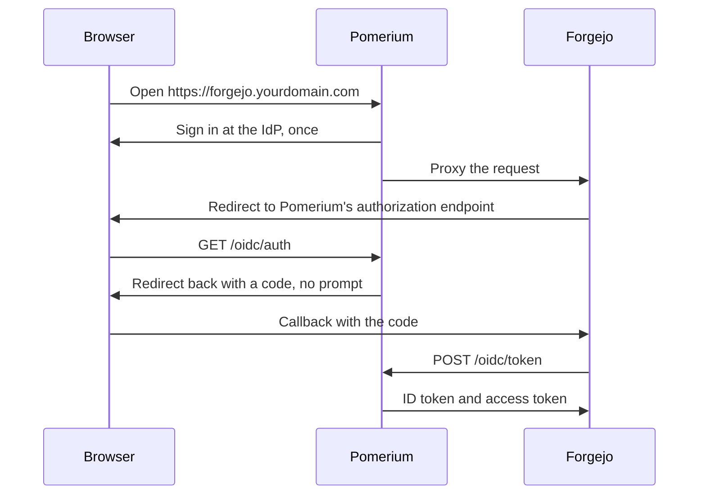
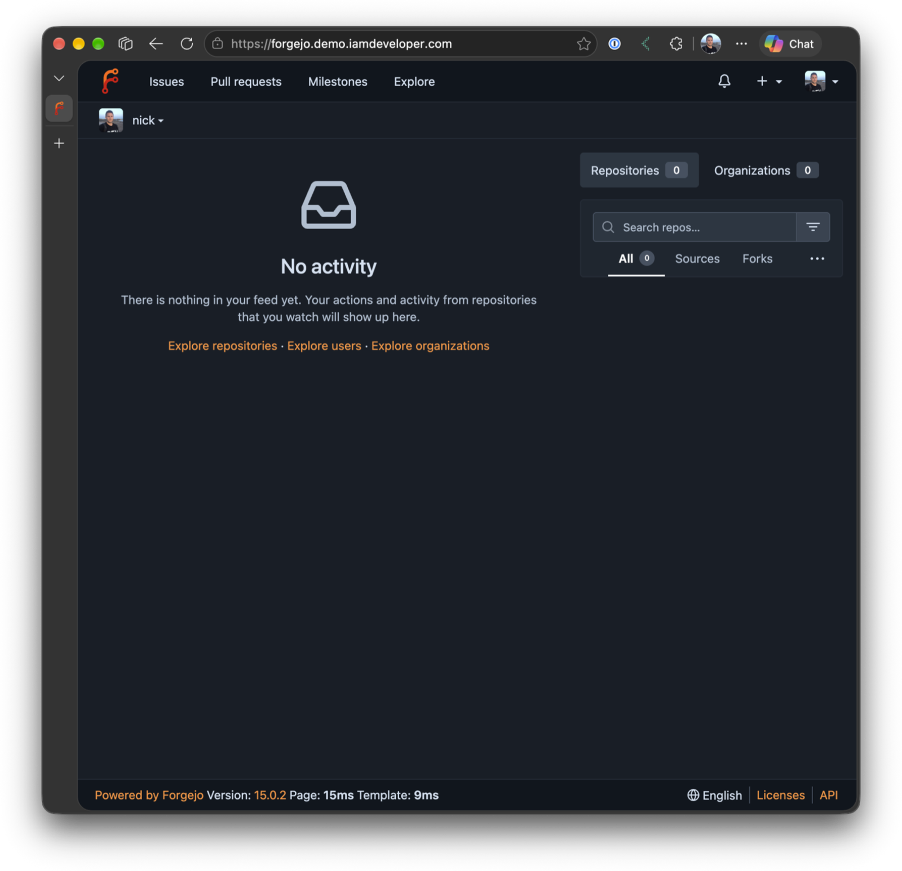

---
# cSpell:ignore automations forgejo gitea
title: Secure Forgejo with Pomerium
sidebar_label: Forgejo
lang: en-US
image: ./img/forgejo/forgejo-dashboard.png
keywords:
  [
    pomerium,
    forgejo,
    gitea,
    git,
    sso,
    oidc,
    oidc bridge,
    openid connect,
    identity aware proxy,
  ]
description: Put a Forgejo instance behind Pomerium and have Pomerium act as Forgejo's OpenID Connect provider through the OIDC bridge, so users sign in once and Forgejo creates their account.
---

import CodeBlock from '@theme/CodeBlock';

import Config from '!!raw-loader!/content/examples/guides/forgejo/config.yaml';
import Compose from '!!raw-loader!/content/examples/guides/forgejo/docker-compose.yaml';

# Secure Forgejo with Pomerium

## What this guide does

You'll put [Forgejo](https://forgejo.org/), a self-hosted Git service, behind Pomerium to gate it with SSO and route policy. Forgejo keeps its standard [OpenID Connect (OIDC) login](https://forgejo.org/docs/latest/user/oauth2-provider/), and Pomerium is the OIDC provider. Users sign in once through Pomerium, and Forgejo creates their account and completes its login without a second prompt. The same setup also works with [Gitea](https://about.gitea.com/).



:::caution This guide configures web UI sign-in only

Git operations over HTTP, API clients, automations, and SSH access still need Forgejo [access tokens](https://forgejo.org/docs/latest/user/api-usage/) or SSH keys.

:::

## When to use this guide

Use it when you want one front door for Forgejo with your existing identity, and Forgejo should keep its own OIDC login and create accounts from it. Forgejo can't verify Pomerium's signed JWT, so this guide uses Pomerium's [OIDC bridge](/docs/capabilities/oidc-bridge) instead. The bridge replaces trusting identity headers from any peer that can reach Forgejo, so network isolation is no longer the only thing protecting logins.

## Prerequisites

- [Docker](https://docs.docker.com/install/) and [Docker Compose](https://docs.docker.com/compose/install/)
- Pomerium Core with a self-hosted authenticate service on a domain you control (this guide uses `authenticate.yourdomain.com`). The OIDC bridge isn't available on the hosted authenticate service.
- An OpenID Connect identity provider. This guide uses [Keycloak](/docs/integrations/user-identity/oidc) as the example.
- A domain you control for the Forgejo route (this guide uses `forgejo.yourdomain.com`)

:::tip Need an identity provider?

Follow [Keycloak + Pomerium](/docs/integrations/user-identity/oidc) to set one up, then fill in the `idp_*` settings in `config.yaml` with your client ID and secret.

:::

## Configure Pomerium

Create a `config.yaml`. It routes `forgejo.yourdomain.com` to the Forgejo container, enables the OIDC bridge on that route, and sets the `shared_secret` that Pomerium uses to sign and encrypt the tokens it issues. It also removes the total request timeout so long Git smart-HTTP transfers aren't cut off.

<CodeBlock language="yaml" title="config.yaml">
  {Config}
</CodeBlock>

Replace `forgejo.yourdomain.com` with your domain, `you@example.com` with your user or domain, and generate your own `shared_secret` and route `client_secret` with the command in each comment. Keep `shared_secret` the same across restarts. If it changes, Pomerium can't read tokens it issued earlier, and users have to sign in again.

Forgejo doesn't use PKCE for its OIDC login, so it's a confidential client and the route needs a `client_secret`. You'll enter the same value in Forgejo below. The route's `from` URL is the OIDC client ID, so it must match the client ID you give Forgejo.

## Configure Forgejo

Forgejo reads its settings from `app.ini`, supplied as `FORGEJO__<section>__<KEY>` environment variables in the Compose file below. The key settings:

- `FORGEJO__server__ROOT_URL` is Forgejo's public URL. Forgejo builds its OIDC callback from it: `https://forgejo.yourdomain.com/user/oauth2/pomerium/callback`.
- `ENABLE_AUTO_REGISTRATION` (in `oauth2_client`) creates the Forgejo account on first sign-in.
- `USERNAME: email` takes the username from the part of the `email` claim before the `@`. Forgejo normalizes the result for you.
- `ACCOUNT_LINKING: auto` links a sign-in to an existing Forgejo account that has the same email, which is how the administrator account you create below picks up its Pomerium login.
- `DISABLE_REGISTRATION: false` with `ALLOW_ONLY_EXTERNAL_REGISTRATION: true` and `SHOW_REGISTRATION_BUTTON: false` allows accounts to be created through the OIDC login while keeping the local sign-up form closed.
- `ENABLE_INTERNAL_SIGNIN: false` hides the local username and password form, so Pomerium is the only sign-in option on the login page.

## Run the stack

The Compose file runs Pomerium and Forgejo together. Place the `config.yaml` from the previous step next to this `docker-compose.yaml`:

<CodeBlock language="yaml" title="docker-compose.yaml">
  {Compose}
</CodeBlock>

Start it:

```bash
docker compose up -d
```

If you change `config.yaml` later, run `docker compose up -d` again to apply it.

## Add Pomerium as a login source

Forgejo needs to know about Pomerium before anyone can sign in. First create an administrator whose email matches the email you sign in with through Pomerium. Because local sign-in is disabled, this account never uses its password. With `ACCOUNT_LINKING: auto`, your first Pomerium sign-in links to it.

```bash
docker compose exec -u git forgejo forgejo admin user create --admin \
  --username site-admin --email you@example.com --random-password
```

Then add the login source, using the route's `client_secret` as the secret:

```bash
docker compose exec -u git forgejo forgejo admin auth add-oauth \
  --name pomerium \
  --provider openidConnect \
  --key https://forgejo.yourdomain.com \
  --secret REPLACE_WITH_ROUTE_CLIENT_SECRET \
  --auto-discover-url https://authenticate.yourdomain.com/.well-known/openid-configuration
```

`--name` becomes part of the callback URL and the label on the login button, so keep it `pomerium` to match the callback above. You can also add the source in the web UI under **Site Administration** > **Identity & Access** > **Authentication Sources**, with the same values and **OpenID Connect** as the provider. Leave the additional scopes empty.

## Verify the setup

1. **The route requires authentication.** In a fresh browser, open `https://forgejo.yourdomain.com`. You should be redirected to Pomerium to sign in.
2. **Forgejo offers Pomerium login.** After you sign in, Forgejo's login page shows a **pomerium** sign-in button. Select it.
3. **The OIDC login completes without a prompt.** You land on the authenticated Forgejo dashboard, signed in as your Pomerium identity. Open **Settings** > **Account** and confirm your email shows.

   

4. **A disallowed user is blocked.** Sign in as a user your policy excludes and open `https://forgejo.yourdomain.com`. Pomerium denies access before Forgejo loads, so Forgejo never creates an account.

## Common failure modes

| Symptom | Cause and fix |
| :-- | :-- |
| Pomerium returns `403` | The route policy still allows only the example user. Replace it with your user or domain. |
| `404 Not Found` from the discovery URL or any `/oidc/` path | Forgejo is pointing at the wrong host. Use your authenticate service URL, and check that `authenticate_service_url` and `idp_provider` are set. |
| HTTP 400 at `/oidc/auth`: `redirect_uri ... does not match client_id ...` | The client ID (`--key`) doesn't match the route's `from` URL, or `FORGEJO__server__ROOT_URL` isn't the Forgejo URL. |
| Token request fails with `invalid_client` | The client secret in Forgejo doesn't match the route's `client_secret`, or the client sends HTTP Basic credentials without `client_id` in the body. Check the secret first, then look for the `oidc: token request invalid` log line in Pomerium. |
| Forgejo shows a link-account form instead of signing you in | An account with your email exists but `ACCOUNT_LINKING` isn't `auto`, or the email on the account differs from your Pomerium email. |
| Users still see two login prompts | Forgejo's local form appears first. Set `ENABLE_INTERNAL_SIGNIN` to `false`. |
| `invalid_token` on Forgejo's user info request | The access token was issued before Pomerium restarted without a fixed `shared_secret`. Set `shared_secret` and sign in again. |
| Sign-in fails on the username | Set `USERNAME` to a claim your identity provider always sends. Forgejo rejects usernames it can't normalize. |

## Security considerations

- **Keep the route protected.** The bridge handles login only. Route policy decides who can reach Forgejo, and Pomerium checks it on every request. A public route would let anyone who can sign in to Pomerium get a Forgejo account.
- **Only Pomerium should reach Forgejo.** Keep `forgejo:3000` off published ports and on the internal Docker network, so Pomerium is the only way in.
- **Pomerium issues the tokens.** Forgejo gets its ID and access tokens from Pomerium, not directly from your identity provider. There are no refresh tokens, so when the Pomerium session expires, the next request sends the user back to Pomerium to sign in.
- **Keep the `client_secret` secret.** It's what lets Forgejo prove to Pomerium that it's the app behind this route. Store it like any other credential.
- **Account linking trusts the email.** `ACCOUNT_LINKING: auto` links a sign-in to the existing account with the same email. That's safe when your identity provider verifies emails and your policy limits who can sign in. Otherwise use the default `login`, which asks for the account's password.
- **Account creation follows the policy.** `ENABLE_AUTO_REGISTRATION` creates a Forgejo account for every user your policy allows. Manage Forgejo roles and organizations separately.
- **Keep a break-glass admin.** Local sign-in is disabled, so create a recovery admin before you rely on this setup, and keep its password somewhere safe. To use it, temporarily set `ENABLE_INTERNAL_SIGNIN` to `true`.

## Next steps

- [OIDC bridge](/docs/capabilities/oidc-bridge)
- [Authentication](/docs/capabilities/authentication)
- [Authorization](/docs/capabilities/authorization)
- [Mirror repositories](https://forgejo.org/docs/latest/user/repo-mirror/) into a Pomerium-gated warm standby
