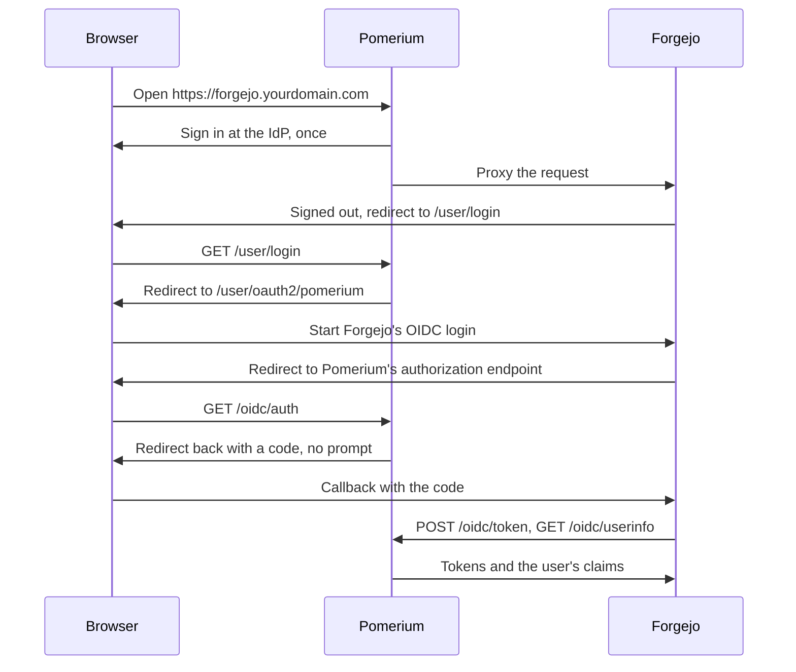
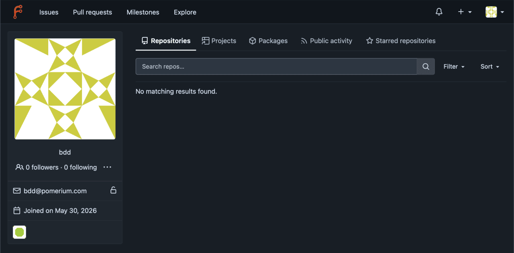

---
# cSpell:ignore automations forgejo gitea tmpl WEBAUTH
title: Secure Forgejo with Pomerium
sidebar_label: Forgejo
lang: en-US
image: ./img/forgejo/forgejo-dashboard.png
keywords:
  [
    pomerium,
    forgejo,
    gitea,
    git,
    sso,
    oidc,
    oidc bridge,
    openid connect,
    identity aware proxy,
    reverse proxy authentication,
    identity headers,
  ]
description: Put a Forgejo instance behind Pomerium and sign users in once, either with Pomerium as Forgejo's OpenID Connect provider through the OIDC bridge or with reverse-proxy header authentication.
---

import CodeBlock from '@theme/CodeBlock';
import TabItem from '@theme/TabItem';
import Tabs from '@theme/Tabs';

import Config from '!!raw-loader!/content/examples/guides/forgejo/config.yaml';
import ProxyHeadersConfig from '!!raw-loader!/content/examples/guides/forgejo-proxy-headers/config.yaml';
import Compose from '!!raw-loader!/content/examples/guides/forgejo/docker-compose.yaml';
import ProxyHeadersCompose from '!!raw-loader!/content/examples/guides/forgejo-proxy-headers/docker-compose.yaml';
import Footer from '!!raw-loader!/content/examples/guides/forgejo/footer.tmpl';

# Secure Forgejo with Pomerium

You'll put [Forgejo](https://forgejo.org/), a self-hosted Git service, behind Pomerium so that Pomerium handles single sign-on and authorization. Users sign in once through Pomerium, and Forgejo creates their account on first visit with no second password.

There are two ways to sign users in to Forgejo. Choose one with the tabs below:

|  | OIDC bridge | Proxy headers |
| :-- | :-- | :-- |
| How Forgejo signs users in | Its standard [OpenID Connect (OIDC) login](https://forgejo.org/docs/latest/user/oauth2-provider/), with Pomerium as the OIDC provider | [Reverse-proxy authentication](https://forgejo.org/docs/latest/admin/setup/reverse-proxy/) from identity headers that Pomerium forwards |
| What Forgejo trusts | Tokens it gets from Pomerium's OIDC endpoints, using the route's client secret | The identity headers, from any peer that can reach Forgejo |
| Pomerium route settings | OIDC bridge with a client secret, plus a redirect route for `/user/login` | `pass_identity_headers` and `jwt_claims_headers` |
| Authenticate service URL | Must be a domain you control | The default hosted URL works |
| Sign-out | Signing out of Forgejo also signs out of Pomerium | Not covered |
| Admin recovery | From the Forgejo container's CLI | A break-glass admin account created out of band |

:::caution Both methods configure web UI sign-in only

Git operations over HTTP, API clients, automations, and SSH access still need Forgejo [access tokens](https://forgejo.org/docs/latest/user/api-usage/) or SSH keys.

:::

## Prerequisites

This guide assumes you've completed the [Quickstart](/docs/get-started/quickstart), so you already have Pomerium running and signing users in through the hosted authenticate service.

You also need:

- [Docker](https://docs.docker.com/install/) and [Docker Compose](https://docs.docker.com/compose/install/)
- A domain you control for the Forgejo route (this guide uses `forgejo.yourdomain.com`)
- An identity provider. This guide uses Pomerium's [hosted identity provider](/docs/capabilities/authentication#hosted-authenticate-service) (`idp_provider: hosted`), which signs users in with email and password, Google, or GitHub.
- For the OIDC bridge method, Pomerium Zero or Pomerium Core with the authenticate service URL set to a domain you control (this guide uses `authenticate.yourdomain.com`). The OIDC bridge isn't served from Pomerium's default hosted authenticate URL. You can still use the hosted identity provider behind your own URL.

:::tip Prefer to self-host the identity provider?

This guide uses the hosted authenticate service so you don't have to run an identity provider (IdP). To run your own instead, follow [Keycloak + Pomerium](/docs/integrations/user-identity/oidc) and swap the `authenticate_service_url` / `idp_*` settings into the config below.

:::

<Tabs queryString="method">
<TabItem value="oidc-bridge" label="OIDC bridge" default>

You'll put [Forgejo](https://forgejo.org/), a self-hosted Git service, behind Pomerium to gate it with SSO and route policy. Forgejo keeps its standard [OpenID Connect (OIDC) login](https://forgejo.org/docs/latest/user/oauth2-provider/), and Pomerium is the OIDC provider. Users sign in once through Pomerium, and Forgejo creates their account and completes its login without a second prompt or a click. Signing out of Forgejo also signs them out of Pomerium.

This guide is tested with Forgejo 15.0.2.



Use this method when you want one front door for Forgejo with your existing identity, and you want Forgejo to create each user's account the first time they sign in. Forgejo's standard OIDC login uses Pomerium's [OIDC bridge](https://www.pomerium.com/docs/capabilities/oidc-bridge) as its provider.

## Configure Pomerium {#oidc-bridge-configure-pomerium}

<Tabs queryString="type">
<TabItem value="zero" label="Pomerium Zero" default>

In the [Zero Console](https://console.pomerium.app), create two **Routes** for `forgejo.<your-starter-domain>`:

1. **Login redirect route.** This route sends Forgejo's login page straight to the **Sign in with Pomerium** address, because Forgejo has no setting to skip its login page when there's only one login source.
   - In **From**, enter `https://forgejo.<your-starter-domain>`, and on the **Path Matching** tab, choose **Exact Path** and enter `/user/login`.
   - On the **Advanced** tab, choose **Redirect** and set **Path Redirect** to `/user/oauth2/pomerium`.
   - Set the policy to the user or domain that should reach Forgejo.
2. **Forgejo route.**
   - In **From**, enter `https://forgejo.<your-starter-domain>`; in **To**, enter `http://forgejo:3000`.
   - Set the same policy as the first route.
   - On the **Advanced** tab, under **OIDC Bridge**, turn on **Enabled** and enter an **OIDC Bridge Client Secret**. Generate one with `openssl rand -base64 32`. You'll enter the same value in Forgejo below. Forgejo authenticates with a client secret and doesn't use Proof Key for Code Exchange (PKCE), so Pomerium treats it as a confidential client.
   - On the **Timeouts** tab, set **Timeout** to `0s` and **Idle Timeout** to `600s` so long Git smart-HTTP transfers aren't cut off.

Order the login redirect route above the Forgejo route. Zero manages the token-signing secret for you, so there's no `shared_secret` to set. Before you create the routes, open the **Identity Provider** page in the Zero Console, set **Authenticate Service URL** to a domain you control (this guide uses `https://authenticate.yourdomain.com`), and leave **Hosted Authenticate** selected. The OIDC bridge isn't served from Pomerium's default hosted authenticate URL.

Your OIDC discovery URL is your authenticate service URL plus `/.well-known/openid-configuration`.

</TabItem>
<TabItem value="core" label="Pomerium Core">

Create a `config.yaml`. It has two routes for `forgejo.yourdomain.com`:

- The first matches only Forgejo's login page, `/user/login`, and redirects it to `/user/oauth2/pomerium`, the address behind Forgejo's **Sign in with Pomerium** button. Forgejo has no setting to skip its login page when there's only one login source, so this route does it. It must come before the main route.
- The second routes everything else to the Forgejo container, enables the OIDC bridge, and removes the total request timeout so long Git smart-HTTP transfers aren't cut off.

<CodeBlock language="yaml" title="config.yaml">
  {Config}
</CodeBlock>

Replace `forgejo.yourdomain.com` with your domain, `you@example.com` with your user or domain in both policies, and generate your own `shared_secret` and route `client_secret` with the command in each comment. Keep `shared_secret` the same across restarts. If it changes, Pomerium can't read tokens it issued earlier, and users have to sign in again.

Forgejo authenticates with a client secret and doesn't use Proof Key for Code Exchange (PKCE), so it's registered as a confidential client and the route needs a `client_secret`. You'll enter the same value in Forgejo below. The route's `from` URL is the OIDC client ID, so it must match the client ID you give Forgejo.

</TabItem>
</Tabs>

## Configure Forgejo {#oidc-bridge-configure-forgejo}

Forgejo reads its settings from `app.ini`, supplied as `FORGEJO__<section>__<KEY>` environment variables in the Compose file below. The key settings:

- `FORGEJO__server__ROOT_URL` is Forgejo's public URL. Forgejo builds its OIDC callback from it: `https://forgejo.yourdomain.com/user/oauth2/pomerium/callback`.
- `ENABLE_AUTO_REGISTRATION` (in `oauth2_client`) creates the Forgejo account on first sign-in.
- `USERNAME: email` takes the username from the part of the `email` claim before the `@`. See [Choose how usernames are created](#choose-how-usernames-are-created) for the other options.
- `ACCOUNT_LINKING: login` is Forgejo's default. If a new sign-in clashes with an existing account's username or email, Forgejo asks the user what to do instead of signing them in to that account.
- `UPDATE_AVATAR: true` sets the user's Forgejo avatar from the `picture` claim on each sign-in.
- `DISABLE_REGISTRATION: false` with `ALLOW_ONLY_EXTERNAL_REGISTRATION: true` and `SHOW_REGISTRATION_BUTTON: false` allows accounts to be created through the OIDC login while keeping the local sign-up form closed.
- `ENABLE_INTERNAL_SIGNIN: false` hides the local username and password form, so Pomerium is the only sign-in option.
- `LANDING_PAGE: login` (in `server`) sends signed-out visitors from `/` to `/user/login`, which the first Pomerium route redirects to the OIDC login. Together, they sign users in without a click. It needs the sign-out template below.

:::note Settings persist in `app.ini`

The Forgejo image writes each `FORGEJO__*` variable into `/data/gitea/conf/app.ini` on startup. Removing a variable from the Compose file doesn't remove its value. Delete the key from `app.ini` too, then restart Forgejo.

:::

### Sign out of Pomerium when users sign out of Forgejo

Forgejo's OIDC login can't sign users out of the provider. It has no setting for a sign-out redirect and doesn't call the OIDC end-session endpoint, so **Sign out** ends only the Forgejo session and returns to `/`. With `LANDING_PAGE: login`, the still-active Pomerium session would sign the user straight back in.

Forgejo includes a [custom footer template](https://forgejo.org/docs/latest/admin/customization/) on every page. Save this as `footer.tmpl` next to your `docker-compose.yaml`. The Compose file mounts it at `/data/gitea/templates/custom/footer.tmpl`:

<CodeBlock language="html" title="footer.tmpl">
  {Footer}
</CodeBlock>

When a user selects **Sign out**, the script runs Forgejo's own sign-out first, so Forgejo destroys its session. Only then does it send the browser to `/.pomerium/sign_out`, which ends the Pomerium session and the identity provider session behind it. If Forgejo's sign-out fails, the page reloads and the user stays signed in to Forgejo.

To do without the template, leave out both the template and `LANDING_PAGE`. Users then select **Sign in** on Forgejo's home page, and **Sign out** ends only the Forgejo session. To sign out of Pomerium, they open `https://forgejo.yourdomain.com/.pomerium/sign_out`.

### Choose how usernames are created

Forgejo usernames can contain only letters, digits, `-`, `_`, and `.`, so a full email address can't be a username. `USERNAME` takes one of three values:

| Value | Username comes from |
| :-- | :-- |
| `email` | The part of the `email` claim before the `@` |
| `nickname` | The `nickname` claim, or `preferred_username` if there's no `nickname`. The value must already be a valid Forgejo username. Many identity providers set `preferred_username` to the email address, which Forgejo rejects. |
| `userid` | The `sub` claim. Always unique, but not readable. |

You can't name another claim. To use a different value, map it into `nickname` or `preferred_username` in your identity provider and set `USERNAME: nickname`.

With `email`, two users with the same name before the `@`, such as `sam@example.com` and `sam@example.org`, get the same username. The second one to sign in hits a clash. With the default `ACCOUNT_LINKING: login`, Forgejo shows that user a form to register a different username.

## Run the stack {#oidc-bridge-run-the-stack}

The Compose file runs Pomerium Core and Forgejo together (for Zero, drop the `pomerium` service and use the `compose.yaml` from the Quickstart with your `POMERIUM_ZERO_TOKEN`, keeping the `forgejo` service and its network below). Place the `footer.tmpl` from the previous steps next to this `docker-compose.yaml`. For Core, place the `config.yaml` there too:

<CodeBlock language="yaml" title="docker-compose.yaml">
  {Compose}
</CodeBlock>

Start it:

```bash
docker compose up -d
```

If you change `config.yaml` later, run `docker compose up -d` again to apply it.

## Add Pomerium as a login source {#oidc-bridge-add-pomerium-as-a-login-source}

Forgejo needs to know about Pomerium before anyone can sign in. Add the login source, using the route's `client_secret` as the secret:

```bash
docker compose exec -u git forgejo forgejo admin auth add-oauth \
  --name pomerium \
  --provider openidConnect \
  --key https://forgejo.yourdomain.com \
  --secret REPLACE_WITH_ROUTE_CLIENT_SECRET \
  --auto-discover-url https://authenticate.yourdomain.com/.well-known/openid-configuration
```

`--name` becomes part of the callback URL and the `/user/oauth2/pomerium` path that the first route redirects to, so keep it `pomerium`. You can also add the source in the web UI under **Site Administration** > **Identity & Access** > **Authentication Sources**, with the same values and **OpenID Connect** as the provider. Leave the additional scopes empty. Forgejo requests `openid` and reads the email, name, and picture from Pomerium's user info endpoint.

Forgejo fetches the discovery document, and later the token and user info endpoints, from the Forgejo container. The container must be able to resolve and reach `authenticate.yourdomain.com`.

## Make yourself the administrator {#oidc-bridge-make-yourself-the-administrator}

Forgejo makes the first account it creates an administrator. Sign in through Pomerium before anyone else does, as described in [Verify the setup](#oidc-bridge-verify-the-setup), and your account becomes the administrator.

You don't need a separate break-glass administrator. Forgejo is only reachable through Pomerium, and the `/user/login` redirect means its local password form can't be used. If you lose administrator access, recover it from the Forgejo container, as described in [Recover admin access](#oidc-bridge-recover-admin-access).

## Verify the setup {#oidc-bridge-verify-the-setup}

1. **The route requires authentication.** In a fresh browser, open `https://forgejo.yourdomain.com`. You should be redirected to Pomerium to sign in.
2. **Forgejo signs you in without a click or a second prompt.** After you sign in to Pomerium, you land on the Forgejo dashboard. Forgejo's login page never appears.
3. **Your identity is correct.** Open **Settings** and confirm that your full name, email, and avatar come from your identity provider.

   

4. **Sign-out ends both sessions.** Select **Sign out**. You land on Pomerium's signed-out page. Open `https://forgejo.yourdomain.com` again. Your identity provider asks you to sign in, and then you land on the dashboard again.
5. **A disallowed user is blocked.** Sign in as a user your policy excludes and open `https://forgejo.yourdomain.com`. Pomerium denies access before Forgejo loads, so Forgejo never creates an account.

## Recover admin access {#oidc-bridge-recover-admin-access}

Everything here runs inside the Forgejo container, so you need shell access to the host.

**If the OIDC login is broken,** for example because the client secret changed, fix the login source from the CLI. List the sources to find the ID, then update it:

```bash
docker compose exec -u git forgejo forgejo admin auth list
docker compose exec -u git forgejo forgejo admin auth update-oauth --id 1 \
  --secret REPLACE_WITH_ROUTE_CLIENT_SECRET
```

**If no one has administrator access,** the CLI can't promote an existing user, but a temporary administrator can do it through Forgejo's API. Replace `your-username` with the Forgejo username to promote:

```bash
docker compose exec -u git forgejo sh -c '
  forgejo admin user create --admin --username recovery-tmp \
    --email recovery-tmp@forgejo.invalid --random-password --must-change-password=false >/dev/null
  TOKEN=$(forgejo admin user generate-access-token --username recovery-tmp \
    --token-name recovery --scopes write:admin --raw)
  curl -s -X PATCH -H "Authorization: token $TOKEN" -H "Content-Type: application/json" \
    -d "{\"admin\": true}" http://localhost:3000/api/v1/admin/users/your-username
  forgejo admin user delete --username recovery-tmp'
```

The response should include `"is_admin":true`. The token is never printed, and deleting `recovery-tmp` also deletes it.

## Common failure modes {#oidc-bridge-common-failure-modes}

| Symptom | Cause and fix |
| :-- | :-- |
| Pomerium returns `403` | The route policy still allows only the example user. Replace it with your user or domain on both routes. |
| Forgejo's login page shows a **Sign in with Pomerium** button | The `/user/login` redirect route is missing or comes after the main Forgejo route. Put it first. |
| `404 Not Found` after selecting **Sign in** | The login source isn't named `pomerium`, so `/user/oauth2/pomerium` doesn't exist. Rename the source or change the redirect route's `path_redirect`. |
| `404 Not Found` from the discovery URL or any `/oidc/` path | Forgejo is pointing at the wrong host. Use your authenticate service URL, and check that `authenticate_service_url` and `idp_provider` are set. |
| HTTP 400 at `/oidc/auth`: `redirect_uri ... does not match client_id ...` | The client ID (`--key`) doesn't match the route's `from` URL, or `FORGEJO__server__ROOT_URL` isn't the Forgejo URL. |
| Token request fails with `invalid_client` | The client secret in Forgejo doesn't match the route's `client_secret`. Look for the `oidc: token request invalid` log line in Pomerium. |
| Forgejo shows a link-account or registration form instead of signing you in | Your username or email clashes with an existing Forgejo account. Register with a different username on that form. Forgejo creates a new account with your identity provider email and leaves the existing account alone. To avoid clashes, see [Choose how usernames are created](#choose-how-usernames-are-created). |
| **Sign out** returns to the dashboard instead of Pomerium's signed-out page | The sign-out template isn't running, so Forgejo's own sign-out sends you to `/` and `LANDING_PAGE: login` signs you back in. Check that `footer.tmpl` is mounted at `/data/gitea/templates/custom/footer.tmpl`, restart Forgejo, and reload the page. After a Forgejo upgrade, check that the sign-out link still has a `data-url` ending in `/user/logout`. If you removed the template, also remove `LANDING_PAGE` from the Compose file and from `app.ini`. |
| Sign-in stops at Forgejo's home page with a **Sign in** link | `LANDING_PAGE` isn't `login`. Set it, or select **Sign in**, which still skips Forgejo's login page. |
| The avatar is a generated pattern | `UPDATE_AVATAR` isn't `true`, your identity provider doesn't send a `picture` claim, or Forgejo can't reach the image URL. Forgejo downloads it from the container on each sign-in. |
| `invalid_token` on Forgejo's user info request | The access token was issued before Pomerium restarted without a fixed `shared_secret`. Set `shared_secret` and sign in again. |
| Sign-in fails on the username | Forgejo couldn't make a valid username from the claim `USERNAME` points at. See [Choose how usernames are created](#choose-how-usernames-are-created). |

## Security considerations {#oidc-bridge-security-considerations}

- **Keep the route protected.** The bridge handles login only. Route policy decides who can reach Forgejo, and Pomerium checks it on every request. A public route would let anyone who can sign in to Pomerium get a Forgejo account.
- **Only Pomerium should reach Forgejo.** Keep `forgejo:3000` off published ports, so Pomerium is the only way in.
- **Pomerium issues the tokens.** Forgejo gets its ID and access tokens from Pomerium, not directly from your identity provider. There are no refresh tokens, so when the Pomerium session expires, the next request sends the user back to Pomerium to sign in.
- **Keep the `client_secret` secret.** It's what lets Forgejo prove to Pomerium that it's the app behind this route. Store it like any other credential.
- **Don't auto-link accounts across email domains.** `ACCOUNT_LINKING: auto` matches on username before email, so a username clash signs one user in to another user's account. See [Choose how usernames are created](#choose-how-usernames-are-created).
- **Signing out of Forgejo signs you out of Pomerium.** The sign-out template ends the Pomerium session, which also signs you out of every other Pomerium route in that browser and of your identity provider. Forgejo can't do this itself, so keep the template working, especially on shared machines.
- **Avatars are fetched server-side.** With `UPDATE_AVATAR`, Forgejo downloads the `picture` URL from the container with a plain `GET`, without the user's tokens. The container needs outbound access to the image host.
- **Account creation follows the policy.** `ENABLE_AUTO_REGISTRATION` creates a Forgejo account for every user your policy allows. Manage Forgejo roles and organizations separately.
- **No standing break-glass account.** Local sign-in is disabled and unreachable, so there's no local administrator password to protect. Recovery needs shell access to the Forgejo container. See [Recover admin access](#oidc-bridge-recover-admin-access).

## Next steps {#oidc-bridge-next-steps}

- [OIDC bridge](https://www.pomerium.com/docs/capabilities/oidc-bridge)
- [Authentication](/docs/capabilities/authentication)
- [Authorization](/docs/capabilities/authorization)
- [Mirror repositories](https://forgejo.org/docs/latest/user/repo-mirror/) into a Pomerium-gated warm standby

</TabItem>
<TabItem value="proxy-headers" label="Proxy headers">

You'll put [Forgejo](https://forgejo.org/), a self-hosted Git service, behind Pomerium so that Pomerium handles single sign-on and authorization, then forwards the user's identity to Forgejo as request headers. Forgejo trusts those headers ([reverse-proxy authentication](https://forgejo.org/docs/latest/admin/setup/reverse-proxy/)), signs the user in, and can auto-create the account on first visit. The result is single sign-on for the Forgejo web UI with no second password. The same setup also works with [Gitea](https://about.gitea.com/).

Use this method when you want one front door for Forgejo with your existing identity, and you want Forgejo to provision and sign users in from Pomerium instead of maintaining its own password directory. Forgejo does not support Pomerium's signed-JWT login mode, so this guide relies on header-based reverse-proxy authentication; read the [Security considerations](#proxy-headers-security-considerations) before you deploy, because that mode trusts the identity header from any peer that can reach Forgejo.

## Configure Pomerium {#proxy-headers-configure-pomerium}

Pomerium forwards the user's `sub`, `email`, and `name` claims as request headers. Forgejo usernames can't contain every character that's valid in an email address, so this uses the stable OIDC `sub` claim for the username and carries the real address in `X-Pomerium-Claim-Email`.

<Tabs queryString="type">
<TabItem value="zero" label="Pomerium Zero" default>

In the [Zero Console](https://console.pomerium.app):

1. Create a **Route**. In **From**, enter `https://forgejo.<your-starter-domain>`; in **To**, enter `http://forgejo:3000`.
2. Set the policy to the user or domain that should reach Forgejo. Reverse-proxy auth trusts the forwarded header, so this policy is your real access gate; keep it tight.
3. On the **Headers** tab, enable **Pass Identity Headers**, then add these **JWT Claim Headers** so the claims arrive under the names Forgejo expects below: `X-Pomerium-Sub` from `sub`, `X-Pomerium-Claim-Email` from `email`, and `X-Pomerium-Claim-Name` from `name`. Save.

</TabItem>
<TabItem value="core" label="Pomerium Core">

Create a `config.yaml`. It routes `forgejo.yourdomain.com` to the Forgejo container, forwards the identity claims as headers, and removes the total request timeout so long Git smart-HTTP transfers aren't cut off.

<CodeBlock language="yaml" title="config.yaml">
  {ProxyHeadersConfig}
</CodeBlock>

Replace `forgejo.yourdomain.com` with your domain and `you@example.com` with your user or domain. A few notes:

- [`jwt_claims_headers`](/docs/reference/jwt-claim-headers) forwards each claim as a request header; [`pass_identity_headers`](/docs/reference/routes/pass-identity-headers-per-route) sends them to Forgejo.
- If your identity provider's `sub` claim isn't a valid Forgejo username, use another stable claim that's unique and already sanitized for Forgejo.
- The policy authorizes who can reach Forgejo. Reverse-proxy auth trusts the header, so this policy is your real access gate.

</TabItem>
</Tabs>

## Configure Forgejo {#proxy-headers-configure-forgejo}

Configure Forgejo to trust and consume the headers. These map to `app.ini` settings, supplied as `FORGEJO__<section>__<KEY>` environment variables in the Compose file below. The key settings:

- `ENABLE_REVERSE_PROXY_AUTHENTICATION` makes Forgejo read the identity header.
- `ENABLE_REVERSE_PROXY_AUTO_REGISTRATION` creates the account on first visit; `..._EMAIL` and `..._FULL_NAME` populate it from the other headers.
- `REVERSE_PROXY_AUTHENTICATION_USER` / `_EMAIL` / `_FULL_NAME` must match the header names Pomerium emits (Forgejo's defaults are `X-WEBAUTH-USER` / `-EMAIL` / `-FULLNAME`).
- `DISABLE_REGISTRATION: false` allows trusted external provisioning, while `ALLOW_ONLY_EXTERNAL_REGISTRATION: true` and `SHOW_REGISTRATION_BUTTON: false` keep the local sign-up form closed.

`REVERSE_PROXY_TRUSTED_PROXIES` only tells Forgejo how to derive the real client IP from `X-Forwarded-For` for its logs and rate limiting. It does **not** restrict which peer the identity header is trusted from; see [Security considerations](#proxy-headers-security-considerations).

## Run the stack {#proxy-headers-run-the-stack}

The Compose file runs Pomerium Core and Forgejo together (for Zero, drop the `pomerium` service and use the `compose.yaml` from the Quickstart with your `POMERIUM_ZERO_TOKEN`, keeping the `forgejo` service and its network below):

<CodeBlock language="yaml" title="docker-compose.yaml">
  {ProxyHeadersCompose}
</CodeBlock>

Start it:

```bash
docker compose up -d
```

The Compose file pins Forgejo and Pomerium by image digest so the stack is reproducible; the digest comment notes the Forgejo version (`v15`). Update the digests when you upgrade Forgejo, then sign in again to confirm it still works. To tear the stack down and delete the Forgejo data volume (all repositories and state), run `docker compose down -v`.

## Verify the setup {#proxy-headers-verify-the-setup}

1. **The route requires authentication.** In a fresh browser, open `https://forgejo.yourdomain.com`. You should be redirected to sign in, not straight into Forgejo.
2. **An allowed user gets in.** Sign in. Pomerium redirects you back to Forgejo.
3. **SSO and auto-provisioning work.** Forgejo signs you in and creates your account from the headers, with no Forgejo password. The account carries your real email; its username comes from the configured username claim, and its full name is populated only if your identity provider supplies a `name` claim. You land on the authenticated Forgejo dashboard, signed in as your Pomerium identity:

   

   Open your Forgejo profile to confirm the account was provisioned from your Pomerium identity: the username comes from your username claim and the email matches the one Pomerium forwarded, with no Forgejo password ever set.

   

4. **A disallowed user is blocked.** Sign in as a user your policy excludes and open `https://forgejo.yourdomain.com`. Pomerium denies access, so no identity headers are forwarded and Forgejo never provisions an account.

The first account Forgejo provisions becomes the instance administrator, so sign in through Pomerium first with the identity that should own Forgejo.

## Common failure modes {#proxy-headers-common-failure-modes}

- **Pomerium returns `403`.** The route policy still allows only the example user. Replace it with your user or domain.
- **You reach Forgejo but aren't signed in or auto-provisioned.** The header names in Pomerium (`jwt_claims_headers`) and in Forgejo (`REVERSE_PROXY_AUTHENTICATION_USER` / `_EMAIL` / `_FULL_NAME`) must match exactly, and `pass_identity_headers` must be set on the route.
- **Sign-in fails on the username.** Forgejo rejects usernames containing characters such as `@`. Use a stable, already-valid claim for the username (this guide uses `sub`).
- **A direct request to the backend signs in.** Expected: reverse-proxy auth trusts the header from any peer. It's why Forgejo must stay reachable only through Pomerium.

## Security considerations {#proxy-headers-security-considerations}

Reverse-proxy authentication means **Forgejo trusts the identity header from any peer that can reach it.** Forgejo does not verify Pomerium's signed `X-Pomerium-Jwt-Assertion` for login, and `REVERSE_PROXY_TRUSTED_PROXIES` does not gate which peer the header is trusted from. So **network isolation is the only trust boundary**: Forgejo must be reachable **only** through Pomerium.

Two properties make this safe, and only these two:

- **Through Pomerium, a forged header is overwritten.** For each claim it forwards, Pomerium sets the header from the real authenticated user, so a client that forges `X-Pomerium-Sub` or `X-Pomerium-Claim-Email` _through_ Pomerium is still signed in as its own identity, never the forged one. The username (`sub`) and email are always present, so they pin the account. The only soft spot is an optional claim Pomerium doesn't emit for a given user (for example `name`, when the token carries none): a forged `X-Pomerium-Claim-Name` could pass through, but the worst case is a wrong display name, not a different account.
- **Direct access must be impossible.** The risk is a client that bypasses Pomerium and talks to Forgejo directly: it can set those headers itself and impersonate anyone (the first such account would even become admin). Keep Forgejo on a network where only Pomerium can reach it.

To hold up that boundary:

- **Don't publish Forgejo's port.** In Docker Compose, keep only Pomerium on Forgejo's network and never map `3000` to the host. Confirm the only containers on the network are Pomerium and Forgejo: `docker network inspect forgejo-pomerium --format '{{range .Containers}}{{.Name}} {{end}}'`.
- **In Kubernetes, a `ClusterIP` service alone isn't enough** if arbitrary pods can connect to Forgejo. Use a policy-enforcing CNI and a `NetworkPolicy` (or another network control) to admit only Pomerium to the backend.
- **`REVERSE_PROXY_TRUSTED_PROXIES` is not a security control for this.** It only affects `X-Forwarded-For` parsing, not which peer the identity header is trusted from. Set it to Pomerium's IP/CIDR (never a hostname) for correct client-IP logging, but treat network isolation as the real boundary.
- **Keep a break-glass admin.** Because the local sign-up form is closed and every request arrives pre-authenticated, create a recovery admin out of band: `docker compose exec -u git forgejo forgejo admin user create --username recovery-admin --email recovery-admin@example.com --random-password --admin`. To use it, reach Forgejo without Pomerium's injected header (a trusted network, or temporarily setting `ENABLE_REVERSE_PROXY_AUTHENTICATION` to `false`).

## Next steps {#proxy-headers-next-steps}

- [Build policies](/docs/get-started/fundamentals/zero/zero-build-policies)
- [Pass identity headers](/docs/reference/routes/pass-identity-headers-per-route)
- [Mirror repositories](https://forgejo.org/docs/latest/user/repo-mirror/) into a Pomerium-gated warm standby

</TabItem>
</Tabs>
