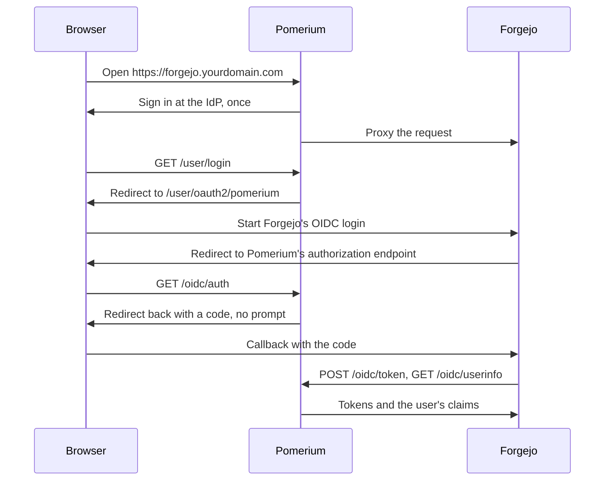

---
# cSpell:ignore automations forgejo gitea tmpl
title: Secure Forgejo with Pomerium
sidebar_label: Forgejo
lang: en-US
image: ./img/forgejo/forgejo-dashboard.png
keywords:
  [
    pomerium,
    forgejo,
    gitea,
    git,
    sso,
    oidc,
    oidc bridge,
    openid connect,
    identity aware proxy,
  ]
description: Put a Forgejo instance behind Pomerium and have Pomerium act as Forgejo's OpenID Connect provider through the OIDC bridge, so users sign in once and Forgejo creates their account.
---

import CodeBlock from "@theme/CodeBlock";

import Config from "!!raw-loader!/content/examples/guides/forgejo/config.yaml";
import Compose from "!!raw-loader!/content/examples/guides/forgejo/docker-compose.yaml";
import Footer from "!!raw-loader!/content/examples/guides/forgejo/footer.tmpl";

# Secure Forgejo with Pomerium

## What this guide does

You'll put [Forgejo](https://forgejo.org/), a self-hosted Git service, behind Pomerium to gate it with SSO and route policy. Forgejo keeps its standard [OpenID Connect (OIDC) login](https://forgejo.org/docs/latest/user/oauth2-provider/), and Pomerium is the OIDC provider. Users sign in once through Pomerium, and Forgejo creates their account and completes its login without a second prompt or a click. Signing out of Forgejo also signs them out of Pomerium. The same setup also works with [Gitea](https://about.gitea.com/).



:::caution This guide configures web UI sign-in only

Git operations over HTTP, API clients, automations, and SSH access still need Forgejo [access tokens](https://forgejo.org/docs/latest/user/api-usage/) or SSH keys.

:::

## When to use this guide

Use it when you want one front door for Forgejo with your existing identity, and Forgejo should keep its own OIDC login and create accounts from it. Forgejo can't verify Pomerium's signed JWT, so this guide uses Pomerium's [OIDC bridge](/docs/capabilities/oidc-bridge) instead. The bridge replaces trusting identity headers from any peer that can reach Forgejo, so network isolation is no longer the only thing protecting logins.

## Prerequisites

- [Docker](https://docs.docker.com/install/) and [Docker Compose](https://docs.docker.com/compose/install/)
- Pomerium Core with a self-hosted authenticate service on a domain you control (this guide uses `authenticate.yourdomain.com`). The OIDC bridge isn't available on the hosted authenticate service.
- An OpenID Connect identity provider. This guide uses [Keycloak](/docs/integrations/user-identity/oidc) as the example.
- A domain you control for the Forgejo route (this guide uses `forgejo.yourdomain.com`)

:::tip Need an identity provider?

Follow [Keycloak + Pomerium](/docs/integrations/user-identity/oidc) to set one up, then fill in the `idp_*` settings in `config.yaml` with your client ID and secret.

:::

## Configure Pomerium

Create a `config.yaml`. It has two routes for `forgejo.yourdomain.com`:

- The first matches only Forgejo's login page, `/user/login`, and redirects it to `/user/oauth2/pomerium`, the address behind Forgejo's **Sign in with Pomerium** button. Forgejo has no setting to skip its login page when there's only one login source, so this route does it. It must come before the main route.
- The second routes everything else to the Forgejo container, enables the OIDC bridge, and removes the total request timeout so long Git smart-HTTP transfers aren't cut off.

The file also sets the `shared_secret` that Pomerium uses to sign and encrypt the tokens it issues.

<CodeBlock language="yaml" title="config.yaml">
  {Config}
</CodeBlock>

Replace `forgejo.yourdomain.com` with your domain, `you@example.com` with your user or domain in both policies, and generate your own `shared_secret` and route `client_secret` with the command in each comment. Keep `shared_secret` the same across restarts. If it changes, Pomerium can't read tokens it issued earlier, and users have to sign in again.

Forgejo doesn't use Proof Key for Code Exchange for its OIDC login, so it's a confidential client and the route needs a `client_secret`. You'll enter the same value in Forgejo below. The route's `from` URL is the OIDC client ID, so it must match the client ID you give Forgejo.

## Configure Forgejo

Forgejo reads its settings from `app.ini`, supplied as `FORGEJO__<section>__<KEY>` environment variables in the Compose file below. The key settings:

- `FORGEJO__server__ROOT_URL` is Forgejo's public URL. Forgejo builds its OIDC callback from it: `https://forgejo.yourdomain.com/user/oauth2/pomerium/callback`.
- `ENABLE_AUTO_REGISTRATION` (in `oauth2_client`) creates the Forgejo account on first sign-in.
- `USERNAME: email` takes the username from the part of the `email` claim before the `@`. See [Choose how usernames are created](#choose-how-usernames-are-created) for the other options.
- `ACCOUNT_LINKING: login` is Forgejo's default. If a new sign-in clashes with an existing account's username or email, Forgejo asks the user what to do instead of signing them in to that account.
- `UPDATE_AVATAR: true` sets the user's Forgejo avatar from the `picture` claim on each sign-in.
- `DISABLE_REGISTRATION: false` with `ALLOW_ONLY_EXTERNAL_REGISTRATION: true` and `SHOW_REGISTRATION_BUTTON: false` allows accounts to be created through the OIDC login while keeping the local sign-up form closed.
- `ENABLE_INTERNAL_SIGNIN: false` hides the local username and password form, so Pomerium is the only sign-in option.
- `LANDING_PAGE: login` (in `server`) sends signed-out visitors from `/` to `/user/login`, which the first Pomerium route redirects to the OIDC login. Together, they sign users in without a click. It needs the sign-out template below.

:::note Settings persist in `app.ini`

The Forgejo image writes each `FORGEJO__*` variable into `/data/gitea/conf/app.ini` on startup. Removing a variable from the Compose file doesn't remove its value. Delete the key from `app.ini` too, then restart Forgejo.

:::

### Sign out of Pomerium when users sign out of Forgejo

Forgejo's OIDC login can't sign users out of the provider. It has no setting for a sign-out redirect and doesn't call the OIDC end-session endpoint, so **Sign out** ends only the Forgejo session and returns to `/`. With `LANDING_PAGE: login`, the still-active Pomerium session would sign the user straight back in.

Forgejo includes a [custom footer template](https://forgejo.org/docs/latest/admin/customization/) on every page. Save this as `footer.tmpl` next to your `docker-compose.yaml`. The Compose file mounts it at `/data/gitea/templates/custom/footer.tmpl`:

<CodeBlock language="html" title="footer.tmpl">
  {Footer}
</CodeBlock>

When a user selects **Sign out**, the script runs Forgejo's own sign-out first, so Forgejo destroys its session. Only then does it send the browser to `/.pomerium/sign_out`, which ends the Pomerium session and the identity provider session behind it. If Forgejo's sign-out fails, the page reloads and the user stays signed in to Forgejo.

:::caution Check sign-out after Forgejo upgrades

The script finds the sign-out link by its `data-url` attribute, which is part of Forgejo's web UI, not a stable interface. After an upgrade, confirm that **Sign out** still reaches Pomerium's signed-out page. If it stops matching, Forgejo's own sign-out runs instead, and `LANDING_PAGE: login` signs the user straight back in.

:::

To do without the template, leave out both the template and `LANDING_PAGE`. Users then select **Sign in** on Forgejo's home page, and **Sign out** ends only the Forgejo session. To sign out of Pomerium, they open `https://forgejo.yourdomain.com/.pomerium/sign_out`.

### Choose how usernames are created

Forgejo usernames can contain only letters, digits, `-`, `_`, and `.`, so a full email address can't be a username. `USERNAME` takes one of three values:

| Value      | Username comes from                                                                                                                                                                                                       |
| :--------- | :------------------------------------------------------------------------------------------------------------------------------------------------------------------------------------------------------------------------ |
| `email`    | The part of the `email` claim before the `@`                                                                                                                                                                              |
| `nickname` | The `nickname` claim, or `preferred_username` if there's no `nickname`. The value must already be a valid Forgejo username. Many identity providers set `preferred_username` to the email address, which Forgejo rejects. |
| `userid`   | The `sub` claim. Always unique, but not readable.                                                                                                                                                                         |

You can't name another claim. To use a different value, map it into `nickname` or `preferred_username` in your identity provider and set `USERNAME: nickname`.

With `email`, two users with the same name before the `@`, such as `sam@example.com` and `sam@example.org`, get the same username. The second one to sign in hits a clash.

:::danger Don't use `ACCOUNT_LINKING: auto` with more than one email domain

With `auto`, Forgejo resolves a clash by linking the sign-in to the existing account. It looks up that account by **username first**, then by email. With `USERNAME: email`, `sam@example.org` would be signed in to the account that belongs to `sam@example.com`. Keep the default `login` unless every username your policy allows is unique, for example when the policy allows a single email domain and no local accounts exist.

:::

## Run the stack

The Compose file runs Pomerium and Forgejo together. Place the `config.yaml` and `footer.tmpl` from the previous steps next to this `docker-compose.yaml`:

<CodeBlock language="yaml" title="docker-compose.yaml">
  {Compose}
</CodeBlock>

Start it:

```bash
docker compose up -d
```

If you change `config.yaml` later, run `docker compose up -d` again to apply it.

## Add Pomerium as a login source

Forgejo needs to know about Pomerium before anyone can sign in. Add the login source, using the route's `client_secret` as the secret:

```bash
docker compose exec -u git forgejo forgejo admin auth add-oauth \
  --name pomerium \
  --provider openidConnect \
  --key https://forgejo.yourdomain.com \
  --secret REPLACE_WITH_ROUTE_CLIENT_SECRET \
  --auto-discover-url https://authenticate.yourdomain.com/.well-known/openid-configuration
```

`--name` becomes part of the callback URL and the `/user/oauth2/pomerium` path that the first route redirects to, so keep it `pomerium`. You can also add the source in the web UI under **Site Administration** > **Identity & Access** > **Authentication Sources**, with the same values and **OpenID Connect** as the provider. Leave the additional scopes empty. Forgejo requests `openid` and reads the email, name, and picture from Pomerium's user info endpoint.

Forgejo fetches the discovery document, and later the token and user info endpoints, from the Forgejo container. The container must be able to resolve and reach `authenticate.yourdomain.com`.

## Make yourself the administrator

Forgejo makes the first account it creates an administrator. Sign in through Pomerium before anyone else does, as described in [Verify the setup](#verify-the-setup), and your account becomes the administrator.

Then create a break-glass administrator for when the OIDC login is unavailable. Local sign-in is disabled, so it's only usable after you temporarily set `ENABLE_INTERNAL_SIGNIN` to `true`. Use an email outside your identity provider, and keep the generated password somewhere safe:

```bash
docker compose exec -u git forgejo forgejo admin user create --admin \
  --username break-glass --email break-glass@forgejo.invalid --random-password
```

## Verify the setup

1. **The route requires authentication.** In a fresh browser, open `https://forgejo.yourdomain.com`. You should be redirected to Pomerium to sign in.
2. **Forgejo signs you in without a click or a second prompt.** After you sign in to Pomerium, you land on the Forgejo dashboard. Forgejo's login page never appears.
3. **Your identity is correct.** Open **Settings** and confirm that your full name, email, and avatar come from your identity provider.

   

4. **Sign-out ends both sessions.** Select **Sign out**. You land on Pomerium's signed-out page. Open `https://forgejo.yourdomain.com` again. Your identity provider asks you to sign in, and then you land on the dashboard again.
5. **A disallowed user is blocked.** Sign in as a user your policy excludes and open `https://forgejo.yourdomain.com`. Pomerium denies access before Forgejo loads, so Forgejo never creates an account.

## Common failure modes

| Symptom                                                                     | Cause and fix                                                                                                                                                                                                                                                                                                                                                                                                                                                  |
| :-------------------------------------------------------------------------- | :------------------------------------------------------------------------------------------------------------------------------------------------------------------------------------------------------------------------------------------------------------------------------------------------------------------------------------------------------------------------------------------------------------------------------------------------------------- |
| Pomerium returns `403`                                                      | The route policy still allows only the example user. Replace it with your user or domain on both routes.                                                                                                                                                                                                                                                                                                                                                       |
| Forgejo's login page shows a **Sign in with Pomerium** button               | The `/user/login` redirect route is missing or comes after the main Forgejo route. Put it first.                                                                                                                                                                                                                                                                                                                                                               |
| `404 Not Found` after selecting **Sign in**                                 | The login source isn't named `pomerium`, so `/user/oauth2/pomerium` doesn't exist. Rename the source or change the redirect route's `path_redirect`.                                                                                                                                                                                                                                                                                                           |
| `404 Not Found` from the discovery URL or any `/oidc/` path                 | Forgejo is pointing at the wrong host. Use your authenticate service URL, and check that `authenticate_service_url` and `idp_provider` are set.                                                                                                                                                                                                                                                                                                                |
| HTTP 400 at `/oidc/auth`: `redirect_uri ... does not match client_id ...`   | The client ID (`--key`) doesn't match the route's `from` URL, or `FORGEJO__server__ROOT_URL` isn't the Forgejo URL.                                                                                                                                                                                                                                                                                                                                            |
| Token request fails with `invalid_client`                                   | The client secret in Forgejo doesn't match the route's `client_secret`, or the client sends HTTP Basic credentials without `client_id` in the body. Check the secret first, then look for the `oidc: token request invalid` log line in Pomerium.                                                                                                                                                                                                              |
| Forgejo shows a link-account or registration form instead of signing you in | Your username or email clashes with an existing Forgejo account. See [Choose how usernames are created](#choose-how-usernames-are-created).                                                                                                                                                                                                                                                                                                                    |
| **Sign out** returns to the dashboard instead of Pomerium's signed-out page | The sign-out template isn't running, so Forgejo's own sign-out sends you to `/` and `LANDING_PAGE: login` signs you back in. Check that `footer.tmpl` is mounted at `/data/gitea/templates/custom/footer.tmpl`, restart Forgejo, and reload the page. After a Forgejo upgrade, check that the sign-out link still has a `data-url` ending in `/user/logout`. If you removed the template, also remove `LANDING_PAGE` from the Compose file and from `app.ini`. |
| Sign-in stops at Forgejo's home page with a **Sign in** link                | `LANDING_PAGE` isn't `login`. Set it, or select **Sign in**, which still skips Forgejo's login page.                                                                                                                                                                                                                                                                                                                                                           |
| The avatar is a generated pattern                                           | `UPDATE_AVATAR` isn't `true`, your identity provider doesn't send a `picture` claim, or Forgejo can't reach the image URL. Forgejo downloads it from the container on each sign-in.                                                                                                                                                                                                                                                                            |
| `invalid_token` on Forgejo's user info request                              | The access token was issued before Pomerium restarted without a fixed `shared_secret`. Set `shared_secret` and sign in again.                                                                                                                                                                                                                                                                                                                                  |
| Sign-in fails on the username                                               | Forgejo couldn't make a valid username from the claim `USERNAME` points at. See [Choose how usernames are created](#choose-how-usernames-are-created).                                                                                                                                                                                                                                                                                                         |

## Security considerations

- **Keep the route protected.** The bridge handles login only. Route policy decides who can reach Forgejo, and Pomerium checks it on every request. A public route would let anyone who can sign in to Pomerium get a Forgejo account.
- **Only Pomerium should reach Forgejo.** Keep `forgejo:3000` off published ports, so Pomerium is the only way in.
- **Pomerium issues the tokens.** Forgejo gets its ID and access tokens from Pomerium, not directly from your identity provider. There are no refresh tokens, so when the Pomerium session expires, the next request sends the user back to Pomerium to sign in.
- **Keep the `client_secret` secret.** It's what lets Forgejo prove to Pomerium that it's the app behind this route. Store it like any other credential.
- **Don't auto-link accounts across email domains.** `ACCOUNT_LINKING: auto` matches on username before email, so a username clash signs one user in to another user's account. See [Choose how usernames are created](#choose-how-usernames-are-created).
- **Signing out of Forgejo signs you out of Pomerium.** The sign-out template ends the Pomerium session, which also signs you out of every other Pomerium route in that browser and of your identity provider. Forgejo can't do this itself, so keep the template working, especially on shared machines.
- **Avatars are fetched server-side.** With `UPDATE_AVATAR`, Forgejo downloads the `picture` URL from the container with a plain `GET`, without the user's tokens. The container needs outbound access to the image host.
- **Account creation follows the policy.** `ENABLE_AUTO_REGISTRATION` creates a Forgejo account for every user your policy allows. Manage Forgejo roles and organizations separately.
- **Keep a break-glass admin.** Local sign-in is disabled, so create a recovery admin before you rely on this setup, and keep its password somewhere safe. To use it, temporarily set `ENABLE_INTERNAL_SIGNIN` to `true`.

## Next steps

- [OIDC bridge](/docs/capabilities/oidc-bridge)
- [Authentication](/docs/capabilities/authentication)
- [Authorization](/docs/capabilities/authorization)
- [Mirror repositories](https://forgejo.org/docs/latest/user/repo-mirror/) into a Pomerium-gated warm standby
