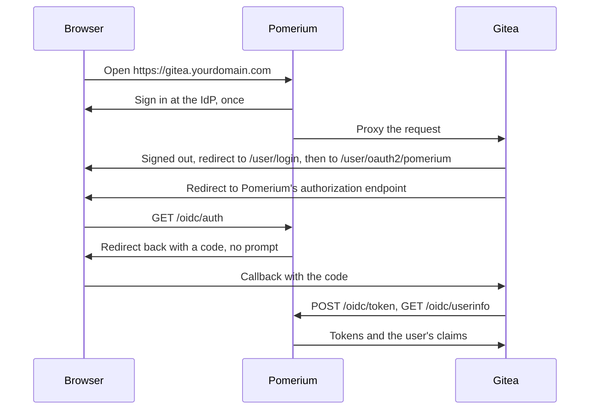
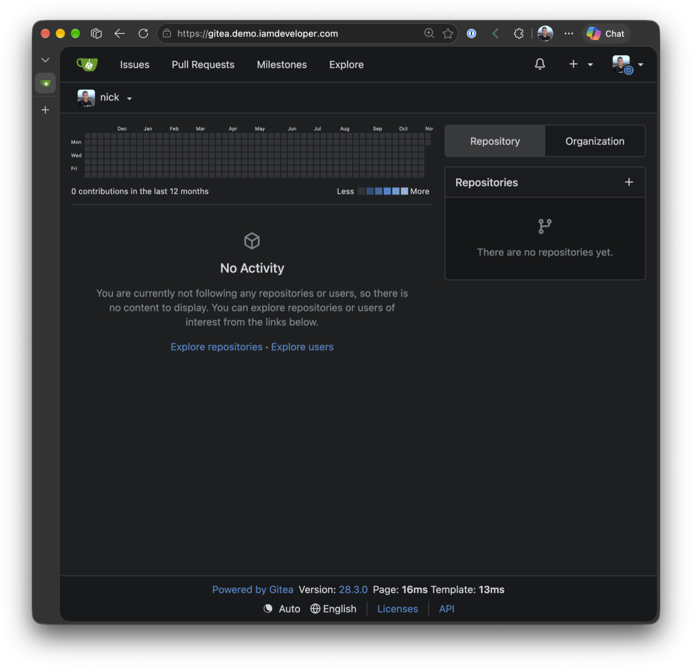
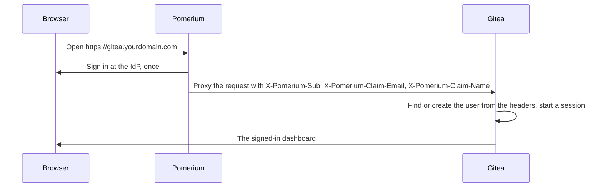
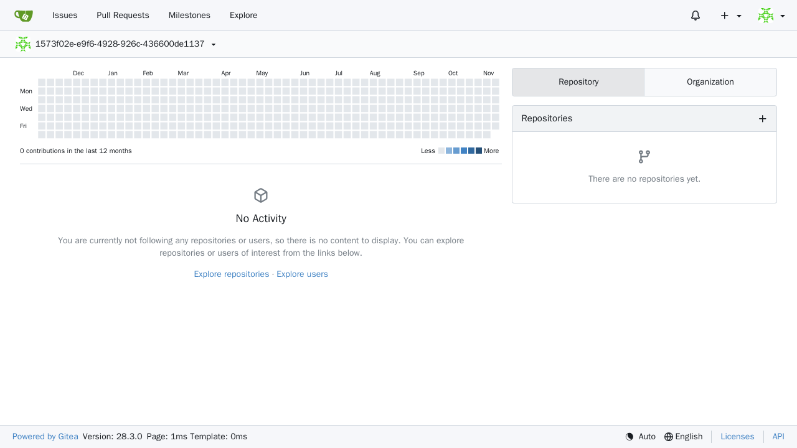
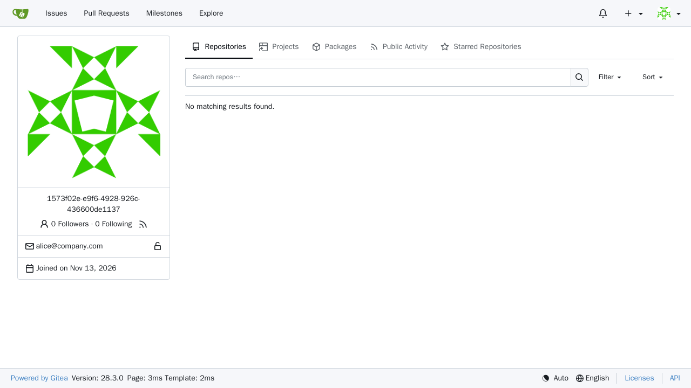

---
# cSpell:ignore automations forgejo gitea passkey passkeys WEBAUTH
title: Secure Gitea with Pomerium
sidebar_label: Gitea
image: ./img/gitea/gitea-dashboard.png
lang: en-US
keywords:
  [
    pomerium,
    gitea,
    forgejo,
    git,
    sso,
    oidc,
    oidc bridge,
    openid connect,
    proxy headers,
    reverse proxy authentication,
    identity aware proxy,
  ]
description: Put a Gitea instance behind Pomerium and sign users in once, either with Pomerium as Gitea's OpenID Connect provider through the OIDC bridge or with identity headers Pomerium forwards.
---

import CodeBlock from '@theme/CodeBlock';
import TabItem from '@theme/TabItem';
import Tabs from '@theme/Tabs';

import Config from '!!raw-loader!/content/examples/guides/gitea/config.yaml';
import Compose from '!!raw-loader!/content/examples/guides/gitea/docker-compose.yaml';
import ProxyHeadersConfig from '!!raw-loader!/content/examples/guides/gitea-proxy-headers/config.yaml';
import ProxyHeadersCompose from '!!raw-loader!/content/examples/guides/gitea-proxy-headers/docker-compose.yaml';

# Secure Gitea with Pomerium

You'll put [Gitea](https://about.gitea.com/), a self-hosted Git service, behind Pomerium so that Pomerium handles single sign-on and authorization. Users sign in once through Pomerium, and Gitea creates their account on first visit with no second password.

There are two ways to sign users in to Gitea. Choose one with the tabs below:

|  | OIDC bridge | Proxy headers |
| :-- | :-- | :-- |
| How Gitea signs users in | Its standard [OpenID Connect (OIDC) login](https://docs.gitea.com/usage/authentication), with Pomerium as the OIDC provider | [Reverse-proxy authentication](https://docs.gitea.com/usage/authentication#reverse-proxy) from identity headers that Pomerium forwards |
| What Gitea trusts | Tokens it gets from Pomerium's OIDC endpoints, using the route's client secret | The identity headers, from any peer that can reach Gitea |
| Pomerium route settings | OIDC bridge with a client secret, and `preserve_host_header` | `pass_identity_headers` and `jwt_claims_headers` |
| Authenticate service URL | Must be a domain you control | The default hosted URL works |
| First account | Becomes the administrator | Promoted to administrator from the Gitea container's CLI |
| Sign-out | Signing out of Gitea also signs out of Pomerium, after a confirmation | Signing out of Gitea also signs out of Pomerium |
| Admin recovery | From the Gitea container's CLI | From the Gitea container's CLI |

:::caution Both methods configure web UI sign-in only

Git operations over HTTP, API clients, automations, and SSH access still need Gitea [access tokens](https://docs.gitea.com/development/api-usage) or SSH keys.

:::

This guide is tested with Gitea 28.3.0.

## Prerequisites

This guide assumes you've completed the [Quickstart](/docs/get-started/quickstart), so you already have Pomerium running and signing users in through the hosted authenticate service.

You also need:

- [Docker](https://docs.docker.com/install/) and [Docker Compose](https://docs.docker.com/compose/install/)
- An identity provider. This guide uses Pomerium's [hosted identity provider](/docs/capabilities/authentication#hosted-authenticate-service) (`idp_provider: hosted`), which signs users in with email and password, Google, or GitHub.
- A domain you control for the Gitea route (this guide uses `gitea.yourdomain.com`)
- For the OIDC bridge method, Pomerium Zero or Pomerium Core with the authenticate service URL set to a domain you control (this guide uses `authenticate.yourdomain.com`). The OIDC bridge isn't served from Pomerium's default hosted authenticate URL. You can still use the hosted identity provider behind your own URL.

:::tip Prefer to self-host the identity provider?

This guide uses the hosted authenticate service so you don't have to run an identity provider (IdP). To run your own instead, follow [Keycloak + Pomerium](/docs/integrations/user-identity/oidc) and swap the `authenticate_service_url` / `idp_*` settings into the config below.

:::

<Tabs queryString="method">
<TabItem value="oidc-bridge" label="OIDC bridge" default>

You'll put [Gitea](https://about.gitea.com/), a self-hosted Git service, behind Pomerium to gate it with SSO and route policy. Gitea keeps its standard [OpenID Connect (OIDC) login](https://docs.gitea.com/usage/authentication), and Pomerium is the OIDC provider. Users sign in once through Pomerium, and Gitea creates their account and completes its login without a second prompt or a click. Signing out of Gitea also signs them out of Pomerium.



Use this method when you want one front door for Gitea with your existing identity, and you want Gitea to create each user's account the first time they sign in. Gitea's standard OIDC login uses Pomerium's [OIDC bridge](https://www.pomerium.com/docs/capabilities/oidc-bridge) as its provider.

## Configure Pomerium {#oidc-bridge-configure-pomerium}

<Tabs queryString="type">
<TabItem value="zero" label="Pomerium Zero" default>

In the [Zero Console](https://console.pomerium.app), create a **Route** for `gitea.<your-starter-domain>`:

- In **From**, enter `https://gitea.<your-starter-domain>`; in **To**, enter `http://gitea:3000`.
- Set the policy to the user or domain that should reach Gitea.
- On the **Advanced** tab, under **OIDC Bridge**, turn on **Enabled** and enter an **OIDC Bridge Client Secret**. Generate one with `openssl rand -base64 32`. You'll enter the same value in Gitea below. Gitea authenticates with a client secret and doesn't use Proof Key for Code Exchange (PKCE), so Pomerium treats it as a confidential client.
- On the **Headers** tab, set **Host Header** to **Preserve**, so Gitea builds its post-sign-out redirect from the public host.
- On the **Timeouts** tab, set **Timeout** to `0s` and **Idle Timeout** to `600s` so long Git smart-HTTP transfers aren't cut off.

Zero manages the token-signing secret for you, so there's no `shared_secret` to set. Before you create the routes, open the **Identity Provider** page in the Zero Console, set **Authenticate Service URL** to a domain you control (this guide uses `https://authenticate.yourdomain.com`), and leave **Hosted Authenticate** selected. The OIDC bridge isn't served from Pomerium's default hosted authenticate URL.

Your OIDC discovery URL is your authenticate service URL plus `/.well-known/openid-configuration`.

The route's **From** URL is the OIDC client ID. In the steps below, use `https://gitea.<your-starter-domain>` wherever the guide shows `https://gitea.yourdomain.com`, including `GITEA__server__ROOT_URL` in the Compose file and `--key` when you add the login source. If `--key` doesn't match, Pomerium rejects the sign-in with `unknown client_id`. If `GITEA__server__ROOT_URL` doesn't match, it rejects it with `redirect_uri ... does not match client_id`.

</TabItem>
<TabItem value="core" label="Pomerium Core">

Create a `config.yaml`. It routes `gitea.yourdomain.com` to the Gitea container, enables the OIDC bridge on that route, and removes the total request timeout so long Git smart-HTTP transfers aren't cut off. It also sets the `cookie_secret` that encrypts Pomerium's session cookies and the `shared_secret` that Pomerium uses to sign and encrypt the tokens it issues.

<CodeBlock language="yaml" title="config.yaml">
  {Config}
</CodeBlock>

Replace `gitea.yourdomain.com` with your domain, `you@example.com` with your user or domain, and generate your own `cookie_secret`, `shared_secret`, and route `client_secret` with the command in each comment. Keep `cookie_secret` and `shared_secret` the same across restarts. If either changes, Pomerium can't read the sessions and tokens it issued earlier, and users have to sign in again.

Gitea authenticates with a client secret and doesn't use Proof Key for Code Exchange (PKCE), so it's registered as a confidential client and the route needs a `client_secret`. You'll enter the same value in Gitea below. The route's `from` URL is the OIDC client ID, so it must match the client ID you give Gitea.

</TabItem>
</Tabs>

## Configure Gitea {#oidc-bridge-configure-gitea}

Gitea reads its settings from `app.ini`, supplied as `GITEA__<section>__<KEY>` environment variables in the Compose file below. The key settings:

- `GITEA__server__ROOT_URL` is Gitea's public URL. Gitea builds its OIDC callback from it: `https://gitea.yourdomain.com/user/oauth2/pomerium/callback`.
- `ENABLE_AUTO_REGISTRATION` (in `oauth2_client`) creates the Gitea account on first sign-in.
- `USERNAME: email` takes the username from the part of the `email` claim before the `@`. See [Choose how usernames are created](#oidc-bridge-choose-how-usernames-are-created) for the other options.
- `ACCOUNT_LINKING: login` is Gitea's default. If a new sign-in clashes with an existing account's username or email, Gitea asks the user what to do instead of signing them in to that account.
- `UPDATE_AVATAR: true` sets the user's Gitea avatar from the `picture` claim on each sign-in.
- `DISABLE_REGISTRATION: false` with `ALLOW_ONLY_EXTERNAL_REGISTRATION: true` and `SHOW_REGISTRATION_BUTTON: false` allows accounts to be created through the OIDC login while keeping the local sign-up form closed.
- `ENABLE_PASSWORD_SIGNIN_FORM: false` and `ENABLE_PASSKEY_AUTHENTICATION: false` turn off local sign-in. With Pomerium as the only sign-in method left, Gitea skips its login page and goes straight to the OIDC login.
- `LANDING_PAGE: login` (in `server`) sends signed-out visitors from `/` to `/user/login`, so users never see Gitea's public home page. Together with the setting above, they sign users in without a click.

:::note Settings persist in `app.ini`

The Gitea image writes each `GITEA__*` variable into `/data/gitea/conf/app.ini` on startup. Removing a variable from the Compose file doesn't remove its value. Delete the key from `app.ini` too, then restart Gitea.

:::

### Sign-out {#oidc-bridge-sign-out}

When a user who signed in through Pomerium selects **Sign out**, Gitea ends its own session and redirects to the `end_session_endpoint` in Pomerium's discovery document. Pomerium asks the user to confirm, then ends its session and the identity provider session behind it. This is why the route sets `preserve_host_header: true`: Gitea builds the post-sign-out redirect from the request's `Host` header, so without it users are sent back to the internal `gitea:3000` address.

### Choose how usernames are created {#oidc-bridge-choose-how-usernames-are-created}

Gitea usernames can contain only letters, digits, `-`, `_`, and `.`, so a full email address can't be a username. `USERNAME` takes one of four values:

| Value | Username comes from |
| :-- | :-- |
| `email` | The part of the `email` claim before the `@` |
| `preferred_username` | The `preferred_username` claim. The value must already be a valid Gitea username. Many identity providers set it to the email address, which Gitea rejects. |
| `nickname` | The `nickname` claim, or `preferred_username` if there's no `nickname`. The same rule applies. |
| `userid` | The `sub` claim. Always unique, but not readable. |

You can't name another claim. To use a different value, map it into `preferred_username` or `nickname` in your identity provider.

With `email`, two users with the same name before the `@`, such as `sam@example.com` and `sam@example.org`, get the same username. The second one to sign in hits a clash. With the default `ACCOUNT_LINKING: login`, Gitea shows that user a form to register a different username. If that name is taken too, the form comes back with the original username filled in again, without saying why.

:::danger Don't use `ACCOUNT_LINKING: auto` with more than one email domain

With `auto`, Gitea resolves a clash by linking the sign-in to the existing account. It looks up that account by **username first**, then by email. With `USERNAME: email`, `sam@example.org` would be signed in to the account that belongs to `sam@example.com`. Keep the default `login` unless every username your policy allows is unique, for example when the policy allows a single email domain and no local accounts exist.

:::

## Run the stack {#oidc-bridge-run-the-stack}

The Compose file runs Pomerium Core and Gitea together (for Zero, drop the `pomerium` service and use the `compose.yaml` from the Quickstart with your `POMERIUM_ZERO_TOKEN`, keeping the `gitea` service and its network below). For Core, place the `config.yaml` from the previous step next to this `docker-compose.yaml`:

<CodeBlock language="yaml" title="docker-compose.yaml">
  {Compose}
</CodeBlock>

Start it:

```bash
docker compose up -d
```

If you change `config.yaml` later, restart Pomerium to apply it:

```bash
docker compose restart pomerium
```

`docker compose up -d` doesn't apply the change, because the Compose file itself hasn't changed.

## Add Pomerium as a login source {#oidc-bridge-add-pomerium-as-a-login-source}

Gitea needs to know about Pomerium before anyone can sign in. Add the login source, using the route's `client_secret` as the secret:

```bash
docker compose exec -u git gitea gitea admin auth add-oauth \
  --name pomerium \
  --provider openidConnect \
  --key https://gitea.yourdomain.com \
  --secret REPLACE_WITH_ROUTE_CLIENT_SECRET \
  --auto-discover-url https://authenticate.yourdomain.com/.well-known/openid-configuration
```

`--name` becomes part of the callback URL, so keep it `pomerium` to match the callback above. You can also add the source in the web UI under **Site Administration** > **Identity & Access** > **Authentication Sources**, with the same values and **OpenID Connect** as the provider. Leave the additional scopes empty. Gitea requests `openid` and reads the email, name, and picture from Pomerium's user info endpoint.

Gitea fetches the discovery document, and later the token and user info endpoints, from the Gitea container. The container must be able to resolve and reach `authenticate.yourdomain.com`. If it can't when you run the command, `add-oauth` fails with `Failed to initialize OpenID Connect Provider`.

## Make yourself the administrator {#oidc-bridge-make-yourself-the-administrator}

Gitea makes the first account it creates an administrator. Sign in through Pomerium before anyone else does, as described in [Verify the setup](#oidc-bridge-verify-the-setup), and your account becomes the administrator.

You don't need a separate break-glass administrator. Gitea is only reachable through Pomerium, and local sign-in is turned off. If you lose administrator access, recover it from the Gitea container, as described in [Recover admin access](#oidc-bridge-recover-admin-access).

## Verify the setup {#oidc-bridge-verify-the-setup}

1. **The route requires authentication.** In a fresh browser, open `https://gitea.yourdomain.com`. You should be redirected to Pomerium to sign in.
2. **Gitea signs you in without a click or a second prompt.** After you sign in to Pomerium, you land on the Gitea dashboard. Gitea's login page never appears.
3. **Your identity is correct.** Open **Settings** and confirm that your email comes from your identity provider, along with your full name and avatar if it sends `name` and `picture` claims. The first account also has **Site Administration** in its menu.

   

4. **Sign-out ends both sessions.** Select **Sign out**, then **Logout** on Pomerium's confirmation page. Open `https://gitea.yourdomain.com` again. Your identity provider asks you to sign in, and then you land on the dashboard again.
5. **A disallowed user is blocked.** Sign in as a user your policy excludes and open `https://gitea.yourdomain.com`. Pomerium denies access before Gitea loads, so Gitea never creates an account.

## Recover admin access {#oidc-bridge-recover-admin-access}

Everything here runs inside the Gitea container, so you need shell access to the host.

**If the OIDC login is broken,** for example because the client secret changed, fix the login source from the CLI. List the sources to find the ID, then update it:

```bash
docker compose exec -u git gitea gitea admin auth list
docker compose exec -u git gitea gitea admin auth update-oauth --id 1 \
  --secret REPLACE_WITH_ROUTE_CLIENT_SECRET
docker compose restart gitea
```

Gitea loads login sources when it starts, so a change made from the CLI takes effect only after the restart. Changes made in the web UI apply immediately.

**If no one has administrator access,** the CLI can't promote an existing user, but a temporary administrator can do it through Gitea's API. Replace `your-username` with the Gitea username to promote:

```bash
docker compose exec -u git gitea sh -c '
  gitea admin user create --admin --username recovery-tmp \
    --email recovery-tmp@gitea.invalid --random-password --must-change-password=false >/dev/null
  TOKEN=$(gitea admin user generate-access-token --username recovery-tmp \
    --token-name recovery --scopes write:admin --raw)
  curl -s -X PATCH -H "Authorization: token $TOKEN" -H "Content-Type: application/json" \
    -d "{\"admin\": true}" http://localhost:3000/api/v1/admin/users/your-username
  gitea admin user delete --username recovery-tmp'
```

The response should include `"is_admin":true`, followed by Gitea's log output from deleting `recovery-tmp`. The token is never printed, and deleting `recovery-tmp` also deletes it.

## Common failure modes {#oidc-bridge-common-failure-modes}

| Symptom | Cause and fix |
| :-- | :-- |
| Pomerium returns `403` | The route policy still allows only the example user. Replace it with your user or domain. |
| Gitea's login page shows a **Sign in with pomerium** button | Another sign-in method is still on. Set `ENABLE_PASSWORD_SIGNIN_FORM` and `ENABLE_PASSKEY_AUTHENTICATION` to `false`, and check that OpenID sign-in and other login sources are off. |
| Sign-in stops at Gitea's home page with a **Sign in** link | `LANDING_PAGE` isn't `login`. Set it, or select **Sign in**, which still skips Gitea's login page. |
| `add-oauth` fails with `Failed to initialize OpenID Connect Provider` | The Gitea container can't reach the discovery URL. Check that Pomerium is running and that the container can resolve `authenticate.yourdomain.com`. |
| `404 Not Found` from the discovery URL or any `/oidc/` path | Gitea is pointing at the wrong host. Use your authenticate service URL, and check that `authenticate_service_url` and `idp_provider` are set. |
| HTTP 400 at `/oidc/auth`: `unknown client_id` | The client ID (`--key`) doesn't match the route's `from` URL. Fix it with `gitea admin auth update-oauth --id 1 --key https://gitea.yourdomain.com`, then restart Gitea. |
| HTTP 400 at `/oidc/auth`: `redirect_uri ... does not match client_id ...` | `GITEA__server__ROOT_URL` isn't the route's `from` URL, so Gitea's callback URL isn't under the client ID. |
| The browser reports too many redirects (`ERR_TOO_MANY_REDIRECTS`) after you sign in, or the token request fails with `invalid_client` | The client secret in Gitea doesn't match the route's `client_secret`. Gitea's failed login sends you back to its login page, which starts the OIDC login again. Look for the `oidc: token request invalid` log line in Pomerium. Fix the secret as described in [Recover admin access](#oidc-bridge-recover-admin-access), and restart Gitea. |
| Gitea shows a link-account or registration form instead of signing you in | Your username or email clashes with an existing Gitea account. Register with a username nobody has on that form. Gitea creates a new account with your identity provider email and leaves the existing account alone. If the name you enter is also taken, Gitea returns you to the form with the original username filled in again. To avoid clashes, see [Choose how usernames are created](#oidc-bridge-choose-how-usernames-are-created). |
| **Sign out** returns to the dashboard instead of signing you out of Pomerium | The account didn't sign in through the OIDC login, or the login source was added without the discovery URL. Gitea only calls the end-session endpoint for OIDC sign-ins whose source advertises one. |
| The full name is blank | Your identity provider doesn't send a `name` claim. Gitea reads it from Pomerium's user info endpoint, which passes on the claims your identity provider sent. With your own OIDC provider, include the `profile` scope in `idp_scopes` and make sure the provider maps the user's name into the `name` claim. Gitea fills in a blank full name on the next sign-in. |
| The avatar is a generated pattern | `UPDATE_AVATAR` isn't `true`, your identity provider doesn't send a `picture` claim, or Gitea can't reach the image URL. Gitea downloads it from the container on each sign-in. |
| `invalid_token` on Gitea's user info request | The access token was issued before Pomerium restarted without a fixed `shared_secret`. Set `shared_secret` and sign in again. |
| Sign-in fails on the username | Gitea couldn't make a valid username from the claim `USERNAME` points at. See [Choose how usernames are created](#oidc-bridge-choose-how-usernames-are-created). |

## Security considerations {#oidc-bridge-security-considerations}

- **Keep the route protected.** The bridge handles login only. Route policy decides who can reach Gitea, and Pomerium checks it on every request. A public route would let anyone who can sign in to Pomerium get a Gitea account.
- **Only Pomerium should reach Gitea.** Keep `gitea:3000` off published ports, so Pomerium is the only way in.
- **Pomerium issues the tokens.** Gitea gets its ID and access tokens from Pomerium, not directly from your identity provider. There are no refresh tokens, so when the Pomerium session expires, the next request sends the user back to Pomerium to sign in.
- **Keep the `client_secret` secret.** It's what lets Gitea prove to Pomerium that it's the app behind this route. Store it like any other credential.
- **Don't auto-link accounts across email domains.** `ACCOUNT_LINKING: auto` matches on username before email, so a username clash signs one user in to another user's account. See [Choose how usernames are created](#oidc-bridge-choose-how-usernames-are-created).
- **Signing out of Gitea signs you out of Pomerium.** That also signs you out of every other Pomerium route in that browser and of your identity provider.
- **Avatars are fetched server-side.** With `UPDATE_AVATAR`, Gitea downloads the `picture` URL from the container with a plain `GET`, without the user's tokens. The container needs outbound access to the image host.
- **Account creation follows the policy.** `ENABLE_AUTO_REGISTRATION` creates a Gitea account for every user your policy allows. Manage Gitea roles and organizations separately.
- **No standing break-glass account.** Local sign-in is turned off, so there's no local administrator password to protect. Recovery needs shell access to the Gitea container. See [Recover admin access](#oidc-bridge-recover-admin-access).

## Next steps {#oidc-bridge-next-steps}

- [OIDC bridge](https://www.pomerium.com/docs/capabilities/oidc-bridge)
- [Authentication](/docs/capabilities/authentication)
- [Authorization](/docs/capabilities/authorization)

</TabItem>
<TabItem value="proxy-headers" label="Proxy headers">

You'll put Gitea behind Pomerium so that Pomerium handles single sign-on and authorization, then forwards the user's identity to Gitea as request headers. Gitea trusts those headers ([reverse-proxy authentication](https://docs.gitea.com/usage/authentication#reverse-proxy)), signs the user in, and creates the account on first visit. Signing out of Gitea also signs them out of Pomerium.



Use this method when you want one front door for Gitea with your existing identity, and you don't want to run your own authenticate service URL. Gitea doesn't verify Pomerium's signed JWT, so this method relies on header-based reverse-proxy authentication. Read the [Security considerations](#proxy-headers-security-considerations) before you deploy, because that mode trusts the identity header from any peer that can reach Gitea.

## Configure Pomerium {#proxy-headers-configure-pomerium}

Pomerium forwards the user's `sub`, `email`, and `name` claims as request headers. Gitea usernames can contain only letters, digits, `-`, `_`, and `.`, so this uses the stable OIDC `sub` claim for the username and carries the real address in `X-Pomerium-Claim-Email`.

<Tabs queryString="type">
<TabItem value="zero" label="Pomerium Zero" default>

In the [Zero Console](https://console.pomerium.app):

1. Go to **Settings** > **Headers**. Under **JWT Claim Headers**, add these so the claims arrive under the names Gitea expects below: `X-Pomerium-Sub` from `sub`, `X-Pomerium-Claim-Email` from `email`, and `X-Pomerium-Claim-Name` from `name`. JWT Claim Headers are a cluster-wide setting, so they apply to every route that passes identity headers. Save.
2. Create a **Route**. In **From**, enter `https://gitea.<your-starter-domain>`, and in **To**, enter `http://gitea:3000`. Use the same URL wherever the guide shows `https://gitea.yourdomain.com`, including `GITEA__server__ROOT_URL` and `GITEA__security__REVERSE_PROXY_LOGOUT_REDIRECT` below.
3. Set the policy to the user or domain that should reach Gitea. Reverse-proxy authentication trusts the forwarded header, so this policy is your real access gate. Keep it tight.
4. On the **Headers** tab, turn on **Pass Identity Headers**, and set **Host Header** to **Preserve** so Gitea sees its public host.
5. On the **Timeouts** tab, set **Timeout** to `0s` and **Idle Timeout** to `600s` so long Git smart-HTTP transfers aren't cut off. Save.

</TabItem>
<TabItem value="core" label="Pomerium Core">

Create a `config.yaml`. It routes `gitea.yourdomain.com` to the Gitea container, forwards the identity claims as headers, and removes the total request timeout so long Git smart-HTTP transfers aren't cut off.

<CodeBlock language="yaml" title="config.yaml">
  {ProxyHeadersConfig}
</CodeBlock>

Replace `gitea.yourdomain.com` with your domain and `you@example.com` with your user or domain, and generate your own `cookie_secret` with the command in its comment. Keep it the same across restarts, or users have to sign in again after Pomerium restarts. A few notes:

- [`jwt_claims_headers`](/docs/reference/jwt-claim-headers) forwards each claim as a request header, and [`pass_identity_headers`](/docs/reference/routes/pass-identity-headers-per-route) sends them to Gitea.
- [`preserve_host_header`](/docs/reference/routes/headers#1-preserve-host-header) passes the public host to Gitea. Gitea compares it with `ROOT_URL`, and without it Gitea sees `gitea:3000` and warns administrators about a mismatch.
- The policy decides who can reach Gitea. Reverse-proxy authentication trusts the header, so this policy is your real access gate.

</TabItem>
</Tabs>

## Configure Gitea {#proxy-headers-configure-gitea}

Gitea reads its settings from `app.ini`, supplied as `GITEA__<section>__<KEY>` environment variables in the Compose file below. The key settings:

- `ENABLE_REVERSE_PROXY_AUTHENTICATION` makes Gitea read the identity header. `ENABLE_REVERSE_PROXY_AUTHENTICATION_API: false` keeps header sign-in off the API, so API clients keep using access tokens.
- `ENABLE_REVERSE_PROXY_AUTO_REGISTRATION` creates the account on first visit. `ENABLE_REVERSE_PROXY_EMAIL` and `ENABLE_REVERSE_PROXY_FULL_NAME` fill it in from the other headers.
- `REVERSE_PROXY_AUTHENTICATION_USER`, `_EMAIL`, and `_FULL_NAME` must match the header names Pomerium sends. Gitea's defaults are `X-WEBAUTH-USER`, `X-WEBAUTH-EMAIL`, and `X-WEBAUTH-FULLNAME`.
- `REVERSE_PROXY_LOGOUT_REDIRECT` sends users to the route's `/.pomerium/sign_out` endpoint when they select **Sign Out**, so Pomerium ends its session too. Without it, the next request carries the headers again and Gitea signs the user straight back in.
- `DISABLE_REGISTRATION: false` allows accounts to be created from the headers, while `ALLOW_ONLY_EXTERNAL_REGISTRATION: true` and `SHOW_REGISTRATION_BUTTON: false` keep the local sign-up form closed.

`REVERSE_PROXY_TRUSTED_PROXIES` only tells Gitea how to find the real client IP in `X-Forwarded-For` for its logs. It does **not** restrict which peer the identity header is trusted from. See [Security considerations](#proxy-headers-security-considerations).

The username comes from the `sub` claim, so it appears in profile and repository URLs. Many identity providers use an opaque ID for `sub`. For readable usernames, map a stable, unique claim that's already a valid Gitea username, such as `preferred_username` if your identity provider sets it that way, to `X-Pomerium-Sub`.

## Run the stack {#proxy-headers-run-the-stack}

The Compose file runs Pomerium Core and Gitea together. For Zero, add the `gitea` service, the `gitea-internal` network, and the `gitea-data` volume below to the `compose.yaml` from the Quickstart. Then attach the Quickstart's `pomerium` service to `gitea-internal` at the fixed address Gitea trusts, keeping its `main` network:

```yaml
services:
  pomerium:
    networks:
      main:
        aliases:
          - verify.<CLUSTER_STARTER_SUBDOMAIN>.pomerium.app
      gitea-internal:
        ipv4_address: 172.31.0.2
```

For Pomerium Core, use the whole file:

<CodeBlock language="yaml" title="docker-compose.yaml">
  {ProxyHeadersCompose}
</CodeBlock>

Start it:

```bash
docker compose up -d
```

If you change `config.yaml` later, restart Pomerium to apply it:

```bash
docker compose restart pomerium
```

## Make yourself the administrator {#proxy-headers-make-yourself-the-administrator}

Gitea doesn't make the first header-provisioned account an administrator. Sign in through Pomerium once so Gitea creates your account, then find your username:

```bash
docker compose exec -u git gitea gitea admin user list
```

The Gitea CLI can't promote an existing user, but a temporary administrator can do it through Gitea's API. Replace `your-username` with your username from the list:

```bash
docker compose exec -u git gitea sh -c '
  gitea admin user create --admin --username recovery-tmp \
    --email recovery-tmp@gitea.invalid --random-password --must-change-password=false >/dev/null
  TOKEN=$(gitea admin user generate-access-token --username recovery-tmp \
    --token-name recovery --scopes write:admin --raw)
  curl -s -X PATCH -H "Authorization: token $TOKEN" -H "Content-Type: application/json" \
    -d "{\"admin\": true}" http://localhost:3000/api/v1/admin/users/your-username
  gitea admin user delete --username recovery-tmp'
```

The response should include `"is_admin":true`, followed by Gitea's log output from deleting `recovery-tmp`. The token is never printed, and deleting `recovery-tmp` also deletes it. Reload Gitea, and **Site Administration** appears in your menu.

## Verify the setup {#proxy-headers-verify-the-setup}

1. **The route requires authentication.** In a fresh browser, open `https://gitea.yourdomain.com`. You should be redirected to sign in, not straight into Gitea.
2. **Gitea signs you in from the headers.** After you sign in to Pomerium, you land on the Gitea dashboard with no Gitea password:

   

3. **Your identity is correct.** Open your profile. The username comes from the `sub` claim and the email matches the one Pomerium forwarded. The full name is filled in only if your identity provider sends a `name` claim.

   

4. **Sign-out ends both sessions.** Select **Sign Out**. Gitea sends you to Pomerium's sign-out endpoint, which ends the Pomerium session without a confirmation page. You land on Pomerium's signed-out page or your identity provider's sign-in page. Either way, opening `https://gitea.yourdomain.com` again asks you to sign in.
5. **A disallowed user is blocked.** Sign in as a user your policy excludes and open `https://gitea.yourdomain.com`. Pomerium denies access, so no identity headers are forwarded and Gitea never creates an account.

## Recover admin access {#proxy-headers-recover-admin-access}

If no one has administrator access, run the commands in [Make yourself the administrator](#proxy-headers-make-yourself-the-administrator) with the username to promote. You need shell access to the host. You don't need a standing break-glass administrator with a password: every request through Pomerium signs in from the headers, so a local password account couldn't sign in anyway.

## Common failure modes {#proxy-headers-common-failure-modes}

| Symptom | Cause and fix |
| :-- | :-- |
| Pomerium returns `403` | The route policy still allows only the example user. Replace it with your user or domain. |
| You reach Gitea but aren't signed in | The header names in Pomerium (`jwt_claims_headers`) and in Gitea (`REVERSE_PROXY_AUTHENTICATION_USER`, `_EMAIL`, `_FULL_NAME`) must match exactly, and `pass_identity_headers` must be set on the route. |
| Sign-in fails on the username | Gitea rejects usernames with characters such as `@`. Use a stable claim that's already a valid username. This guide uses `sub`. |
| **Site Administration** is missing from your menu | Gitea doesn't make the first header-provisioned account an administrator. See [Make yourself the administrator](#proxy-headers-make-yourself-the-administrator). |
| **Sign Out** signs you straight back in | `REVERSE_PROXY_LOGOUT_REDIRECT` isn't set to the route's `/.pomerium/sign_out` URL, so the Pomerium session is still active and the next request carries the headers again. |
| **Site Administration** shows a warning that the detected URL `https://gitea:3000/` is unlikely to match `ROOT_URL` | The route doesn't preserve the Host header. Set `preserve_host_header: true` on the route, or **Host Header** to **Preserve** in Zero. |
| A direct request to Gitea signs in | Expected. Reverse-proxy authentication trusts the header from any peer, which is why Gitea must stay reachable only through Pomerium. |

## Security considerations {#proxy-headers-security-considerations}

Reverse-proxy authentication means **Gitea trusts the identity header from any peer that can reach it.** Gitea doesn't verify Pomerium's signed `X-Pomerium-Jwt-Assertion`, and `REVERSE_PROXY_TRUSTED_PROXIES` doesn't limit which peer the header is trusted from. So **network isolation is the only trust boundary**: Gitea must be reachable **only** through Pomerium.

Two properties make this safe:

- **Through Pomerium, a forged header is overwritten.** For each claim it forwards, Pomerium sets the header from the authenticated user, so a client that forges `X-Pomerium-Sub` or `X-Pomerium-Claim-Email` through Pomerium is still signed in as itself. The username (`sub`) and email are always present, so they pin the account. The only soft spot is an optional claim Pomerium doesn't send for a given user, such as `name` when the token has none. A forged `X-Pomerium-Claim-Name` could pass through, but the worst case is a wrong display name on a new account, not a different account.
- **Direct access must be impossible.** A client that bypasses Pomerium and talks to Gitea directly can set those headers itself and impersonate anyone. Keep Gitea on a network where only Pomerium can reach it.

To hold that boundary:

- **Don't publish Gitea's port.** In Docker Compose, keep only Pomerium on Gitea's network and never map `3000` to the host. Confirm the only containers on the network are Pomerium and Gitea: `docker network inspect gitea-pomerium --format '{{range .Containers}}{{.Name}} {{end}}'`.
- **In Kubernetes, a `ClusterIP` service alone isn't enough** if other pods can connect to Gitea. Use a policy-enforcing CNI and a `NetworkPolicy`, or another network control, to admit only Pomerium.
- **`REVERSE_PROXY_TRUSTED_PROXIES` isn't a security control for this.** It only affects `X-Forwarded-For` parsing. Set it to Pomerium's IP or CIDR, never a hostname, for correct client IPs in logs, but treat network isolation as the real boundary.
- **Account creation follows the policy.** `ENABLE_REVERSE_PROXY_AUTO_REGISTRATION` creates a Gitea account for every user your policy allows. Manage Gitea roles and organizations separately.
- **Signing out of Gitea signs you out of Pomerium.** That also signs you out of every other Pomerium route in that browser.

## Next steps {#proxy-headers-next-steps}

- [JWT claim headers](/docs/reference/jwt-claim-headers)
- [Pass identity headers](/docs/reference/routes/pass-identity-headers-per-route)
- [Authorization](/docs/capabilities/authorization)

</TabItem>
</Tabs>
