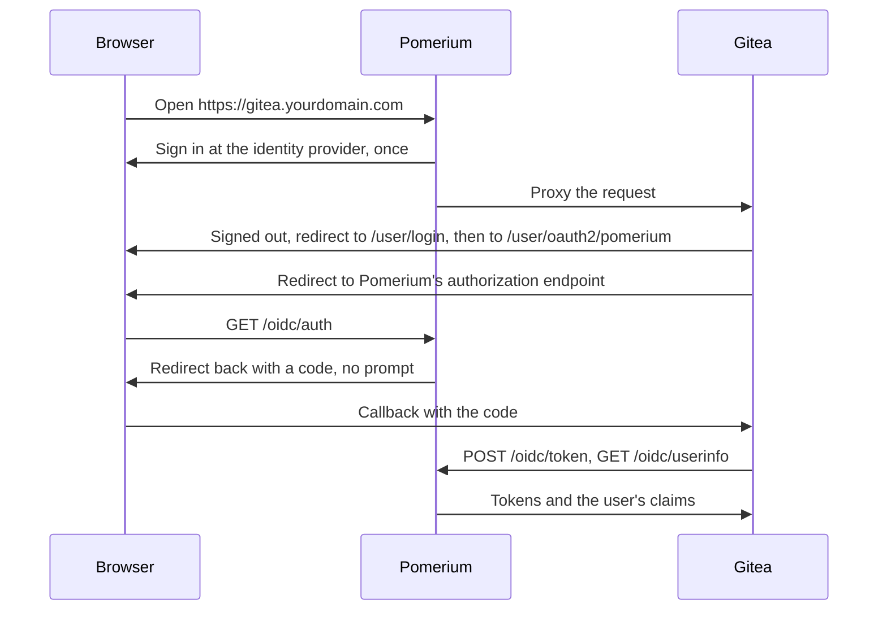
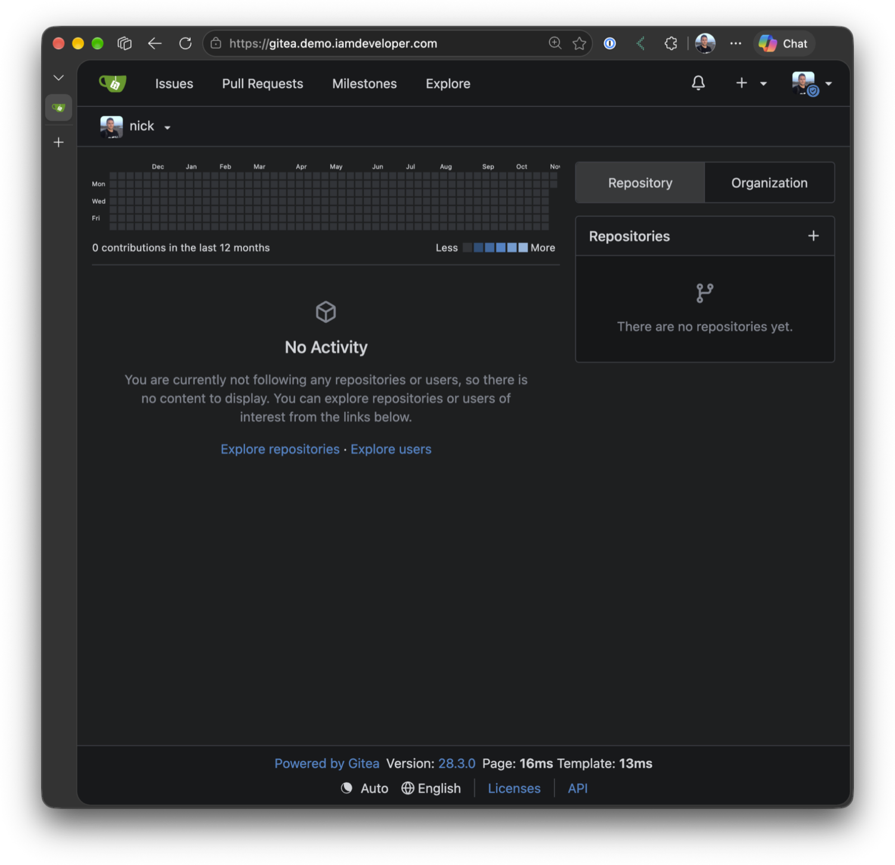
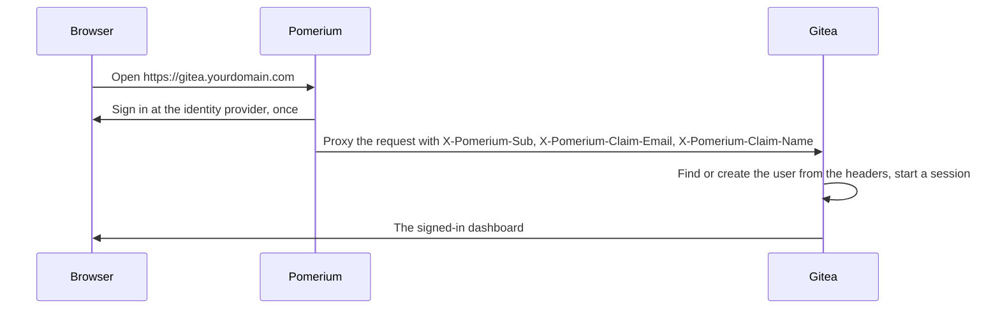
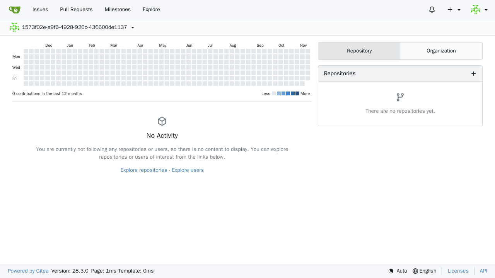
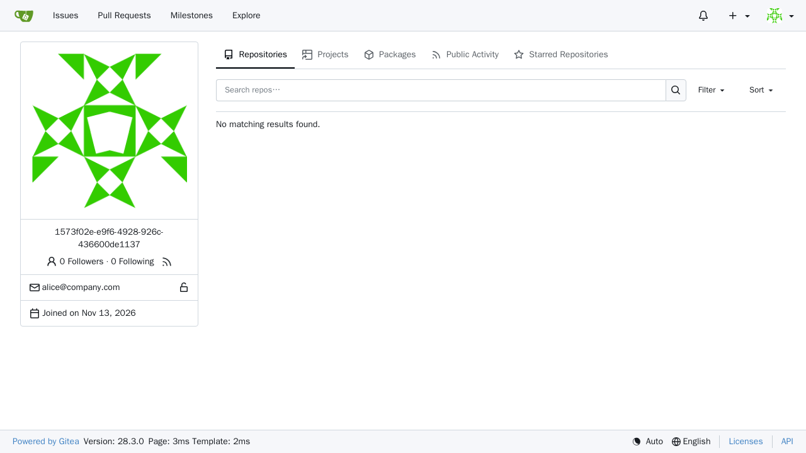

---
# cSpell:ignore automations forgejo gitea passkey passkeys WEBAUTH
title: Secure Gitea with Pomerium
sidebar_label: Gitea
image: ./img/gitea/gitea-dashboard.png
lang: en-US
keywords:
  [
    pomerium,
    gitea,
    forgejo,
    git,
    sso,
    oidc,
    oidc bridge,
    openid connect,
    proxy headers,
    reverse proxy authentication,
    identity aware proxy,
  ]
description: Put a Gitea instance behind Pomerium and sign users in once, either with Pomerium as Gitea's OpenID Connect provider through the OIDC bridge or with identity headers Pomerium forwards.
---

import CodeBlock from '@theme/CodeBlock';
import TabItem from '@theme/TabItem';
import Tabs from '@theme/Tabs';

import Config from '!!raw-loader!/content/examples/guides/gitea/config.yaml';
import Compose from '!!raw-loader!/content/examples/guides/gitea/docker-compose.yaml';
import ProxyHeadersConfig from '!!raw-loader!/content/examples/guides/gitea-proxy-headers/config.yaml';
import ProxyHeadersCompose from '!!raw-loader!/content/examples/guides/gitea-proxy-headers/docker-compose.yaml';

# Secure Gitea with Pomerium

Pomerium can sign users in to [Gitea](https://about.gitea.com/), a self-hosted Git service, so they never see a separate Gitea login.

There are two ways to secure Gitea with Pomerium: the OIDC bridge and proxy headers. The table below compares them, and each one has its own tab with the full setup.

|  | OIDC bridge | Proxy headers |
| :-- | :-- | :-- |
| Gitea login | Its [OpenID Connect (OIDC) login](https://docs.gitea.com/usage/authentication), with Pomerium as the OIDC provider | [Reverse-proxy authentication](https://docs.gitea.com/usage/authentication#reverse-proxy) from identity headers Pomerium forwards |
| What Gitea trusts | Tokens from Pomerium's OIDC endpoints, using the route's client secret | The identity headers, from any peer that can reach Gitea |
| Route settings | `oidc_bridge` with a `client_secret`, `preserve_host_header` | `pass_identity_headers`, `preserve_host_header`, plus global `jwt_claims_headers` |
| Authenticate service URL | Must be a domain you control | The default hosted URL works |
| First account | Becomes the administrator | Promoted from the Gitea container |

Use **OIDC bridge** if you control an authenticate service domain and want Gitea to verify tokens with Pomerium rather than trusting headers on the network; use **Proxy headers** if you want to stay on Pomerium's hosted authenticate URL and can strictly isolate Gitea on a private network.

Both setups turn off Gitea's own sign-in form, and Gitea creates each user's account the first time they sign in. Signing out of Gitea also signs you out of Pomerium. Only sign-in from a browser goes through Pomerium: Git over HTTP, API clients, and SSH keep using Gitea [access tokens](https://docs.gitea.com/development/api-usage) or SSH keys. This guide was tested with Gitea 28.3.0.

## Prerequisites

- You've completed the [Quickstart](/docs/get-started/quickstart), and Pomerium is running
- [Docker](https://docs.docker.com/install/) and [Docker Compose](https://docs.docker.com/compose/install/)
- A domain for the Gitea route (this guide uses `gitea.yourdomain.com`)
- For the OIDC bridge only: an authenticate service URL on a domain you control (this guide uses `authenticate.yourdomain.com`)

:::tip Prefer to self-host the identity provider?

This guide uses Pomerium's [hosted identity provider](/docs/capabilities/authentication#hosted-authenticate-service), so you don't have to run one. To run your own instead, follow [Keycloak + Pomerium](/docs/integrations/user-identity/oidc) and add its `idp_*` settings to `config.yaml`.

:::

<Tabs queryString="method">
<TabItem value="oidc-bridge" label="OIDC bridge" default>

Pomerium's [OIDC bridge](https://www.pomerium.com/docs/capabilities/oidc-bridge) makes Pomerium an OpenID Connect provider for Gitea's built-in OIDC login. Users sign in to Pomerium once, and Gitea finishes its own login without asking them to sign in again.



## Configure Pomerium {#oidc-bridge-configure-pomerium}

<Tabs queryString="type">
<TabItem value="zero" label="Pomerium Zero" default>

1. On the **Identity Provider** page of the [Zero Console](https://console.pomerium.app), set **Authenticate Service URL** to a domain you control, such as `https://authenticate.yourdomain.com`. Leave **Hosted Authenticate** selected.
1. Create a route. Set **From** to `https://gitea.<your-starter-domain>`, **To** to `http://gitea:3000`, and the policy to the users who should reach Gitea.
1. On the **Advanced** tab, turn on **OIDC Bridge** and enter an **OIDC Bridge Client Secret**. Generate one with `openssl rand -base64 32`. Gitea doesn't use Proof Key for Code Exchange (PKCE), so Pomerium needs this secret to know the token request really comes from Gitea.
1. On the **Headers** tab, set **Host Header** to **Preserve**.
1. On the **Timeouts** tab, set **Timeout** to `0s` and **Idle Timeout** to `600s`, so long Git pushes and clones aren't cut off. Then save.

The route's **From** URL also serves as the OIDC client ID. Wherever this guide shows `https://gitea.yourdomain.com`, use your **From** URL instead. That includes the `GITEA__server__ROOT_URL` setting and the `--key` value when you add the login source.

</TabItem>
<TabItem value="core" label="Pomerium Core">

Create a `config.yaml` file with the following contents. The comments in the file explain what each setting does.

<CodeBlock language="yaml" title="config.yaml">
  {Config}
</CodeBlock>

Replace the example domains and `you@example.com` with your own values. Generate `cookie_secret`, `shared_secret`, and the route's `client_secret` with the command shown in each setting's comment. Don't regenerate `cookie_secret` or `shared_secret` when Pomerium restarts, or every user has to sign in again.

</TabItem>
</Tabs>

## Configure and run Gitea {#oidc-bridge-run-the-stack}

Gitea runs in Docker Compose alongside Pomerium. The comments in the Compose file explain each Gitea setting.

<Tabs queryString="type">
<TabItem value="zero" label="Pomerium Zero" default>

The Quickstart's `compose.yaml` already runs Pomerium. From the following Compose file, copy only the `gitea` service and the `gitea-data` volume into it.

<CodeBlock language="yaml" title="docker-compose.yaml">
  {Compose}
</CodeBlock>

Then attach the `gitea` service to the Quickstart's `main` network, so Pomerium can reach it at `http://gitea:3000`:

```yaml
services:
  gitea:
    networks:
      - main
```

</TabItem>
<TabItem value="core" label="Pomerium Core">

The following Compose file runs Pomerium Core and Gitea together.

<CodeBlock language="yaml" title="docker-compose.yaml">
  {Compose}
</CodeBlock>

</TabItem>
</Tabs>

1. Start the stack:

   ```bash
   docker compose up -d
   ```

1. Add Pomerium to Gitea as a login source. Use the route's client secret as the `--secret` value:

   ```bash
   docker compose exec -u git gitea gitea admin auth add-oauth \
     --name pomerium \
     --provider openidConnect \
     --key https://gitea.yourdomain.com \
     --secret REPLACE_WITH_ROUTE_CLIENT_SECRET \
     --auto-discover-url https://authenticate.yourdomain.com/.well-known/openid-configuration
   ```

Keep `--name pomerium`, because Gitea builds the callback URL from it. The Gitea container also has to be able to resolve and reach `authenticate.yourdomain.com`, because Gitea fetches Pomerium's OIDC discovery document from there. If you prefer the UI, you can add the same login source in **Site Administration** > **Identity & Access** > **Authentication Sources**. Choose **OpenID Connect** as the provider and leave the additional scopes empty.

If you change `config.yaml` later, run `docker compose restart pomerium` to apply it. If you change the Compose file, run `docker compose up -d`.

:::caution Keep `ACCOUNT_LINKING: login` if you allow more than one email domain

Keep `ACCOUNT_LINKING: login` if your route policy allows more than one email domain. With `USERNAME: email`, Gitea uses the part of the email before the `@` as the username, so `sam@example.com` and `sam@example.org` both become `sam`. With `ACCOUNT_LINKING: auto`, Gitea links a sign-in to an existing account with the same username, so `sam@example.org` would be signed in to `sam@example.com`'s account. `login` blocks automatic linking and prompts for local sign-in instead, which fails because password sign-in is disabled.

:::

## Make yourself the administrator {#oidc-bridge-make-yourself-the-administrator}

Gitea makes the first account it creates an administrator. To make sure that's you, sign in through Pomerium before anyone else does, as described in [Verify the setup](#oidc-bridge-verify-the-setup).

If no one has administrator access anymore, you can promote a user from the Gitea container. Gitea's CLI can't promote an existing user, so the following command creates a temporary administrator, uses it to promote `your-username` through Gitea's API, and then deletes the temporary account and its token:

```bash
docker compose exec -u git gitea sh -c '
  gitea admin user create --admin --username recovery-tmp \
    --email recovery-tmp@gitea.invalid --random-password --must-change-password=false >/dev/null
  TOKEN=$(gitea admin user generate-access-token --username recovery-tmp \
    --token-name recovery --scopes write:admin --raw)
  curl -s -X PATCH -H "Authorization: token $TOKEN" -H "Content-Type: application/json" \
    -d "{\"admin\": true}" http://localhost:3000/api/v1/admin/users/your-username
  gitea admin user delete --username recovery-tmp'
```

Replace `your-username` with the account to promote. If it worked, the response includes `"is_admin":true`.

## Verify the setup {#oidc-bridge-verify-the-setup}

1. Open `https://gitea.yourdomain.com` in a private or incognito window. Pomerium asks you to sign in.
1. Sign in. You land on the Gitea dashboard without seeing Gitea's login page.
1. Open **Settings**. Your email comes from your identity provider. Your full name and avatar appear too, if your identity provider sends `name` and `picture` claims. If yours is the first account, **Site Administration** also appears in your menu.

   

1. Select **Sign out**, then select **Logout** on Pomerium's confirmation page. When you open Gitea again, Pomerium asks you to sign in.
1. Sign in as a user your policy excludes. Pomerium denies access before Gitea loads, so Gitea never creates an account for that user.

## Troubleshooting {#oidc-bridge-common-failure-modes}

| Symptom | Fix |
| :-- | :-- |
| Pomerium returns `403` | Replace `you@example.com` in the route policy with your users or domain. |
| Gitea's login page shows a **Sign in with pomerium** button | Set `ENABLE_PASSWORD_SIGNIN_FORM` and `ENABLE_PASSKEY_AUTHENTICATION` to `false`, and turn off OpenID sign-in and other login sources. |
| Sign-in stops at Gitea's home page with a **Sign in** link | Set `LANDING_PAGE` to `login`. |
| `add-oauth` fails with `Failed to initialize OpenID Connect Provider` | Make sure Pomerium is running and the Gitea container can resolve `authenticate.yourdomain.com`. |
| `404 Not Found` from the discovery URL or any `/oidc/` path | Point Gitea at your authenticate service URL, and set `authenticate_service_url` and `idp_provider` in Pomerium. |
| HTTP 400 at `/oidc/auth`: `unknown client_id` | Run `gitea admin auth update-oauth --id 1 --key https://gitea.yourdomain.com` with the route's `from` URL, then restart Gitea. |
| HTTP 400 at `/oidc/auth`: `redirect_uri ... does not match client_id ...` | Set `GITEA__server__ROOT_URL` to the route's `from` URL. |
| `ERR_TOO_MANY_REDIRECTS` after sign-in, `invalid_client` on the token request, or `oidc: token request invalid` in Pomerium's logs | Run `gitea admin auth update-oauth --id 1 --secret <route client_secret>` (find the ID with `gitea admin auth list`), then restart Gitea. CLI changes apply only after a restart. |
| Gitea shows a link-account or registration form | Your username or email clashes with an existing account. Register a username nobody has. If that name is taken too, the form returns with the original name and no error. |
| **Sign out** returns to the dashboard | Sign in through the OIDC login, and add the login source with `--auto-discover-url`. |
| The full name is blank | Have your identity provider send a `name` claim. With your own provider, add `profile` to `idp_scopes`. |
| The avatar is a generated pattern | Set `UPDATE_AVATAR` to `true`, and check that your identity provider sends `picture` and the Gitea container can reach the image URL. |
| `invalid_token` on Gitea's user info request | Set a fixed `shared_secret` and sign in again. |
| Sign-in fails on the username | Pick a `USERNAME` value whose claim is a valid Gitea username (letters, digits, `-`, `_`, `.`). |

## Security considerations {#oidc-bridge-security-considerations}

- **Keep the route policy tight.** Gitea creates an account for every user the policy allows, the first time they sign in, so the policy decides who gets a Gitea account.
- **Don't publish Gitea's port.** If users can reach `gitea:3000` directly, they skip Pomerium's policy checks. Only Pomerium should be able to reach it.
- **Keep the `client_secret` secret.** It's how Pomerium knows a token request really comes from Gitea. Anyone with the secret can redeem authorization codes for the route.
- **Don't auto-link accounts across email domains.** With `USERNAME: email`, `ACCOUNT_LINKING: auto` can sign one user in to another user's account, as the caution in [Configure and run Gitea](#oidc-bridge-run-the-stack) explains.
- **Sign-out is global.** Signing out of Gitea ends the Pomerium session for every route in that browser, and the identity provider session too.

## Next steps {#oidc-bridge-next-steps}

- [OIDC bridge](https://www.pomerium.com/docs/capabilities/oidc-bridge)
- [Authentication](/docs/capabilities/authentication)
- [Authorization](/docs/capabilities/authorization)

</TabItem>
<TabItem value="proxy-headers" label="Proxy headers">

Pomerium adds the user's `sub`, `email`, and `name` claims as headers to every request it forwards to Gitea. Gitea's reverse-proxy authentication reads those headers and signs the user in, creating the account on their first visit.



:::caution Gitea trusts the identity headers from any peer

Gitea can't verify Pomerium's signed JWT, so it believes whatever identity headers arrive with a request. Anyone who can reach Gitea without going through Pomerium can send their own headers and sign in as any user. Keep Gitea reachable only through Pomerium, and read the [Security considerations](#proxy-headers-security-considerations) before you deploy.

:::

## Configure Pomerium {#proxy-headers-configure-pomerium}

<Tabs queryString="type">
<TabItem value="zero" label="Pomerium Zero" default>

1. In the [Zero Console](https://console.pomerium.app), go to **Settings** > **Headers**. Under **JWT Claim Headers**, add `X-Pomerium-Sub` from `sub`, `X-Pomerium-Claim-Email` from `email`, and `X-Pomerium-Claim-Name` from `name`, then save. These apply to every route that passes identity headers.
1. Create a route. Set **From** to `https://gitea.<your-starter-domain>`, **To** to `http://gitea:3000`, and the policy to the users who should reach Gitea.
1. On the **Headers** tab, turn on **Pass Identity Headers** and set **Host Header** to **Preserve**.
1. On the **Timeouts** tab, set **Timeout** to `0s` and **Idle Timeout** to `600s`, so long Git pushes and clones aren't cut off. Then save.

Wherever this guide shows `https://gitea.yourdomain.com`, use your route's **From** URL instead. That includes the `GITEA__server__ROOT_URL` and `GITEA__security__REVERSE_PROXY_LOGOUT_REDIRECT` settings.

</TabItem>
<TabItem value="core" label="Pomerium Core">

Create a `config.yaml` file with the following contents. The comments in the file explain what each setting does.

<CodeBlock language="yaml" title="config.yaml">
  {ProxyHeadersConfig}
</CodeBlock>

Replace the example domain and `you@example.com` with your own values. Generate `cookie_secret` with the command shown in its comment. Don't regenerate it when Pomerium restarts, or every user has to sign in again.

</TabItem>
</Tabs>

## Configure and run Gitea {#proxy-headers-run-the-stack}

Gitea runs in Docker Compose on a private network that only Pomerium shares, so nothing else can reach it and send forged identity headers. Pomerium has a fixed address on that network, which Gitea uses to recognize it as the trusted proxy. The comments in the Compose file explain each Gitea setting.

<Tabs queryString="type">
<TabItem value="zero" label="Pomerium Zero" default>

The Quickstart's `compose.yaml` already runs Pomerium. From the following Compose file, copy only the `gitea` service, the `gitea-internal` network, and the `gitea-data` volume into it.

<CodeBlock language="yaml" title="docker-compose.yaml">
  {ProxyHeadersCompose}
</CodeBlock>

Then add the `gitea-internal` network to the `pomerium` service in the Quickstart's `compose.yaml`, at the fixed address:

```yaml
services:
  pomerium:
    networks:
      main:
        aliases:
          - verify.<CLUSTER_STARTER_SUBDOMAIN>.pomerium.app
      gitea-internal:
        ipv4_address: 172.31.0.2
```

</TabItem>
<TabItem value="core" label="Pomerium Core">

The following Compose file runs Pomerium Core and Gitea together.

<CodeBlock language="yaml" title="docker-compose.yaml">
  {ProxyHeadersCompose}
</CodeBlock>

</TabItem>
</Tabs>

Start the stack:

```bash
docker compose up -d
```

If you change `config.yaml` later, run `docker compose restart pomerium` to apply it. If you change the Compose file, run `docker compose up -d`.

## Make yourself the administrator {#proxy-headers-make-yourself-the-administrator}

Gitea doesn't make accounts it creates from headers into administrators, so you promote your own account from the Gitea container. If no one has administrator access later, the same steps get you back in.

1. Sign in through Pomerium once, so Gitea creates your account.
1. Find your username:

   ```bash
   docker compose exec -u git gitea gitea admin user list
   ```

1. Promote your account. Gitea's CLI can't promote an existing user, so the following command creates a temporary administrator, uses it to promote `your-username` through Gitea's API, and then deletes the temporary account and its token. Replace `your-username` with the username from the previous step:

   ```bash
   docker compose exec -u git gitea sh -c '
     gitea admin user create --admin --username recovery-tmp \
       --email recovery-tmp@gitea.invalid --random-password --must-change-password=false >/dev/null
     TOKEN=$(gitea admin user generate-access-token --username recovery-tmp \
       --token-name recovery --scopes write:admin --raw)
     curl -s -X PATCH -H "Authorization: token $TOKEN" -H "Content-Type: application/json" \
       -d "{\"admin\": true}" http://localhost:3000/api/v1/admin/users/your-username
     gitea admin user delete --username recovery-tmp'
   ```

   If it worked, the response includes `"is_admin":true`.

1. Reload Gitea. **Site Administration** now appears in your menu.

## Verify the setup {#proxy-headers-verify-the-setup}

1. Open `https://gitea.yourdomain.com` in a private or incognito window. Pomerium asks you to sign in.
1. Sign in. You land on the Gitea dashboard without entering a Gitea password.

   

1. Open your profile. Your username comes from the `sub` claim, and your email comes from your identity provider. Your full name appears only if your identity provider sends a `name` claim.

   

1. Select **Sign Out**. Pomerium ends its session without showing a confirmation page. When you open Gitea again, Pomerium asks you to sign in.
1. Sign in as a user your policy excludes. Pomerium denies access before Gitea loads, so Gitea never creates an account for that user.

## Troubleshooting {#proxy-headers-common-failure-modes}

| Symptom | Fix |
| :-- | :-- |
| Pomerium returns `403` | Replace `you@example.com` in the route policy with your users or domain. |
| You reach Gitea but aren't signed in | Turn on `pass_identity_headers`, and make the header names in `jwt_claims_headers` and `REVERSE_PROXY_AUTHENTICATION_*` match exactly. |
| Sign-in fails on the username | Forward a claim that's already a valid Gitea username, such as `sub`, as `X-Pomerium-Sub`. |
| **Site Administration** is missing from your menu | Promote your account as in [Make yourself the administrator](#proxy-headers-make-yourself-the-administrator). |
| **Sign Out** signs you straight back in | Set `REVERSE_PROXY_LOGOUT_REDIRECT` to `https://gitea.yourdomain.com/.pomerium/sign_out`. |
| **Site Administration** warns that the detected URL `https://gitea:3000/` is unlikely to match `ROOT_URL` | Set `preserve_host_header: true`, or **Host Header** to **Preserve** in Zero. |
| A direct request to Gitea signs in | Expected. Keep Gitea reachable only through Pomerium. |

## Security considerations {#proxy-headers-security-considerations}

- **Don't publish Gitea's port.** When a request goes through Pomerium, Pomerium replaces any identity headers the client sent with the signed-in user's claims. A request that reaches Gitea directly skips that step, so it can claim to be anyone. To check that only Pomerium and Gitea are on the private network, run `docker network inspect gitea-pomerium --format '{{range .Containers}}{{.Name}} {{end}}'`.
- **In Kubernetes, a `ClusterIP` service isn't enough.** Any pod in the cluster can reach a `ClusterIP` service. Use a `NetworkPolicy` with a Container Network Interface (CNI) plugin that enforces it, or another network control, so only Pomerium can reach Gitea.
- **`REVERSE_PROXY_TRUSTED_PROXIES` doesn't protect you.** Gitea uses it only to read the client's IP address from `X-Forwarded-For` for its logs. It doesn't stop other peers from sending identity headers.
- **Keep the route policy tight.** The policy is what decides who gets in, and Gitea creates an account for every user it allows on their first visit.
- **Sign-out is global.** Signing out of Gitea ends the Pomerium session for every route in that browser.

## Next steps {#proxy-headers-next-steps}

- [JWT claim headers](/docs/reference/jwt-claim-headers)
- [Pass identity headers](/docs/reference/routes/pass-identity-headers-per-route)
- [Authorization](/docs/capabilities/authorization)

</TabItem>
</Tabs>

## Stop, reset, or upgrade

Run `docker compose down` to stop the stack. Add `-v` to also delete the `pomerium-cache` and `gitea-data` volumes, including all Gitea repositories and accounts. To upgrade, update the pinned image tags and digests in the Compose file, then run `docker compose pull` and `docker compose up -d`.
