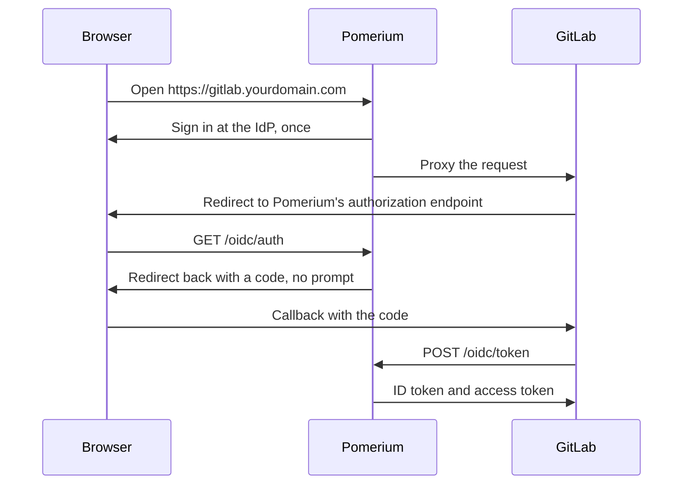
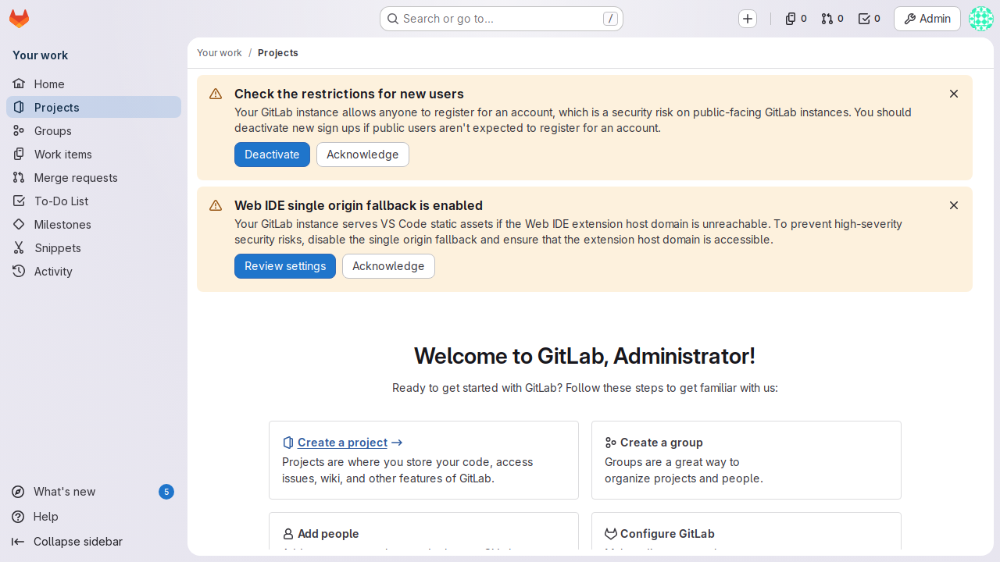

---
# cSpell:ignore omniauth pkce
title: Secure GitLab with Pomerium
sidebar_label: GitLab
lang: en-US
image: ./img/gitlab/gitlab-dashboard.png
keywords:
  [
    pomerium,
    gitlab,
    sso,
    oidc,
    oidc bridge,
    openid connect,
    omniauth,
    identity aware proxy,
    self-hosted,
  ]
description: Add single sign-on and per-route authorization to self-hosted GitLab by having Pomerium act as GitLab's OpenID Connect provider through the OIDC bridge.
---

import CodeBlock from '@theme/CodeBlock';
import TabItem from '@theme/TabItem';
import Tabs from '@theme/Tabs';

import Config from '!!raw-loader!/content/examples/guides/gitlab/config.yaml';
import Compose from '!!raw-loader!/content/examples/guides/gitlab/docker-compose.yaml';

# Secure GitLab with Pomerium

## What this guide does

Put a self-hosted [GitLab](https://gitlab.com/) instance behind Pomerium to gate it with SSO and route policy. GitLab keeps its standard OpenID Connect (OIDC) login through its OmniAuth `openid_connect` provider, and Pomerium is the OIDC provider. Users sign in once through Pomerium, and GitLab completes its own login without a second prompt.



## When to use this guide

Use it when you run self-hosted GitLab and want one front door with your existing identity, while GitLab keeps its own accounts, projects, and permissions. It uses GitLab's generic OpenID Connect login, which works with Pomerium's [OIDC bridge](https://www.pomerium.com/docs/capabilities/oidc-bridge). If you only need to reach GitLab over a private network without browser SSO (for example, plain Git over SSH), a [TCP route](/docs/capabilities/non-http) is a better fit.

## Prerequisites

This guide assumes you've completed the [Quickstart](/docs/get-started/quickstart), so you already have Pomerium running and signing users in through the hosted authenticate service.

You also need:

- [Docker](https://docs.docker.com/install/) and [Docker Compose](https://docs.docker.com/compose/install/)
- Pomerium Zero or Pomerium Core, with the authenticate service URL set to a domain you control (this guide uses `authenticate.yourdomain.com`). The OIDC bridge isn't served from Pomerium's default hosted authenticate URL. You can still use the hosted identity provider behind your own URL.
- An identity provider. This guide uses Pomerium's [hosted identity provider](/docs/capabilities/authentication#hosted-authenticate-service) (`idp_provider: hosted`), which signs users in with email and password, Google, or GitHub.
- A domain you control for the GitLab route (this guide uses `gitlab.yourdomain.com`)

:::tip Prefer to self-host the identity provider?

This guide uses the hosted authenticate service so you don't have to run an identity provider (IdP). To run your own instead, follow [Keycloak + Pomerium](/docs/integrations/user-identity/oidc) and swap the `authenticate_service_url` / `idp_*` settings into the config below.

:::

:::caution Don't use GitLab as both your IdP and a protected service

Pomerium can use self-hosted GitLab [as an identity provider](/docs/integrations/user-identity/gitlab), but do not do that while also running GitLab behind Pomerium. You risk locking yourself out of every route if the IdP becomes unreachable, and it's best practice to keep your identity provider separate from the services it protects, especially one holding source code.

:::

## Configure Pomerium

<Tabs queryString="type">
<TabItem value="zero" label="Pomerium Zero" default>

In the [Zero Console](https://console.pomerium.app), create a **Route** for `gitlab.<your-starter-domain>`:

- In **From**, enter `https://gitlab.<your-starter-domain>`; in **To**, enter `http://gitlab:80`.
- Set the policy to the user or domain that should reach GitLab.
- On the **Advanced** tab, under **OIDC Bridge**, turn on **Enabled**. GitLab uses PKCE, so leave **OIDC Bridge Client Secret** empty.
- On the **Headers** tab, set **Host Header** to **Preserve**, so GitLab's redirects stay correct.

Zero manages the token-signing secret for you, so there's no `shared_secret` to set. Before you create the routes, open the **Identity Provider** page in the Zero Console, set **Authenticate Service URL** to a domain you control (this guide uses `https://authenticate.yourdomain.com`), and leave **Hosted Authenticate** selected. The OIDC bridge isn't served from Pomerium's default hosted authenticate URL.

Your OIDC discovery URL is your authenticate service URL plus `/.well-known/openid-configuration`.

</TabItem>
<TabItem value="core" label="Pomerium Core">

Create a `config.yaml`. It routes `gitlab.yourdomain.com` to the GitLab container, preserves the host header so GitLab's redirects stay correct, enables the OIDC bridge on that route, and sets the `shared_secret` that Pomerium uses to sign and encrypt the tokens it issues.

<CodeBlock language="yaml" title="config.yaml">
  {Config}
</CodeBlock>

Replace `gitlab.yourdomain.com` with your domain, `you@example.com` with the email (or switch to a group or domain match) that should be allowed through, and generate your own `shared_secret` with the command in the comment. The route's `from` URL is the OIDC client ID that GitLab uses, so it must match `identifier` in the next section. Keep `shared_secret` the same across restarts. If it changes, Pomerium can't read tokens it issued earlier, and users have to sign in again.

</TabItem>
</Tabs>

## Configure GitLab

GitLab's Omnibus configuration needs its public URL, plain HTTP on the internal Docker network (Pomerium terminates TLS), and an OmniAuth `openid_connect` provider that points at Pomerium. The key settings are in the `GITLAB_OMNIBUS_CONFIG` of the `gitlab` service in the Compose file below:

- `external_url 'https://gitlab.yourdomain.com'` — GitLab generates links and redirects from this value, so it must match the public route host, not the container name.
- `nginx['listen_port'] = 80` and `nginx['listen_https'] = false` — GitLab listens on plain HTTP inside the network; Pomerium handles HTTPS for users.
- `letsencrypt['enable'] = false` — Pomerium, not GitLab, manages the public certificate.
- `issuer` — your `authenticate_service_url`, exactly as set in `config.yaml`. With `discovery: true`, GitLab finds the authorization, token, and user info endpoints from `/.well-known/openid-configuration` on that URL.
- `client_options.identifier` — the route's `from` URL.
- `client_options.redirect_uri` — `https://gitlab.yourdomain.com/users/auth/openid_connect/callback`. It must be on the same host as the client ID.
- `pkce: true` — GitLab uses Proof Key for Code Exchange, so the route needs no client secret. GitLab still requires a `secret` value, and the bridge ignores it for a route without a `client_secret`.
- `client_auth_method: 'query'` — GitLab sends the client ID in the token request body. GitLab's default, HTTP Basic, is the other method the bridge accepts.
- `scope` and `response_type: 'code'` — the bridge supports only the authorization code flow.

### How users are provisioned

This guide lets Pomerium's route policy decide who gets in, and has GitLab create an account for each person on their first sign-in:

- `omniauth_allow_single_sign_on = ['openid_connect']` creates a GitLab account the first time someone signs in through Pomerium. Without it, a person would need an existing GitLab account that they link to the provider themselves.
- `omniauth_block_auto_created_users = false` activates those accounts right away. GitLab's default, `true`, leaves each new account pending until an administrator approves it. GitLab warns that `false` is only safe when you control who can sign in through the provider. Here your route policy does that, so keep it tight. If you'd rather approve each person by hand, remove this line.
- `omniauth_auto_sign_in_with_provider = 'openid_connect'` redirects GitLab's sign-in page straight to Pomerium, so users never see GitLab's own login form.

If someone already has a GitLab account with the same email, GitLab by default guides them through linking it to the provider by signing in with their existing credentials. GitLab's [OmniAuth documentation](https://docs.gitlab.com/integration/omniauth/) also describes `omniauth_auto_link_user`, which links on an email match alone. This guide doesn't enable it, because that trusts the identity provider's email claim.

### The root account and the first admin

GitLab's built-in `root` administrator still exists, and this guide keeps it as a break-glass account. Pomerium-created accounts are regular users, so nobody gets administrator rights from signing in. To get an admin who signs in through Pomerium:

1. Get the initial `root` password, which GitLab writes to a file inside the container:

   ```bash
   docker compose exec gitlab grep 'Password:' /etc/gitlab/initial_root_password
   ```

2. Open `https://gitlab.yourdomain.com/users/sign_in?auto_sign_in=false`. Pomerium still asks you to sign in first. The query string skips GitLab's automatic redirect and shows its local login form. Sign in as `root`.
3. Have the person who should be an administrator sign in once through Pomerium so their account exists. Then, as `root`, open the **Admin** area, find their user, and make them an administrator.

GitLab's documentation advises making sure at least one OmniAuth user is an administrator when automatic sign-in is on, because local credentials are bypassed. Once you have one, store the `root` password somewhere safe for break-glass use. Don't delete the account.

GitLab deletes the `initial_root_password` file on the first container restart after 24 hours, so save the password or set a new one from `root`'s profile.

### How GitLab reaches Pomerium

GitLab calls the authenticate service from the server side for discovery and the token exchange, not only from the browser. In the Compose file, Pomerium carries the `authenticate.yourdomain.com` alias on the Compose network, so the `gitlab` container reaches Pomerium directly and the certificate for that name still validates. If GitLab runs somewhere that can already reach your authenticate service, you don't need the alias.

## Run the stack

The Compose file runs Pomerium Core and GitLab together. For Zero, drop the `pomerium` service and use the `compose.yaml` from the Quickstart with your `POMERIUM_ZERO_TOKEN`, keeping the other services and their networks below. For Core, place the `config.yaml` from the previous step next to this `docker-compose.yaml`, then start the stack:

<CodeBlock language="yaml" title="docker-compose.yaml">
  {Compose}
</CodeBlock>

```bash
docker compose up -d
```

GitLab is heavy and slow to initialize. The container can take several minutes before it answers requests; watch `docker compose ps` until its status changes from `health: starting` to `healthy`, or follow `docker compose logs -f gitlab`. If you change `config.yaml` later, run `docker compose up -d` again to apply it.

## Verify the setup

1. **The route requires authentication.** In a fresh browser, open `https://gitlab.yourdomain.com`. You should be redirected to Pomerium to sign in, not straight to GitLab.
2. **The OIDC login completes without a prompt.** After you sign in with an allowed user, GitLab redirects through Pomerium and lands you signed in on its dashboard. You never see a GitLab login form.



3. **GitLab created your account.** Open your profile and confirm your email matches the identity provider's email for that user.
4. **A disallowed user is blocked.** Sign in as a user your policy excludes and open `https://gitlab.yourdomain.com`. Pomerium denies access before GitLab loads.

## Common failure modes

| Symptom | Cause and fix |
| :-- | :-- |
| `404 Not Found` from the `/oidc/` paths or discovery | GitLab is pointing at the wrong host. Check that `authenticate_service_url` is set and that `issuer` uses the same URL. |
| HTTP 400 at `/oidc/auth`: `redirect_uri ... does not match client_id ...` | `identifier` doesn't match the route's `from` URL, or `redirect_uri` is on a different host. |
| Token request fails with `invalid_client` or `invalid_request` | GitLab authenticated with HTTP Basic and left the client ID out of the request body. Keep `client_auth_method: 'query'`. The Pomerium log line `oidc: token request invalid` says which check failed. |
| Token request fails with `unsupported_grant_type` | GitLab asked for something other than `authorization_code`. The bridge doesn't issue refresh tokens. |
| GitLab can't reach the discovery URL, or fails with a TLS or connection error | The `gitlab` container has no route to your authenticate service. Add the `authenticate.yourdomain.com` alias to Pomerium on GitLab's network, or put GitLab on a network that can reach it. |
| Sign-in loops, or `issuer` mismatch | `issuer` differs from the issuer in Pomerium's discovery document. Set it to your `authenticate_service_url` exactly, with no extra trailing slash. |
| GitLab says the account is pending approval | `omniauth_block_auto_created_users` is `true`. An administrator must approve the account, or set it to `false`. |
| Sign-in fails after a GitLab config change | GitLab reads `GITLAB_OMNIBUS_CONFIG` when the container starts and reconfigures. Recreate the container with `docker compose up -d` and wait until it's healthy. |
| You can't reach GitLab's local login | Automatic sign-in is on. Use `/users/sign_in?auto_sign_in=false`. |
| `invalid_token` on GitLab's user info request | The access token was issued before Pomerium restarted without a fixed `shared_secret`. Set `shared_secret` and sign in again. |
| Redirects send you to the container name or the wrong host | GitLab's `external_url` doesn't match the public route, or `preserve_host_header` isn't set. Make both agree on `gitlab.yourdomain.com`. |
| `502` or `503` right after `docker compose up` | GitLab hasn't finished booting. Wait for the container to report `healthy`; first boot routinely takes several minutes and a couple of GB of RAM. |
| Mixed-content or TLS errors | Make sure GitLab serves plain HTTP internally (`nginx['listen_https'] = false`) and that Pomerium is the only service terminating TLS for the public hostname. |

## Security considerations

- **Keep the route protected.** The bridge handles login only. Route policy decides who can reach GitLab, and Pomerium checks it on every request. A public route would let anyone who can sign in to Pomerium get a GitLab account.
- **Only Pomerium should reach GitLab.** Keep `gitlab:80` off published ports and on the internal Docker network, so Pomerium is the only way in and the policy can't be bypassed.
- **Pomerium issues the tokens.** GitLab gets its ID and access tokens from Pomerium, not directly from your identity provider.
- **No refresh tokens.** When the Pomerium session expires, the next request sends the user back to Pomerium to sign in.
- **PKCE means no client secret.** If you later use an app that can't do PKCE, the bridge supports a `client_secret` on that route. Keep it secret.
- **Account creation follows the policy.** `omniauth_allow_single_sign_on` and `omniauth_block_auto_created_users = false` create an active GitLab account for every user your policy allows. Scope the policy (group or domain) to who should have any access to GitLab at all, and manage GitLab project permissions separately.
- **Protect the `root` account.** It's a local password login that doesn't go through Pomerium's identity. Keep its password in a secrets manager.
- **Claims are strings.** Every claim Pomerium issues is a string, so a `groups` claim arrives as a comma-separated string such as `"a,b"`. GitLab doesn't read groups from this login in this guide.
- Do not point Pomerium's identity provider at this same GitLab instance. Keeping the IdP separate avoids a circular dependency that can lock you out of every route at once.

## Next steps

- [OIDC bridge](https://www.pomerium.com/docs/capabilities/oidc-bridge)
- [Authentication](/docs/capabilities/authentication)
- [Custom domains](/docs/capabilities/custom-domains)
