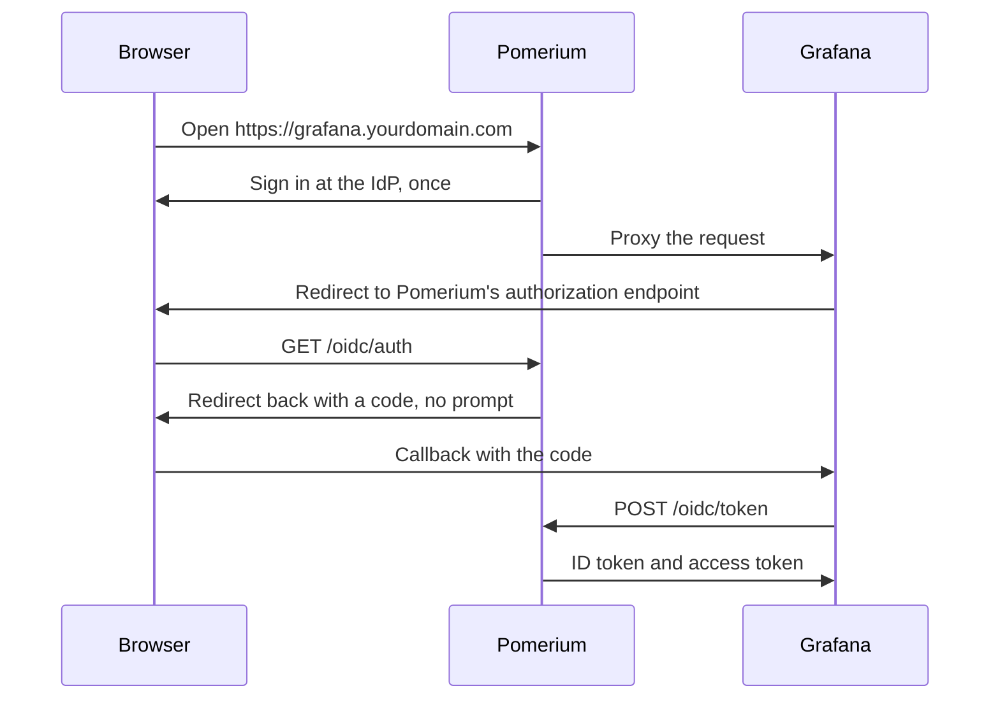

import CodeBlock from '@theme/CodeBlock';

import Config from '!!raw-loader!/content/examples/guides/grafana/config.yaml';
import Compose from '!!raw-loader!/content/examples/guides/grafana/docker-compose.yaml';

# Secure Grafana with Pomerium

## What this guide does

Put Grafana behind Pomerium to gate it with SSO and route policy. Grafana keeps its standard OpenID Connect (OIDC) login, and Pomerium is the OIDC provider. Users sign in once through Pomerium, and Grafana completes its login without a second prompt.



## When to use this guide

Use it when you want one front door for Grafana with your existing identity, and Grafana should keep its own OIDC login. It uses Grafana's generic OAuth login, which works with Pomerium's [OIDC bridge](/docs/capabilities/oidc-bridge). If you only need to reach Grafana over a private network without browser SSO, a plain [TCP route](/docs/capabilities/non-http) is a better fit.

## Prerequisites

- [Docker](https://docs.docker.com/install/) and [Docker Compose](https://docs.docker.com/compose/install/)
- Pomerium Core with a self-hosted authenticate service on a domain you control (this guide uses `authenticate.yourdomain.com`). The OIDC bridge isn't available on the hosted authenticate service.
- An OpenID Connect identity provider. This guide uses [Keycloak](/docs/integrations/user-identity/oidc) as the example.
- A domain you control for the Grafana route (this guide uses `grafana.yourdomain.com`)

:::tip Need an identity provider?

Follow [Keycloak + Pomerium](/docs/integrations/user-identity/oidc) to set one up, then fill in the `idp_*` settings in `config.yaml` with your client ID and secret.

:::

## Configure Pomerium

Create a `config.yaml`. It routes `grafana.yourdomain.com` to the Grafana container, enables the OIDC bridge on that route, and sets the `shared_secret` that Pomerium uses to sign and encrypt the tokens it issues.

<CodeBlock language="yaml" title="config.yaml">
  {Config}
</CodeBlock>

Replace `grafana.yourdomain.com` with your domain, `you@example.com` with your email, and generate your own `shared_secret` with the command in the comment. The route's `from` URL is the OIDC client ID that Grafana uses, so it must match `GF_AUTH_GENERIC_OAUTH_CLIENT_ID` in the next section. Keep `shared_secret` the same across restarts. If it changes, Pomerium can't read tokens it issued earlier, and users have to sign in again.

## Configure Grafana

Grafana's generic OAuth login talks to Pomerium's OIDC endpoints. The key settings are in the `grafana` service of the Compose file below:

- `GF_SERVER_ROOT_URL` — Grafana's public URL. Grafana builds its callback from it: `https://grafana.yourdomain.com/login/generic_oauth`.
- `GF_AUTH_GENERIC_OAUTH_CLIENT_ID` — the route's `from` URL.
- `GF_AUTH_GENERIC_OAUTH_USE_PKCE=true` — Grafana uses PKCE, so no client secret is needed.
- `GF_AUTH_GENERIC_OAUTH_AUTH_URL`, `_TOKEN_URL`, and `_API_URL` — the `/oidc/auth`, `/oidc/token`, and `/oidc/userinfo` endpoints on your authenticate service.
- `GF_AUTH_GENERIC_OAUTH_EMAIL_ATTRIBUTE_PATH` and `_LOGIN_ATTRIBUTE_PATH=email` — which claim becomes the Grafana account.
- `GF_AUTH_GENERIC_OAUTH_ALLOW_SIGN_UP=true` — create the Grafana user on first sign-in.
- `GF_AUTH_GENERIC_OAUTH_AUTO_LOGIN=true` and `GF_AUTH_DISABLE_LOGIN_FORM=true` — skip Grafana's login page and start the OIDC login right away, so users never see a Grafana sign-in button or password form.
- `GF_AUTH_SIGNOUT_REDIRECT_URL` — Pomerium's sign-out URL on the Grafana route, `https://grafana.yourdomain.com/.pomerium/sign_out`. Grafana's own sign-out only clears the Grafana session. With auto-login on, Grafana would sign the user straight back in through the bridge, so sign-out has to end the Pomerium session too.
- `GF_AUTH_GENERIC_OAUTH_ROLE_ATTRIBUTE_PATH` — optional role mapping. Pomerium's user info endpoint returns the `groups` claim from your identity provider: an array for users in several groups, or a single string for users in one group. `contains()` handles both. It only works if your identity provider sends a `groups` claim.

## Run the stack

The Compose file runs Pomerium and Grafana together. Place the `config.yaml` from the previous step next to this `docker-compose.yaml`, then start the stack:

<CodeBlock language="yaml" title="docker-compose.yaml">
  {Compose}
</CodeBlock>

```bash
docker compose up -d
```

If you change `config.yaml` later, run `docker compose up -d` again to apply it.

## Verify the setup

1. **The route requires authentication.** In a fresh browser, open `https://grafana.yourdomain.com`. You should be redirected to Pomerium to sign in.
2. **The OIDC login completes without a prompt.** After you sign in, Grafana signs you in on its own, with no Grafana login page or second prompt. Open `/profile` and confirm your email and name show.
3. **Sign-out ends the session.** Sign out from Grafana's profile menu. You land on Pomerium's signed-out page. Opening `https://grafana.yourdomain.com` again sends you to your identity provider to sign in.
4. **A disallowed user is blocked.** Sign in as a user your policy excludes and open `https://grafana.yourdomain.com`. Pomerium denies access before Grafana loads.

## Common failure modes

| Symptom | Cause and fix |
| :-- | :-- |
| `404 Not Found` from Grafana's OAuth URLs or the `/oidc/` paths | Grafana is pointing at the wrong host. Check that `authenticate_service_url` is set and that the `GF_AUTH_GENERIC_OAUTH_*_URL` values use the same host. |
| HTTP 400 at `/oidc/auth`: `redirect_uri ... does not match client_id ...` | `GF_AUTH_GENERIC_OAUTH_CLIENT_ID` doesn't match the route's `from` URL, or `GF_SERVER_ROOT_URL` isn't the Grafana URL. |
| Token request fails with `invalid_client` | The Grafana OAuth client authenticates with HTTP Basic and leaves `client_id` out of the request body. Set `GF_AUTH_GENERIC_OAUTH_AUTH_STYLE` so the credentials are sent in the body, and check the option's value in your Grafana version's docs. |
| Grafana shows its login page or a **Sign in with Pomerium** button | `GF_AUTH_GENERIC_OAUTH_AUTO_LOGIN` isn't set. Set it to `true`, and set `GF_AUTH_DISABLE_LOGIN_FORM=true` so Pomerium is the only login option. |
| Signing out of Grafana signs you straight back in | `GF_AUTH_SIGNOUT_REDIRECT_URL` isn't set, so only the Grafana session ends and auto-login starts a new one. Set it to `https://grafana.yourdomain.com/.pomerium/sign_out`. |
| Sign-in fails for users who already had a Grafana account | Grafana won't link an OAuth login to an existing account by email unless you allow it. If those accounts use the same email as your identity provider, set `GF_AUTH_OAUTH_ALLOW_INSECURE_EMAIL_LOOKUP=true`. Only do this if your identity provider verifies email addresses. |
| Grafana logs `Error retrieving access token payload ... token is not in JWT format` | Expected. The bridge's access token isn't a JWT, so Grafana reads the user's claims from the user info endpoint instead. Sign-in still works. |
| Everyone is a Viewer | The `groups` claim is missing from the identity provider's tokens, or the expression doesn't match the group names. Confirm your identity provider sends `groups` and that the names match exactly. |
| `invalid_token` on Grafana's user info request | The access token was issued before Pomerium restarted without a fixed `shared_secret`. Set `shared_secret` and sign in again. |

## Security considerations

- **Keep the route protected.** The bridge handles login only. Route policy decides who can reach Grafana, and Pomerium checks it on every request. A public route would let anyone who can sign in to Pomerium get a Grafana account.
- **Only Pomerium should reach Grafana.** Keep `grafana:3000` off published ports and on the internal Docker network, so Pomerium is the only way in.
- **Pomerium issues the tokens.** Grafana gets its ID and access tokens from Pomerium, not directly from your identity provider.
- **No refresh tokens.** When the Pomerium session expires, the next request sends the user back to Pomerium to sign in.
- **PKCE means no client secret.** If you later use an app that can't do PKCE, the bridge supports a `client_secret` on that route. Keep it secret.
- **Account creation follows the policy.** `GF_AUTH_GENERIC_OAUTH_ALLOW_SIGN_UP=true` creates a Grafana account for every user your policy allows. Manage Grafana org roles separately, or use the role mapping above.

## Next steps

- [OIDC bridge](/docs/capabilities/oidc-bridge)
- [Authentication](/docs/capabilities/authentication)
- [Custom domains](/docs/capabilities/custom-domains)
