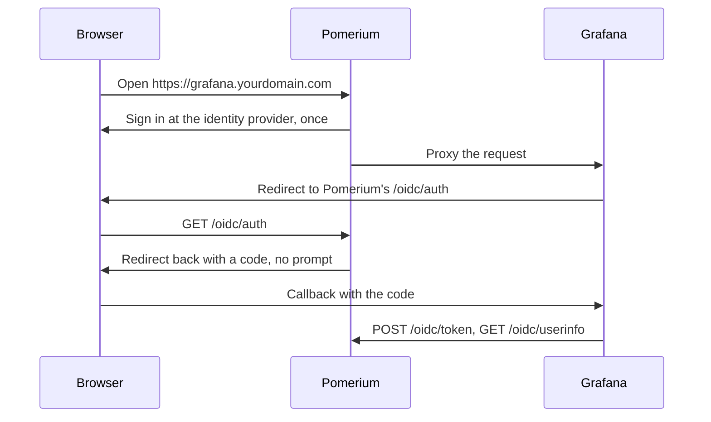
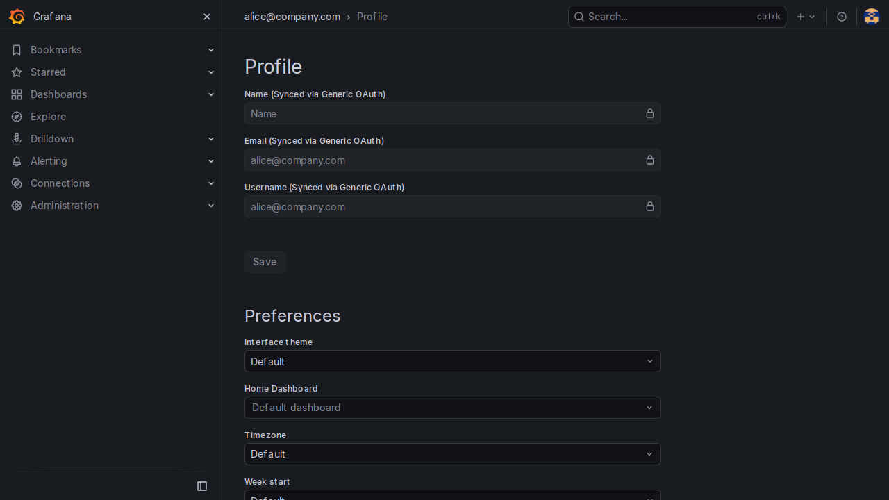
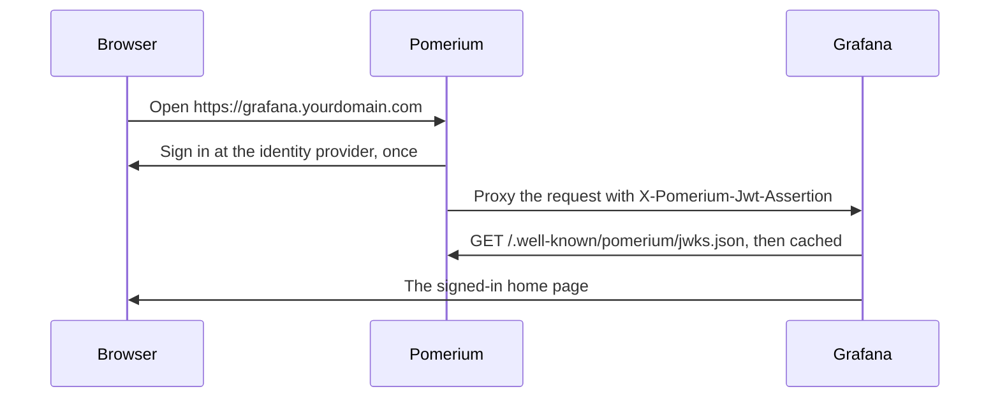
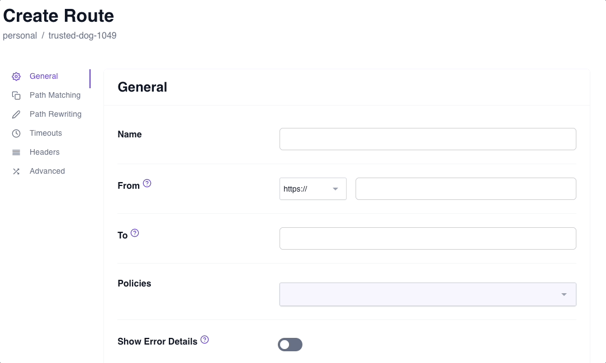
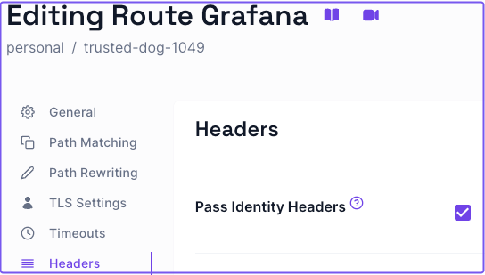
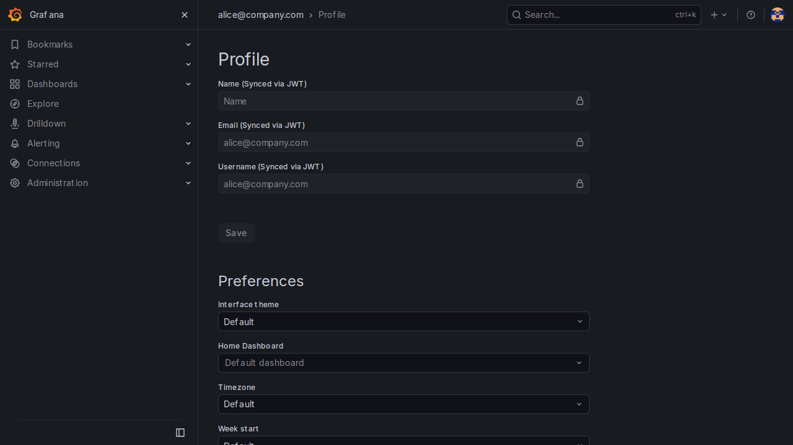

---
# cSpell:ignore automations
title: Secure Grafana with Pomerium
sidebar_label: Grafana
lang: en-US
image: ./img/grafana/grafana-profile.png
keywords:
  [
    pomerium,
    identity access proxy,
    grafana,
    sso,
    oidc,
    oidc bridge,
    openid connect,
    jwt,
    proxy headers,
    authentication,
    authorization,
  ]
description: Put Grafana behind Pomerium and sign users in once, either with Pomerium as Grafana's OpenID Connect provider through the OIDC bridge or with the signed identity JWT Pomerium forwards.
---

import CodeBlock from '@theme/CodeBlock';
import TabItem from '@theme/TabItem';
import Tabs from '@theme/Tabs';

import Config from '!!raw-loader!/content/examples/guides/grafana/config.yaml';
import Compose from '!!raw-loader!/content/examples/guides/grafana/docker-compose.yaml';
import ProxyHeadersConfig from '!!raw-loader!/content/examples/guides/grafana-proxy-headers/config.yaml';
import ProxyHeadersCompose from '!!raw-loader!/content/examples/guides/grafana-proxy-headers/docker-compose.yaml';

# Secure Grafana with Pomerium

Pomerium can sign users in to [Grafana](https://grafana.com/oss/grafana/), so they never see a separate Grafana login.

There are two ways to secure Grafana with Pomerium: the OIDC bridge and proxy headers. The table below compares them, and each one has its own tab with the full setup.

|  | OIDC bridge | Proxy headers |
| :-- | :-- | :-- |
| Grafana login | [Generic OAuth](https://grafana.com/docs/grafana/latest/setup-grafana/configure-access/configure-authentication/generic-oauth/), with Pomerium as the OpenID Connect (OIDC) provider | [JWT authentication](https://grafana.com/docs/grafana/latest/setup-grafana/configure-access/configure-authentication/jwt/) from the `X-Pomerium-Jwt-Assertion` header |
| What Grafana trusts | Tokens from Pomerium's OIDC endpoints, using Proof Key for Code Exchange (PKCE) | The signed JSON Web Token (JWT) in `X-Pomerium-Jwt-Assertion`, verified against Pomerium's JSON Web Key Set (JWKS) |
| Authenticate service URL | Must be a domain you control | The default hosted URL works |
| Route settings | `oidc_bridge`, `preserve_host_header`, `allow_websockets` | `pass_identity_headers`, `allow_websockets` |

Use **OIDC bridge** for standard OpenID Connect sign-in when you control an authenticate service domain; use **Proxy headers** if you want to stay on Pomerium's hosted authenticate URL while still having Grafana verify Pomerium's signed JWT.

Both setups turn off Grafana's login form and basic auth, and signing out of Grafana also signs you out of Pomerium. Scripts and other API clients should use Grafana [service account tokens](https://grafana.com/docs/grafana/latest/administration/service-accounts/) instead of a user login. This guide was tested with Grafana 13.3.1.

## Prerequisites

- You've completed the [Quickstart](/docs/get-started/quickstart), and Pomerium is running
- [Docker](https://docs.docker.com/install/) and [Docker Compose](https://docs.docker.com/compose/install/)
- A domain for the Grafana route (this guide uses `grafana.yourdomain.com`)
- For the OIDC bridge only: an authenticate service URL on a domain you control (this guide uses `authenticate.yourdomain.com`)

:::tip Prefer to self-host the identity provider?

This guide uses Pomerium's [hosted identity provider](/docs/capabilities/authentication#hosted-authenticate-service), so you don't have to run one. To run your own instead, follow [Keycloak + Pomerium](/docs/integrations/user-identity/oidc) and add its `idp_*` settings to `config.yaml`.

:::

<Tabs queryString="method">
<TabItem value="oidc-bridge" label="OIDC bridge" default>

Pomerium's [OIDC bridge](https://www.pomerium.com/docs/capabilities/oidc-bridge) makes Pomerium an OpenID Connect provider for Grafana's built-in generic OAuth login. Users sign in to Pomerium once, and Grafana finishes its own login without asking them to sign in again.



## Configure Pomerium {#oidc-bridge-configure-pomerium}

<Tabs queryString="type">
<TabItem value="zero" label="Pomerium Zero" default>

1. On the **Identity Provider** page of the [Zero Console](https://console.pomerium.app), set **Authenticate Service URL** to a domain you control, such as `https://authenticate.yourdomain.com`. Leave **Hosted Authenticate** selected.
1. Create a route. Set **From** to `https://grafana.<your-starter-domain>`, **To** to `http://grafana:3000`, and the policy to the users who should reach Grafana.
1. On the **Advanced** tab, turn on **OIDC Bridge**. Leave the client secret empty. Grafana uses PKCE, so it doesn't need one.
1. On the **Headers** tab, set **Host Header** to **Preserve**.
1. On the **Timeouts** tab, turn on **Allow Websockets**, then save.

The route's **From** URL also serves as the OIDC client ID. Wherever this guide shows `https://grafana.yourdomain.com`, use your **From** URL instead. That includes the `GF_SERVER_ROOT_URL` and `GF_AUTH_GENERIC_OAUTH_CLIENT_ID` settings.

</TabItem>
<TabItem value="core" label="Pomerium Core">

Create a `config.yaml` file with the following contents. The comments in the file explain what each setting does.

<CodeBlock language="yaml" title="config.yaml">
  {Config}
</CodeBlock>

Replace the example domains and `you@example.com` with your own values. Generate `cookie_secret` and `shared_secret` with the command shown in each setting's comment. Don't regenerate these secrets when Pomerium restarts, or every user has to sign in again.

</TabItem>
</Tabs>

## Configure and run Grafana {#oidc-bridge-run-the-stack}

Grafana runs in Docker Compose on a private network that only Pomerium shares, so nothing else can reach it. The network aliases let Grafana call Pomerium's `/oidc/token` and `/oidc/userinfo` endpoints directly over that network. The comments in the Compose file explain each Grafana setting.

<Tabs queryString="type">
<TabItem value="zero" label="Pomerium Zero" default>

The Quickstart's `compose.yaml` already runs Pomerium. From the following Compose file, copy only the `grafana` service, the `grafana-internal` network, and the `grafana-storage` volume into it.

<CodeBlock language="yaml" title="docker-compose.yaml">
  {Compose}
</CodeBlock>

Then add the `grafana-internal` network to the `pomerium` service in the Quickstart's `compose.yaml`:

```yaml
services:
  pomerium:
    networks:
      main:
        aliases:
          - verify.<your-starter-domain>
      grafana-internal:
        aliases:
          - authenticate.yourdomain.com
          - grafana.<your-starter-domain>
```

</TabItem>
<TabItem value="core" label="Pomerium Core">

The following Compose file runs Pomerium Core and Grafana together.

<CodeBlock language="yaml" title="docker-compose.yaml">
  {Compose}
</CodeBlock>

</TabItem>
</Tabs>

Start the stack:

```bash
docker compose up -d
```

If you change `config.yaml` later, run `docker compose restart pomerium` to apply it. If you change the Compose file, run `docker compose up -d`.

## Make yourself the administrator {#oidc-bridge-make-yourself-the-administrator}

To make yourself an administrator, add your email to the role expression in `GF_AUTH_GENERIC_OAUTH_ROLE_ATTRIBUTE_PATH`. Grafana checks this [JMESPath](https://jmespath.org/) expression every time a user signs in:

```text
contains(['you@example.com'], email) && 'GrafanaAdmin' || ''
```

Replace `you@example.com` with the email addresses of your administrators. Everyone else gets Grafana's default role, Viewer. If you change someone's role in Grafana's UI, the change is overwritten the next time they sign in. To assign roles by group instead of by email, see Grafana's [role mapping](https://grafana.com/docs/grafana/latest/setup-grafana/configure-access/configure-authentication/generic-oauth/#configure-role-mapping) docs.

:::caution Keep the empty string at the end

Keep `|| ''` at the end of `GF_AUTH_GENERIC_OAUTH_ROLE_ATTRIBUTE_PATH`. Grafana checks the expression against the ID token first, and that token has no `email` claim. If the expression ended with `|| 'Viewer'`, that first check would always return Viewer, so every user, including your administrators, would be a Viewer.

:::

If no one has administrator access anymore, fix the email list, run `docker compose up -d`, and then sign out and sign back in.

## Verify the setup {#oidc-bridge-verify-the-setup}

1. Open `https://grafana.yourdomain.com` in a private or incognito window. Pomerium asks you to sign in.
1. Sign in. You land on Grafana's home page without seeing Grafana's login page.
1. Open `/profile`. Your email and username show **Synced via Generic OAuth**.

   

1. Select **Sign out** from the profile menu. You land on Pomerium's signed-out page.
1. Sign in as a user your policy excludes. Pomerium denies access before Grafana loads.

## Troubleshooting {#oidc-bridge-common-failure-modes}

| Symptom | Fix |
| :-- | :-- |
| `unknown client_id` at `/oidc/auth` | Set `GF_AUTH_GENERIC_OAUTH_CLIENT_ID` to the route's `from` URL. |
| `redirect_uri ... does not match client_id` | Set `GF_SERVER_ROOT_URL` to the route's `from` URL. |
| `invalid_scope` in Grafana's logs | Set `GF_AUTH_GENERIC_OAUTH_SCOPES=openid`. The bridge accepts no other scope. |
| `404` from the `/oidc/` paths | Point the `GF_AUTH_GENERIC_OAUTH_*_URL` values at your `authenticate_service_url`. |
| Grafana can't connect to the authenticate service | Check the network aliases on the `pomerium` service. |
| `origin not allowed` when saving a dashboard | Set `preserve_host_header: true`, or **Host Header** to **Preserve** in Zero. |
| `upgrade_failed` for `/api/live/ws` | Set `allow_websockets: true`, or turn on **Allow Websockets** in Zero. |
| Sign-out signs you straight back in | Set `GF_AUTH_SIGNOUT_REDIRECT_URL` to `https://grafana.yourdomain.com/.pomerium/sign_out`. |
| Everyone is a Viewer | Fix the email list, and keep `\|\| ''` at the end of the role expression. |
| `invalid_token` on the user info request | Set a fixed `shared_secret` and sign in again. |
| Existing Grafana users can't sign in | Set `GF_AUTH_OAUTH_ALLOW_INSECURE_EMAIL_LOOKUP=true`, only if your identity provider verifies emails. |

Grafana logs `token is not in JWT format` every time someone signs in. You can ignore it. The OIDC bridge's access token isn't a JWT, so Grafana gets the user's details from the user info endpoint instead.

## Security considerations {#oidc-bridge-security-considerations}

- **Keep the route policy tight.** Every user the policy allows gets a Grafana account the first time they sign in.
- **Keep basic auth off.** If basic auth is on, any user the policy allows could sign in as Grafana's built-in `admin` account with its default password.
- **Don't publish Grafana's port.** Only Pomerium should be able to reach `grafana:3000`.
- **Sign-out is global.** Signing out of Grafana ends the Pomerium session for every route in that browser.

## Next steps {#oidc-bridge-next-steps}

- [OIDC bridge](https://www.pomerium.com/docs/capabilities/oidc-bridge)
- [Authentication](/docs/capabilities/authentication)
- [Authorization](/docs/capabilities/authorization)

</TabItem>
<TabItem value="proxy-headers" label="Proxy headers">

Pomerium adds a signed JWT with the user's identity to every request it forwards to Grafana. Grafana checks the JWT's signature against Pomerium's public keys and signs the user in.



## Configure Pomerium {#proxy-headers-configure-pomerium}

<Tabs queryString="type">
<TabItem value="zero" label="Pomerium Zero" default>

1. In the [Zero Console](https://console.pomerium.app), create a route. Set **From** to `https://grafana.<your-starter-domain>`, **To** to `http://grafana:3000`, and the policy to the users who should reach Grafana.

   

1. On the **Headers** tab, turn on **Pass Identity Headers**.

   

1. On the **Timeouts** tab, turn on **Allow Websockets**, then save.

Wherever this guide shows `https://grafana.yourdomain.com`, use your route's **From** URL instead.

</TabItem>
<TabItem value="core" label="Pomerium Core">

Create a `config.yaml` file with the following contents. The comments in the file explain what each setting does.

<CodeBlock language="yaml" title="config.yaml">
  {ProxyHeadersConfig}
</CodeBlock>

Replace the example domain and `you@example.com` with your own values. Generate `cookie_secret` and `signing_key` with the command shown in each setting's comment. Don't regenerate them when Pomerium restarts. A new `cookie_secret` signs everyone out, and a new `signing_key` makes Grafana reject the JWT until it reloads the keys.

</TabItem>
</Tabs>

## Configure and run Grafana {#proxy-headers-run-the-stack}

Grafana runs in Docker Compose on a private network that only Pomerium shares, so nothing else can reach it. The network alias lets Grafana download Pomerium's public keys directly over that network. The comments in the Compose file explain each Grafana setting.

<Tabs queryString="type">
<TabItem value="zero" label="Pomerium Zero" default>

The Quickstart's `compose.yaml` already runs Pomerium. From the following Compose file, copy only the `grafana` service, the `grafana-internal` network, and the `grafana-storage` volume into it.

<CodeBlock language="yaml" title="docker-compose.yaml">
  {ProxyHeadersCompose}
</CodeBlock>

Then add the `grafana-internal` network to the `pomerium` service in the Quickstart's `compose.yaml`:

```yaml
services:
  pomerium:
    networks:
      main:
        aliases:
          - verify.<your-starter-domain>
      grafana-internal:
        aliases:
          - grafana.<your-starter-domain>
```

</TabItem>
<TabItem value="core" label="Pomerium Core">

The following Compose file runs Pomerium Core and Grafana together.

<CodeBlock language="yaml" title="docker-compose.yaml">
  {ProxyHeadersCompose}
</CodeBlock>

</TabItem>
</Tabs>

Start the stack:

```bash
docker compose up -d
```

If you change `config.yaml` later, run `docker compose restart pomerium` to apply it. If you change the Compose file, run `docker compose up -d`.

## Make yourself the administrator {#proxy-headers-make-yourself-the-administrator}

To make yourself an administrator, add your email to the role expression in `GF_AUTH_JWT_ROLE_ATTRIBUTE_PATH`. Grafana checks this [JMESPath](https://jmespath.org/) expression on every request:

```text
contains(['you@example.com'], email) && 'GrafanaAdmin' || ''
```

Replace `you@example.com` with the email addresses of your administrators. Everyone else gets Grafana's default role, Viewer. If you change someone's role in Grafana's UI, the expression overwrites the change. To assign roles by group instead of by email, see Grafana's [JWT role mapping](https://grafana.com/docs/grafana/latest/setup-grafana/configure-access/configure-authentication/jwt/#configure-role-mapping) docs.

If no one has administrator access anymore, fix the email list and run `docker compose up -d`.

## Verify the setup {#proxy-headers-verify-the-setup}

1. Open `https://grafana.yourdomain.com` in a private or incognito window. Pomerium asks you to sign in.
1. Sign in. You land on Grafana's home page without seeing Grafana's login page.
1. Open `/profile`. Your email and username show **Synced via JWT**.

   

1. Select **Sign out** from the profile menu. Opening Grafana again asks you to sign in.
1. Sign in as a user your policy excludes. Pomerium denies access before Grafana loads.

## Troubleshooting {#proxy-headers-common-failure-modes}

| Symptom | Fix |
| :-- | :-- |
| Grafana shows its login page | Turn on `pass_identity_headers`, and check Grafana's logs for `failed to verify JWT`. |
| `failed to verify JWT` with a connection error | Check the network alias on the `pomerium` service. |
| `failed to verify JWT` with a key error | Set `signing_key` (Core), then run `docker compose restart grafana`. |
| `upgrade_failed` for `/api/live/ws` | Set `allow_websockets: true`, or turn on **Allow Websockets** in Zero. |
| Sign-out signs you straight back in | Set `GF_AUTH_SIGNOUT_REDIRECT_URL` to `https://grafana.yourdomain.com/.pomerium/sign_out`. |
| Everyone is a Viewer | Fix the email list in the role expression. |
| Redirect loop or certificate errors | Point DNS at Pomerium. With Core, `autocert` needs ports 80 and 443 reachable. |

## Security considerations {#proxy-headers-security-considerations}

- **Don't publish Grafana's port.** Grafana accepts any validly signed JWT. If Grafana can be reached without going through Pomerium, someone who captures a JWT could reuse it to sign in. To confirm that only Pomerium and Grafana are on the network, run `docker network inspect grafana-pomerium --format '{{range .Containers}}{{.Name}} {{end}}'`.
- **Keep the route policy tight.** Every user the policy allows gets a Grafana account the first time they visit.
- **Keep basic auth off.** Grafana's built-in `admin` account still exists, and basic auth would let users sign in to it.
- **Sign-out is global.** Signing out of Grafana ends the Pomerium session for every route in that browser.

## Next steps {#proxy-headers-next-steps}

- [Pass identity headers](/docs/reference/routes/pass-identity-headers-per-route)
- [Signing key](/docs/reference/signing-key)
- [Authorization](/docs/capabilities/authorization)

</TabItem>
</Tabs>

## Stop, reset, or upgrade

Run `docker compose down` to stop the stack. Add `-v` to also delete the `pomerium-cache` and `grafana-storage` volumes, including all Grafana dashboards and accounts. To upgrade, update the pinned image tags and digests in the Compose file, then run `docker compose pull` and `docker compose up -d`.
