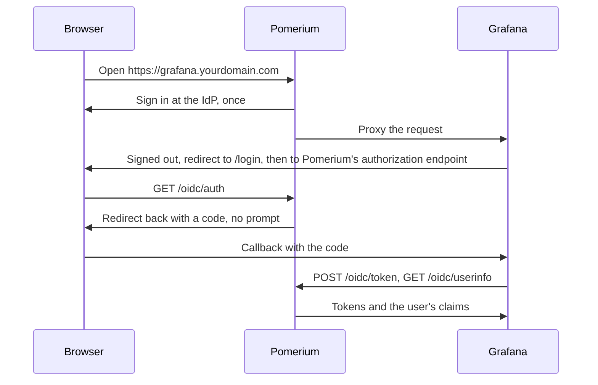
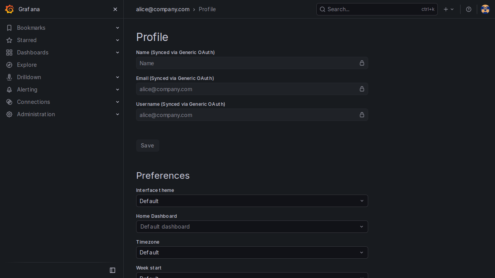
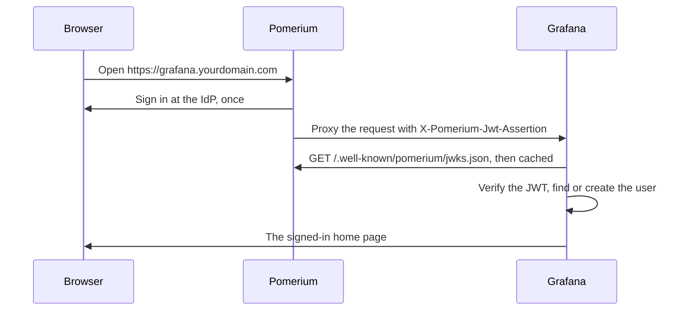
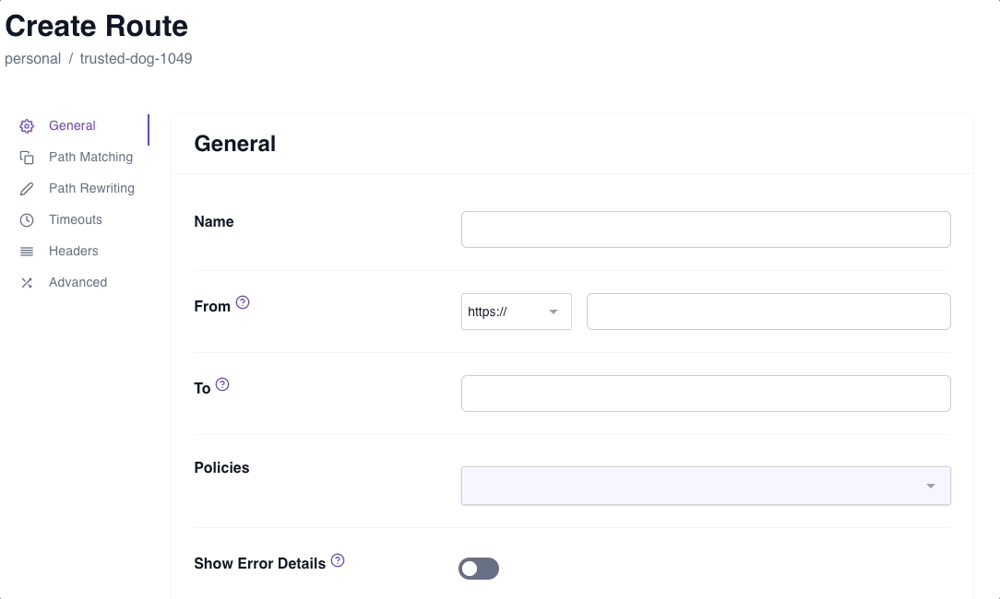
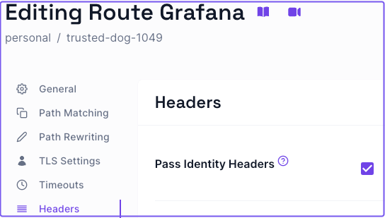
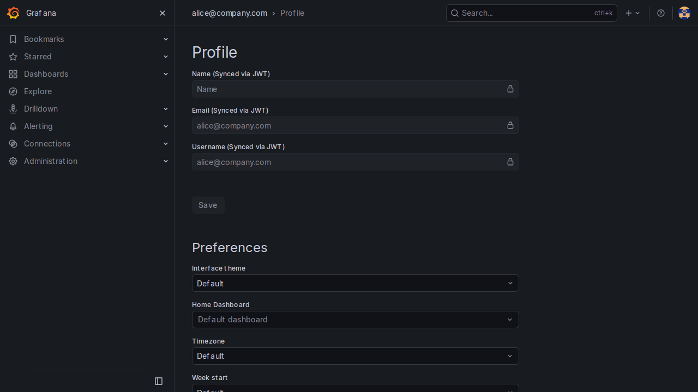

---
# cSpell:ignore automations
title: Secure Grafana with Pomerium
sidebar_label: Grafana
lang: en-US
image: ./img/grafana/grafana-profile.png
keywords:
  [
    pomerium,
    identity access proxy,
    grafana,
    sso,
    oidc,
    oidc bridge,
    openid connect,
    jwt,
    proxy headers,
    authentication,
    authorization,
  ]
description: Put Grafana behind Pomerium and sign users in once, either with Pomerium as Grafana's OpenID Connect provider through the OIDC bridge or with the signed identity JWT Pomerium forwards.
---

import CodeBlock from '@theme/CodeBlock';
import TabItem from '@theme/TabItem';
import Tabs from '@theme/Tabs';

import Config from '!!raw-loader!/content/examples/guides/grafana/config.yaml';
import Compose from '!!raw-loader!/content/examples/guides/grafana/docker-compose.yaml';
import ProxyHeadersConfig from '!!raw-loader!/content/examples/guides/grafana-proxy-headers/config.yaml';
import ProxyHeadersCompose from '!!raw-loader!/content/examples/guides/grafana-proxy-headers/docker-compose.yaml';

# Secure Grafana with Pomerium

You'll put [Grafana](https://grafana.com/oss/grafana/) behind Pomerium so that Pomerium handles single sign-on and authorization. Users sign in once through Pomerium, and Grafana creates their account on first visit with no second password.

There are two ways to sign users in to Grafana. Choose one with the tabs below:

|  | OIDC bridge | Proxy headers |
| :-- | :-- | :-- |
| How Grafana signs users in | Its [generic OAuth login](https://grafana.com/docs/grafana/latest/setup-grafana/configure-access/configure-authentication/generic-oauth/), with Pomerium as the OpenID Connect (OIDC) provider | [JWT authentication](https://grafana.com/docs/grafana/latest/setup-grafana/configure-access/configure-authentication/jwt/) from the signed `X-Pomerium-Jwt-Assertion` header |
| What Grafana verifies | Tokens it gets from Pomerium's OIDC endpoints, using PKCE with no client secret | The JWT's signature on every request, against Pomerium's published keys |
| Pomerium route settings | OIDC bridge, `preserve_host_header`, and `allow_websockets` | `pass_identity_headers` and `allow_websockets` |
| Authenticate service URL | Must be a domain you control | The default hosted URL works |
| Administrators | Listed by email in a role expression, applied at each sign-in | Listed by email in a role expression, applied on every request |
| Sign-out | Signing out of Grafana also signs out of Pomerium | Signing out of Grafana also signs out of Pomerium |

:::caution Both methods configure web UI sign-in only

Both methods turn off Grafana's local login form and basic auth. API clients and automations use Grafana [service account tokens](https://grafana.com/docs/grafana/latest/administration/service-accounts/).

:::

This guide is tested with Grafana 13.3.1.

## Prerequisites

This guide assumes you've completed the [Quickstart](/docs/get-started/quickstart), so you already have Pomerium running and signing users in through the hosted authenticate service.

You also need:

- [Docker](https://docs.docker.com/install/) and [Docker Compose](https://docs.docker.com/compose/install/)
- An identity provider. This guide uses Pomerium's [hosted identity provider](/docs/capabilities/authentication#hosted-authenticate-service) (`idp_provider: hosted`), which signs users in with email and password, Google, or GitHub.
- A domain you control for the Grafana route (this guide uses `grafana.yourdomain.com`)
- For the OIDC bridge method, Pomerium Zero or Pomerium Core with the authenticate service URL set to a domain you control (this guide uses `authenticate.yourdomain.com`). The OIDC bridge isn't served from Pomerium's default hosted authenticate URL. You can still use the hosted identity provider behind your own URL.

:::tip Prefer to self-host the identity provider?

This guide uses the hosted authenticate service so you don't have to run an identity provider (IdP). To run your own instead, follow [Keycloak + Pomerium](/docs/integrations/user-identity/oidc) and swap the `authenticate_service_url` / `idp_*` settings into the config below.

:::

<Tabs queryString="method">
<TabItem value="oidc-bridge" label="OIDC bridge" default>

You'll put Grafana behind Pomerium to gate it with SSO and route policy. Grafana keeps its standard generic OAuth login, and Pomerium is the OIDC provider. Users sign in once through Pomerium, and Grafana creates their account and completes its login without a second prompt or a click. Signing out of Grafana also signs them out of Pomerium.



Use this method when you want one front door for Grafana with your existing identity, and Grafana should keep its own OIDC login. Grafana's generic OAuth login uses Pomerium's [OIDC bridge](https://www.pomerium.com/docs/capabilities/oidc-bridge) as its provider.

## Configure Pomerium {#oidc-bridge-configure-pomerium}

<Tabs queryString="type">
<TabItem value="zero" label="Pomerium Zero" default>

In the [Zero Console](https://console.pomerium.app), create a **Route** for `grafana.<your-starter-domain>`:

- In **From**, enter `https://grafana.<your-starter-domain>`; in **To**, enter `http://grafana:3000`.
- Set the policy to the user or domain that should reach Grafana.
- On the **Advanced** tab, under **OIDC Bridge**, turn on **Enabled**. Grafana uses Proof Key for Code Exchange (PKCE), so leave **OIDC Bridge Client Secret** empty.
- On the **Headers** tab, set **Host Header** to **Preserve**, so Grafana accepts browser writes such as saving a dashboard.
- On the **Timeouts** tab, turn on **Allow Websockets**, so Grafana Live can stream dashboard updates. Save.

Zero manages the token-signing secret for you, so there's no `shared_secret` to set. Before you create the routes, open the **Identity Provider** page in the Zero Console, set **Authenticate Service URL** to a domain you control (this guide uses `https://authenticate.yourdomain.com`), and leave **Hosted Authenticate** selected. The OIDC bridge isn't served from Pomerium's default hosted authenticate URL.

The route's **From** URL is the OIDC client ID. In the steps below, use `https://grafana.<your-starter-domain>` wherever the guide shows `https://grafana.yourdomain.com`, including `GF_SERVER_ROOT_URL` and `GF_AUTH_GENERIC_OAUTH_CLIENT_ID` in the Compose file. If the client ID doesn't match, Pomerium rejects the sign-in with `unknown client_id`. If `GF_SERVER_ROOT_URL` doesn't match, it rejects it with `redirect_uri ... does not match client_id`.

</TabItem>
<TabItem value="core" label="Pomerium Core">

Create a `config.yaml`. It routes `grafana.yourdomain.com` to the Grafana container and enables the OIDC bridge on that route. It also sets the `cookie_secret` that encrypts Pomerium's session cookies and the `shared_secret` that Pomerium uses to sign and encrypt the tokens it issues.

<CodeBlock language="yaml" title="config.yaml">
  {Config}
</CodeBlock>

Replace `grafana.yourdomain.com` and `authenticate.yourdomain.com` with your domains and `you@example.com` with your user or domain, and generate your own `cookie_secret` and `shared_secret` with the command in each comment. Keep both the same across restarts. If either changes, Pomerium can't read the sessions and tokens it issued earlier, and users have to sign in again. A few notes:

- The route's `from` URL is the OIDC client ID, so it must match `GF_AUTH_GENERIC_OAUTH_CLIENT_ID` in the next section.
- [`preserve_host_header`](/docs/reference/routes/headers#1-preserve-host-header) passes the public host to Grafana. After the OIDC login, Grafana checks that each browser write's `Origin` matches the `Host` it sees. Without this setting, Grafana sees `grafana:3000` and rejects writes such as saving a dashboard with `origin not allowed`.
- [`allow_websockets`](/docs/reference/routes/timeouts#websocket-connections) lets Grafana Live stream dashboard updates.

</TabItem>
</Tabs>

## Configure Grafana {#oidc-bridge-configure-grafana}

Grafana's generic OAuth login talks to Pomerium's OIDC endpoints. The key settings are in the `grafana` service of the Compose file below:

- `GF_SERVER_ROOT_URL` is Grafana's public URL. Grafana builds its callback from it: `https://grafana.yourdomain.com/login/generic_oauth`.
- `GF_AUTH_GENERIC_OAUTH_CLIENT_ID` is the route's `from` URL.
- `GF_AUTH_GENERIC_OAUTH_USE_PKCE=true` means Grafana uses PKCE, so no client secret is needed.
- `GF_AUTH_GENERIC_OAUTH_SCOPES=openid` is the only scope the OIDC bridge accepts. Grafana still gets the user's email and name from Pomerium's user info endpoint.
- `GF_AUTH_GENERIC_OAUTH_AUTH_URL`, `_TOKEN_URL`, and `_API_URL` are the `/oidc/auth`, `/oidc/token`, and `/oidc/userinfo` endpoints on your authenticate service.
- `GF_AUTH_GENERIC_OAUTH_EMAIL_ATTRIBUTE_PATH` and `_LOGIN_ATTRIBUTE_PATH=email` make the `email` claim the Grafana account's email and username.
- `GF_AUTH_GENERIC_OAUTH_ALLOW_SIGN_UP=true` creates the Grafana user on first sign-in.
- `GF_AUTH_GENERIC_OAUTH_ROLE_ATTRIBUTE_PATH` and `_ALLOW_ASSIGN_GRAFANA_ADMIN` set each user's role. See [Make yourself the administrator](#oidc-bridge-make-yourself-the-administrator).
- `GF_AUTH_GENERIC_OAUTH_AUTO_LOGIN=true` skips Grafana's login page and starts the OIDC login right away. `GF_AUTH_DISABLE_LOGIN_FORM=true` and `GF_AUTH_BASIC_ENABLED=false` turn off Grafana's local sign-in, so Pomerium is the only way in.
- `GF_AUTH_SIGNOUT_REDIRECT_URL` is Pomerium's sign-out URL on the Grafana route, `https://grafana.yourdomain.com/.pomerium/sign_out`. Grafana's own sign-out only clears the Grafana session. With auto-login on, Grafana would sign the user straight back in through the bridge, so sign-out has to end the Pomerium session too.

## Run the stack {#oidc-bridge-run-the-stack}

The Compose file runs Pomerium Core and Grafana together. Grafana shares a network with Pomerium and nothing else, and the network aliases let Grafana reach your authenticate service through Pomerium directly.

For Zero, add the `grafana` service, the `grafana-internal` network, and the `grafana-storage` volume below to the `compose.yaml` from the Quickstart. Then attach the Quickstart's `pomerium` service to `grafana-internal`, keeping its `main` network:

```yaml
services:
  pomerium:
    networks:
      main:
        aliases:
          - verify.<CLUSTER_STARTER_SUBDOMAIN>.pomerium.app
      grafana-internal:
        aliases:
          - authenticate.yourdomain.com
          - grafana.<your-starter-domain>
```

For Pomerium Core, place the `config.yaml` from the previous step next to this `docker-compose.yaml`:

<CodeBlock language="yaml" title="docker-compose.yaml">
  {Compose}
</CodeBlock>

Start it:

```bash
docker compose up -d
```

If you change `config.yaml` later, restart Pomerium to apply it:

```bash
docker compose restart pomerium
```

`docker compose up -d` doesn't apply the change, because the Compose file itself hasn't changed. If you change the Compose file, run `docker compose up -d` again.

## Make yourself the administrator {#oidc-bridge-make-yourself-the-administrator}

Grafana sets each user's role at every sign-in from `GF_AUTH_GENERIC_OAUTH_ROLE_ATTRIBUTE_PATH`, a [JMESPath](https://jmespath.org/) expression over the user's claims:

```text
contains(['you@example.com'], email) && 'GrafanaAdmin' || ''
```

Replace `you@example.com` with your email before you start the stack. To add more administrators, list their emails: `['you@example.com', 'ops@example.com']`. Users in the list get the `GrafanaAdmin` role, which makes them a Grafana server administrator and an Admin of the main organization. `GF_AUTH_GENERIC_OAUTH_ALLOW_ASSIGN_GRAFANA_ADMIN=true` lets the expression grant it. Everyone else gets Grafana's default role, Viewer.

Keep the empty string at the end. Grafana evaluates the expression against the bridge's ID token first, and that token carries no `email` claim. If the expression ended with `|| 'Viewer'`, Grafana would take `Viewer` from the ID token and never check the email from the user info endpoint.

Because the expression runs at every sign-in, role changes made in Grafana's UI last only until the user's next sign-in. To use groups instead of emails, see Grafana's [role mapping](https://grafana.com/docs/grafana/latest/setup-grafana/configure-access/configure-authentication/generic-oauth/#configure-role-mapping) docs. Your identity provider must send a `groups` claim.

## Verify the setup {#oidc-bridge-verify-the-setup}

1. **The route requires authentication.** In a fresh browser, open `https://grafana.yourdomain.com`. You should be redirected to Pomerium to sign in.
2. **Grafana signs you in without a click or a second prompt.** After you sign in to Pomerium, you land on Grafana's home page. Grafana's login page never appears.
3. **Your identity is correct.** Open `/profile`. Your email and username show **Synced via Generic OAuth**. Your name is filled in only if your identity provider sends a `name` claim. If you're in the administrator list, **Administration** shows the server admin pages.

   

4. **Sign-out ends both sessions.** Open the profile menu and select **Sign out**. You land on Pomerium's signed-out page. Opening `https://grafana.yourdomain.com` again sends you to your identity provider to sign in.
5. **A disallowed user is blocked.** Sign in as a user your policy excludes and open `https://grafana.yourdomain.com`. Pomerium denies access before Grafana loads, so Grafana never creates an account.

## Recover admin access {#oidc-bridge-recover-admin-access}

If no one has administrator access, fix the email list in `GF_AUTH_GENERIC_OAUTH_ROLE_ATTRIBUTE_PATH` and apply the change:

```bash
docker compose up -d
```

Then sign out of Grafana and sign in again. Grafana applies the new role at sign-in. You don't need a separate break-glass administrator: Grafana is only reachable through Pomerium, and its local sign-in is turned off.

## Common failure modes {#oidc-bridge-common-failure-modes}

| Symptom | Cause and fix |
| :-- | :-- |
| Pomerium returns `403` | The route policy still allows only the example user. Replace it with your user or domain. |
| `404 Not Found` from Grafana's OAuth URLs or the `/oidc/` paths | Grafana is pointing at the wrong host. Check that `authenticate_service_url` is set and that the `GF_AUTH_GENERIC_OAUTH_*_URL` values use the same host. |
| Sign-in fails, and Grafana logs `failed to login` with `invalid_scope` and `unsupported scope requested` | `GF_AUTH_GENERIC_OAUTH_SCOPES` asks for more than `openid`. The OIDC bridge accepts only `openid`. |
| HTTP 400 at `/oidc/auth`: `unknown client_id` | `GF_AUTH_GENERIC_OAUTH_CLIENT_ID` doesn't match the route's `from` URL. |
| HTTP 400 at `/oidc/auth`: `redirect_uri ... does not match client_id ...` | `GF_SERVER_ROOT_URL` isn't the route's `from` URL, so Grafana's callback URL isn't under the client ID. |
| Sign-in fails, and Grafana's logs show it can't connect to your authenticate service | The Grafana container can't reach the `/oidc/token` or `/oidc/userinfo` endpoint. Check the network aliases on the `pomerium` service. |
| Saving a dashboard fails with `origin not allowed` | The route doesn't preserve the Host header. Set `preserve_host_header: true` on the route, or **Host Header** to **Preserve** in Zero. |
| Panels don't update live, and Pomerium logs `upgrade_failed` for `/api/live/ws` | Set `allow_websockets: true` on the route, or turn on **Allow Websockets** in Zero. |
| Signing out of Grafana signs you straight back in | `GF_AUTH_SIGNOUT_REDIRECT_URL` isn't set, so only the Grafana session ends and auto-login starts a new one. Set it to `https://grafana.yourdomain.com/.pomerium/sign_out`. |
| Sign-in fails for users who already had a Grafana account | Grafana won't link an OAuth login to an existing account by email unless you allow it. If those accounts use the same email as your identity provider, set `GF_AUTH_OAUTH_ALLOW_INSECURE_EMAIL_LOOKUP=true`. Only do this if your identity provider verifies email addresses. |
| Grafana logs `Error retrieving access token payload ... token is not in JWT format` | Expected. The bridge's access token isn't a JWT, so Grafana reads the user's claims from the user info endpoint instead. Sign-in still works. |
| Everyone is a Viewer, including administrators | The email in the role expression doesn't match, or the expression ends with `\|\| 'Viewer'`. See [Make yourself the administrator](#oidc-bridge-make-yourself-the-administrator). |
| `invalid_token` on Grafana's user info request | The access token was issued before Pomerium restarted without a fixed `shared_secret`. Set `shared_secret` and sign in again. |

## Security considerations {#oidc-bridge-security-considerations}

- **Keep the route protected.** The bridge handles login only. Route policy decides who can reach Grafana, and Pomerium checks it on every request. A public route would let anyone who can sign in to Pomerium get a Grafana account.
- **Keep basic auth off.** Grafana checks basic auth before its session cookie. With basic auth on and the default `admin` password, any user your policy allows could send `Authorization: Basic` through Pomerium and act as Grafana's local administrator. `GF_AUTH_BASIC_ENABLED=false` closes that path.
- **Only Pomerium should reach Grafana.** Keep `grafana:3000` off published ports and on a network shared only with Pomerium.
- **Pomerium issues the tokens.** Grafana gets its ID and access tokens from Pomerium, not directly from your identity provider. There are no refresh tokens, so when the Pomerium session expires, the next request sends the user back to Pomerium to sign in.
- **Signing out of Grafana signs you out of Pomerium.** That also signs you out of every other Pomerium route in that browser.
- **Account creation follows the policy.** `GF_AUTH_GENERIC_OAUTH_ALLOW_SIGN_UP=true` creates a Grafana account for every user your policy allows. Scope the policy to who should have access.

## Next steps {#oidc-bridge-next-steps}

- [OIDC bridge](https://www.pomerium.com/docs/capabilities/oidc-bridge)
- [Authentication](/docs/capabilities/authentication)
- [Authorization](/docs/capabilities/authorization)

</TabItem>
<TabItem value="proxy-headers" label="Proxy headers">

You'll put Grafana behind Pomerium so that Pomerium handles single sign-on and authorization, then forwards a signed identity JWT on every request. Grafana verifies that JWT against Pomerium's published keys ([JWT authentication](https://grafana.com/docs/grafana/latest/setup-grafana/configure-access/configure-authentication/jwt/)), signs the user in, and creates the account on first visit. Signing out of Grafana also signs them out of Pomerium.



Use this method when you want one front door for Grafana with your existing identity, and you don't want to run your own authenticate service URL.

## Configure Pomerium {#proxy-headers-configure-pomerium}

<Tabs queryString="type">
<TabItem value="zero" label="Pomerium Zero" default>

In the [Zero Console](https://console.pomerium.app):

1. Create a **Route**. In **From**, enter `https://grafana.<your-starter-domain>`, and in **To**, enter `http://grafana:3000`. Use the same URL wherever the guide shows `https://grafana.yourdomain.com`, including in the Compose file.
2. Set the policy to the user or domain that should reach Grafana.

   

3. On the **Headers** tab, turn on **Pass Identity Headers**.

   

4. On the **Timeouts** tab, turn on **Allow Websockets**, so Grafana Live can stream dashboard updates. Save.

Zero manages the key that signs the JWT. Pomerium publishes the public key on every route, so Grafana fetches it from `https://grafana.<your-starter-domain>/.well-known/pomerium/jwks.json`.

</TabItem>
<TabItem value="core" label="Pomerium Core">

Create a `config.yaml`. It routes `grafana.yourdomain.com` to the Grafana container and forwards the signed identity JWT.

<CodeBlock language="yaml" title="config.yaml">
  {ProxyHeadersConfig}
</CodeBlock>

Replace `grafana.yourdomain.com` with your domain and `you@example.com` with your user or domain, and generate your own `cookie_secret` and `signing_key` with the command in each comment. Keep both the same across restarts. If `cookie_secret` changes, users have to sign in again. A few notes:

- [`pass_identity_headers`](/docs/reference/routes/pass-identity-headers-per-route) sends the signed `X-Pomerium-Jwt-Assertion` header to Grafana.
- [`signing_key`](/docs/reference/signing-key) signs that JWT. Pomerium publishes the public key at the route's `/.well-known/pomerium/jwks.json`, which is where Grafana fetches it.
- [`allow_websockets`](/docs/reference/routes/timeouts#websocket-connections) lets Grafana Live stream dashboard updates.

</TabItem>
</Tabs>

## Configure Grafana {#proxy-headers-configure-grafana}

The key settings are in the `grafana` service of the Compose file below:

- `GF_AUTH_JWT_HEADER_NAME=X-Pomerium-Jwt-Assertion` is the header Pomerium sends the signed identity JWT in.
- `GF_AUTH_JWT_JWK_SET_URL` is where Grafana fetches Pomerium's public keys to verify the JWT. `GF_AUTH_JWT_CACHE_TTL` is how long Grafana caches them.
- `GF_AUTH_JWT_EMAIL_CLAIM` and `GF_AUTH_JWT_USERNAME_CLAIM=email` make the `email` claim the Grafana account's email and username.
- `GF_AUTH_JWT_AUTO_SIGN_UP=true` creates the Grafana user on first sign-in.
- `GF_AUTH_JWT_ROLE_ATTRIBUTE_PATH` and `_ALLOW_ASSIGN_GRAFANA_ADMIN` set each user's role. See [Make yourself the administrator](#proxy-headers-make-yourself-the-administrator).
- `GF_AUTH_DISABLE_LOGIN_FORM=true` and `GF_AUTH_BASIC_ENABLED=false` turn off Grafana's local sign-in, so Pomerium is the only way in.
- `GF_AUTH_SIGNOUT_REDIRECT_URL` sends users to the route's `/.pomerium/sign_out` endpoint when they sign out, so Pomerium ends its session too. Without it, the next request carries the JWT again and Grafana signs the user straight back in.
- `GF_SERVER_ROOT_URL` is Grafana's public URL, used in the links Grafana generates.

## Run the stack {#proxy-headers-run-the-stack}

The Compose file runs Pomerium Core and Grafana together. Grafana shares a network with Pomerium and nothing else, and the network alias lets Grafana fetch the keys from the route URL through Pomerium directly.

For Zero, add the `grafana` service, the `grafana-internal` network, and the `grafana-storage` volume below to the `compose.yaml` from the Quickstart. Then attach the Quickstart's `pomerium` service to `grafana-internal`, keeping its `main` network:

```yaml
services:
  pomerium:
    networks:
      main:
        aliases:
          - verify.<CLUSTER_STARTER_SUBDOMAIN>.pomerium.app
      grafana-internal:
        aliases:
          - grafana.<your-starter-domain>
```

For Pomerium Core, place the `config.yaml` from the previous step next to this `docker-compose.yaml`:

<CodeBlock language="yaml" title="docker-compose.yaml">
  {ProxyHeadersCompose}
</CodeBlock>

Start it:

```bash
docker compose up -d
```

If you change `config.yaml` later, restart Pomerium to apply it:

```bash
docker compose restart pomerium
```

If you change the Compose file, run `docker compose up -d` again.

## Make yourself the administrator {#proxy-headers-make-yourself-the-administrator}

Grafana sets each user's role on every request from `GF_AUTH_JWT_ROLE_ATTRIBUTE_PATH`, a [JMESPath](https://jmespath.org/) expression over the JWT's claims:

```text
contains(['you@example.com'], email) && 'GrafanaAdmin' || ''
```

Replace `you@example.com` with your email before you start the stack. To add more administrators, list their emails: `['you@example.com', 'ops@example.com']`. Users in the list get the `GrafanaAdmin` role, which makes them a Grafana server administrator and an Admin of the main organization. `GF_AUTH_JWT_ALLOW_ASSIGN_GRAFANA_ADMIN=true` lets the expression grant it. Everyone else gets Grafana's default role, Viewer.

Because the expression runs on every request, role changes made in Grafana's UI don't last. To use groups instead of emails, map them from the JWT's `groups` claim, as described in Grafana's [JWT role mapping](https://grafana.com/docs/grafana/latest/setup-grafana/configure-access/configure-authentication/jwt/#configure-role-mapping) docs.

## Verify the setup {#proxy-headers-verify-the-setup}

1. **The route requires authentication.** In a fresh browser, open `https://grafana.yourdomain.com`. You should be redirected to sign in, not straight into Grafana.
2. **Grafana signs you in from the JWT.** After you sign in to Pomerium, you land on Grafana's home page with no Grafana login page or password.
3. **Your identity is correct.** Open `/profile`. Your email and username show **Synced via JWT**. Your name is filled in only if your identity provider sends a `name` claim. If you're in the administrator list, **Administration** shows the server admin pages.

   

4. **Sign-out ends both sessions.** Open the profile menu and select **Sign out**. Grafana sends you to Pomerium's sign-out endpoint, which ends the Pomerium session without a confirmation page. Opening `https://grafana.yourdomain.com` again asks you to sign in.
5. **A disallowed user is blocked.** Sign in as a user your policy excludes and open `https://grafana.yourdomain.com`. Pomerium denies access, so no JWT is forwarded and Grafana never creates an account.

## Recover admin access {#proxy-headers-recover-admin-access}

If no one has administrator access, fix the email list in `GF_AUTH_JWT_ROLE_ATTRIBUTE_PATH` and apply the change:

```bash
docker compose up -d
```

Grafana applies the new role on your next request. You don't need a separate break-glass administrator: Grafana is only reachable through Pomerium, and its local sign-in is turned off.

## Common failure modes {#proxy-headers-common-failure-modes}

| Symptom | Cause and fix |
| :-- | :-- |
| Pomerium returns `403` | The route policy still allows only the example user. Replace it with your user or domain. |
| Grafana shows its login page instead of signing you in | The JWT didn't verify, or it wasn't forwarded. Check that `pass_identity_headers` is set on the route, and look for `failed to verify JWT` in Grafana's logs. |
| Grafana logs `failed to verify JWT` with a fetch or connection error | The Grafana container can't reach `GF_AUTH_JWT_JWK_SET_URL`. Check the network alias on the `pomerium` service. |
| Grafana logs `failed to verify JWT` with a key error | Pomerium has no `signing_key` (Core), or the key changed while Grafana cached the old one. Set `signing_key` and restart Grafana with `docker compose restart grafana`. |
| Panels don't update live, and Pomerium logs `upgrade_failed` for `/api/live/ws` | Set `allow_websockets: true` on the route, or turn on **Allow Websockets** in Zero. |
| Signing out of Grafana signs you straight back in | `GF_AUTH_SIGNOUT_REDIRECT_URL` isn't set to the route's `/.pomerium/sign_out` URL, so the Pomerium session is still active and the next request carries the JWT again. |
| Everyone is a Viewer, including administrators | The email in the role expression doesn't match the `email` claim. See [Make yourself the administrator](#proxy-headers-make-yourself-the-administrator). |
| Redirect loop or certificate errors | Make sure DNS for `grafana.yourdomain.com` points at Pomerium and that Pomerium can obtain a TLS certificate. With Core, `autocert` needs ports 80 and 443 reachable for Let's Encrypt. Zero manages certificates for you. |

## Security considerations {#proxy-headers-security-considerations}

- **Grafana verifies the JWT on every request.** A forged or unsigned `X-Pomerium-Jwt-Assertion` fails verification, and through Pomerium it's replaced with the signed JWT for the authenticated user anyway.
- **Only Pomerium should reach Grafana.** Grafana accepts any valid JWT it receives, so a JWT captured elsewhere could be replayed against a reachable Grafana. Keep `grafana:3000` off published ports and on a network shared only with Pomerium. Confirm the only containers on the network are Pomerium and Grafana: `docker network inspect grafana-pomerium --format '{{range .Containers}}{{.Name}} {{end}}'`.
- **Keep basic auth off.** Grafana's local `admin` account still exists. `GF_AUTH_BASIC_ENABLED=false` and `GF_AUTH_DISABLE_LOGIN_FORM=true` make sure no one can sign in with it.
- **Signing out of Grafana signs you out of Pomerium.** That also signs you out of every other Pomerium route in that browser.
- **Account creation follows the policy.** `GF_AUTH_JWT_AUTO_SIGN_UP=true` creates a Grafana account for every user your policy allows. Scope the policy to who should have access.

## Next steps {#proxy-headers-next-steps}

- [Pass identity headers](/docs/reference/routes/pass-identity-headers-per-route)
- [Signing key](/docs/reference/signing-key)
- [Authorization](/docs/capabilities/authorization)

</TabItem>
</Tabs>
