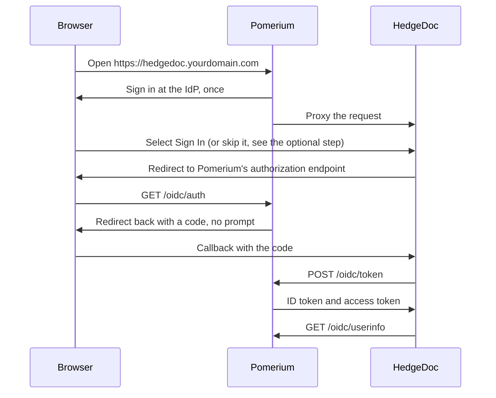
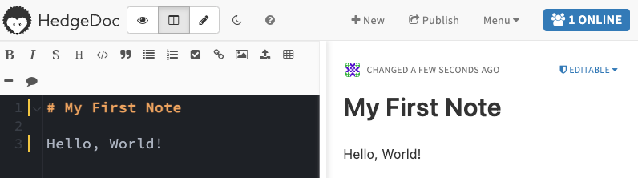

import CodeBlock from '@theme/CodeBlock';
import TabItem from '@theme/TabItem';
import Tabs from '@theme/Tabs';

import Config from '!!raw-loader!/content/examples/guides/hedgedoc/config.yaml';
import Compose from '!!raw-loader!/content/examples/guides/hedgedoc/docker-compose.yaml';
import Header from '!!raw-loader!/content/examples/guides/hedgedoc/header.ejs';

# Secure HedgeDoc with Pomerium

## What this guide does

[HedgeDoc](https://hedgedoc.org/) is a collaborative, web-based Markdown editor for writing notes, diagrams, and documents in real time. This guide puts HedgeDoc behind Pomerium to gate it with SSO and route policy. HedgeDoc keeps its own OAuth2 login, and Pomerium is the OpenID Connect (OIDC) provider. Users sign in once through Pomerium, and HedgeDoc completes its login without a second prompt.



## When to use this guide

Use it when you want one front door for HedgeDoc with your existing identity, and HedgeDoc accounts should come from that identity instead of local registration or guests. It uses HedgeDoc's generic OAuth2 login, which works with Pomerium's [OIDC bridge](https://www.pomerium.com/docs/capabilities/oidc-bridge). If you only need to reach HedgeDoc over a private network without browser SSO, a plain [TCP route](/docs/capabilities/non-http) is a better fit.

## Prerequisites

This guide assumes you've completed the [Quickstart](/docs/get-started/quickstart), so you already have Pomerium running and signing users in through the hosted authenticate service.

You also need:

- [Docker](https://docs.docker.com/install/) and [Docker Compose](https://docs.docker.com/compose/install/)
- Pomerium Zero or Pomerium Core, with the authenticate service URL set to a domain you control (this guide uses `authenticate.yourdomain.com`). The OIDC bridge isn't served from Pomerium's default hosted authenticate URL. You can still use the hosted identity provider behind your own URL.
- An identity provider. This guide uses Pomerium's [hosted identity provider](/docs/capabilities/authentication#hosted-authenticate-service) (`idp_provider: hosted`), which signs users in with email and password, Google, or GitHub.
- A domain you control for the HedgeDoc route (this guide uses `hedgedoc.yourdomain.com`)

:::tip Prefer to self-host the identity provider?

This guide uses the hosted authenticate service so you don't have to run an identity provider (IdP). To run your own instead, follow [Keycloak + Pomerium](/docs/integrations/user-identity/oidc) and swap the `authenticate_service_url` / `idp_*` settings into the config below.

:::

## Configure Pomerium

<Tabs queryString="type">
<TabItem value="zero" label="Pomerium Zero" default>

In the [Zero Console](https://console.pomerium.app), create two **Routes** for `hedgedoc.<your-starter-domain>`:

1. **Sign-out route.** This route makes HedgeDoc's **Sign Out** end the Pomerium session too.
   - In **From**, enter `https://hedgedoc.<your-starter-domain>`, and on the **Path Matching** tab, choose **Exact Path** and enter `/logout`; in **To**, enter `http://hedgedoc:3000`.
   - On the **Headers** tab, under **Set Response Headers**, add `Location` with the value `https://hedgedoc.<your-starter-domain>/.pomerium/sign_out`.
   - Set the policy to the user or domain that should reach HedgeDoc.
2. **HedgeDoc route.**
   - In **From**, enter `https://hedgedoc.<your-starter-domain>`; in **To**, enter `http://hedgedoc:3000`.
   - Set the same policy as the first route.
   - On the **Advanced** tab, under **OIDC Bridge**, turn on **Enabled**. HedgeDoc uses PKCE, so leave **OIDC Bridge Client Secret** empty.
   - On the **Timeouts** tab, turn on **Allow Websockets**, which the real-time editor needs.

Order the sign-out route above the HedgeDoc route.

Zero manages the token-signing secret for you, so there's no `shared_secret` to set. Before you create the routes, open the **Identity Provider** page in the Zero Console, set **Authenticate Service URL** to a domain you control (this guide uses `https://authenticate.yourdomain.com`), and leave **Hosted Authenticate** selected. The OIDC bridge isn't served from Pomerium's default hosted authenticate URL.

Your OIDC discovery URL is your authenticate service URL plus `/.well-known/openid-configuration`.

</TabItem>
<TabItem value="core" label="Pomerium Core">

Create a `config.yaml`. It routes `hedgedoc.yourdomain.com` to the HedgeDoc container, enables the OIDC bridge on that route, allows the WebSocket upgrade the editor needs, and sets the `shared_secret` that Pomerium uses to sign and encrypt the tokens it issues.

<CodeBlock language="yaml" title="config.yaml">
  {Config}
</CodeBlock>

Replace `hedgedoc.yourdomain.com` with your domain, `you@example.com` with your email, and generate your own `shared_secret` with the command in the comment. The route's `from` URL is the OIDC client ID that HedgeDoc uses, so it must match `CMD_OAUTH2_CLIENT_ID` in the next section. The `allow_websockets: true` line is required: without it HedgeDoc's real-time editor can't open its connection. Keep `shared_secret` the same across restarts. If it changes, Pomerium can't read tokens it issued earlier, and users have to sign in again.

The first route makes HedgeDoc's **Sign Out** end the Pomerium session too. On its own, HedgeDoc's sign-out ends only the HedgeDoc session and returns to the home page, so the next sign-in skips the password prompt because the Pomerium session is still active. HedgeDoc has no setting to change where sign-out goes. The `/logout` route still sends the request to HedgeDoc, so HedgeDoc clears its session, and `set_response_headers` replaces the `Location` header so the browser goes on to `/.pomerium/sign_out`. That ends the Pomerium session, and with it access to every app behind Pomerium, not only HedgeDoc. Keep this route before the main route, because Pomerium matches routes in order, and give it the same policy.

</TabItem>
</Tabs>

## Configure HedgeDoc

HedgeDoc needs to know the public URL it's served from so that links, redirects, and cookies are correct when it sits behind Pomerium's TLS. HedgeDoc's [OAuth2 login](https://docs.hedgedoc.org/configuration/) then talks to Pomerium's OIDC endpoints. HedgeDoc doesn't use OIDC discovery, so you set each endpoint yourself. The key settings are in the `hedgedoc` service of the Compose file below:

- `CMD_DOMAIN=hedgedoc.yourdomain.com` — the external hostname users reach, which is the Pomerium route host.
- `CMD_PROTOCOL_USESSL=true` and `CMD_URL_ADDPORT=false` — HedgeDoc is reached over HTTPS on the standard port through Pomerium, so it should build `https://` URLs without a port suffix. HedgeDoc builds its OAuth2 callback from these: `https://hedgedoc.yourdomain.com/auth/oauth2/callback`.
- `CMD_SESSION_SECRET` — signs HedgeDoc's session cookies. Generate your own with `head -c32 /dev/urandom | base64`; if you leave it unset, HedgeDoc picks a new random value on every restart and signs everyone out.
- `CMD_OAUTH2_CLIENT_ID` — the route's `from` URL.
- `CMD_OAUTH2_PKCE=true` — HedgeDoc uses Proof Key for Code Exchange (PKCE), so the route doesn't need a client secret.
- `CMD_OAUTH2_CLIENT_SECRET=unused` — required anyway. HedgeDoc only turns on its OAuth2 login when both a client ID and a client secret are set, and without one `/auth/oauth2` returns `404 Not Found`. Any non-empty value works, because the route has no `client_secret` for Pomerium to check.
- `CMD_OAUTH2_SCOPE=openid email profile` — the scopes HedgeDoc requests.
- `CMD_OAUTH2_AUTHORIZATION_URL`, `CMD_OAUTH2_TOKEN_URL`, and `CMD_OAUTH2_USER_PROFILE_URL` — the `/oidc/auth`, `/oidc/token`, and `/oidc/userinfo` endpoints on your authenticate service.
- `CMD_OAUTH2_USER_PROFILE_ID_ATTR=sub`, `_USERNAME_ATTR=email`, `_DISPLAY_NAME_ATTR=name`, and `_EMAIL_ATTR=email` — which userinfo claims become the HedgeDoc account. HedgeDoc identifies the user by `sub`. These names must match claims your identity provider sends.
- `CMD_OAUTH2_PROVIDERNAME=Pomerium` — the name HedgeDoc shows on its sign-in button.

HedgeDoc stores its notes in PostgreSQL, so the Compose file below also runs a `database` service and points `CMD_DB_URL` at it.

### Make Pomerium the only way to sign in

By default HedgeDoc lets guests create notes and lets anyone register a local account with an email address. Three settings turn both off, so a HedgeDoc account can only come from Pomerium:

- `CMD_ALLOW_ANONYMOUS=false` — HedgeDoc no longer lets guests create notes.
- `CMD_EMAIL=false` — turns off HedgeDoc's email and password sign-in. HedgeDoc documents that `CMD_ALLOW_EMAIL_REGISTER` has no effect when email sign-in is off, but the Compose file also sets `CMD_ALLOW_EMAIL_REGISTER=false` so registration stays closed if you turn email sign-in back on.
- `CMD_ALLOW_EMAIL_REGISTER=false` — blocks new local accounts.

HedgeDoc doesn't document an option that hides every other sign-in method, so these settings are what you control. They don't replace the route policy. HedgeDoc has no idea who your users are beyond the login it performs, so Pomerium's policy is still the only thing deciding who reaches HedgeDoc at all. Notes that already exist keep the permissions they were created with.

## Run the stack

The Compose file runs Pomerium Core, HedgeDoc, and its PostgreSQL database together. HedgeDoc and the database sit on an `internal` Docker network that Pomerium shares, and only Pomerium publishes ports to the host. For Zero, drop the `pomerium` service and use the `compose.yaml` from the Quickstart with your `POMERIUM_ZERO_TOKEN`, keeping the other services and their networks below. For Core, place the `config.yaml` from the previous step next to this `docker-compose.yaml`, then start the stack:

<CodeBlock language="yaml" title="docker-compose.yaml">
  {Compose}
</CodeBlock>

```bash
docker compose up -d
```

If you change `config.yaml` later, run `docker compose up -d` again to apply it.

HedgeDoc calls the authenticate service from the server side, for the token exchange and the userinfo request, not only from the browser. The `internal` network has no route to the outside world, so Pomerium carries the `authenticate.yourdomain.com` alias on that network. If you run HedgeDoc on a network that can reach your authenticate service, you don't need the alias.

## Optional: skip the Sign In button

With the setup so far, users sign in to Pomerium, land on HedgeDoc's home page, and select **Sign In** once. HedgeDoc completes the login without another prompt. HedgeDoc 1.x has no setting that starts the login automatically, even when Pomerium is the only sign-in method, so skipping that click means changing one of HedgeDoc's page templates.

HedgeDoc's home page includes an empty template file, `public/views/index/header.ejs`. Save the following as `header.ejs` next to `docker-compose.yaml`:

<CodeBlock language="html" title="header.ejs">
  {Header}
</CodeBlock>

Then uncomment the `./header.ejs` line under the `hedgedoc` service's `volumes` in `docker-compose.yaml` and run `docker compose up -d`.

The template sends a signed-out user straight to HedgeDoc's OAuth2 login, and only when Pomerium is the only sign-in method enabled. Links to a note work too: HedgeDoc sends a signed-out user to the home page and returns them to the note after sign-in. If the login fails, the template doesn't retry for 30 seconds, so the home page shows the normal **Sign In** button instead of looping.

:::caution

This replaces a file inside the HedgeDoc image, which HedgeDoc doesn't support as a customization point. Before each HedgeDoc upgrade, check that `public/views/index/header.ejs` in the new image is still empty. If it isn't, your file hides the new content, and if the template variables it uses change, the home page fails with an error. In either case, remove the volume line to go back to the **Sign In** button.

:::

## Verify the setup

1. **The route requires authentication.** In a fresh browser, open `https://hedgedoc.yourdomain.com`. You should be redirected to Pomerium to sign in.
2. **HedgeDoc offers Pomerium login.** After you sign in, HedgeDoc loads. Select **Sign In** and choose the **Pomerium** option. If you added the optional `header.ejs`, HedgeDoc skips this step and signs you in by itself.
3. **The OAuth2 login completes without a prompt.** HedgeDoc signs you in and shows your name from the identity provider next to your avatar at the top right. On narrow windows HedgeDoc hides the name, so widen the window if you only see the avatar. HedgeDoc has no profile page, so the menu only offers **Export user data**, **Delete user**, and **Sign Out**.
4. **The editor connects.** Open a new note and start typing. The live editor relies on the WebSocket connection you allowed on the route; if it works, your `allow_websockets` setting is correct.

   

5. **Sign-out ends the Pomerium session.** Open the menu at the top right and select **Sign Out**. You should end up on Pomerium's signed-out page. Open `https://hedgedoc.yourdomain.com` again: Pomerium asks you to sign in.
6. **A disallowed user is blocked.** Sign in as a user your policy excludes and open `https://hedgedoc.yourdomain.com`. Pomerium denies access before HedgeDoc loads.

HedgeDoc doesn't use the identity provider's `picture` claim. Avatars come from [Gravatar](https://gravatar.com/), based on the user's email address, and the browser loads them directly, so the `internal` network doesn't block them. To use generated letter avatars instead, set `CMD_ALLOW_GRAVATAR=false`.

## Common failure modes

| Symptom | Cause and fix |
| :-- | :-- |
| Redirect loop or broken links inside HedgeDoc | `CMD_DOMAIN`, `CMD_PROTOCOL_USESSL`, and `CMD_URL_ADDPORT` don't match how Pomerium serves the route. Set the domain to the route host, `CMD_PROTOCOL_USESSL=true`, and `CMD_URL_ADDPORT=false`. |
| The editor never loads or notes don't sync | The WebSocket upgrade is being dropped. Confirm `allow_websockets: true` is set on the route. |
| HTTP 400 at `/oidc/auth`: `redirect_uri ... does not match client_id ...` | `CMD_OAUTH2_CLIENT_ID` doesn't match the route's `from` URL, or `CMD_DOMAIN` isn't the HedgeDoc host. |
| `404 Not Found` at `https://hedgedoc.yourdomain.com/auth/oauth2`, or no **Sign In** button | HedgeDoc's OAuth2 login is off because `CMD_OAUTH2_CLIENT_SECRET` isn't set. Set it to any non-empty value, even with PKCE. |
| **Sign Out** returns to HedgeDoc's home page and the next sign-in has no prompt | The `/logout` route is missing or comes after the main route. Put it first in `routes`. |
| The home page fails with an error after a HedgeDoc upgrade | The optional `header.ejs` no longer matches the new HedgeDoc templates. Remove its volume line and run `docker compose up -d`. |
| `404 Not Found` from the `/oidc/` paths | HedgeDoc is pointing at the wrong host. Check that `authenticate_service_url` is set and that the `CMD_OAUTH2_*_URL` values use the same host. |
| HedgeDoc can't reach the token or userinfo URL | The `hedgedoc` container has no route to your authenticate service. Add the `authenticate.yourdomain.com` alias to Pomerium on HedgeDoc's network, or put HedgeDoc on a network that can reach it. |
| Login returns to HedgeDoc but you aren't signed in | HedgeDoc couldn't read a user from the userinfo response. Check that your identity provider sends the claims named in `CMD_OAUTH2_USER_PROFILE_*_ATTR` and read the HedgeDoc log. |
| `invalid_token` on the userinfo request | The access token was issued before Pomerium restarted without a fixed `shared_secret`. Set `shared_secret` and sign in again. |
| Everyone gets signed out after a restart | No fixed `CMD_SESSION_SECRET`. Set a stable, secret value so sessions survive restarts. |
| Certificate errors reaching the route | Make sure DNS for `hedgedoc.yourdomain.com` points at Pomerium and that Pomerium can obtain a TLS certificate. `autocert` needs ports 80 and 443 reachable for Let's Encrypt. |

## Security considerations

- **Keep the route protected.** The bridge handles login only. Route policy decides who can reach HedgeDoc, and Pomerium checks it on every request. A public route would let anyone who can sign in to Pomerium get a HedgeDoc account.
- **Only Pomerium should reach HedgeDoc.** HedgeDoc trusts whatever can reach `hedgedoc:3000`. Keep it off published host ports and on the internal Docker network, so Pomerium is the only way in.
- **Pomerium issues the tokens.** HedgeDoc gets its ID and access tokens from Pomerium, not directly from your identity provider.
- **No refresh tokens.** When the Pomerium session expires, the next request sends the user back to Pomerium to sign in.
- **PKCE means no client secret on the route.** HedgeDoc's `CMD_OAUTH2_CLIENT_SECRET=unused` only switches its OAuth2 login on; PKCE is what protects the token exchange. If you later use an app that can't do PKCE, the bridge supports a `client_secret` on that route. Keep it secret.
- **Don't rely on HedgeDoc's role check.** Userinfo passes claims through with their JSON types: a user in several groups gets a `groups` array, but a user in one group gets a plain string. HedgeDoc's `CMD_OAUTH2_ACCESS_ROLE` check then matches any part of that string, so a user whose only group is `notadmins` passes a check for `admin`. Gate access with route policy instead.
- **Account creation follows the policy.** HedgeDoc creates an account for every user your policy allows. Manage who gets in with the route policy.
- **Change the demo database password.** The demo `database` password is `password`; change it before running anything beyond a local demo.

## Operations

To stop the stack without losing data, run `docker compose down`. The notes live in the `hedgedoc-database` volume and uploads in `hedgedoc-uploads`, so they survive a restart. Use `docker compose down -v` only when you want to delete those volumes and start clean.

To upgrade HedgeDoc, bump the pinned image tag (this guide uses `1.10.8`; check [the latest release](https://hedgedoc.org/latest-release)), then `docker compose pull && docker compose up -d`. Review the HedgeDoc release notes for database migrations before upgrading across minor versions.

## Next steps

- [OIDC bridge](https://www.pomerium.com/docs/capabilities/oidc-bridge)
- [Authentication](/docs/capabilities/authentication)
- [Custom domains](/docs/capabilities/custom-domains)
