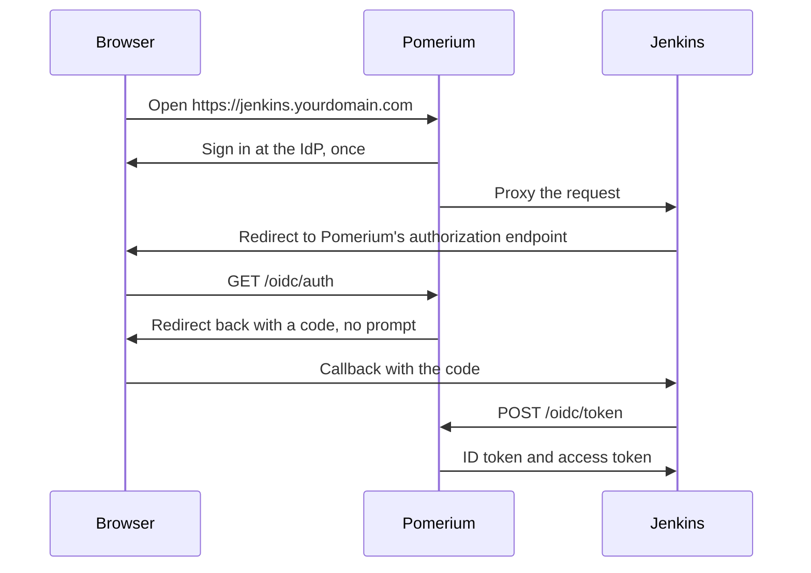
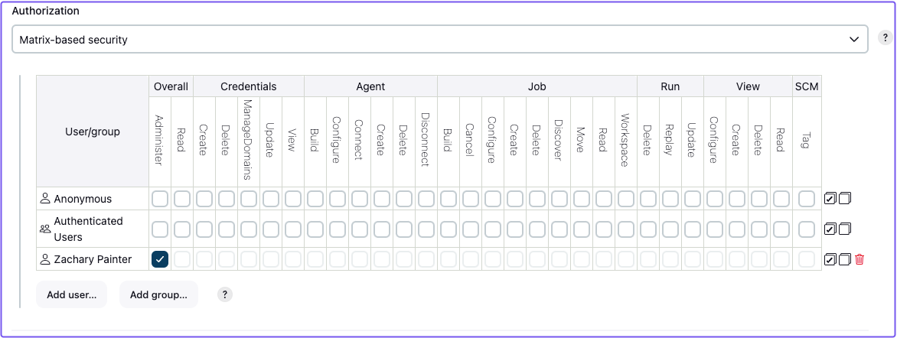
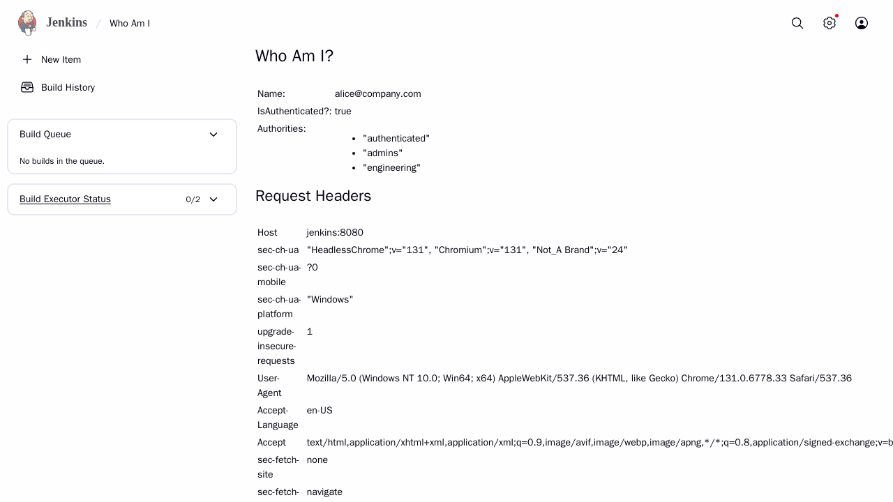

---
# cSpell:ignore truststore PKCE
title: Secure Jenkins with Pomerium
sidebar_label: Jenkins
lang: en-US
image: ./img/jenkins/jenkins-whoami.png
keywords:
  [
    pomerium,
    jenkins,
    sso,
    oidc,
    oidc bridge,
    openid connect,
    identity aware proxy,
  ]
description: Add single sign-on and per-route authorization to Jenkins by having Pomerium act as the OpenID Connect provider for the Jenkins OpenID Connect Authentication plugin through the OIDC bridge.
---

import CodeBlock from '@theme/CodeBlock';
import TabItem from '@theme/TabItem';
import Tabs from '@theme/Tabs';

import Config from '!!raw-loader!/content/examples/guides/jenkins/config.yaml';
import Compose from '!!raw-loader!/content/examples/guides/jenkins/docker-compose.yaml';

# Secure Jenkins with Pomerium

## What this guide does

Put Jenkins behind Pomerium to gate it with SSO and route policy. Jenkins keeps a standard OpenID Connect (OIDC) login through its [OpenID Connect Authentication plugin](https://plugins.jenkins.io/oic-auth/), and Pomerium is the OIDC provider. Users sign in once through Pomerium, and Jenkins completes its login without a second prompt or a Jenkins-managed password.



## When to use this guide

Use it when you want one front door for Jenkins with your existing identity, and Jenkins should keep its own OIDC login. Jenkins has no built-in OIDC support, so this flow depends on the OpenID Connect Authentication plugin, which works with Pomerium's [OIDC bridge](https://www.pomerium.com/docs/capabilities/oidc-bridge). If you only need to reach Jenkins over a private network without browser SSO, a plain [TCP route](/docs/capabilities/non-http) is a better fit.

## Prerequisites

This guide assumes you've completed the [Quickstart](/docs/get-started/quickstart), so you already have Pomerium running and signing users in through the hosted authenticate service.

You also need:

- [Docker](https://docs.docker.com/install/) and [Docker Compose](https://docs.docker.com/compose/install/)
- Pomerium Zero or Pomerium Core, with the authenticate service URL set to a domain you control (this guide uses `authenticate.yourdomain.com`). The OIDC bridge isn't served from Pomerium's default hosted authenticate URL. You can still use the hosted identity provider behind your own URL.
- An identity provider. This guide uses Pomerium's [hosted identity provider](/docs/capabilities/authentication#hosted-authenticate-service) (`idp_provider: hosted`), which signs users in with email and password, Google, or GitHub.
- A domain you control for the Jenkins route (this guide uses `jenkins.yourdomain.com`)

:::tip Prefer to self-host the identity provider?

This guide uses the hosted authenticate service so you don't have to run an identity provider (IdP). To run your own instead, follow [Keycloak + Pomerium](/docs/integrations/user-identity/oidc) and swap the `authenticate_service_url` / `idp_*` settings into the config below.

:::

## Configure Pomerium

<Tabs queryString="type">
<TabItem value="zero" label="Pomerium Zero" default>

In the [Zero Console](https://console.pomerium.app), create a **Route** for `jenkins.<your-starter-domain>`:

- In **From**, enter `https://jenkins.<your-starter-domain>`; in **To**, enter `http://jenkins:8080`.
- Set the policy to the user or domain that should reach Jenkins.
- On the **Advanced** tab, under **OIDC Bridge**, turn on **Enabled** and enter an **OIDC Bridge Client Secret**. Generate one with `openssl rand -base64 32`. You'll enter the same value in Jenkins below.

Zero manages the token-signing secret for you, so there's no `shared_secret` to set. Before you create the routes, open the **Identity Provider** page in the Zero Console, set **Authenticate Service URL** to a domain you control (this guide uses `https://authenticate.yourdomain.com`), and leave **Hosted Authenticate** selected. The OIDC bridge isn't served from Pomerium's default hosted authenticate URL.

Your OIDC discovery URL is your authenticate service URL plus `/.well-known/openid-configuration`.

</TabItem>
<TabItem value="core" label="Pomerium Core">

Create a `config.yaml`. It routes `jenkins.yourdomain.com` to the Jenkins container, enables the OIDC bridge on that route, and sets the `shared_secret` that Pomerium uses to sign and encrypt the tokens it issues.

<CodeBlock language="yaml" title="config.yaml">
  {Config}
</CodeBlock>

Replace `jenkins.yourdomain.com` with your domain and `you@example.com` with your email. Generate your own `shared_secret` and the route's `client_secret` with the command in the comments. The route's `from` URL is the OIDC client ID that Jenkins uses. Keep `shared_secret` the same across restarts. If it changes, Pomerium can't read tokens it issued earlier, and users have to sign in again.

The `client_secret` is set because the plugin's configuration asks for a client secret. The plugin also offers PKCE, which you enable below, so Jenkins sends both.

</TabItem>
</Tabs>

## Run the stack

The Compose file runs Pomerium Core and Jenkins together. For Zero, drop the `pomerium` service and use the `compose.yaml` from the Quickstart with your `POMERIUM_ZERO_TOKEN`, keeping the other services and their networks below. For Core, place the `config.yaml` from the previous step next to this `docker-compose.yaml`, then start the stack:

<CodeBlock language="yaml" title="docker-compose.yaml">
  {Compose}
</CodeBlock>

```bash
docker compose up -d
```

If you change `config.yaml` later, run `docker compose up -d` again to apply it.

Jenkins prints an initial admin password to the container log on first start (`docker compose logs jenkins`), which you'll need to complete the setup wizard the first time you reach it through Pomerium.

## Configure Jenkins

After the stack is running and you've completed the Jenkins first-run wizard:

1. Go to **Manage Jenkins** -> **Plugins** -> **Available plugins**, search for **OpenID Connect Authentication**, install it, and restart Jenkins.
2. Go to **Manage Jenkins** -> **Security**. In the **Security Realm** dropdown, select **Login with OpenID Connect** and fill in the fields:

   | Setting | Value |
   | --- | --- |
   | **Client id** | the route's `from` URL, `https://jenkins.yourdomain.com` |
   | **Client secret** | the route's `oidc_bridge` `client_secret` |
   | **Well-known configuration endpoint** | `https://authenticate.yourdomain.com/.well-known/openid-configuration` |
   | **User name field name** | `email` |
   | **Full name field name** | `name` |
   | **Email field name** | `email` |
   | **PKCE** | enabled |

   The plugin builds its callback from your Jenkins root URL: `https://jenkins.yourdomain.com/securityRealm/finishLogin`. Set the Jenkins URL under **Manage Jenkins** -> **System** if it isn't already `https://jenkins.yourdomain.com/`.

3. Leave the plugin's **Disable ID token and user info verification** option off. Pomerium issues valid tokens, so there's nothing to skip. Also leave **Logout from OpenID Provider** on (the default). Pomerium's discovery document advertises its sign-out URL as the end session endpoint, so logging out of Jenkins also ends the Pomerium session. Without it, Jenkins would sign the user straight back in through the bridge.
4. Under **Authorization**, pick a strategy. **Logged-in users can do anything** is a reasonable start, since Pomerium's route policy is the real access gate. With **Matrix-based security**, click **Add user...** and grant your user (their email address) the permissions they need, such as **Administer**, so you aren't locked out.

   

Save. The plugin lets you define an administrator credential as an escape hatch in case the OpenID Connect provider is unavailable. Set one before you rely on the new login.

:::note Groups

Pomerium's user info endpoint returns the `groups` claim from your identity provider: an array for users in several groups, or a single string for users in one group. This guide maps users by email. If you use the plugin's **Groups field name**, test it with a user in exactly one group as well as a user in several.

:::

## Verify the setup

1. **The route requires authentication.** In a fresh browser, open `https://jenkins.yourdomain.com`. You should be redirected to Pomerium to sign in.
2. **The OIDC login completes without a prompt.** After you sign in, Jenkins redirects to Pomerium's authorization endpoint and back, and you land in Jenkins signed in. Jenkins never shows its own login form.
3. **Jenkins knows who you are.** The top-right corner shows your full name. If your identity provider sends a `picture` claim, the plugin uses it as your avatar. Open the **Who Am I** page (`/whoAmI`). It reports your email under **Name** and **IsAuthenticated?: true**.

   

4. **Sign-out ends the session.** Click **log out** in the top-right corner. You land on Pomerium's signed-out page. Opening `https://jenkins.yourdomain.com` again sends you to your identity provider to sign in.
5. **A disallowed user is blocked.** Sign in as a user your policy excludes and open `https://jenkins.yourdomain.com`. Pomerium denies access before Jenkins loads.

## Common failure modes

| Symptom | Cause and fix |
| --- | --- |
| `404 Not Found` from the well-known endpoint or any `/oidc/` path | Jenkins is pointing at the wrong host. Use your `authenticate_service_url` host, and check that `idp_provider` is set. |
| Discovery works, but the issuer is `https://authenticate.pomerium.app` and sign-in fails | `authenticate_service_url` isn't set, so Jenkins found the hosted authenticate service. Set it and point the plugin at that URL. |
| HTTP 400 at `/oidc/auth`: `redirect_uri ... does not match client_id ...` | **Client id** doesn't match the route's `from` URL, or the Jenkins root URL isn't `https://jenkins.yourdomain.com/`. |
| Token request fails with `invalid_client` | The **Client secret** doesn't match the route's `client_secret`, or the plugin sends the credentials in a way Pomerium rejects. Check the secret first. If it matches, switch the plugin's token authentication method to send credentials in the request body (`client_secret_post`). |
| Token request fails with `unsupported_grant_type` | The plugin asked for a refresh token. The bridge doesn't issue refresh tokens, so turn off token refresh in the plugin. |
| `unable to find valid certification path to requested target` in the Jenkins log | Jenkins (the Java runtime) doesn't trust the certificate on the authenticate service. With a public certificate this won't happen. If you use a private CA, import it into the Java truststore. |
| Logging out of Jenkins signs you straight back in | **Logout from OpenID Provider** is off, so only the Jenkins session ends and the plugin starts a new login through the bridge. Turn it back on. |
| Jenkins shows its own login form or an error page after sign-in | The plugin isn't the selected security realm, or the login failed. Check the Jenkins log for the OIDC error. |
| `invalid_token` on the user info request | Pomerium restarted without a fixed `shared_secret`, so it can't read tokens it issued earlier. Set `shared_secret` and sign in again. |

## Security considerations

- **Keep the route protected.** The bridge handles login only. Route policy decides who can reach Jenkins, and Pomerium checks it on every request. A public route would let anyone who can sign in to Pomerium get a Jenkins account.
- **Only Pomerium should reach Jenkins.** Keep `jenkins:8080` off published ports and on the internal Docker network, so Pomerium is the only way in.
- **Pomerium issues the tokens.** Jenkins gets its ID and access tokens from Pomerium, not directly from your identity provider.
- **No refresh tokens.** When the Pomerium session expires, the next request sends the user back to Pomerium to sign in.
- **Keep the client secret secret.** Anyone who has the route's `client_secret` can act as the Jenkins OIDC client.
- **Manage permissions in Jenkins.** Scope the route policy to who should have access, and use Jenkins matrix-based security for fine-grained authorization.

## Operations

- Tear the stack down with `docker compose down`. Add `-v` to also delete the `jenkins-home` and `pomerium-cache` volumes, which resets Jenkins (including its security realm) to a fresh first run.
- Changing `shared_secret` invalidates tokens Pomerium issued earlier. Users sign in again.
- Last tested with Jenkins LTS (`jenkins/jenkins:2.555.2-lts`) and the OpenID Connect Authentication plugin (`4.731.v4932b_506e767`).

## Next steps

- [OIDC bridge](https://www.pomerium.com/docs/capabilities/oidc-bridge)
- [Authentication](/docs/capabilities/authentication)
- [Build policies](/docs/get-started/fundamentals/zero/zero-build-policies)
- [Custom domains](/docs/capabilities/custom-domains)
