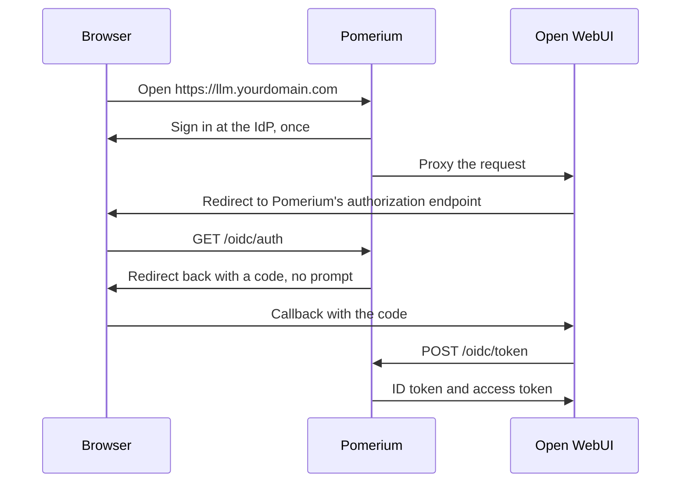

import CodeBlock from '@theme/CodeBlock';

import Config from '!!raw-loader!/content/examples/guides/llm/config.yaml';
import Compose from '!!raw-loader!/content/examples/guides/llm/docker-compose.yaml';

# Secure Open WebUI with Pomerium

## What this guide does

[Open WebUI](https://github.com/open-webui/open-webui) is a self-hosted web interface for talking to local or remote large language models (LLMs). This guide puts it behind Pomerium so that every request is authenticated against your identity provider before it reaches the model. Open WebUI keeps its standard OpenID Connect (OIDC) login, and Pomerium is the OIDC provider. Users sign in once through Pomerium, and Open WebUI completes its login without a second prompt.



## When to use this guide

Use this guide when you host Open WebUI yourself and want one access control plane in front of it: SSO, per-user or per-group policy, and audit logging, without maintaining a separate set of accounts and passwords inside the app. It applies whether your model backend is a local Ollama instance, a remote API, or anything Open WebUI supports; Pomerium sits in front of the UI regardless of the backend.

It uses Open WebUI's generic OIDC login, which works with Pomerium's [OIDC bridge](/docs/capabilities/oidc-bridge).

## Prerequisites

- [Docker](https://docs.docker.com/install/) and [Docker Compose](https://docs.docker.com/compose/install/)
- Pomerium Core with a self-hosted authenticate service on a domain you control (this guide uses `authenticate.yourdomain.com`). The OIDC bridge isn't available on the hosted authenticate service.
- An OpenID Connect identity provider. This guide uses [Keycloak](/docs/integrations/user-identity/oidc) as the example.
- A domain you control for the Open WebUI route (this guide uses `llm.yourdomain.com`)

:::tip Need an identity provider?

Follow [Keycloak + Pomerium](/docs/integrations/user-identity/oidc) to set one up, then fill in the `idp_*` settings in `config.yaml` with your client ID and secret.

:::

## Configure Pomerium

Create a `config.yaml`. It routes `llm.yourdomain.com` to the Open WebUI container, enables the OIDC bridge on that route, and sets the `shared_secret` that Pomerium uses to sign and encrypt the tokens it issues. `allow_websockets` keeps streamed responses working.

<CodeBlock language="yaml" title="config.yaml">
  {Config}
</CodeBlock>

Replace `llm.yourdomain.com` with your domain, `you@example.com` with the users or groups that should have access, and generate your own `shared_secret` with the command in the comment. The route's `from` URL is the OIDC client ID that Open WebUI uses, so it must match `OAUTH_CLIENT_ID` in the next section. Keep `shared_secret` the same across restarts. If it changes, Pomerium can't read tokens it issued earlier, and users have to sign in again.

## Configure Open WebUI

Open WebUI reads its OIDC settings from environment variables. The key settings are in the `open-webui` service of the Compose file below:

- `OAUTH_CLIENT_ID` is the route's `from` URL.
- `OAUTH_CODE_CHALLENGE_METHOD=S256` makes Open WebUI use Proof Key for Code Exchange, so no client secret is needed.
- `OAUTH_TOKEN_ENDPOINT_AUTH_METHOD=client_secret_post` sends the client ID in the token request body rather than in an HTTP Basic header.
- `OPENID_PROVIDER_URL` is the discovery document on your authenticate service: `https://authenticate.yourdomain.com/.well-known/openid-configuration`.
- `OPENID_REDIRECT_URI` is Open WebUI's callback, `https://llm.yourdomain.com/oauth/oidc/callback`. It is on the same host as the client ID, as the bridge requires.
- `ENABLE_OAUTH_SIGNUP=true` creates the Open WebUI account on first sign-in.
- `ENABLE_LOGIN_FORM=false` hides the email and password form, so Pomerium is the only login option.

Pomerium sends every claim as a string, so a `groups` claim arrives as a comma-separated string such as `"engineering,admins"`. Check the Open WebUI [SSO documentation](https://docs.openwebui.com/features/authentication-access/auth/sso) before relying on group or role mapping.

The first user Open WebUI provisions becomes an admin; everyone provisioned after that lands in a pending role and sees a "waiting for activation" screen until an admin approves them. Plan for that, or set `DEFAULT_USER_ROLE=user` so new SSO users are active immediately.

Open WebUI calls the authenticate service from the server side for discovery and the token exchange, not only from the browser. In the Compose file, the `open-webui` container sits on an internal Docker network with no route to the outside, so Pomerium carries the `authenticate.yourdomain.com` alias on that network. If you run Open WebUI on a network that can reach your authenticate service, you don't need the alias.

## Run the stack

The Compose file runs Pomerium and Open WebUI together. Open WebUI listens on `8080`, which Pomerium routes to internally; only Pomerium publishes ports to the host. Place the `config.yaml` from the previous step next to this `docker-compose.yaml`, then start the stack:

<CodeBlock language="yaml" title="docker-compose.yaml">
  {Compose}
</CodeBlock>

```bash
docker compose up -d
```

The Open WebUI image is large and its first boot runs a one-time database migration, so give the container a minute or two to become ready the first time you start it. If you change `config.yaml` later, run `docker compose up -d` again to apply it.

The compose file pins the Open WebUI image by digest so the example is reproducible. To move to a newer release, update the digest (or switch to a version tag you have tested) and re-pull.

## Operations

To stop the stack without losing data:

```bash
docker compose down
```

To tear it down completely, including the `pomerium-cache` and `open-webui-data` volumes (this deletes your Open WebUI accounts, chats, and settings):

```bash
docker compose down -v
```

To upgrade, pull the newer images and recreate the containers; your data persists in the named volumes unless you remove them:

```bash
docker compose pull
docker compose up -d
```

## Verify the setup

1. **The route requires authentication.** In a fresh browser, open `https://llm.yourdomain.com`. You should be redirected to your identity provider through Pomerium.
2. **Open WebUI offers Pomerium login.** After you sign in, the Open WebUI login page shows a Pomerium sign-in button instead of a password form. Select it.
3. **The OIDC login completes without a prompt.** Open WebUI signs you in, and the account in the corner shows your authenticated identity.

   

4. **A disallowed user is blocked.** Sign in as a user your policy excludes and open `https://llm.yourdomain.com`. Pomerium denies access before Open WebUI loads.

## Common failure modes

| Symptom | Cause and fix |
| :-- | :-- |
| `404 Not Found` from the discovery URL or the `/oidc/` paths | Open WebUI is pointing at the wrong host. Check that `authenticate_service_url` is set and that `OPENID_PROVIDER_URL` uses the same host. |
| Discovery works, but the issuer is `https://authenticate.pomerium.app` and sign-in fails | There is no `authenticate_service_url` in the Pomerium config, so Open WebUI found the hosted authenticate service. Set `authenticate_service_url` and point Open WebUI at that URL. |
| HTTP 400 at `/oidc/auth`: `redirect_uri ... does not match client_id ...` | `OAUTH_CLIENT_ID` doesn't match the route's `from` URL, or `OPENID_REDIRECT_URI` isn't on the same host. |
| Token request fails with `invalid_client` | Open WebUI is authenticating with HTTP Basic and leaving `client_id` out of the request body. Set `OAUTH_TOKEN_ENDPOINT_AUTH_METHOD=client_secret_post`. |
| Open WebUI can't reach the discovery URL | The `open-webui` container has no route to your authenticate service. Add the `authenticate.yourdomain.com` alias to Pomerium on Open WebUI's network, or put Open WebUI on a network that can reach it. |
| `invalid_token` on the user info request | The access token was issued before Pomerium restarted without a fixed `shared_secret`. Set `shared_secret` and sign in again. |
| Open WebUI still shows a password form | Set `ENABLE_LOGIN_FORM=false` so Pomerium is the only login option. Open WebUI keeps OAuth settings from its database after first start unless the environment is authoritative; see its SSO documentation if changes don't apply. |
| Streamed responses hang or never start | WebSockets are not allowed on the route. Set `allow_websockets: true`. |
| 502 / connection refused from Pomerium | Open WebUI is still booting its first-run migration, or the `to` address doesn't match the service name and port (`http://open-webui:8080`). |

## Security considerations

- **Keep the route protected.** The bridge handles login only. Route policy decides who can reach Open WebUI, and Pomerium checks it on every request. A public route would let anyone who can sign in to Pomerium get an Open WebUI account.
- **Only Pomerium should reach Open WebUI.** The Compose file publishes no host ports for Open WebUI and puts it on an `internal` Docker network shared only with Pomerium. Reproduce that isolation in production.
- **Pomerium issues the tokens.** Open WebUI gets its ID and access tokens from Pomerium, not directly from your identity provider.
- **No refresh tokens.** When the Pomerium session expires, the next request sends the user back to Pomerium to sign in.
- **No client secret needed.** If you later use an app that does not support Proof Key for Code Exchange, the bridge supports a `client_secret` on that route. Keep it secret.
- **Account creation follows the policy.** `ENABLE_OAUTH_SIGNUP=true` creates an Open WebUI account for every user your policy allows. Open WebUI's pending-approval role still applies unless you set `DEFAULT_USER_ROLE`.

## Next steps

- [OIDC bridge](/docs/capabilities/oidc-bridge)
- Tighten the policy with group-based rules or [Pomerium Policy Language](/docs/internals/ppl).
- Point Open WebUI at your model backend with `OLLAMA_BASE_URL` or an OpenAI-compatible endpoint.
- Add more self-hosted tools behind the same Pomerium instance with additional routes.
