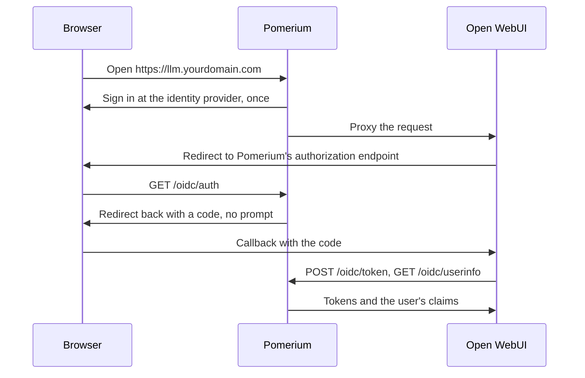
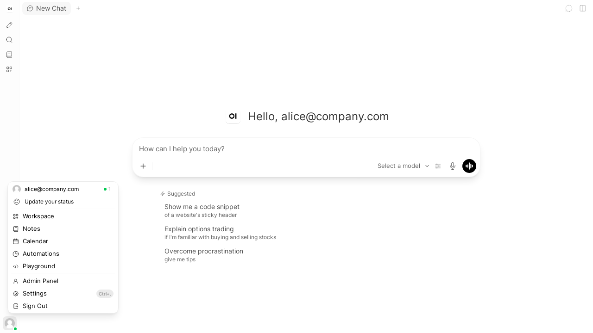
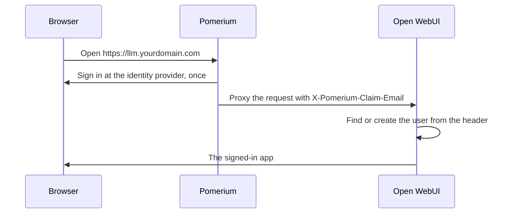
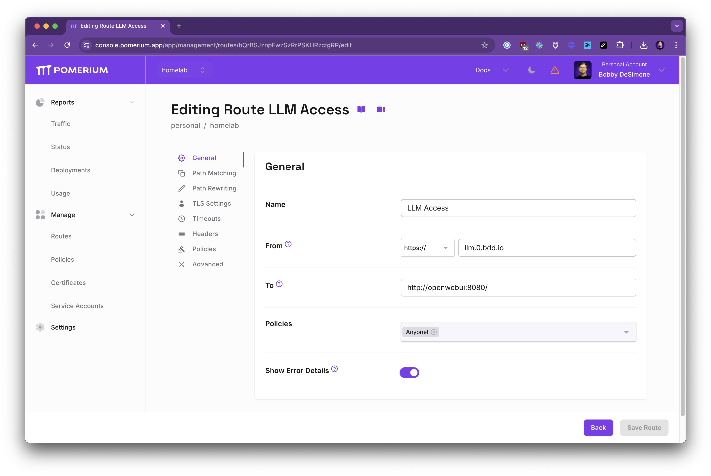
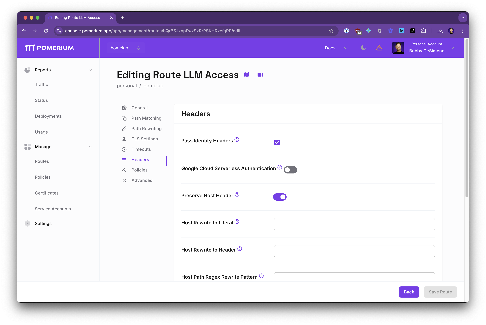
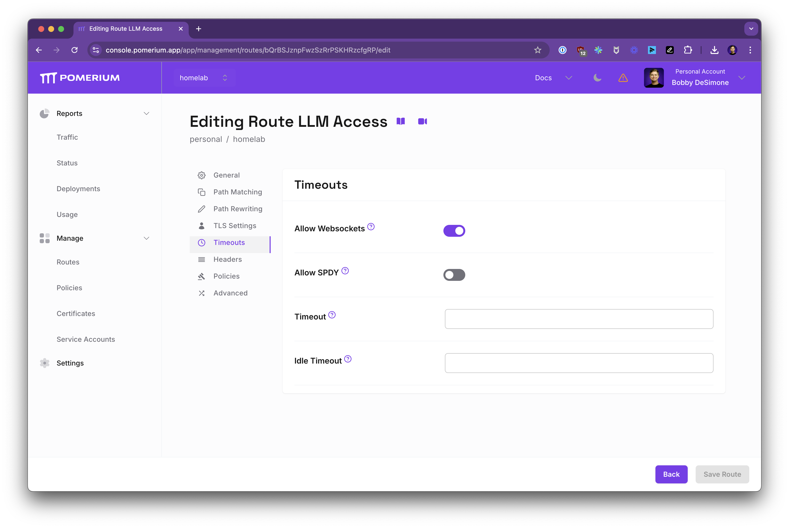
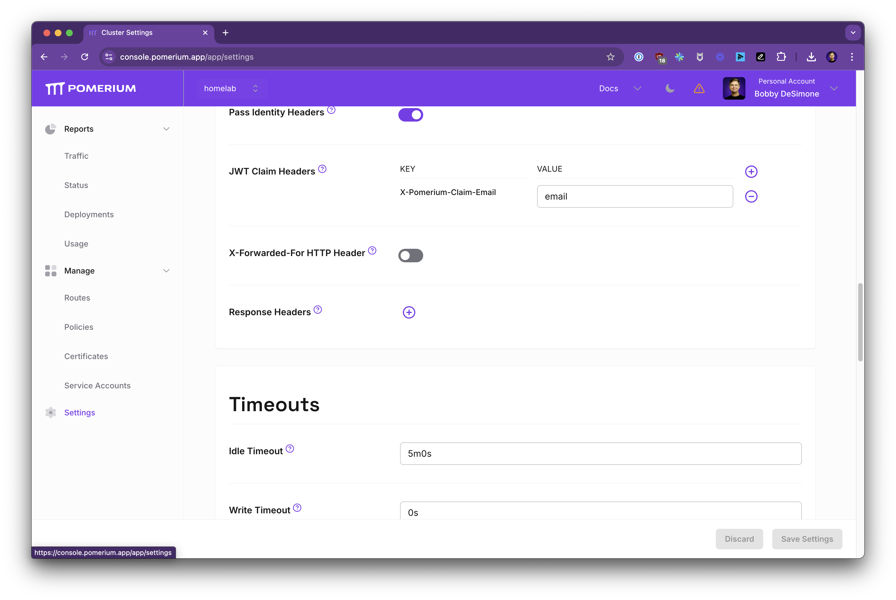
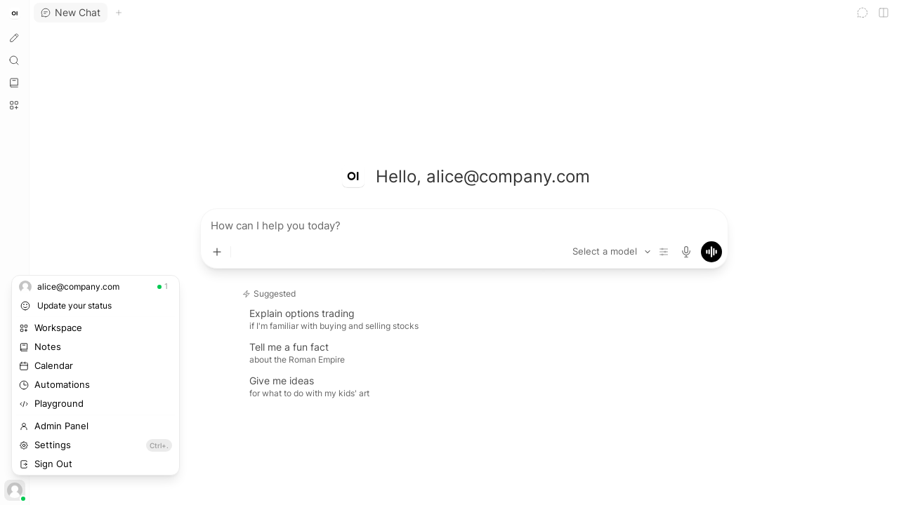

import CodeBlock from '@theme/CodeBlock';
import TabItem from '@theme/TabItem';
import Tabs from '@theme/Tabs';

import Config from '!!raw-loader!/content/examples/guides/llm/config.yaml';
import Compose from '!!raw-loader!/content/examples/guides/llm/docker-compose.yaml';
import ProxyHeadersConfig from '!!raw-loader!/content/examples/guides/llm-proxy-headers/config.yaml';
import ProxyHeadersCompose from '!!raw-loader!/content/examples/guides/llm-proxy-headers/docker-compose.yaml';

# Secure Open WebUI with Pomerium

Pomerium can sign users in to [Open WebUI](https://github.com/open-webui/open-webui), a self-hosted web interface for large language models (LLMs), so they never see a separate Open WebUI login.

There are two ways to secure Open WebUI with Pomerium: the OIDC bridge and proxy headers. The table below compares them, and each one has its own tab with the full setup.

|  | OIDC bridge | Proxy headers |
| :-- | :-- | :-- |
| Open WebUI login | Its [OpenID Connect (OIDC) login](https://docs.openwebui.com/features/authentication-access/auth/sso), with Pomerium as the OIDC provider | [Trusted-header SSO](https://docs.openwebui.com/features/authentication-access/auth/sso) from the `X-Pomerium-Claim-Email` header |
| What Open WebUI trusts | Tokens from Pomerium's OIDC endpoints, using Proof Key for Code Exchange (PKCE) instead of a client secret | The email header, from any peer that can reach Open WebUI |
| Route settings | `oidc_bridge`, `allow_websockets`, `set_response_headers` | `pass_identity_headers`, `allow_websockets`, plus global `jwt_claims_headers` |
| Authenticate service URL | Must be a domain you control | The default hosted URL works |

Use **OIDC bridge** if you control an authenticate service domain and want Open WebUI to verify tokens with Pomerium rather than trusting headers on the network; use **Proxy headers** if you want to stay on Pomerium's hosted authenticate URL and can strictly isolate Open WebUI on a private network.

Both setups skip Open WebUI's own login screen, and Open WebUI creates each user's account the first time they sign in. Signing out of Open WebUI also signs you out of Pomerium. The model backend (Ollama, a remote API, or anything else Open WebUI supports) doesn't change the setup. This guide was tested with Open WebUI 0.13.3.

## Prerequisites

- You've completed the [Quickstart](/docs/get-started/quickstart), and Pomerium is running
- [Docker](https://docs.docker.com/install/) and [Docker Compose](https://docs.docker.com/compose/install/)
- A domain for the Open WebUI route (this guide uses `llm.yourdomain.com`)
- For the OIDC bridge only: an authenticate service URL on a domain you control (this guide uses `authenticate.yourdomain.com`)

:::tip Prefer to self-host the identity provider?

This guide uses Pomerium's [hosted identity provider](/docs/capabilities/authentication#hosted-authenticate-service), so you don't have to run one. To run your own instead, follow [Keycloak + Pomerium](/docs/integrations/user-identity/oidc) and add its `idp_*` settings to `config.yaml`.

:::

<Tabs queryString="method">
<TabItem value="oidc-bridge" label="OIDC bridge" default>

Pomerium's [OIDC bridge](https://www.pomerium.com/docs/capabilities/oidc-bridge) makes Pomerium an OpenID Connect provider for Open WebUI's built-in OIDC login. Users sign in to Pomerium once, and Open WebUI finishes its own login without asking them to sign in again.



## Configure Pomerium {#oidc-bridge-configure-pomerium}

Open WebUI needs two routes on the same domain: one for its static assets and one for everything else. The caution after the tabs explains why.

<Tabs queryString="type">
<TabItem value="zero" label="Pomerium Zero" default>

1. On the **Identity Provider** page of the [Zero Console](https://console.pomerium.app), set **Authenticate Service URL** to a domain you control, such as `https://authenticate.yourdomain.com`. Leave **Hosted Authenticate** selected.
1. Create the static assets route. Set **From** to `https://llm.<your-starter-domain>`, **To** to `http://open-webui:8080`, and the policy to the users who should reach Open WebUI.
1. On the **Path Matching** tab, choose **Prefix** and enter `/_app/immutable/`.
1. On the **Headers** tab, under **Set Response Headers**, add `Cache-Control` with the value `private, max-age=31536000, immutable`, then save.
1. Create the Open WebUI route with the same **From**, **To**, and policy.
1. On the **Advanced** tab, under **OIDC Bridge**, turn on **Enabled**. Leave **OIDC Bridge Client Secret** empty. Open WebUI uses PKCE, which proves the token request comes from the same client that started the login, so it doesn't need a secret.
1. On the **Timeouts** tab, turn on **Allow Websockets**, so Open WebUI can stream responses.
1. On the **Headers** tab, under **Set Response Headers**, add `Cache-Control` with the value `no-cache`, then save.
1. Order the static assets route above the Open WebUI route.

The route's **From** URL also serves as the OIDC client ID. Wherever this guide shows `https://llm.yourdomain.com`, use your **From** URL instead. That includes the `WEBUI_URL`, `OAUTH_CLIENT_ID`, `OPENID_REDIRECT_URI`, and `OPENID_END_SESSION_ENDPOINT` settings.

</TabItem>
<TabItem value="core" label="Pomerium Core">

Create a `config.yaml` file with the following contents. The comments in the file explain what each setting does.

<CodeBlock language="yaml" title="config.yaml">
  {Config}
</CodeBlock>

Replace the example domains and `you@example.com` with your own values. Generate `cookie_secret` and `shared_secret` with the command shown in each setting's comment. Don't regenerate them when Pomerium restarts, or every user has to sign in again.

</TabItem>
</Tabs>

:::caution Keep both routes, in this order

Open WebUI doesn't send a `Cache-Control` header, so browsers keep reusing the cached app page after the Pomerium session ends. The page's requests to Open WebUI's API then get redirected to sign-in, the browser blocks those redirects, and Open WebUI reloads in a loop. The `no-cache` header makes the browser check with Pomerium before it reuses the page, and the long-lived header on `/_app/immutable/` keeps Open WebUI's versioned files cached. Keep the `/_app/immutable/` route first, because Pomerium uses the first route that matches.

:::

## Configure and run Open WebUI {#oidc-bridge-run-the-stack}

Open WebUI runs in Docker Compose on a private network that only Pomerium shares. That network has no route to the outside world, so Pomerium also answers there as `authenticate.yourdomain.com`. That's how Open WebUI reaches the authenticate service for OIDC discovery and the token exchange. The comments in the Compose file explain each Open WebUI setting.

<Tabs queryString="type">
<TabItem value="zero" label="Pomerium Zero" default>

The Quickstart's `compose.yaml` already runs Pomerium. From the following Compose file, copy only the `open-webui` service, the `internal` network, and the `open-webui-data` volume into it.

<CodeBlock language="yaml" title="docker-compose.yaml">
  {Compose}
</CodeBlock>

Then add the `internal` network to the `pomerium` service in the Quickstart's `compose.yaml`, with an alias for your authenticate service:

```yaml
services:
  pomerium:
    networks:
      main:
        aliases:
          - verify.<CLUSTER_STARTER_SUBDOMAIN>.pomerium.app
      internal:
        aliases:
          - authenticate.yourdomain.com
```

</TabItem>
<TabItem value="core" label="Pomerium Core">

The following Compose file runs Pomerium Core and Open WebUI together.

<CodeBlock language="yaml" title="docker-compose.yaml">
  {Compose}
</CodeBlock>

</TabItem>
</Tabs>

Start the stack:

```bash
docker compose up -d
```

The first start runs a database migration, so Open WebUI can take a minute or two to become ready. If you change `config.yaml` later, run `docker compose restart pomerium` to apply it. If you change the Compose file, run `docker compose up -d`.

Pomerium sends every claim as a string, so a `groups` claim arrives as one comma-separated value, such as `"engineering,admins"`, rather than a list. Check Open WebUI's [SSO docs](https://docs.openwebui.com/features/authentication-access/auth/sso) before you rely on group mapping.

## Make yourself the administrator {#oidc-bridge-make-yourself-the-administrator}

Open WebUI makes the first account it creates an administrator. Until that account exists, Open WebUI shows its welcome screen instead of starting the OIDC login. To make sure the first account is yours, sign in before anyone else does: open Open WebUI, select **Get started**, then select **Continue with Pomerium**.

After that, every sign-in is automatic. Later users wait on an activation screen until an administrator approves them in the **Admin Panel**. To make new users active right away instead, uncomment `DEFAULT_USER_ROLE=user` in the Compose file.

## Verify the setup {#oidc-bridge-verify-the-setup}

1. Open `https://llm.yourdomain.com` in a private or incognito window. Pomerium asks you to sign in.
1. Sign in. On a new install, select **Get started**, then **Continue with Pomerium**.
1. Open the account menu. It shows your email, and you never saw an Open WebUI login page.

   

1. Select **Sign Out** from the account menu. When you open Open WebUI again, Pomerium asks you to sign in, with no confirmation page or reload loop.
1. Sign in as a user your policy excludes. Pomerium denies access before Open WebUI loads, so Open WebUI never creates an account for that user.

## Troubleshooting {#oidc-bridge-common-failure-modes}

| Symptom | Fix |
| :-- | :-- |
| Pomerium returns `403` | Replace `you@example.com` in the route policy with your users or domain. |
| `404 Not Found` from the discovery URL or the `/oidc/` paths | Set `authenticate_service_url`, and use the same host in `OPENID_PROVIDER_URL`. |
| The discovery issuer is `https://authenticate.pomerium.app` and sign-in fails | Set `authenticate_service_url` to your own domain, and point `OPENID_PROVIDER_URL` at it. |
| `invalid_scope` with `unsupported scope requested` at `/oidc/auth` | Set `OAUTH_SCOPES=openid`. The bridge accepts no other scope. |
| `unknown client_id` at `/oidc/auth` | Set `OAUTH_CLIENT_ID` to the route's `from` URL. |
| `redirect_uri ... does not match client_id ...` at `/oidc/auth` | Put `OPENID_REDIRECT_URI` under the route's `from` URL. |
| `invalid_client` on the token request | Set `OAUTH_TOKEN_ENDPOINT_AUTH_METHOD=client_secret_post`. |
| Open WebUI can't reach the discovery URL | Check the `authenticate.yourdomain.com` alias on the `pomerium` service. |
| `invalid_token` on the user info request | Set a fixed `shared_secret` and sign in again. |
| Open WebUI shows a password form or a **Continue with Pomerium** button | Set `ENABLE_LOGIN_FORM=false` and `OAUTH_AUTO_REDIRECT=true`. If the form persists, turn it off under **Admin Panel** > **Settings** > **Authentication**. |
| The first sign-in shows Open WebUI's welcome screen | Expected on a new install. Select **Get started**, then **Continue with Pomerium**. |
| New users see a "waiting for activation" screen | Approve them in the **Admin Panel**, or set `DEFAULT_USER_ROLE=user`. |
| After sign-out, the page reloads in a loop with CORS errors for `/api/config`, `loader.js`, or `manifest.json` | Add the `Cache-Control` response headers from `config.yaml`, then clear the site's cached data once. |
| Sign-out signs you straight back in, or shows a Pomerium sign-out confirmation page | Set `OPENID_END_SESSION_ENDPOINT` to `https://llm.yourdomain.com/.pomerium/sign_out`. |
| Sign-out stops at your identity provider with `Invalid redirect uri` | Register `https://authenticate.yourdomain.com/.pomerium/signed_out` as a post-logout redirect URI on your identity provider's client. |
| Users have the default avatar | Make sure your identity provider sends a `picture` claim, then see the `OAUTH_UPDATE_PICTURE_ON_LOGIN` comment in the Compose file. |
| Open WebUI keeps the old domain after you change it | Update **WebUI URL** under **Admin Panel** > **Settings** > **General**. |
| Streamed responses hang or never start | Set `allow_websockets: true`, or turn on **Allow Websockets** in Zero. |
| `502` or connection refused from Pomerium | Wait for the first-start migration to finish, and check that `to` is `http://open-webui:8080`. |

## Security considerations {#oidc-bridge-security-considerations}

- **Keep the route policy tight.** Open WebUI creates an account for every user the policy allows, the first time they sign in, so the policy decides who gets an Open WebUI account.
- **Don't publish Open WebUI's port.** If users can reach `open-webui:8080` directly, they skip Pomerium's policy checks. Only Pomerium should be able to reach it.
- **Sessions end with Pomerium's.** The bridge doesn't issue refresh tokens, so Open WebUI can't extend a session on its own. When the Pomerium session expires, the user signs in again.
- **Sign-out is global.** Signing out of Open WebUI ends the Pomerium session for every route in that browser.

## Next steps {#oidc-bridge-next-steps}

- [OIDC bridge](https://www.pomerium.com/docs/capabilities/oidc-bridge)
- [Pomerium Policy Language](/docs/internals/ppl)
- Point Open WebUI at your model backend with `OLLAMA_BASE_URL` or an OpenAI-compatible endpoint.

</TabItem>
<TabItem value="proxy-headers" label="Proxy headers">

Pomerium adds the user's email to every request it forwards to Open WebUI, in the `X-Pomerium-Claim-Email` header. Open WebUI's trusted-header SSO reads that header and signs the user in, creating the account on their first visit.



:::caution Open WebUI trusts the email header from any peer

Open WebUI can't verify where the header came from, so it believes whatever `X-Pomerium-Claim-Email` value arrives with a request. Anyone who can reach Open WebUI without going through Pomerium can send their own header and sign in as any user. Keep Open WebUI reachable only through Pomerium, and read the [Security considerations](#proxy-headers-security-considerations) before you deploy.

:::

## Configure Pomerium {#proxy-headers-configure-pomerium}

<Tabs queryString="type">
<TabItem value="zero" label="Pomerium Zero" default>

1. In the [Zero Console](https://console.pomerium.app), create a route. Set **From** to `https://llm.<your-starter-domain>`, **To** to `http://open-webui:8080`, and the policy to the users who should reach Open WebUI.

   

1. On the **Headers** tab, turn on **Pass Identity Headers**.

   

1. On the **Timeouts** tab, turn on **Allow Websockets**, so Open WebUI can stream responses. Then save.

   

1. Go to **Settings** > **Headers**. Under **JWT Claim Headers**, map the `email` claim to `X-Pomerium-Claim-Email`, then save. Pass Identity Headers on its own doesn't send this header, so Open WebUI needs the mapping to see the user's email.

   

Wherever this guide shows `https://llm.yourdomain.com`, use your route's **From** URL instead. That includes the `WEBUI_URL` and `WEBUI_AUTH_SIGNOUT_REDIRECT_URL` settings.

</TabItem>
<TabItem value="core" label="Pomerium Core">

Create a `config.yaml` file with the following contents. The comments in the file explain what each setting does.

<CodeBlock language="yaml" title="config.yaml">
  {ProxyHeadersConfig}
</CodeBlock>

Replace the example domain and `you@example.com` with your own values. Generate `cookie_secret` with the command shown in its comment. Don't regenerate it when Pomerium restarts, or every user has to sign in again.

</TabItem>
</Tabs>

## Configure and run Open WebUI {#proxy-headers-run-the-stack}

Open WebUI runs in Docker Compose on a private network that only Pomerium shares, so nothing else can reach it and send a forged email header. The comments in the Compose file explain each Open WebUI setting.

<Tabs queryString="type">
<TabItem value="zero" label="Pomerium Zero" default>

The Quickstart's `compose.yaml` already runs Pomerium. From the following Compose file, copy only the `open-webui` service, the `internal` network, and the `open-webui-data` volume into it.

<CodeBlock language="yaml" title="docker-compose.yaml">
  {ProxyHeadersCompose}
</CodeBlock>

Then add the `internal` network to the `pomerium` service in the Quickstart's `compose.yaml`:

```yaml
services:
  pomerium:
    networks:
      main:
        aliases:
          - verify.<CLUSTER_STARTER_SUBDOMAIN>.pomerium.app
      internal: {}
```

</TabItem>
<TabItem value="core" label="Pomerium Core">

The following Compose file runs Pomerium Core and Open WebUI together.

<CodeBlock language="yaml" title="docker-compose.yaml">
  {ProxyHeadersCompose}
</CodeBlock>

</TabItem>
</Tabs>

Start the stack:

```bash
docker compose up -d
```

The first start runs a database migration, so Open WebUI can take a minute or two to become ready. If you change `config.yaml` later, run `docker compose restart pomerium` to apply it. If you change the Compose file, run `docker compose up -d`.

## Make yourself the administrator {#proxy-headers-make-yourself-the-administrator}

Open WebUI makes the first account it creates an administrator, so sign in through Pomerium before anyone else does. Later users wait on an activation screen until an administrator approves them in the **Admin Panel**. To make new users active right away instead, uncomment `DEFAULT_USER_ROLE=user` in the Compose file.

## Verify the setup {#proxy-headers-verify-the-setup}

1. Open `https://llm.yourdomain.com` in a private or incognito window. Pomerium asks you to sign in.
1. Sign in. You land in Open WebUI without seeing its login page, and the account menu shows your email.

   

1. Select **Sign Out** from the account menu. When you open Open WebUI again, Pomerium asks you to sign in.
1. Sign in as a user your policy excludes. Pomerium denies access before Open WebUI loads, so Open WebUI never creates an account for that user.

## Troubleshooting {#proxy-headers-common-failure-modes}

| Symptom | Fix |
| :-- | :-- |
| Pomerium returns `403` | Replace `you@example.com` in the route policy with your users or domain. |
| Open WebUI shows its own login screen | Turn on `pass_identity_headers`, map `email` to `X-Pomerium-Claim-Email` in `jwt_claims_headers` (or **JWT Claim Headers** in Zero), and check `WEBUI_AUTH_TRUSTED_EMAIL_HEADER`. |
| Wrong or blank user in Open WebUI | Use `X-Pomerium-Claim-Email` in both Pomerium and `WEBUI_AUTH_TRUSTED_EMAIL_HEADER`. |
| New users see a "waiting for activation" screen | Approve them in the **Admin Panel**, or set `DEFAULT_USER_ROLE=user`. |
| Sign-out signs you straight back in | Set `WEBUI_AUTH_SIGNOUT_REDIRECT_URL` to `https://llm.yourdomain.com/.pomerium/sign_out`. |
| Sign-out stops at your identity provider with `Invalid redirect uri` | Register your authenticate service's `/.pomerium/signed_out` URL as a post-logout redirect URI on your identity provider's client. |
| Open WebUI keeps the old domain after you change it | Update **WebUI URL** under **Admin Panel** > **Settings** > **General**. |
| Streamed responses hang or never start | Set `allow_websockets: true`, or turn on **Allow Websockets** in Zero. |
| `502` or connection refused from Pomerium | Wait for the first-start migration to finish, and check that `to` is `http://open-webui:8080`. |

## Security considerations {#proxy-headers-security-considerations}

- **Don't publish Open WebUI's port.** When a request goes through Pomerium, Pomerium replaces any `X-Pomerium-Claim-Email` header the client sent with the signed-in user's email. A request that reaches `open-webui:8080` directly skips that step, so it can claim to be anyone. Check firewalls and load balancers too, not just the Compose file.
- **Keep the route policy tight.** The policy is what decides who gets in, and Open WebUI creates an account for every user it allows on their first visit.
- **Sign-out is global.** Signing out of Open WebUI ends the Pomerium session for every route in that browser.

## Next steps {#proxy-headers-next-steps}

- [Pass identity headers](/docs/reference/routes/pass-identity-headers-per-route)
- [JWT claim headers](/docs/reference/jwt-claim-headers)
- Point Open WebUI at your model backend with `OLLAMA_BASE_URL` or an OpenAI-compatible endpoint.

</TabItem>
</Tabs>

## Stop, reset, or upgrade

Run `docker compose down` to stop the stack. Add `-v` to also delete the `pomerium-cache` and `open-webui-data` volumes, including all Open WebUI accounts and chats. To upgrade, update the pinned image tags and digests in the Compose file, then run `docker compose pull` and `docker compose up -d`.
