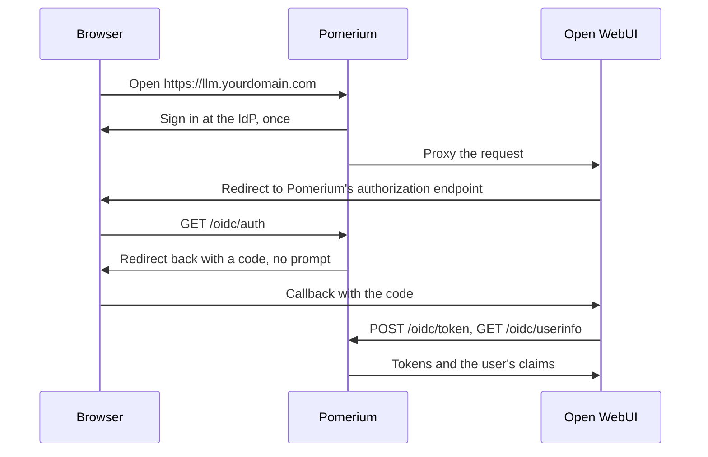
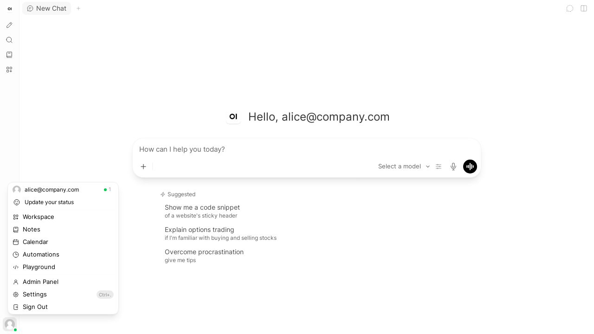
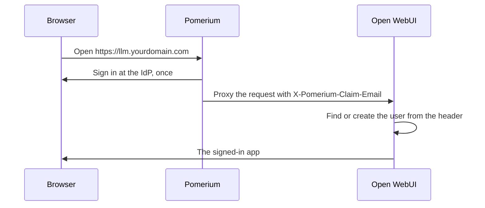
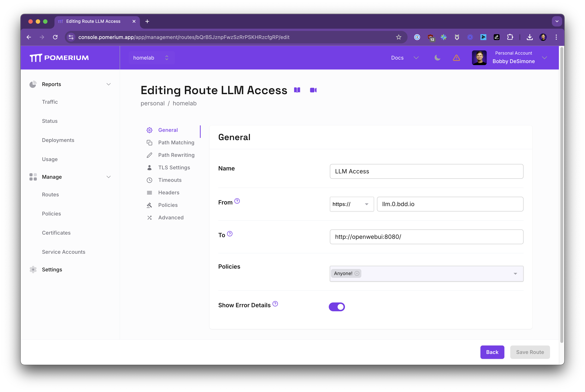
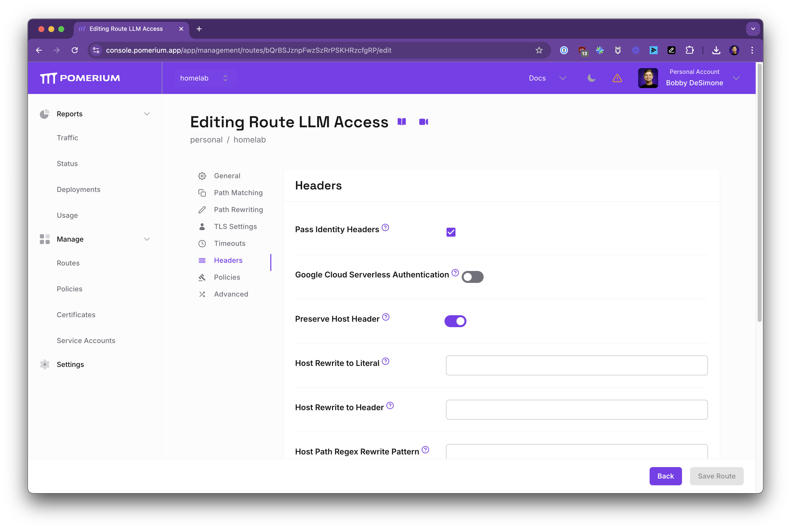
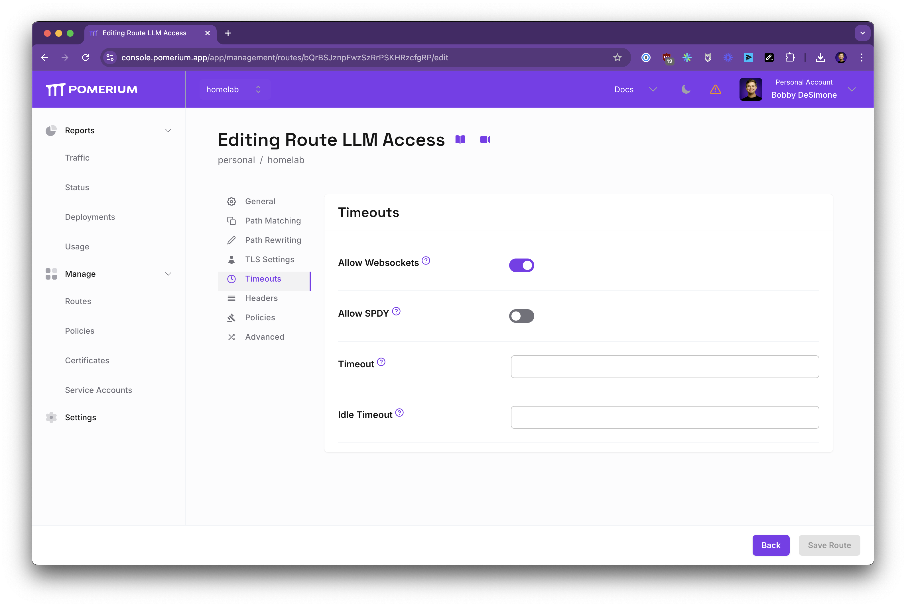
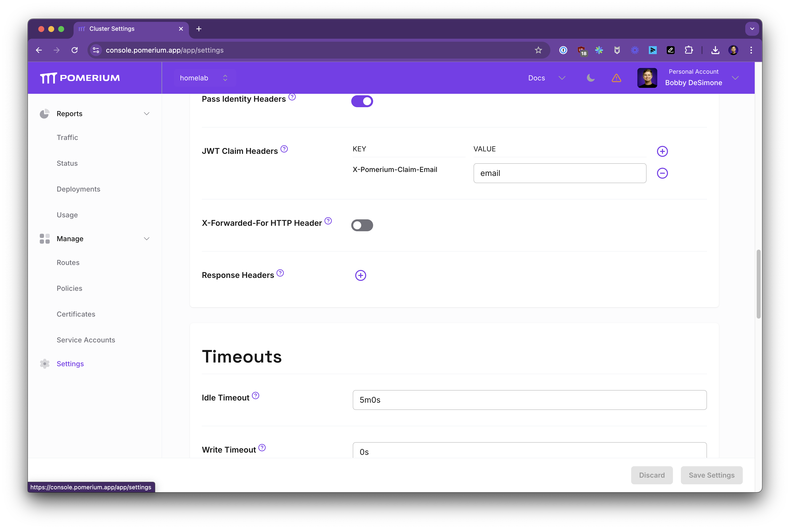
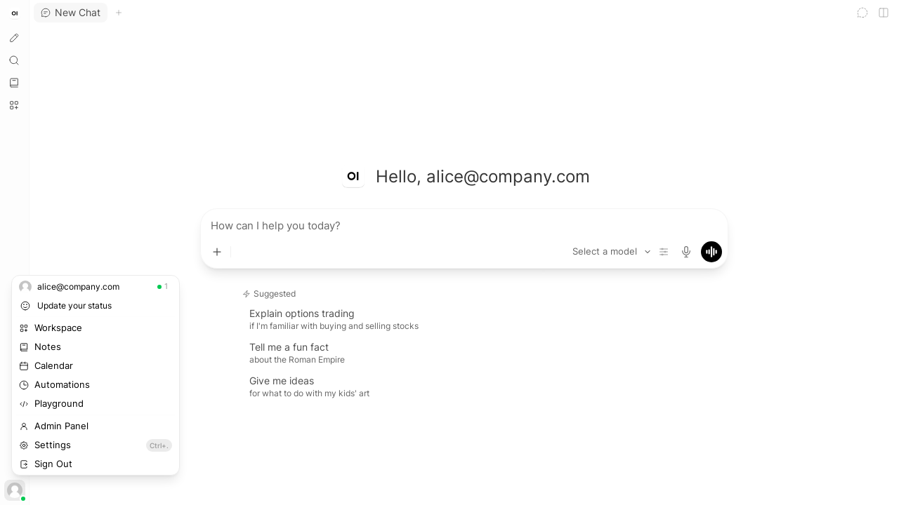

import CodeBlock from '@theme/CodeBlock';
import TabItem from '@theme/TabItem';
import Tabs from '@theme/Tabs';

import Config from '!!raw-loader!/content/examples/guides/llm/config.yaml';
import Compose from '!!raw-loader!/content/examples/guides/llm/docker-compose.yaml';
import ProxyHeadersConfig from '!!raw-loader!/content/examples/guides/llm-proxy-headers/config.yaml';
import ProxyHeadersCompose from '!!raw-loader!/content/examples/guides/llm-proxy-headers/docker-compose.yaml';

# Secure Open WebUI with Pomerium

## What this guide does

[Open WebUI](https://github.com/open-webui/open-webui) is a self-hosted web interface for talking to local or remote large language models (LLMs). This guide puts it behind Pomerium so that every request is authenticated against your identity provider before it reaches the model, and so that Open WebUI knows who the user is without running its own login. Users sign in once through Pomerium, and Open WebUI creates their account on first visit with no second password.

There are two ways to sign users in to Open WebUI. Choose one with the tabs below:

|  | OIDC bridge | Proxy headers |
| :-- | :-- | :-- |
| How Open WebUI signs users in | Its [OIDC login](https://docs.openwebui.com/features/authentication-access/auth/sso), with Pomerium as the OpenID Connect (OIDC) provider | [Trusted-header SSO](https://docs.openwebui.com/features/authentication-access/auth/sso) from the `X-Pomerium-Claim-Email` header |
| What Open WebUI verifies | Tokens it gets from Pomerium's OIDC endpoints, using PKCE with no client secret | Nothing. It trusts the header, so Pomerium must be the only way in |
| Pomerium route settings | OIDC bridge, `allow_websockets`, and caching headers | `pass_identity_headers`, `jwt_claims_headers`, and `allow_websockets` |
| Authenticate service URL | Must be a domain you control | The default hosted URL works |
| Sign-out | Signing out of Open WebUI also signs out of Pomerium | Signing out of Open WebUI also signs out of Pomerium |

## When to use this guide

Use this guide when you host Open WebUI yourself and want one access control plane in front of it: SSO, per-user or per-group policy, and audit logging, without maintaining a separate set of accounts and passwords inside the app. It applies whether your model backend is a local Ollama instance, a remote API, or anything Open WebUI supports; Pomerium sits in front of the UI regardless of the backend.

This guide is tested with Open WebUI 0.13.3.

## Prerequisites

This guide assumes you've completed the [Quickstart](/docs/get-started/quickstart), so you already have Pomerium running and signing users in through the hosted authenticate service.

You also need:

- [Docker](https://docs.docker.com/install/) and [Docker Compose](https://docs.docker.com/compose/install/)
- An identity provider. This guide uses Pomerium's [hosted identity provider](/docs/capabilities/authentication#hosted-authenticate-service) (`idp_provider: hosted`), which signs users in with email and password, Google, or GitHub.
- A domain you control for the Open WebUI route (this guide uses `llm.yourdomain.com`)
- For the OIDC bridge method, Pomerium Zero or Pomerium Core with the authenticate service URL set to a domain you control (this guide uses `authenticate.yourdomain.com`). The OIDC bridge isn't served from Pomerium's default hosted authenticate URL. You can still use the hosted identity provider behind your own URL.

:::tip Prefer to self-host the identity provider?

This guide uses the hosted authenticate service so you don't have to run an identity provider (IdP). To run your own instead, follow [Keycloak + Pomerium](/docs/integrations/user-identity/oidc) and swap the `authenticate_service_url` / `idp_*` settings into the config below.

:::

<Tabs queryString="method">
<TabItem value="oidc-bridge" label="OIDC bridge" default>

Open WebUI keeps its standard OIDC login, and Pomerium is the OIDC provider. Users sign in once through Pomerium, and Open WebUI completes its login without a second prompt or a click. Signing out of Open WebUI also signs them out of Pomerium.



Use this method when Open WebUI should keep its own OIDC login. It uses Pomerium's [OIDC bridge](https://www.pomerium.com/docs/capabilities/oidc-bridge) as its provider.

## Configure Pomerium {#oidc-bridge-configure-pomerium}

<Tabs queryString="type">
<TabItem value="zero" label="Pomerium Zero" default>

In the [Zero Console](https://console.pomerium.app), create two **Routes** for `llm.<your-starter-domain>`:

1. **Static assets route.** This route caches Open WebUI's content-hashed build assets.
   - In **From**, enter `https://llm.<your-starter-domain>`, and on the **Path Matching** tab, choose **Prefix** and enter `/_app/immutable/`; in **To**, enter `http://open-webui:8080`.
   - On the **Headers** tab, under **Set Response Headers**, add `Cache-Control` with the value `private, max-age=31536000, immutable`.
   - Set the policy to the users or groups that should have access.
2. **Open WebUI route.**
   - In **From**, enter `https://llm.<your-starter-domain>`; in **To**, enter `http://open-webui:8080`.
   - Set the same policy as the first route.
   - On the **Advanced** tab, under **OIDC Bridge**, turn on **Enabled**. Open WebUI uses Proof Key for Code Exchange (PKCE), so leave **OIDC Bridge Client Secret** empty.
   - On the **Timeouts** tab, turn on **Allow Websockets**, so streamed responses keep working.
   - On the **Headers** tab, under **Set Response Headers**, add `Cache-Control` with the value `no-cache`.

Order the static assets route above the Open WebUI route.

Zero manages the token-signing secret for you, so there's no `shared_secret` to set. Before you create the routes, open the **Identity Provider** page in the Zero Console, set **Authenticate Service URL** to a domain you control (this guide uses `https://authenticate.yourdomain.com`), and leave **Hosted Authenticate** selected. The OIDC bridge isn't served from Pomerium's default hosted authenticate URL.

The route's **From** URL is the OIDC client ID. In the steps below, use `https://llm.<your-starter-domain>` wherever the guide shows `https://llm.yourdomain.com`, including `OAUTH_CLIENT_ID`, `OPENID_REDIRECT_URI`, `OPENID_END_SESSION_ENDPOINT`, and `WEBUI_URL` in the Compose file. If the client ID doesn't match, Pomerium rejects the sign-in with `unknown client_id`. If the redirect URI isn't under it, Pomerium rejects it with `redirect_uri ... does not match client_id`.

</TabItem>
<TabItem value="core" label="Pomerium Core">

Create a `config.yaml`. It routes `llm.yourdomain.com` to the Open WebUI container and enables the OIDC bridge on that route. It also sets the `cookie_secret` that encrypts Pomerium's session cookies and the `shared_secret` that Pomerium uses to sign and encrypt the tokens it issues. `allow_websockets` keeps streamed responses working.

<CodeBlock language="yaml" title="config.yaml">
  {Config}
</CodeBlock>

Replace `llm.yourdomain.com` and `authenticate.yourdomain.com` with your domains and `you@example.com` with the users or groups that should have access, and generate your own `cookie_secret` and `shared_secret` with the command in each comment. Keep both the same across restarts. If either changes, Pomerium can't read the sessions and tokens it issued earlier, and users have to sign in again. The route's `from` URL is the OIDC client ID that Open WebUI uses, so it must match `OAUTH_CLIENT_ID` in the next section.

The config uses two routes for the same host because Open WebUI doesn't send a `Cache-Control` header. Without one, browsers cache the app page and keep loading it from cache after the Pomerium session ends. The page's own requests then get redirected to sign-in, the browser blocks those cross-origin redirects, and Open WebUI reloads in a loop. The routes set caching explicitly:

- `/_app/immutable/` holds Open WebUI's content-hashed build assets, whose filenames change on every release. They're cached for a year, so repeat visits don't re-request them.
- Everything else, including the app page, is sent with `no-cache`. Browsers still keep a copy but check with the server before using it. An unchanged file comes back as a small `304 Not Modified`, and an expired session redirects the page to sign-in.

Keep the `/_app/immutable/` route first. Pomerium uses the first route that matches a request.

</TabItem>
</Tabs>

## Configure Open WebUI {#oidc-bridge-configure-open-webui}

Open WebUI reads its OIDC settings from environment variables. The key settings are in the `open-webui` service of the Compose file below:

- `OAUTH_CLIENT_ID` is the route's `from` URL.
- `OAUTH_CODE_CHALLENGE_METHOD=S256` makes Open WebUI use PKCE, so no client secret is needed.
- `OAUTH_TOKEN_ENDPOINT_AUTH_METHOD=client_secret_post` sends the client ID in the token request body rather than in an HTTP Basic header.
- `OAUTH_SCOPES=openid` is the only scope the OIDC bridge accepts. Open WebUI still gets the user's email and name from Pomerium's user info endpoint.
- `OPENID_PROVIDER_URL` is the discovery document on your authenticate service: `https://authenticate.yourdomain.com/.well-known/openid-configuration`.
- `OPENID_REDIRECT_URI` is Open WebUI's callback, `https://llm.yourdomain.com/oauth/oidc/callback`. It is under the client ID, as the bridge requires.
- `ENABLE_OAUTH_SIGNUP=true` creates the Open WebUI account on first sign-in.
- `ENABLE_LOGIN_FORM=false` hides the email and password form, so Pomerium is the only login option.
- `OAUTH_AUTO_REDIRECT=true` skips Open WebUI's "Continue with Pomerium" button and starts the OIDC login right away. It applies only when Pomerium is the only provider, the login form is off, and Open WebUI already has at least one account. If the login fails, Open WebUI shows the error instead of redirecting again.

- `OPENID_END_SESSION_ENDPOINT` is Pomerium's sign-out URL on the Open WebUI route, `https://llm.yourdomain.com/.pomerium/sign_out`. Open WebUI's own sign-out only clears the Open WebUI session. With auto-login on, Open WebUI would sign the user straight back in through the bridge, so sign-out has to end the Pomerium session too. Without this setting, Open WebUI uses the bridge's `end_session_endpoint` from the discovery document, which shows a sign-out confirmation page.

Pomerium sends every claim as a string, so a `groups` claim arrives as a comma-separated string such as `"engineering,admins"`. Check the Open WebUI [SSO documentation](https://docs.openwebui.com/features/authentication-access/auth/sso) before relying on group or role mapping.

The first user Open WebUI provisions becomes an admin; everyone provisioned after that lands in a pending role and sees a "waiting for activation" screen until an admin approves them. Plan for that, or set `DEFAULT_USER_ROLE=user` so new SSO users are active immediately.

Until that first account exists, Open WebUI shows its welcome screen instead of starting the OIDC login on its own. Have the person who should be the admin sign in first: select **Get started**, then **Continue with Pomerium**. After that, every sign-in is automatic.

### Profile pictures {#oidc-bridge-profile-pictures}

Open WebUI sets each user's avatar from the standard OIDC `picture` claim, a URL to an image. The bridge passes along the claims Pomerium received from your identity provider, so the avatar appears when your identity provider sends `picture`. Google includes it for accounts with a profile photo. If your identity provider uses a different claim name, set `OAUTH_PICTURE_CLAIM` to that name.

Open WebUI saves the picture only when it creates the account. Set `OAUTH_UPDATE_PICTURE_ON_LOGIN=true` to update it on every sign-in, so a photo added or changed later shows up after the user signs out and back in.

Open WebUI downloads the image on the server and stores a copy, so the `open-webui` container needs outbound access to the image host. On the Compose file's internal-only network it has none, and users get the default avatar. Open WebUI also sends the user's Pomerium access token as a bearer token with that download, so only enable picture updates for image hosts you trust.

## Run the stack {#oidc-bridge-run-the-stack}

The Compose file runs Pomerium Core and Open WebUI together. Open WebUI listens on `8080`, which Pomerium routes to internally; only Pomerium publishes ports to the host.

Open WebUI calls the authenticate service from the server side for discovery and the token exchange, not only from the browser. In the Compose file, the `open-webui` container sits on an internal Docker network with no route to the outside, so Pomerium carries the `authenticate.yourdomain.com` alias on that network. If you run Open WebUI on a network that can reach your authenticate service, you don't need the alias.

For Zero, add the `open-webui` service, the `internal` network, and the `open-webui-data` volume below to the `compose.yaml` from the Quickstart. Then attach the Quickstart's `pomerium` service to `internal`, keeping its `main` network:

```yaml
services:
  pomerium:
    networks:
      main:
        aliases:
          - verify.<CLUSTER_STARTER_SUBDOMAIN>.pomerium.app
      internal:
        aliases:
          - authenticate.yourdomain.com
```

For Pomerium Core, place the `config.yaml` from the previous step next to this `docker-compose.yaml`:

<CodeBlock language="yaml" title="docker-compose.yaml">
  {Compose}
</CodeBlock>

Start it:

```bash
docker compose up -d
```

The Open WebUI image is large and its first boot runs a one-time database migration, so give the container a minute or two to become ready the first time you start it.

If you change `config.yaml` later, restart Pomerium to apply it:

```bash
docker compose restart pomerium
```

If you change the Compose file, run `docker compose up -d` again.

## Verify the setup {#oidc-bridge-verify-the-setup}

1. **The route requires authentication.** In a fresh browser, open `https://llm.yourdomain.com`. You should be redirected to your identity provider through Pomerium.
2. **Open WebUI signs you in without a second prompt.** On a new install, select **Get started**, then **Continue with Pomerium** once to create the admin account. After that, Open WebUI starts its OIDC login automatically after you sign in to your identity provider, and you land in the app without an Open WebUI login page, a password form, or a "Continue with Pomerium" button. The account in the corner shows your authenticated identity.

   

3. **Sign-out ends both sessions.** Open the account menu and select **Sign Out**. Open WebUI sends you to Pomerium's sign-out endpoint, which ends the Pomerium session without a confirmation page. Opening `https://llm.yourdomain.com` again sends you to your identity provider to sign in, not into a reload loop.
4. **A disallowed user is blocked.** Sign in as a user your policy excludes and open `https://llm.yourdomain.com`. Pomerium denies access before Open WebUI loads, so Open WebUI never creates an account.

## Common failure modes {#oidc-bridge-common-failure-modes}

| Symptom | Cause and fix |
| :-- | :-- |
| Pomerium returns `403` | The route policy still allows only the example user. Replace it with your user or domain. |
| `404 Not Found` from the discovery URL or the `/oidc/` paths | Open WebUI is pointing at the wrong host. Check that `authenticate_service_url` is set and that `OPENID_PROVIDER_URL` uses the same host. |
| Discovery works, but the issuer is `https://authenticate.pomerium.app` and sign-in fails | There is no `authenticate_service_url` in the Pomerium config, so Open WebUI found the hosted authenticate service. Set `authenticate_service_url` and point Open WebUI at that URL. |
| HTTP 400 at `/oidc/auth`: `invalid_scope` with `unsupported scope requested` | `OAUTH_SCOPES` asks for more than `openid`. The OIDC bridge accepts only `openid`. |
| HTTP 400 at `/oidc/auth`: `unknown client_id` | `OAUTH_CLIENT_ID` doesn't match the route's `from` URL. |
| HTTP 400 at `/oidc/auth`: `redirect_uri ... does not match client_id ...` | `OPENID_REDIRECT_URI` isn't under the route's `from` URL. |
| Token request fails with `invalid_client` | Open WebUI is authenticating with HTTP Basic and leaving `client_id` out of the request body. Set `OAUTH_TOKEN_ENDPOINT_AUTH_METHOD=client_secret_post`. |
| Open WebUI can't reach the discovery URL | The `open-webui` container has no route to your authenticate service. Add the `authenticate.yourdomain.com` alias to Pomerium on Open WebUI's network, or put Open WebUI on a network that can reach it. |
| `invalid_token` on the user info request | The access token was issued before Pomerium restarted without a fixed `shared_secret`. Set `shared_secret` and sign in again. |
| Open WebUI still shows a password form or a "Continue with Pomerium" button | Set `ENABLE_LOGIN_FORM=false` and `OAUTH_AUTO_REDIRECT=true` so Pomerium is the only login option and Open WebUI starts it automatically. Open WebUI saves `ENABLE_LOGIN_FORM` in its database the first time it starts, so if you set it later, also turn off the login form under **Admin Panel** > **Settings** > **Authentication**. |
| After sign-out, the page reloads in a loop and the browser console shows CORS errors for `/api/config`, `loader.js`, or `manifest.json` redirected to your identity provider | The browser is loading Open WebUI's app page from cache. Add the `set_response_headers` caching shown in `config.yaml`, then clear the site's cached data once (or hard-reload) so the browser drops the copy it already has. |
| The first sign-in shows Open WebUI's welcome screen instead of signing you in | Expected on a new install. Select **Get started**, then **Continue with Pomerium**. Open WebUI starts the OIDC login on its own once it has an account. |
| Signing out of Open WebUI signs you straight back in, or shows a Pomerium sign-out confirmation page | `OPENID_END_SESSION_ENDPOINT` isn't set. Set it to `https://llm.yourdomain.com/.pomerium/sign_out`. |
| Sign-out stops at your identity provider with an error such as `Invalid redirect uri` | Pomerium also signs you out of your identity provider, then asks it to send you back to `https://authenticate.yourdomain.com/.pomerium/signed_out`. If you run your own identity provider, register that URL as a post-logout redirect URI on Pomerium's client. |
| Users have the default avatar | Your identity provider doesn't send a `picture` claim, or the `open-webui` container can't reach the image host. For an existing account, also set `OAUTH_UPDATE_PICTURE_ON_LOGIN=true`, then sign out of Open WebUI and sign in again. |
| After you change the domain in the Compose file, Open WebUI still uses the old one | Open WebUI saves `WEBUI_URL` in its database the first time it starts and ignores later changes to the variable. Update **WebUI URL** under **Admin Panel** > **Settings** > **General**. |
| Streamed responses hang or never start | WebSockets are not allowed on the route. Set `allow_websockets: true`, or turn on **Allow Websockets** in Zero. |
| 502 / connection refused from Pomerium | Open WebUI is still booting its first-run migration, or the `to` address doesn't match the service name and port (`http://open-webui:8080`). |

## Security considerations {#oidc-bridge-security-considerations}

- **Keep the route protected.** The bridge handles login only. Route policy decides who can reach Open WebUI, and Pomerium checks it on every request. A public route would let anyone who can sign in to Pomerium get an Open WebUI account.
- **Only Pomerium should reach Open WebUI.** The Compose file publishes no host ports for Open WebUI and puts it on an `internal` Docker network shared only with Pomerium. Reproduce that isolation in production.
- **Pomerium issues the tokens.** Open WebUI gets its ID and access tokens from Pomerium, not directly from your identity provider. There are no refresh tokens, so when the Pomerium session expires, the next request sends the user back to Pomerium to sign in.
- **Signing out of Open WebUI signs you out of Pomerium.** That also signs you out of every other Pomerium route in that browser.
- **No client secret needed.** If you later use an app that does not support PKCE, the bridge supports a `client_secret` on that route. Keep it secret.
- **Account creation follows the policy.** `ENABLE_OAUTH_SIGNUP=true` creates an Open WebUI account for every user your policy allows. Open WebUI's pending-approval role still applies unless you set `DEFAULT_USER_ROLE`.

## Next steps {#oidc-bridge-next-steps}

- [OIDC bridge](https://www.pomerium.com/docs/capabilities/oidc-bridge)
- Tighten the policy with group-based rules or [Pomerium Policy Language](/docs/internals/ppl).
- Point Open WebUI at your model backend with `OLLAMA_BASE_URL` or an OpenAI-compatible endpoint.
- Add more self-hosted tools behind the same Pomerium instance with additional routes.

</TabItem>
<TabItem value="proxy-headers" label="Proxy headers">

Pomerium forwards the authenticated user's email to Open WebUI in a trusted header (`X-Pomerium-Claim-Email`). With trusted-header SSO enabled, Open WebUI provisions and signs in that account automatically, so the only credential prompt your users ever see is your identity provider. Signing out of Open WebUI also signs them out of Pomerium.



Use this method when you don't want to run your own authenticate service URL. If you only need to gate access and do not care about Open WebUI recognizing the user, you can skip the trusted-header settings and treat this as a plain HTTP app behind Pomerium.

## Configure Pomerium {#proxy-headers-configure-pomerium}

<Tabs queryString="type">
<TabItem value="zero" label="Pomerium Zero" default>

In the [Zero Console](https://console.pomerium.app), create a policy and a route.

1. Under **Policies**, create a policy that allows the users who should reach the LLM, for example an allow rule matching your email domain.
2. Under **Routes**, create a route:
   - **From**: `https://llm.yourdomain.com`
   - **To**: `http://open-webui:8080`
   - **Policy**: the policy from step 1.

   

3. On the route, enable **Pass Identity Headers** (Headers tab) so Pomerium forwards identity to Open WebUI, and enable **Allow Websockets** (Timeouts tab) so streamed responses work.

   

   

4. Under **Settings**, configure **JWT Claim Headers** to emit the `email` claim as `X-Pomerium-Claim-Email`. Pass Identity Headers alone forwards only the signed assertion; the `X-Pomerium-Claim-Email` header Open WebUI reads comes from this mapping.

   

</TabItem>
<TabItem value="core" label="Pomerium Core">

With Pomerium Core you supply a `config.yaml`. `jwt_claims_headers` emits the user's email as `X-Pomerium-Claim-Email`, the route's `pass_identity_headers` forwards it to Open WebUI, and `allow_websockets` keeps streamed responses working. Note that `pass_identity_headers` on its own only forwards the signed assertion; the `X-Pomerium-Claim-Email` header comes from `jwt_claims_headers`, so both are required.

<CodeBlock language="yaml" title="config.yaml">
  {ProxyHeadersConfig}
</CodeBlock>

`autocert: true` provisions TLS from Let's Encrypt for the route host. Replace `llm.yourdomain.com` with your domain and the `email` allow rule with the users or groups that should have access, and generate your own `cookie_secret` with the command in the comment. Keep it the same across restarts, or users have to sign in again after Pomerium restarts.

</TabItem>
</Tabs>

## Configure Open WebUI {#proxy-headers-configure-open-webui}

The key settings are in the `open-webui` service of the Compose file below:

- `WEBUI_AUTH_TRUSTED_EMAIL_HEADER=X-Pomerium-Claim-Email` tells Open WebUI to trust the email Pomerium forwards, provision the account on first sight, and sign the user in without its own password prompt.
- `WEBUI_URL` should match your external route so generated links are correct.
- `WEBUI_AUTH_SIGNOUT_REDIRECT_URL` sends users to the route's `/.pomerium/sign_out` endpoint when they sign out, so Pomerium ends its session too. Without it, the next request carries the trusted header again and Open WebUI signs the user straight back in.

The first user Open WebUI provisions becomes an admin; everyone provisioned after that lands in a pending role and sees a "waiting for activation" screen until an admin approves them. Plan for that, or set `DEFAULT_USER_ROLE=user` so new trusted-header users are active immediately.

Trusted-header SSO is only safe when the app is unreachable except through Pomerium; see [Security considerations](#proxy-headers-security-considerations).

## Run the stack {#proxy-headers-run-the-stack}

The Compose file runs Pomerium and Open WebUI together. Open WebUI listens on `8080`, which Pomerium routes to internally; only Pomerium publishes ports to the host.

For Zero, add the `open-webui` service, the `internal` network, and the `open-webui-data` volume below to the `compose.yaml` from the Quickstart. Then attach the Quickstart's `pomerium` service to `internal`, keeping its `main` network:

```yaml
services:
  pomerium:
    networks:
      main:
        aliases:
          - verify.<CLUSTER_STARTER_SUBDOMAIN>.pomerium.app
      internal: {}
```

For Pomerium Core, place the `config.yaml` from the previous step next to this `docker-compose.yaml`:

<CodeBlock language="yaml" title="docker-compose.yaml">
  {ProxyHeadersCompose}
</CodeBlock>

Start it:

```bash
docker compose up -d
```

The Open WebUI image is large and its first boot runs a one-time database migration, so give the container a minute or two to become ready the first time you start it.

If you change `config.yaml` later, restart Pomerium to apply it:

```bash
docker compose restart pomerium
```

If you change the Compose file, run `docker compose up -d` again.

## Verify the setup {#proxy-headers-verify-the-setup}

1. **The route requires authentication.** Visit `https://llm.yourdomain.com` while logged out. Pomerium should redirect you to your identity provider rather than show the Open WebUI login.
2. **Open WebUI signs you in from the header.** Sign in with an allowed account. After the identity provider redirect you land in Open WebUI already signed in, with no second password prompt. The account in the corner shows your authenticated email, which Pomerium forwarded as `X-Pomerium-Claim-Email`.

   

3. **Sign-out ends both sessions.** Open the account menu and select **Sign Out**. Open WebUI sends you to Pomerium's sign-out endpoint, which ends the Pomerium session. Opening `https://llm.yourdomain.com` again asks you to sign in.
4. **A disallowed user is blocked.** Sign in with a user the policy denies and confirm Pomerium blocks the request before it reaches Open WebUI.

## Common failure modes {#proxy-headers-common-failure-modes}

| Symptom | Cause and fix |
| :-- | :-- |
| Pomerium returns `403` | The route policy still allows only the example user. Replace it with your user or domain. |
| Open WebUI shows its own login screen | The trusted-header variable is unset or misspelled, or Pomerium is not emitting the claim header. Confirm `WEBUI_AUTH_TRUSTED_EMAIL_HEADER` matches the header name, that `jwt_claims_headers` (Core) or **JWT Claim Headers** (Zero) maps `email` to `X-Pomerium-Claim-Email`, and that the route has `pass_identity_headers` enabled. |
| Wrong or blank user in Open WebUI | The forwarded header name does not match what Open WebUI expects. Both sides must agree on `X-Pomerium-Claim-Email`. |
| Signing out of Open WebUI signs you straight back in | `WEBUI_AUTH_SIGNOUT_REDIRECT_URL` isn't set to the route's `/.pomerium/sign_out` URL, so the Pomerium session is still active and the next request carries the trusted header again. |
| Sign-out stops at your identity provider with an error such as `Invalid redirect uri` | Pomerium also signs you out of your identity provider, then asks it to send you back to your authenticate service's `/.pomerium/signed_out` URL. If you run your own identity provider, register that URL as a post-logout redirect URI on Pomerium's client. |
| After you change the domain in the Compose file, Open WebUI still uses the old one | Open WebUI saves `WEBUI_URL` in its database the first time it starts and ignores later changes to the variable. Update **WebUI URL** under **Admin Panel** > **Settings** > **General**. |
| Streamed responses hang or never start | WebSockets are not allowed on the route. Enable **Allow Websockets** (Zero) or `allow_websockets: true` (Core). |
| 502 / connection refused from Pomerium | Open WebUI is still booting its first-run migration, or the `to` address does not match the service name and port (`http://open-webui:8080`). |

## Security considerations {#proxy-headers-security-considerations}

Trusted-header SSO means Open WebUI believes whatever identity arrives in `X-Pomerium-Claim-Email`. Two properties keep that safe, and both must hold:

- **Pomerium owns the header.** Pomerium overwrites any inbound `X-Pomerium-Claim-Email` header with the authenticated user's email before forwarding upstream, so a client cannot smuggle a forged email through Pomerium to impersonate someone else. The identity Open WebUI sees is always the one Pomerium authenticated.
- **Pomerium is the only path to the app.** That guarantee is worth nothing if a user can reach Open WebUI directly on `8080` and set the header themselves. The Compose file enforces this: Open WebUI publishes no host ports and sits on an `internal` Docker network shared only with Pomerium, so the only route to it is through Pomerium. Reproduce that isolation in production, and make sure no firewall, load balancer, or other route bypasses Pomerium.

Treat any direct path to the upstream as an authentication bypass. Also note:

- **Signing out of Open WebUI signs you out of Pomerium.** That also signs you out of every other Pomerium route in that browser.
- **Account creation follows the policy.** Open WebUI creates an account for every user your policy allows. Open WebUI's pending-approval role still applies unless you set `DEFAULT_USER_ROLE`.

## Next steps {#proxy-headers-next-steps}

- [Pass identity headers](/docs/reference/routes/pass-identity-headers-per-route)
- [JWT claim headers](/docs/reference/jwt-claim-headers)
- Tighten the policy with group-based rules or [Pomerium Policy Language](/docs/internals/ppl).
- Point Open WebUI at your model backend with `OLLAMA_BASE_URL` or an OpenAI-compatible endpoint.

</TabItem>
</Tabs>

## Operations

To stop the stack without losing data:

```bash
docker compose down
```

To tear it down completely, including the `pomerium-cache` and `open-webui-data` volumes (this deletes your Open WebUI accounts, chats, and settings):

```bash
docker compose down -v
```

The Compose file pins both images by tag and digest so the example is reproducible. To upgrade, update the tags and digests to a newer release you have tested, then pull the images and recreate the containers. Your data persists in the named volumes unless you remove them:

```bash
docker compose pull
docker compose up -d
```
