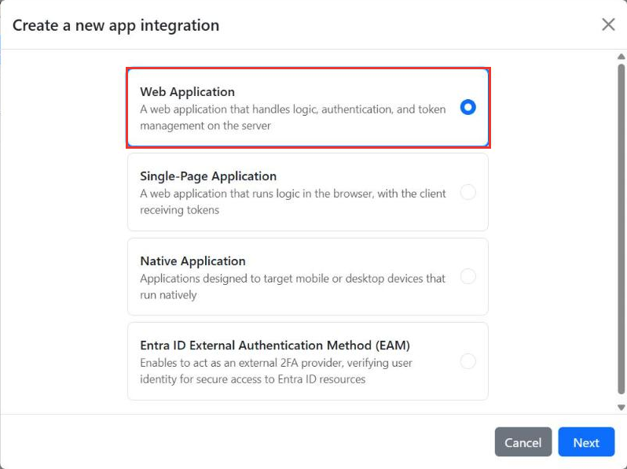
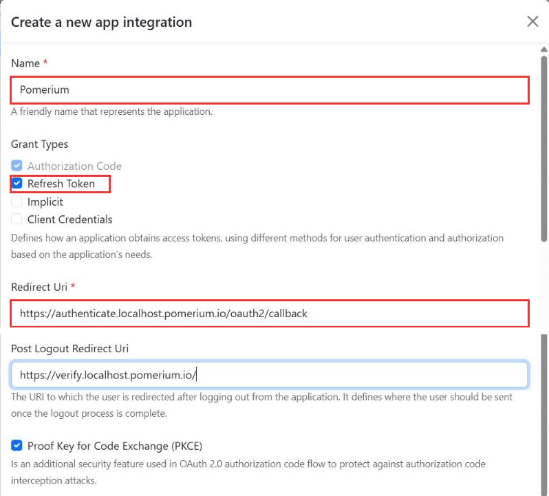
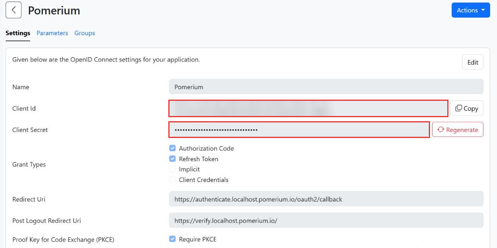
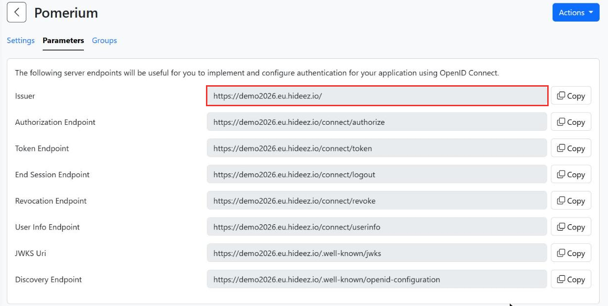
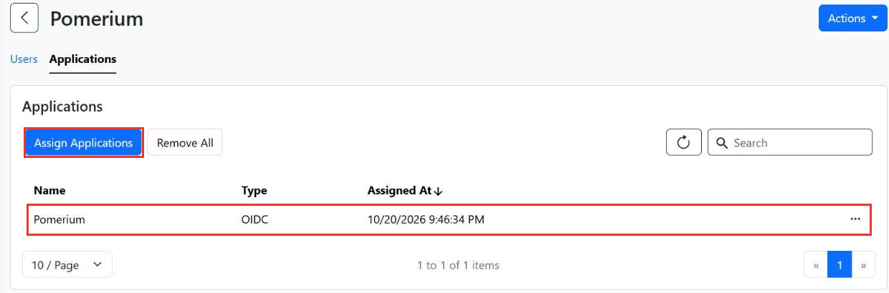

---
title: Hideez
description: Configure Hideez Workforce Identity as an identity provider for Pomerium Core and Enterprise.
lang: en-US
keywords: [hideez, pomerium, identity provider, idp, oidc]
pagination_prev: null
pagination_next: null
---

import TabItem from '@theme/TabItem';
import Tabs from '@theme/Tabs';

This page documents how to configure an OpenID Connect application in [Hideez Workforce Identity](https://hideez.com/pages/hideez-authentication-service) for use with Pomerium. It assumes you have already [installed Pomerium](/docs/get-started/quickstart).

:::caution

While we do our best to keep our documentation up to date, changes to third-party systems are outside our control. Refer to the [Hideez Workforce Identity documentation](https://hideez.gitbook.io/hideez-enterprise-authentication/) as needed, or [let us know](https://github.com/pomerium/documentation/issues/new?assignees=&labels=&template=doc-error.md) if we need to re-visit this page.

:::

## Create a Hideez OIDC Application

1. Sign in to the Hideez Workforce Identity admin console (for the cloud service, [cloud.hideez.com](https://cloud.hideez.com)) and select **Integrations** → **OpenID Connect**. Click **Create App Integration**, select **Web Application**, and then click **Next**.

   

1. Enter a **Name**, for example `Pomerium`. Under **Grant Types**, keep **Authorization Code** selected and also select **Refresh Token**, so Pomerium can renew user sessions. In **Redirect Uri**, enter your Pomerium `authenticate_service_url` followed by `/oauth2/callback`. For example, if your authenticate service URL is `https://authenticate.localhost.pomerium.io`, enter:

   ```text
   https://authenticate.localhost.pomerium.io/oauth2/callback
   ```

   Leave **Proof Key for Code Exchange (PKCE)** enabled and click **Create**.

   

1. Hideez displays the **Client Id** and **Client Secret** of the new application. Note both values to apply in Pomerium's settings.

   

   :::caution

   Copy the **Client Secret** right after you create the application. Afterwards the **Settings** tab shows it masked, and you can issue a new one with **Regenerate**.

   :::

1. Open the **Parameters** tab and note the **Issuer** value, which will later become the **Identity Provider URL** when configuring Pomerium. Use it exactly as shown, including the trailing slash.

   

1. Hideez only lets users sign in to applications that are assigned to them. Under **User Management** → **Groups**, create a group, add your users to it, and assign the new application on the **Applications** tab of the group. Users who are not assigned to the application see the message "Access to the application is denied" when they sign in.

   

## Configure Pomerium

You can now configure Pomerium with the identity provider settings. Your `config.yaml` keys or environmental variables should look something like this.

<Tabs queryString="configuration-settings">
<TabItem value="config-file-keys" label="Config file keys">

```yaml
idp_provider: 'oidc'
idp_provider_url: 'REPLACE_ME' # the Issuer from the Hideez OIDC application, including the trailing slash
idp_client_id: 'REPLACE_ME' # from the Hideez OIDC application
idp_client_secret: 'REPLACE_ME' # from the Hideez OIDC application
idp_scopes: 'openid,profile,email,offline_access'
```

</TabItem>
<TabItem value="environment-variables" label="Environment Variables">

```bash
IDP_PROVIDER="oidc"
IDP_PROVIDER_URL="REPLACE_ME" # the Issuer from the Hideez OIDC application, including the trailing slash
IDP_CLIENT_ID="REPLACE_ME" # from the Hideez OIDC application
IDP_CLIENT_SECRET="REPLACE_ME" # from the Hideez OIDC application
IDP_SCOPES="openid,profile,email,offline_access"
```

</TabItem>
</Tabs>

## Authorization Policies

Hideez includes the user's email address in the identity token, so you can use Pomerium's `email` criterion in your policies. For example, this policy allows access to a single user:

```yaml
routes:
  - from: 'https://verify.localhost.pomerium.io'
    to: 'https://verify.pomerium.com'
    policy:
      - allow:
          and:
            - email:
                is: user@example.com
```
