import SelfSignedCertWarning from '@site/content/docs/admonitions/_handle-self-signed-certificate-warning.mdx';

# Keycloak + Pomerium (OIDC)

[Keycloak](https://www.keycloak.org/) is an open-source identity and access management solution that supports the [OpenID Connect (OIDC) specification](https://openid.net/specs/openid-connect-core-1_0.html). With [Pomerium](https://www.pomerium.com/) as your identity-aware proxy, you can authenticate and authorize requests to your applications while letting Keycloak handle user sign-in, tokens, and sessions.

This guide shows how to integrate a self-hosted Keycloak instance as your OIDC provider for Pomerium. It walks through deploying Keycloak in production mode (HTTPS only, backed by PostgreSQL), but the Pomerium configuration is the same for any existing Keycloak deployment. The steps focus on Keycloak but apply to most [generic OIDC](https://openid.net/specs/openid-connect-core-1_0.html) providers.

## Prerequisites

- [Docker](https://docs.docker.com/install/)
- [Docker Compose](https://docs.docker.com/compose/install/)
- A TLS certificate and key that cover `*.localhost.pomerium.io`. Keycloak requires HTTPS for any non-localhost hostname, so both Keycloak and Pomerium use this certificate. For a local test, [mkcert](https://github.com/FiloSottile/mkcert) works well:

  ```bash
  mkcert -install
  mkdir certs
  mkcert -cert-file certs/localhost.pomerium.io.pem \
    -key-file certs/localhost.pomerium.io-key.pem \
    '*.localhost.pomerium.io'
  cp "$(mkcert -CAROOT)/rootCA.pem" certs/rootCA.pem
  ```

  The mkcert certificate is for testing this setup locally only. In production, use certificates issued by a public CA, for example with [certbot](https://certbot.eff.org/) or another ACME client, or your organization's PKI. Pomerium can also manage certificates for your routes with [autocert](/docs/reference/autocert), but Keycloak needs its own certificate (or TLS termination in front of it). Certificates from a CA your containers already trust don't need `rootCA.pem`.

## Docker Compose Configuration

This guide uses these URLs. Replace them with your own domains in production.

| Service      | URL                                           |
| ------------ | --------------------------------------------- |
| Keycloak     | `https://keycloak.localhost.pomerium.io:8443` |
| Authenticate | `https://authenticate.localhost.pomerium.io`  |
| Verify app   | `https://verify.localhost.pomerium.io`        |

Create a file named `docker-compose.yaml` next to the `certs` directory:

```yaml title="docker-compose.yaml"
services:
  postgres:
    image: postgres:17
    environment:
      POSTGRES_DB: keycloak
      POSTGRES_USER: keycloak
      POSTGRES_PASSWORD: change-me # Replace with a strong password
    volumes:
      - postgres-data:/var/lib/postgresql/data

  keycloak:
    image: quay.io/keycloak/keycloak:26.4
    command: start
    depends_on:
      - postgres
    environment:
      KC_DB: postgres
      KC_DB_URL: jdbc:postgresql://postgres:5432/keycloak
      KC_DB_USERNAME: keycloak
      KC_DB_PASSWORD: change-me # Must match POSTGRES_PASSWORD
      KC_HOSTNAME: https://keycloak.localhost.pomerium.io:8443
      KC_HTTPS_PORT: 8443
      KC_HTTP_ENABLED: 'false'
      KC_HTTPS_CERTIFICATE_FILE: /opt/keycloak/certs/localhost.pomerium.io.pem
      KC_HTTPS_CERTIFICATE_KEY_FILE: /opt/keycloak/certs/localhost.pomerium.io-key.pem
      KC_BOOTSTRAP_ADMIN_USERNAME: temp-admin
      KC_BOOTSTRAP_ADMIN_PASSWORD: change-me # Temporary, you delete this account below
    volumes:
      - ./certs:/opt/keycloak/certs:ro
    ports:
      - 8443:8443
    networks:
      default:
        aliases:
          - keycloak.localhost.pomerium.io

  pomerium:
    image: pomerium/pomerium:latest
    volumes:
      - ./config.yaml:/pomerium/config.yaml:ro
      - ./certs:/pomerium/certs:ro
    ports:
      - 443:443
    networks:
      default:
        aliases:
          - verify.localhost.pomerium.io

  verify:
    image: pomerium/verify:latest
    environment:
      JWKS_ENDPOINT: https://verify.localhost.pomerium.io/.well-known/pomerium/jwks.json
      SSL_CERT_FILE: /certs/rootCA.pem
    volumes:
      - ./certs:/certs:ro

volumes:
  postgres-data:
```

A few notes on this configuration:

- `command: start` runs Keycloak in production mode. It requires a real database, an explicit hostname, and TLS, unlike `start-dev`.
- `KC_HOSTNAME` is the public URL, including the scheme and port. Keycloak uses it as the OIDC `issuer`, so it must match the `idp_provider_url` you set in Pomerium.
- The network alias lets the Pomerium container resolve Keycloak by the same hostname your browser uses.
- Verify fetches Pomerium's signing keys from `JWKS_ENDPOINT`. The hostname must be covered by your certificate, and Verify must trust the CA that signed it (`SSL_CERT_FILE`). Drop `SSL_CERT_FILE` if your certificates come from a public CA.

Start Keycloak and PostgreSQL:

```bash
docker compose up -d postgres keycloak
```

When Keycloak finishes starting, open [https://keycloak.localhost.pomerium.io:8443](https://keycloak.localhost.pomerium.io:8443) to reach the **Keycloak Admin Console**.

## Keycloak Setup

:::note

This guide was written and tested with Keycloak 26.4. Environment variable names, admin console labels, and available roles can differ in other versions. For example, the `KC_BOOTSTRAP_ADMIN_*` variables replaced `KEYCLOAK_ADMIN` in Keycloak 26. If you run an older version, follow the matching [Keycloak documentation](https://www.keycloak.org/documentation) for deployment and console steps. The Pomerium configuration is the same.

:::

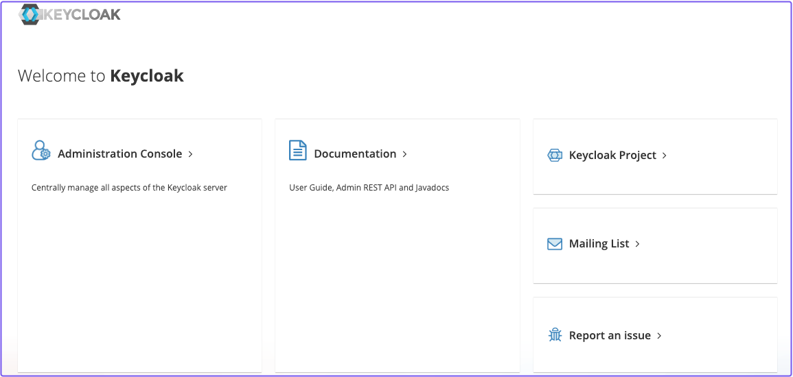

Sign in with `temp-admin` and `change-me`.

### Replace the Temporary Admin

Keycloak shows a warning that you're signed in as a temporary admin user. Replace it with a permanent account before you continue:

1. In the **master** realm, go to **Users** and select **Add user**.
1. Enter a username (for example, `pomerium-admin`) and select **Create**.
1. Select **Credentials**, then **Set password**, and disable **Temporary**.
1. Select **Role mapping**, then **Assign role**, and assign the `admin` realm role.
1. Sign out, then sign in as the new user.
1. In **Users**, delete `temp-admin`.

In production, also enable MFA for this account and restrict who can reach the admin console. See the [Keycloak server administration guide](https://www.keycloak.org/docs/latest/server_admin/) for details.

### Create a Realm

Keep the `master` realm for administering Keycloak and create a separate realm for your applications.

1. Select **Manage realms** (top-left) and **Create realm**.
1. Enter `pomerium` as the **Realm name** and select **Create**.

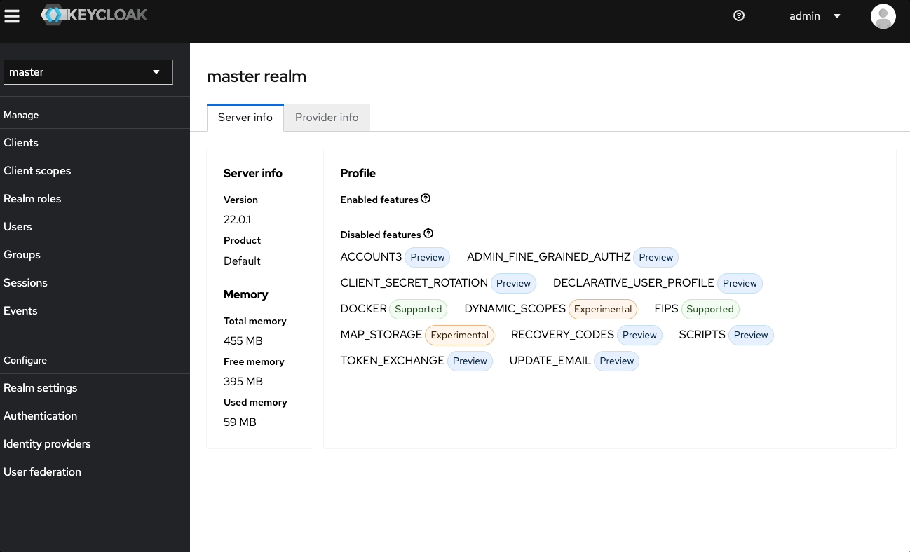

### Create a User

1. In the `pomerium` realm, go to **Users** and **Add user**.
1. Enter a username, email address, first name, and last name. Turn on **Email verified**, then **Create**.
1. Select **Credentials**, then **Set password** and disable **Temporary**.

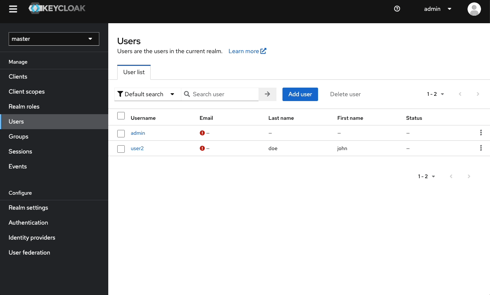 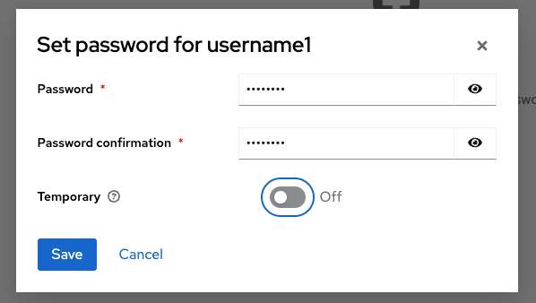

Pomerium reads the `email`, `name`, and `sub` claims from Keycloak, so fill in the profile fields.

### Create a Client

1. Go to **Clients** > **Create client**.
1. **Client type**: **OpenID Connect**.
1. **Client ID**: `pomerium`.
1. Turn on **Client authentication** and enable only **Standard flow**. Turn off **Direct access grants**, which Pomerium doesn't use.
1. In **Login settings**, set **Valid redirect URIs** to `https://authenticate.localhost.pomerium.io/oauth2/callback` and **Web origins** to `https://authenticate.localhost.pomerium.io`.
1. **Save**.

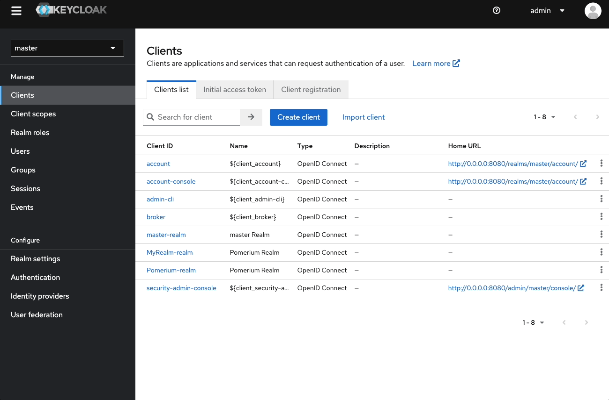

Confirm the client's **Access settings** match your Pomerium authenticate URL exactly, including the scheme and path:

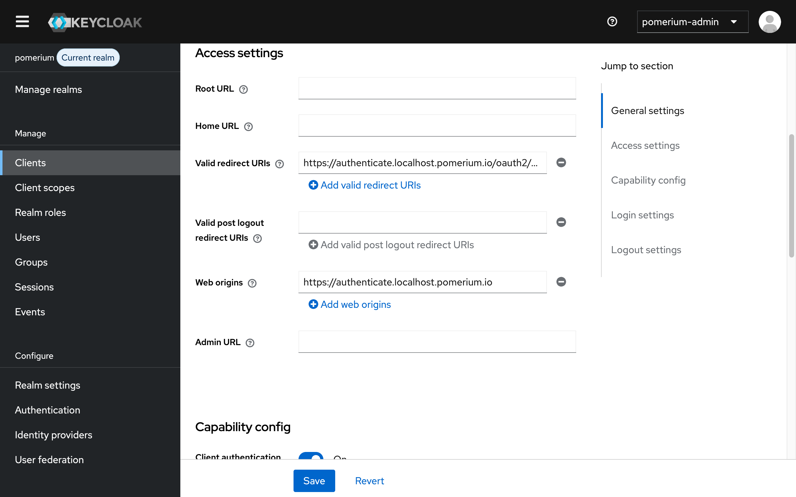

And that **Capability config** has **Client authentication** on and only **Standard flow** selected:


Open the **Credentials** tab and copy the **Client secret**:

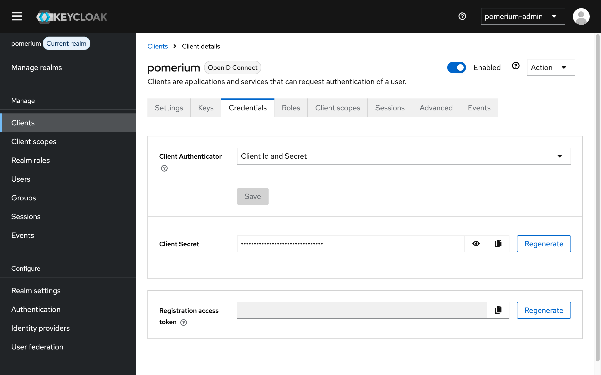

## Pomerium Configuration

Create `config.yaml` next to `docker-compose.yaml`:

```yaml title="config.yaml"
authenticate_service_url: https://authenticate.localhost.pomerium.io

certificate_file: /pomerium/certs/localhost.pomerium.io.pem
certificate_key_file: /pomerium/certs/localhost.pomerium.io-key.pem
certificate_authority_file: /pomerium/certs/rootCA.pem # Only needed for a private CA

idp_provider: oidc
idp_client_id: 'pomerium'
idp_client_secret: 'your_client_secret' # Replace with the actual secret
idp_provider_url: 'https://keycloak.localhost.pomerium.io:8443/realms/pomerium'

signing_key: 'your_signing_key' # Replace with a generated signing key

routes:
  - from: https://verify.localhost.pomerium.io
    to: http://verify:8000
    allow_any_authenticated_user: true
    pass_identity_headers: true
```

Generate a [Signing Key](/docs/reference/signing-key) and replace `your_signing_key` with the base64-encoded private key.

`idp_provider_url` is the realm URL, without a trailing slash. Pomerium discovers the OIDC endpoints at `<idp_provider_url>/.well-known/openid-configuration`, and the `issuer` in that document must match `idp_provider_url`.

Start Pomerium and Verify:

```bash
docker compose up -d pomerium verify
```

## Test the Integration

Visit [https://verify.localhost.pomerium.io](https://verify.localhost.pomerium.io).

:::tip

<SelfSignedCertWarning />

:::

You'll be redirected to Keycloak to sign in, then back to the Verify service. Sign in with the user you created above.

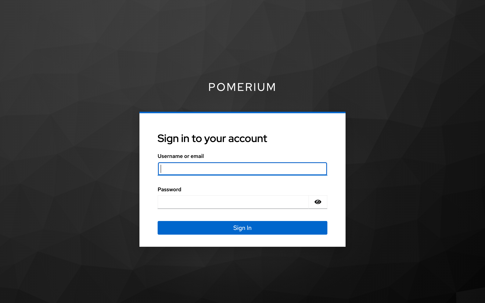 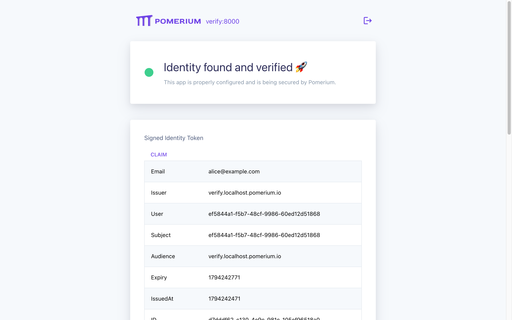

You can see user claims from Keycloak in the JWT payload, such as `email` and `sub`, confirming that Pomerium has authenticated and authorized your request.

## Troubleshooting

| Symptom | Cause and fix |
| --- | --- |
| Keycloak shows **HTTPS required** | Keycloak only serves plain HTTP to `localhost`. Serve it over HTTPS as shown above, and don't set `KC_HTTP_ENABLED` to `true` for a public hostname. |
| **Invalid parameter: redirect_uri** | The client's **Valid redirect URIs** doesn't exactly match `authenticate_service_url` plus `/oauth2/callback`. |
| Pomerium logs `x509: certificate signed by unknown authority` | Pomerium doesn't trust the CA that signed Keycloak's certificate. Set `certificate_authority_file`. |
| Pomerium logs an `issuer` mismatch | `idp_provider_url` doesn't match `KC_HOSTNAME` and the realm path. Compare it to the `issuer` at `/realms/pomerium/.well-known/openid-configuration`. |
| Verify shows **TLS Certificate verification failed** | Verify can't fetch the JWKS. Use a `JWKS_ENDPOINT` hostname covered by your certificate and set `SSL_CERT_FILE` if the certificate uses a private CA. |

## Directory Sync (Enterprise)

:::enterprise

Directory sync is available in [Pomerium Enterprise](/docs/deploy/enterprise/quickstart).

:::

Directory sync lets Pomerium Enterprise read users and groups from Keycloak so you can write policies against group membership.

### Configure Client Credentials

To allow the client configured above to be used for directory sync, open the client's **Settings** tab. Under **Capability config**, turn on **Service accounts roles** and save.

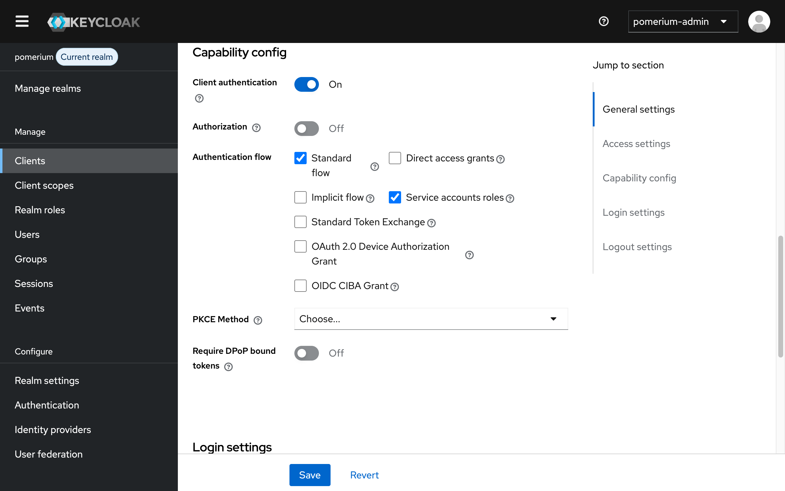

Then open the **Service accounts roles** tab, select **Assign role**, filter by clients, and assign the `view-users` role from `realm-management`. This composite role includes `query-users` and `query-groups`, which Pomerium uses to list users and groups.

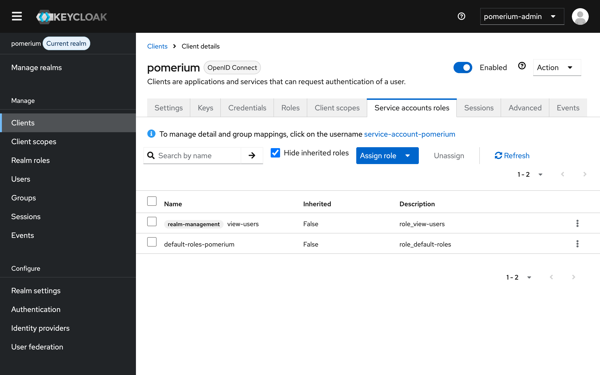

### Configure Pomerium Enterprise Console

Under **Settings → Identity Providers**, select "Keycloak" as the identity provider and set the Client ID, Client Secret, Realm and URL. Use the realm name (`pomerium`) and the Keycloak base URL (`https://keycloak.localhost.pomerium.io:8443`).

## Additional Resources

- [Identity Provider Settings](/docs/reference/identity-provider-settings)
- [Signing Keys](/docs/reference/signing-key)
- [Routes and Policies](/docs/reference/routes)
- [Keycloak Server Administration Guide](https://www.keycloak.org/docs/latest/server_admin/)
- [Keycloak Production Configuration](https://www.keycloak.org/server/configuration-production)
- [Pomerium Verify](https://github.com/pomerium/verify)
