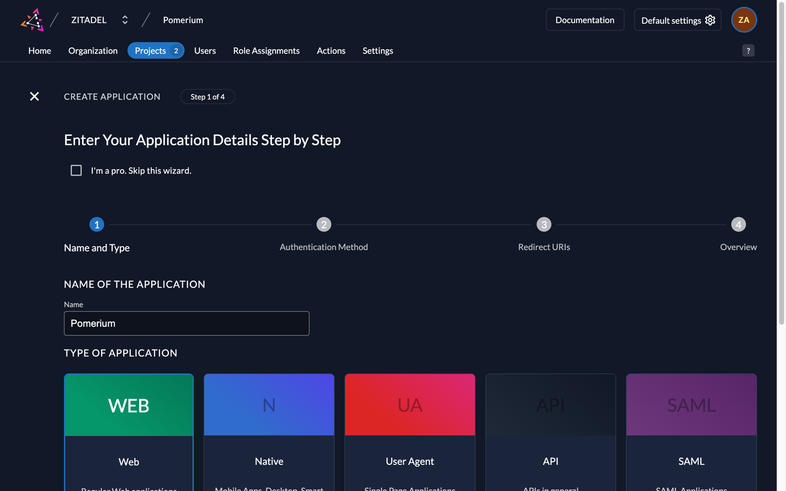
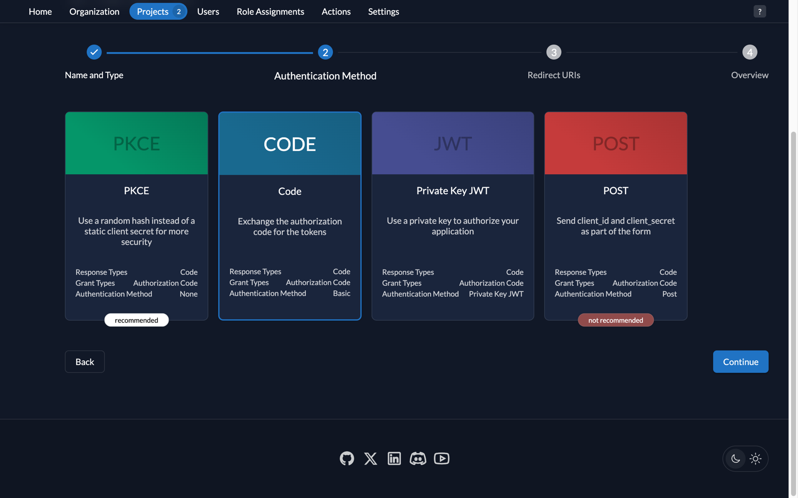
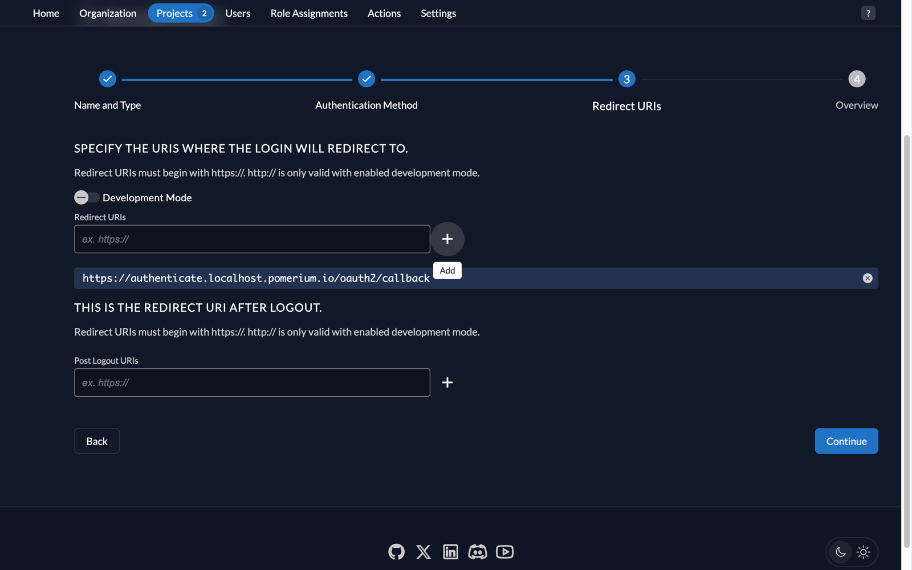
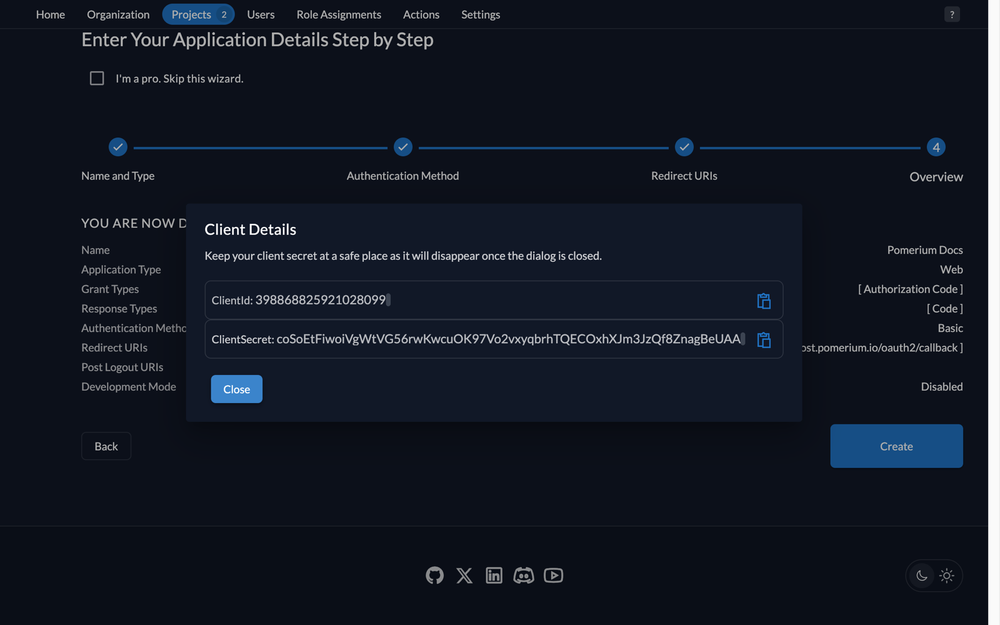
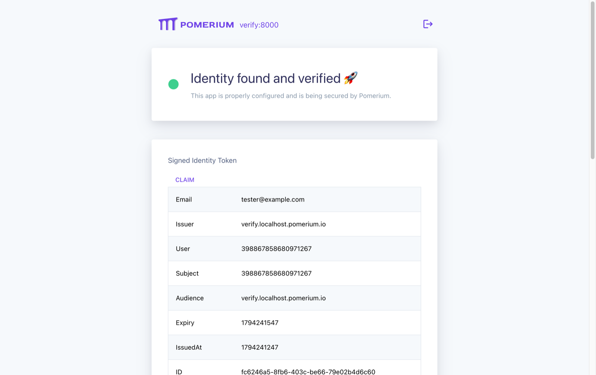

import SelfSignedCertWarning from '@site/content/docs/admonitions/_handle-self-signed-certificate-warning.mdx';

# ZITADEL + Pomerium (OIDC)

[ZITADEL](https://zitadel.com/) is an open-source identity and access management solution that supports the [OpenID Connect (OIDC) specification](https://openid.net/specs/openid-connect-core-1_0.html). With [Pomerium](https://www.pomerium.com/) as your identity-aware proxy, you can authenticate and authorize requests to your applications while letting ZITADEL handle user sign-in, tokens, and sessions.

This guide shows how to integrate a self-hosted ZITADEL instance as your OIDC provider for Pomerium.

## Prerequisites

- [Docker](https://docs.docker.com/install/)
- [Docker Compose](https://docs.docker.com/compose/install/)
- A self-hosted ZITADEL instance with an HTTPS URL reachable from both your browser and the Pomerium container
- An administrator account for that instance

## Self-Hosted ZITADEL Setup

Follow ZITADEL's [Docker Compose guide](https://zitadel.com/docs/self-hosting/deploy/compose) to deploy the instance. Configure your domain, enable TLS, and replace the default credentials before exposing it to the network.

This guide uses `https://zitadel.example.com` as the instance URL. Replace it with your own URL throughout. ZITADEL's external domain, port, and secure settings must match this URL so that discovery and token validation use the same issuer.

:::note

The ZITADEL deployment and the Pomerium deployment below both use HTTPS. If you run them on the same host, give them separate IP addresses or configure a reverse proxy so they don't compete for port 443.

:::

Open `https://zitadel.example.com/ui/console` and sign in with your administrator account.

:::note

The console screenshots in this guide were taken with ZITADEL v4.20.2. Labels and screens can differ slightly in other versions, but the settings are the same.

:::

### Create a User

1. Select the organization that will own your application.
1. Go to **Users** and create a human user.
1. Enter the user's profile and email address, then save.
1. Complete the user's account initialization and password setup before testing sign-in.

### Create a Project

1. Go to **Projects** and create a project.
1. Enter a name (for example, `Pomerium`) and select **Create**.

For this walkthrough, leave the project's authentication restrictions unchecked: the options that require users to have a role assigned to the project, and that require users' organizations to have been granted access to it. Pomerium will allow any authenticated user on the test route.

### Create an Application

1. Open the project and add an application.
1. Enter a name (for example, `Pomerium`) and select **Web** as the application type.

   

1. Select **Code** as the authentication method. This uses the authorization code flow with a client ID and client secret (`client_secret_basic`).

   

1. Set **Redirect URIs** to `https://authenticate.localhost.pomerium.io/oauth2/callback`.

   

1. Review the settings and create the application.
1. Copy the **Client ID** and **Client Secret** for the Pomerium configuration below. Store the secret before closing the dialog.

   

## Docker Compose Configuration

In a separate directory from your ZITADEL deployment, create a file named `docker-compose.yaml`:

```yaml title="docker-compose.yaml"
services:
  pomerium:
    image: pomerium/pomerium:latest
    volumes:
      - ./config.yaml:/pomerium/config.yaml:ro
    ports:
      - 443:443

  verify:
    image: pomerium/verify:latest
    environment:
      JWKS_ENDPOINT: https://pomerium/.well-known/pomerium/jwks.json
```

## Pomerium Configuration

Create `config.yaml` alongside `docker-compose.yaml`:

```yaml title="config.yaml"
authenticate_service_url: https://authenticate.localhost.pomerium.io

idp_provider: oidc
idp_client_id: 'your_client_id' # Replace with the application's Client ID
idp_client_secret: 'your_client_secret' # Replace with the application's Client Secret
idp_provider_url: https://zitadel.example.com
idp_scopes:
  - openid
  - profile
  - email

signing_key: 'your_signing_key' # Replace with a generated signing key

routes:
  - from: https://verify.localhost.pomerium.io
    to: http://verify:8000
    allow_any_authenticated_user: true
    pass_identity_headers: true
```

Generate a [Signing Key](/docs/reference/signing-key) and replace `your_signing_key` with the base64-encoded private key.

Set `idp_provider_url` to the instance URL, without `/ui/console` or an OAuth endpoint path. Pomerium discovers the OIDC endpoints at `https://zitadel.example.com/.well-known/openid-configuration`. The `issuer` in that document must match `idp_provider_url`.

Start Pomerium and Verify:

```bash
docker compose up -d
```

## Test the Integration

Visit [https://verify.localhost.pomerium.io](https://verify.localhost.pomerium.io).

:::tip

<SelfSignedCertWarning />

:::

:::note

The self-signed certificate warning applies to this local test setup only. In production, use certificates issued by a public CA, for example with [certbot](https://certbot.eff.org/) or another ACME client, or let Pomerium manage them for your routes with [autocert](/docs/reference/autocert).

:::

You'll be redirected to ZITADEL to sign in, then back to the Verify service. Sign in with the user you created above.

Depending on your instance's login policy, ZITADEL may ask the user to verify or set up a second factor (for example, a passkey) during sign-in. Complete that step to continue.

You can see user claims from ZITADEL in the JWT payload, such as `email`, `name`, and `sub`, confirming that Pomerium has authenticated and authorized your request.



If sign-in fails, check that the application's redirect URI matches the Pomerium callback URL exactly, including the scheme and path. If Pomerium can't discover the provider, check that the container can resolve the ZITADEL hostname and trusts its TLS certificate.

## Additional Resources

- [Identity Provider Settings](/docs/reference/identity-provider-settings)
- [Signing Keys](/docs/reference/signing-key)
- [Routes and Policies](/docs/reference/routes)
- [ZITADEL Documentation](https://zitadel.com/docs)
- [Pomerium Verify](https://github.com/pomerium/verify)
