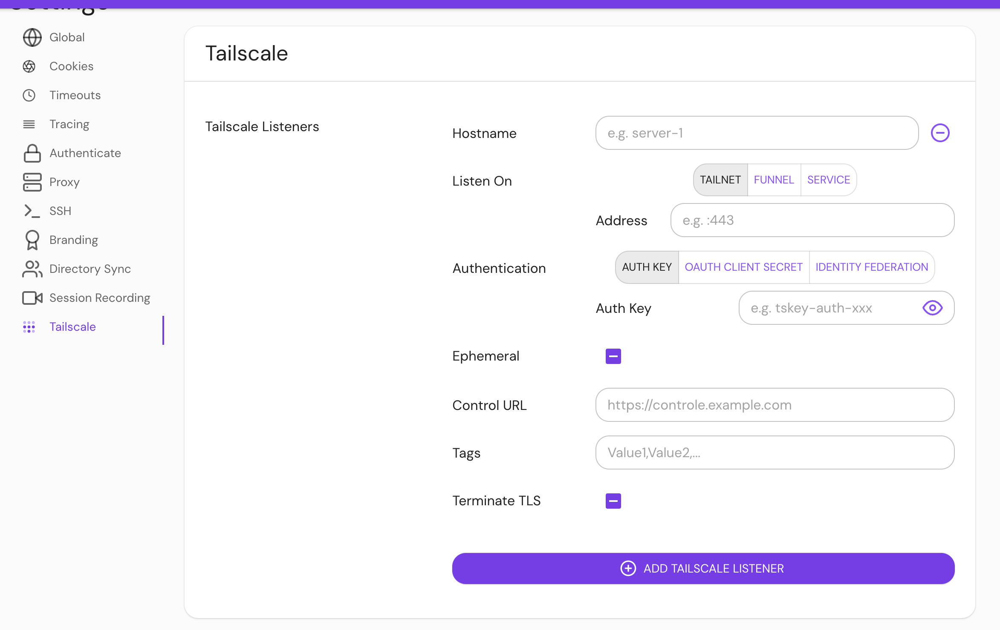

import TabItem from '@theme/TabItem';
import Tabs from '@theme/Tabs';

import EnterpriseConfiguration from '../../../src/components/EnterpriseConfiguration';

# Tailscale Listener Settings

## Summary

**Tailscale Listener Settings** configure Tailscale listeners within Pomerium.

## How to Configure

<Tabs>
<TabItem value="Core" label="Core">

| **Config File Keys**  | **Type**            |
| :-------------------- | :------------------ |
| `tailscale_listeners` | `array` of `object` |

</TabItem>
<TabItem value="Enterprise" label="Enterprise">
<EnterpriseConfiguration name="log_level" resource="settings">

Set **Tailscale Listener Settings** under **Global** settings in the Console:



</EnterpriseConfiguration>
</TabItem>
<TabItem value="Kubernetes" label="Kubernetes">

</TabItem>
</Tabs>

## Hostname

### Summary

**Hostname** is the node name to present to the control server. It is required, must be unique and will be used as the subdomain name with Magic DNS.

### How to Configure

<Tabs>
<TabItem value="Core" label="Core">

| **Config File Keys**             | **Type** |
| :------------------------------- | :------- |
| `tailscale_listeners.0.hostname` | `string` |

### Examples

```yaml
tailscale_listeners:
  - hostname: example
```

</TabItem>
<TabItem value="Kubernetes" label="Kubernetes">

</TabItem>
</Tabs>

## Listen Address

### Summary

When set, **Listen Address** starts a TCP listener on the Tailscale network.

### How to Configure

<Tabs>
<TabItem value="Core" label="Core">

| **Config File Keys**                | **Type** |
| :---------------------------------- | :------- |
| `tailscale_listeners.0.listen_addr` | `string` |

### Examples

```yaml
tailscale_listeners:
  - listen_addr: :443
```

</TabItem>
<TabItem value="Kubernetes" label="Kubernetes">

</TabItem>
</Tabs>
